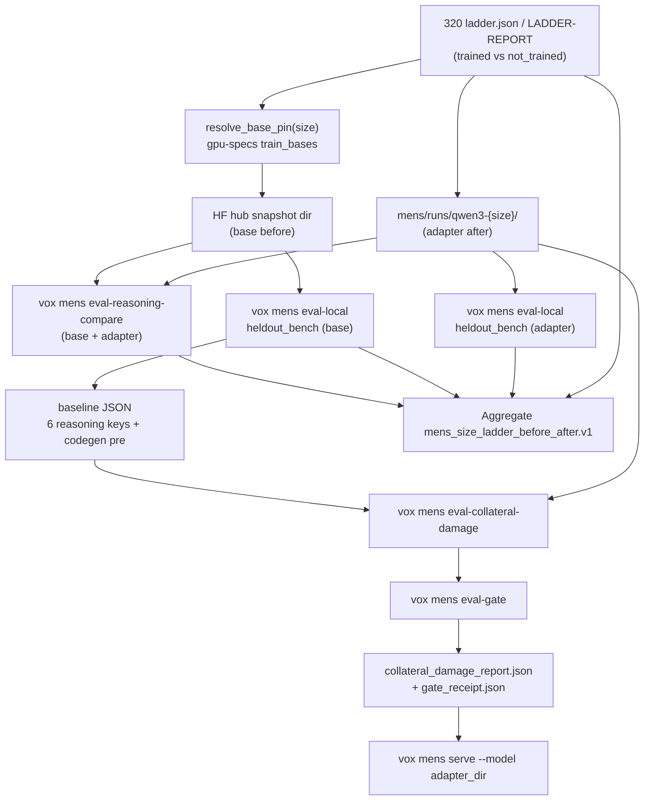

# Phase 321: Harness Before/After (HARN-01, BENCH-04) — Research

**Researched:** 2026-10-28
**Domain:** MENS size ladder, `vox mens serve` + collateral gate, reasoning before/after scoring, codegen held-out bench
**Confidence:** HIGH for existing seams (source read this session). MEDIUM for recommended aggregate-report shape (not yet in repo). LOW for wall-clock runtime estimates on Metal (hardware-dependent).

## Summary

Phase 321 closes the v5.6 milestone loop started in Phase 316: prove **each trained Qwen3 ladder size** (today **0.6B** and **1.7B** from Phase 320) with a **before (base snapshot) / after (adapter run dir)** report on the **three 32-item reasoning slices**, plus an **intelligence score** from an existing codegen bench, and wire **serve** so operators (and autonomous runs) can bring up **base or adapter** for a **named size** only through the **same `vox mens serve` path** already guarded by **collateral + eval-gate receipts**.

Almost all scoring and serving machinery exists. Phase 316 shipped `vox mens eval-reasoning-compare` (`reasoning_before_after.v1`, `gate_input: false`). Phase 315 shipped `assert_collateral_gate` and `assert_serve_preconditions` on adapter directories. Phase 320 left **real adapters** at `mens/runs/qwen3-0.6b/` and `mens/runs/qwen3-1.7b/` but **no** `collateral_damage_report.json` or `gate_receipt.json` on those dirs — S2 smoke explicitly **refused serve at the gate** (expected). BENCH-04 therefore adds **ladder-wide orchestration**, **intelligence (eval-local) on both sides**, a **single milestone report** covering all six rungs (trained vs `not_trained` without invented numbers), and **HARN-01** size→path resolution that **never bypasses** the gate (including the Phase 320 finding that pointing `--model` at the **adapter file** skips manifest detection).

**Primary recommendation:** One orchestrated flow (VoxScript-first automation under `scripts/`, invoked by `vox run`) that (1) reads `.planning/phases/320-train-the-sizes-size-03/320-LADDER-REPORT.md` / `evidence/ladder.json` for trained rungs, (2) for each trained size runs base-then-adapter scoring via existing CLI seams, (3) runs `eval-local` on `mens/data/heldout_bench` for both sides for pass@1 + n, (4) for each adapter run dir generates collateral baseline from **base-side** scores then `eval-collateral-damage` + `eval-gate`, (5) verifies `vox mens serve --model <run_dir>` for adapter (and base-only dir rules) behind the gate, (6) writes one aggregate JSON under `mens/runs/` (new schema tag, see Architecture Patterns). Extend Rust only where CLI lacks a composable entry (multi-size driver, serve target resolver, aggregate report builder); reuse `eval-reasoning-compare`, `eval-local`, `eval-collateral-damage`, `eval-gate`, and `dispatch.rs` serve arms unchanged in semantics.

<user_constraints>
## User Constraints (from CONTEXT.md)

**No `321-*-CONTEXT.md` exists on branch `gsd/mens-compare-316`.** Autonomous discuss→plan should treat the following as **default locked intent** derived from `.planning/REQUIREMENTS.md`, `.planning/ROADMAP.md` Phase 321 success criteria, and Phase 316/320 handoff — confirm only where grey areas below remain open.

### Locked Decisions (autonomous defaults)

- **Trained sizes SSOT:** Phase 320 ladder — only **0.6B** and **1.7B** are trained with on-disk adapters; **4B/8B/14B/32B** are `not_trained` and must appear in the milestone report **without numeric scores**. `[VERIFIED: .planning/phases/320-train-the-sizes-size-03/evidence/size-03-check.txt:1-6]`
- **Reasoning slices:** Same three checked-in slices as BENCH-01/316: `gsm8k_think`, `math500_think`, `vox_think` (32 items each). Accuracy and think-initiation stay **separate keys** inside each slice's `BenchOutcome::to_json` (`accuracy`, `think_initiation_rate`). `[VERIFIED: crates/vox-eval/src/reasoning_bench.rs:17-18,137-142]`
- **Serve path:** Use existing **`vox mens serve`** local branch (`PopuliAction::Serve`) with `--model` pointing at a **directory**; adapter dirs must pass **`assert_collateral_gate`** and **`assert_serve_preconditions`**. Do not serve via adapter **file** path (gate bypass). `[VERIFIED: crates/vox-ml-cli/src/commands/mens/populi/dispatch.rs:357-366,836-903]`
- **Compare report is not gate input:** `reasoning_before_after.v1` remains operator/milestone evidence only (`gate_input: false`). Collateral artifacts stay in the **adapter run dir**. `[VERIFIED: crates/vox-eval/src/reasoning_bench.rs:156-158,339]`
- **No weight download in CI/autonomous doc-only paths;** real scoring runs require HF snapshots + adapters already on disk (same discipline as Phase 316).
- **Size naming:** `--base Qwen3-0.6B` etc. resolves through `gpu-specs.yaml` `train_bases` via `resolve_base_pin` (Phase 318/316). `[VERIFIED: crates/vox-populi/src/mens/tensor/size_select.rs:225-262]`

### Claude's Discretion (research recommendations below)

- Aggregate report file name/schema (`mens_size_ladder_before_after.v1` proposed).
- Whether HARN-01 is a **new `vox mens` subcommand** vs **`vox run scripts/mens-ladder-before-after.vox`** only — prefer **script orchestrates, Rust exposes thin `*_with` hooks** per VoxScript-first policy.
- Full vs subset of `heldout_bench` (52 tasks) for intelligence score on Metal — default **full manifest** for milestone evidence; subset only with explicit `n` recorded.
- HTTP smoke after serve (single completion) vs gate-only check.

### Deferred Ideas (OUT OF SCOPE)

- Phase 319 mesh-wide selection (MESH-01).
- Swapping default Qwen3-8B hub default or new training recipes (v5.6 Out of Scope).
- Re-scoring pre-2026-10-26 adapters.
- Agent-harness `vox harness eval` continuous eval (different product surface).
</user_constraints>

<phase_requirements>
## Phase Requirements

| ID | Description | Research Support |
|----|-------------|------------------|
| HARN-01 | Harness serves chosen size base or adapter via existing serve path, behind collateral gate | `PopuliAction::Serve` + gate functions; size→run dir map from `mens/runs/qwen3-<size>/`; preflight collateral + `gate_receipt.json`; refuse adapter-file serve bypass |
| BENCH-04 | Per trained size, one report with before/after reasoning + intelligence on codegen/agent bench with n; ≥2 trained sizes with real scores; not_trained listed without numbers | Orchestrate `eval-reasoning-compare` + dual `eval-local` on `heldout_bench`; aggregate from `320-LADDER-REPORT.md`; extend or wrap `reasoning_before_after.v1` with intelligence block |
</phase_requirements>

## Architectural Responsibility Map

| Capability | Primary Tier | Secondary Tier | Rationale |
|------------|-------------|----------------|-----------|
| Reasoning before/after JSON shape | `vox-eval` `reasoning_bench.rs` | — | SSOT for slices, `BenchOutcome`, `compared_report_json`, absence records |
| Per-size compare run | `vox-ml-cli` `reasoning_compare.rs` | `reasoning_eval.rs` | Loads base snapshot + adapter dir; unloads between sides |
| Intelligence (codegen) score | `vox-ml-cli` `eval_local.rs` | — | `mens/data/heldout_bench/manifest.json`; pass@1 + task count as n |
| Collateral gate artifacts | `vox-ml-cli` `eval_collateral.rs` | `reasoning_eval.rs` | Writes `collateral_damage_report.json` + `collateral_eval/**` in adapter dir |
| Eval-gate receipt | `vox-ml-cli` `eval_gate/` | — | `gate_receipt.json` required by `assert_serve_preconditions` |
| Local HTTP serve | `vox-ml-cli` `commands/ai/serve` | `populi/dispatch.rs` | OpenAI-compatible server; feature `execution-api` |
| Size pin resolution | `vox-populi` `size_select::resolve_base_pin` | `gpu-specs.yaml` | Maps `Qwen3-0.6B` → pinned `hf_id@sha` |
| Ladder trained / not_trained SSOT | Planning artifact + `train-record.json` | `evidence/ladder.json` | Phase 320 handoff; drives which sizes get numeric scores |
| Multi-size orchestration | `scripts/*.vox` (new) | optional thin Rust driver | AGENTS.md VoxScript-first automation |

## Standard Stack

No new external packages. Workspace crates only.

### Core

| Library | Version | Purpose | Why Standard |
|---------|---------|---------|--------------|
| `vox-eval` | workspace (`0.6.0+build.*`) | Reasoning slices, collateral math, report shapes | BENCH-01/02/03 SSOT |
| `vox-ml-cli` | workspace | `mens` subcommands, serve, eval-local | All operator entry points |
| `vox-populi` | workspace | `resolve_base_pin`, ladder overlay, backend select | SIZE-01/02 pins |
| `vox-plugin-mens-candle-metal` | workspace plugin | Metal inference for compare + eval-local | Phase 320 training host |
| `mens/config/gpu-specs.yaml` | repo file | `train_bases.qwen3_code` ladder | SIZE-01 pins + floors |

### Supporting

| Surface | Purpose | When to Use |
|---------|---------|-------------|
| `vox mens eval-reasoning-compare` | Base vs adapter on 3 slices | Each trained size (BENCH-04 reasoning leg) |
| `vox mens eval-local --bench mens/data/heldout_bench` | Codegen intelligence pass@1 | Both base snapshot dir and adapter run dir |
| `vox mens eval-collateral-damage` | Gate envelope in adapter dir | After base pre-score JSON exists |
| `vox mens eval-gate --run-dir <adapter>` | `gate_receipt.json` | Before serve (HARN-01) |
| `vox mens serve --model <dir>` | Served model | HARN-01 verification (adapter + optional base) |

### Alternatives Considered

| Instead of | Could Use | Tradeoff |
|------------|-----------|----------|
| `heldout_bench` eval-local | `eval-gate --five-spokes` BFCL agent bench | Held-out Vox codegen is already wired to eval-local; five-spokes is heavier and overlapping with v1.7 scorecard — use **heldout_bench** unless user picks agent bench in grey-area resolution |
| New aggregate schema | Only per-size `mens/runs/reasoning_compare/*.json` | Fails BENCH-04 "one report" for **every trained size** — need ladder rollup |
| `vox harness eval --live` | MENS compare | Wrong harness (agent self-eval), not MENS serve/score |

**Version verification:** not applicable (no new packages).

## Package Legitimacy Audit

No external packages installed. **Packages removed due to [SLOP]:** none. **Packages flagged [SUS]:** none.

## Project Constraints (from .cursor/rules/)

- **VoxScript-first:** New automation → committed `.vox` under `scripts/`, run via `vox run` — no new `.sh`/`.py` glue. `[CITED: AGENTS.md §VoxLang-First Glue Code]`
- **LLM boundary / secrets:** N/A for this phase (local inference only); no new `std::env` secret reads.
- **Data storage:** Reports under `mens/runs/` or `contracts/reports/` — not Turso event streams; no new DB tier without contract bump.
- **Test-first:** New `pub fn` in Rust needs tests before merge (`skeleton/untested-pub-api`).
- **CI:** Hosted CI is gate; local spot-check `cargo test -p vox-ml-cli --features gpu reasoning_compare` and `-p vox-eval reasoning_bench`.
- **Kill-safety:** No pattern-kill; no writing live user home from secondary worktrees.
- **Retired surfaces:** Use `vox-orchestrator`, `VOX_DB_*`, not retired mens crate names.

## Architecture Patterns

### System Architecture Diagram



### Recommended Project Structure

```text
scripts/
  mens-ladder-before-after.vox    # orchestration (Wave 1)
crates/vox-ml-cli/src/commands/mens/
  reasoning_compare.rs            # reuse; optional export score_side hooks
  ladder_before_after.rs          # NEW optional: aggregate writer + serve resolver
  populi/dispatch.rs              # serve gate unchanged
mens/runs/
  qwen3-0.6b/ qwen3-1.7b/         # adapter dirs (Phase 320)
  reasoning_compare/              # per-base compare files (316)
  ladder_before_after.json        # proposed aggregate (BENCH-04)
.planning/phases/320-.../
  320-LADDER-REPORT.md              # handoff SSOT
```

### Pattern 1: Per-size reasoning compare (Phase 316)

**What:** Model-free detection, then score base snapshot and adapter run dir on identical slice items; unload between loads.

**When:** Each trained ladder rung with weights on disk.

**Example:**

```bash
vox mens eval-reasoning-compare \
  --base Qwen3-0.6B \
  --adapter mens/runs/qwen3-0.6b \
  --out mens/runs/reasoning_compare/Qwen3-0.6B-c1899de289a0.json
```

Source: `[VERIFIED: docs/src/how-to/how-to-train-mens-macos-metal.md:102-114]`

### Pattern 2: Collateral + serve gate (Phase 315)

**What:** Adapter directory must contain passing `collateral_damage_report.json` and scored per-slice `collateral_eval/<slice>/reasoning_report.json`; serve also requires substantive `gate_receipt.json`.

**When:** Before any HARN-01 serve of an adapter.

**Example:**

```bash
vox mens eval-collateral-damage --pre-score path/to/baseline.json --post-adapter mens/runs/qwen3-0.6b
vox mens eval-gate --run-dir mens/runs/qwen3-0.6b --policy mens/config/eval-gates.yaml
vox mens serve --model mens/runs/qwen3-0.6b --host 127.0.0.1 --port 11436
```

Source: `[VERIFIED: docs/src/how-to/how-to-train-mens-macos-metal.md:66-99]`, `[VERIFIED: crates/vox-ml-cli/src/commands/mens/populi/dispatch.rs:360-366]`

### Pattern 3: Intelligence via eval-local (codegen bench)

**What:** `eval-local` over `mens/data/heldout_bench` returns pass@1 and task count; reuse for base snapshot path and adapter run dir separately.

**When:** BENCH-04 intelligence leg; record **n** = number of benchmark tasks attempted.

**Example:**

```bash
vox mens eval-local --model /path/to/base/snapshot --bench mens/data/heldout_bench -o /tmp/base-heldout.json
vox mens eval-local --model mens/runs/qwen3-0.6b --bench mens/data/heldout_bench -o /tmp/adapter-heldout.json
```

Source: `[VERIFIED: mens/data/heldout_bench/manifest.json:1-5]` (schema `vox_mens_bench_manifest_v1`), `[VERIFIED: crates/vox-ml-cli/src/commands/mens/eval_collateral.rs:214-267]` (eval-local reuse pattern)

### Anti-Patterns to Avoid

- **Serving `--model …/candle_qlora_adapter.safetensors`:** Skips adapter-dir gate checks. `[VERIFIED: .planning/phases/320-train-the-sizes-size-03/320-LADDER-REPORT.md:41-42]`
- **Writing compare output into adapter dir or `collateral_eval/`:** `check_out_path` refuses; compare must stay under `mens/runs/reasoning_compare/`.
- **Using `score_reasoning_file` for compare:** Writes into `collateral_eval/` inside model dir — use `score_loaded` / compare path only.
- **Inventing scores for `not_trained` sizes:** BENCH-04 forbids numbers; use status + reason from ladder only.

## Don't Hand-Roll

| Problem | Don't Build | Use Instead | Why |
|---------|-------------|-------------|-----|
| Reasoning grader | Custom answer matcher | `vox_eval::qwen_reasoning` via `score_loaded` | Thinking-mode + `<think>` detection already standardized |
| Collateral math | Ad-hoc % drop | `eval_collateral_damage` + `verify_reasoning_slices` | Serve gate recomputes drops from stored numbers |
| HTTP OpenAI server | New Axum stack | `commands/ai/serve::run_serve` | Single serve implementation behind feature flag |
| HF pin detection | Fuzzy cache check | `detect_inputs` + exact `snapshots/<40-hex>` | Wrong revision silently invalidates before/after |
| Size ladder pins | Hard-coded HF IDs | `resolve_base_pin` + embedded `gpu-specs.yaml` | SIZE-01 SSOT |

## Common Pitfalls

### Pitfall 1: Adapters without collateral artifacts

**What goes wrong:** `vox mens serve` exits immediately — no `collateral_damage_report.json`. **Verified on Phase 320 dirs:** 0.6B run dir has adapter files but **no** collateral report or gate receipt (shell probe this session).

**Why:** SIZE-03 training did not require collateral generation on full S4 dirs.

**How to avoid:** Phase 321 plan must include a **baseline capture + eval-collateral-damage + eval-gate** wave per trained adapter before HARN-01 serve tests.

### Pitfall 2: Dual model residency OOM

**What goes wrong:** Scoring base then adapter without unload holds two models.

**Why:** Plugin load is explicit per compare side — compare already unloads (`unload_model`). **Do not** parallelize two Metal loads on one machine.

**How to avoid:** Keep sequential compare; 316 pattern already unloads. `[VERIFIED: crates/vox-ml-cli/src/commands/mens/reasoning_compare.rs:270-327]`

### Pitfall 3: Baseline JSON missing six reasoning keys

**What goes wrong:** `eval-collateral-damage` refuses pre-score.

**Why:** Requires `gsm8k_think`, `gsm8k_think_init`, … all six keys. `[CITED: docs/src/how-to/how-to-train-mens-macos-metal.md:77-83]`

**How to avoid:** Build baseline from **base model** reasoning scores (compare output or dedicated base-only collateral pre-run).

### Pitfall 4: Gate receipt all-skipped

**What goes wrong:** `assert_serve_preconditions` refuses serve even when `overall_passed: true`.

**Why:** Serve backstop counts substantive gates. `[VERIFIED: crates/vox-ml-cli/src/commands/mens/populi/dispatch.rs:905-938]`

### Pitfall 5: `execution-api` missing build

**What goes wrong:** Serve fails at compile-time feature gate.

**How to avoid:** Use release `vox`/`vox-ml-cli` built with `gpu,execution-api,mens-candle-metal` (same as Phase 320 S2).

### Pitfall 6: heldout_bench runtime

**What goes wrong:** Full 52-task eval-local at 1024 tokens can take hours on 0.6B Metal (S2 extrapolated ~2.7h).

**How to avoid:** Record **n** and wall time in report; for dev iterations use subset with explicit smaller **n** — milestone closure should use **full n** or document subset policy in aggregate report.

## Code Examples

### BenchOutcome scored shape (reasoning leg)

```rust
// Source: crates/vox-eval/src/reasoning_bench.rs:137-142
BenchOutcome::Scored(s) => serde_json::json!({
    "status": "scored",
    "n": s.n,
    "accuracy": s.accuracy,
    "think_initiation_rate": s.think_initiation_rate,
}),
```

### Serve gate trigger (adapter directory)

```rust
// Source: crates/vox-ml-cli/src/commands/mens/populi/dispatch.rs:361-366
let manifest_path = model.join("training_manifest.json");
let adapter_path = model.join("candle_qlora_adapter.safetensors");
if manifest_path.exists() || adapter_path.exists() {
    assert_collateral_gate(&model)?;
    assert_serve_preconditions(&model)?;
}
```

### Slice names and scope note

```rust
// Source: crates/vox-eval/src/reasoning_bench.rs:17-18
pub const SLICE_NAMES: [&str; 3] = ["gsm8k_think", "math500_think", "vox_think"];

// Source: crates/vox-eval/src/reasoning_slice.rs:17
pub const REASONING_SLICE_SCOPE_NOTE: &str = "The reasoning benches gsm8k_think, math500_think and vox_think are fixed 32-item slices, not full GSM8K or MATH-500 results. The 5% relative bar applies to these 32 items only.";
```

## State of the Art

| Old Approach | Current Approach | When Changed | Impact |
|--------------|------------------|--------------|--------|
| Single 8B compare only | Per-size `--base Qwen3-*` via train_bases | Phase 316/318 | Ladder sizes addressable by name |
| Serve without collateral | Hard refuse at dispatch | Phase 315 | HARN-01 must preflight artifacts |
| v1.7 25-case spoke scorecard | v5.6 reasoning slices + lane policy | Milestone v5.6 | BENCH-04 adds ladder rollup, not replace v1.7 JSON |

**Deprecated/outdated:**

- `@endpoint` / retired mens crate names — do not use in new docs or scripts.
- Expecting serve on smoke dirs without collateral — invalid after Phase 315.

## Assumptions Log

| # | Claim | Section | Risk if Wrong |
|---|-------|---------|---------------|
| A1 | "Harness" means **MENS operator harness** (mens CLI + serve + compare), not `vox harness eval` | Summary | Wrong tasks if planner targets agent harness |
| A2 | **Intelligence score** = `eval-local` pass@1 on **`heldout_bench`** | Standard Stack | Wrong bench if stakeholder wanted BFCL / five-spokes |
| A3 | Base for compare is **HF snapshot directory**, not hub id string | Pattern 1 | Load failures on adapter side |
| A4 | Two trained sizes (0.6B, 1.7B) sufficient for BENCH-04 "≥2 sizes" | User Constraints | Milestone already satisfied if scoring succeeds |
| A5 | Aggregate report path `mens/runs/ladder_before_after.json` | Architecture | Low — path is discretion |

## Open Questions

1. **Aggregate schema versioning**
   - What we know: Per-size `reasoning_before_after.v1` exists; v1.7 `mens_before_after_comparison_v1` is a different 25-case spoke artifact.
   - Unclear: Whether to extend `reasoning_before_after.v1` with an optional `intelligence` block vs new top-level `mens_size_ladder_before_after.v1`.
   - Recommendation: **New aggregate schema** referencing per-size compare paths; keep slice schema stable for 316 tests.

2. **Base-only serve (HARN-01 "base or adapter")**
   - What we know: Gate runs only when adapter/manifest files exist in **served directory**.
   - Unclear: Whether HARN-01 requires HTTP serve smoke for **base snapshot dir** or only adapter.
   - Recommendation: **Require serve smoke for adapter**; base path = compare + eval-local only unless product asks for base HTTP.

3. **Pre-score baseline provenance**
   - What we know: Collateral needs pre/post for six reasoning keys + optional generic benches.
   - Unclear: Single shared baseline file vs per-size baseline under `mens/runs/qwen3-{size}/`.
   - Recommendation: **Per-size baseline** derived from that size's pinned base snapshot scores.

4. **Autonomous runtime budget**
   - Full compare + dual heldout for 0.6B and 1.7B may exceed typical agent session wall clock.
   - Recommendation: Script emits checkpoint JSON per size; planner splits waves (321-01 collateral prep, 321-02 score, 321-03 serve verify).

## Environment Availability

| Dependency | Required By | Available | Version | Fallback |
|------------|------------|-----------|---------|----------|
| `vox` CLI | All mens commands | ✓ | `0.6.0+build.7208 (252cfe7af)` | `cargo run -p vox-cli -- …` |
| `cargo` | Tests / rebuild | ✓ | `1.98.1` | — |
| Metal MENS plugin | GPU inference | ✓ [ASSUMED: Phase 320 used mens-candle-metal] | — | CUDA plugin on other hosts |
| HF hub snapshots (0.6B, 1.7B pins) | Base side scoring | ✓/✗ | — | Compare writes `not_compared` if absent |
| `execution-api` feature in binary | `vox mens serve` | ✓ [ASSUMED: Phase 320 release vox] | — | Rebuild with `--features gpu,execution-api` |

**Missing dependencies with no fallback:**

- Pinned base snapshots if not cached — scoring cannot fabricate numbers (by design).

## Validation Architecture

### Test Framework

| Property | Value |
|----------|-------|
| Framework | Rust `cargo test` (workspace stable) |
| Config file | none — crate-local `#[test]` |
| Quick run command | `cargo test -p vox-eval reasoning_bench --lib -- --nocapture` |
| Full suite command | `cargo test -p vox-ml-cli --features gpu reasoning_compare -- --nocapture` |

### Phase Requirements → Test Map

| Req ID | Behavior | Test Type | Automated Command | File Exists? |
|--------|----------|-----------|-------------------|-------------|
| HARN-01 | Serve refuses adapter without collateral | unit | `cargo test -p vox-ml-cli --features gpu a_missing_report_is_refused -- --exact` | ✅ dispatch tests |
| HARN-01 | Serve accepts valid collateral dir | unit | `cargo test -p vox-ml-cli --features gpu a_report_written_by_the_writer_is_accepted -- --exact` | ✅ |
| BENCH-04 | Compare absence has no score keys | unit | `cargo test -p vox-eval absence_record_has_no_score_keys_anywhere -- --exact` | ✅ |
| BENCH-04 | Aggregate lists not_trained without scores | integration | Wave 0 — new test on ladder fixture | ❌ Wave 0 |
| BENCH-04 | Intelligence n recorded | integration | Wave 0 — eval-local merge test or script assert | ❌ Wave 0 |

### Sampling Rate

- **Per task commit:** `cargo test -p vox-ml-cli --features gpu reasoning_compare -- --nocapture`
- **Per wave merge:** Above + `cargo test -p vox-eval reasoning_bench --lib`
- **Phase gate:** Manual or scripted real run on 0.6B + 1.7B with artifacts committed under `mens/runs/` / `.planning/phases/321-*/evidence/`

### Wave 0 Gaps

- [ ] Aggregate report builder + schema test (trained vs `not_trained` rows)
- [ ] Serve target resolver test (size name → run dir; rejects file path)
- [ ] Vox orchestration script `scripts/mens-ladder-before-after.vox` committed before autonomous execute
- [ ] Optional: HTTP smoke test helper (single completion against serve URL)

## Security Domain

### Applicable ASVS Categories

| ASVS Category | Applies | Standard Control |
|---------------|---------|------------------|
| V2 Authentication | no | Local serve bind defaults; no new auth surface |
| V3 Session Management | no | — |
| V4 Access Control | no | Localhost serve only in docs/smoke |
| V5 Input Validation | yes | Existing `check_out_path`, path canonicalization in compare; extend for serve resolver |
| V6 Cryptography | no | No new crypto |

### Known Threat Patterns

| Pattern | STRIDE | Standard Mitigation |
|---------|--------|---------------------|
| Path traversal via `--out` or `--model` | Tampering | `resolved()` + gate file name denylist in compare |
| Symlink write escape | Tampering | Refuse symlink `--out` |
| Serving unevaluated adapter | Elevation | `assert_collateral_gate` + receipt backstop |

## Sources

### Primary (HIGH confidence)

- `crates/vox-ml-cli/src/commands/mens/reasoning_compare.rs` — compare orchestration, out guards
- `crates/vox-ml-cli/src/commands/mens/populi/dispatch.rs:320-366,836-938` — serve + gates
- `crates/vox-eval/src/reasoning_bench.rs:156-343` — report schema constants and shapes
- `.planning/phases/320-train-the-sizes-size-03/320-LADDER-REPORT.md` — handoff + serve bypass note
- `.planning/phases/316-before-after-comparison-bench-01/316-PATTERNS.md` — implementation patterns

### Secondary (MEDIUM confidence)

- `docs/src/how-to/how-to-train-mens-macos-metal.md` — operator command sequences
- `.planning/ROADMAP.md` Phase 321 success criteria

### Tertiary (LOW confidence)

- Wall-clock estimates for full heldout_bench on Metal (extrapolated from Phase 320 S2 notes only)

## Metadata

**Confidence breakdown:**

- Standard stack: **HIGH** — all surfaces exist in tree
- Architecture: **MEDIUM** — aggregate schema and HARN entry shape not yet coded
- Pitfalls: **HIGH** — verified missing collateral on trained dirs + documented bypass

**Research date:** 2026-10-28
**Valid until:** 2026-11-28 (stable mens CLI); 2026-11-07 if ladder pins change
