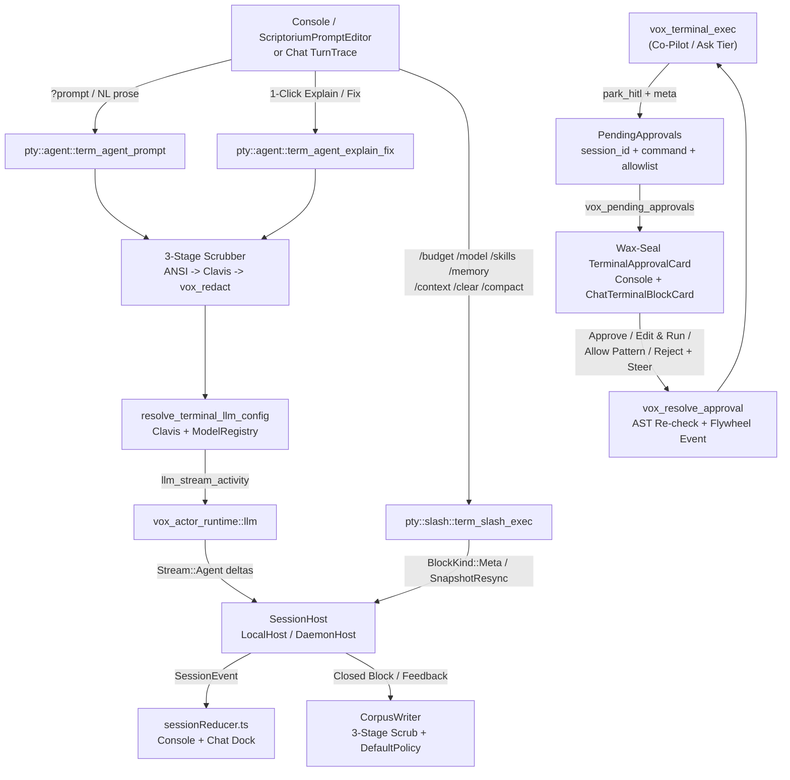

# Phase 445: Terminal Agentic Mode, Command Approval Cards & MENS Flywheel - Research

**Researched:** 2026-11-15
**Domain:** Model-agnostic terminal agent streaming (`vox_actor_runtime::llm`), failed-block diagnosis & repair, Co-Pilot wax-seal HITL command approval cards + `Autopilot -> Manual` preemption, live orchestrator slash commands, and triple-scrubbed MENS terminal trajectory curation
**Confidence:** HIGH

<user_constraints>
## User Constraints (from CONTEXT.md)

### Locked Decisions
- **D-01 (Model-Agnostic LLM Boundary — Mandatory):** ALL terminal LLM calls (`?prompt`, natural-language prompt routing, and `Explain / Fix Failed Block`) MUST go exclusively through `vox_actor_runtime::llm` (`llm_chat`, `llm_stream`, `infer_with_retry`) with model selection from `vox-orchestrator::models::{registry, select, autonomic}` / `vox_terminal_core::agent::route_agent_prompt`. NEVER hardcode vendor hostnames (`api.anthropic.com`, `api.openai.com`, `openrouter.ai`, `generativelanguage.googleapis.com`) or instantiate vendor SDKs directly (`vox-code-audit` `llm_provider_call` detector enforces zero violations).
- **D-02 (Streaming In-Band `BlockKind::AgentTurn`):** Submitting `?prompt` or detected natural-language prose opens an in-band `BlockKind::AgentTurn` block in the session block stream and streams incremental chunks into `Stream::Agent` via session events so the operator watches the reasoning/response arrive live inside `Console` (and compact Chat terminal dock) rather than receiving a static stub string.
- **D-03 (Clavis Secret Resolution & Graceful Unconfigured Fallback):** Provider credentials MUST resolve exclusively via `vox_secrets::resolve_secret(...)` (Clavis SSOT — zero direct `std::env::var` secret reads). When no cloud key or local MENS endpoint is configured/reachable, the `AgentTurn` block fails cleanly with a clear, actionable diagnostic pointing to Clavis (`vox secrets doctor` / Keys & Secrets surface) rather than panicking or hanging.
- **D-04 (1-Click Explain / Fix Failed Block):** Failed shell blocks (`exit_code != 0` or `BlockStatus::Failed`) expose a 1-click **Explain / Fix** action in `BlockCard`. Invoking it passes the triple-scrubbed (`strip_ansi_and_normalize` + `vox_secrets::scrub_resolved_secrets` + `vox_redact::redact_owned`) command, bounded output tail, exit code, `cwd`, and `git_branch` to `vox_actor_runtime::llm`, rendering a structured root-cause explanation plus extracted proposed fix command(s) with **Run Fix** and **Edit in Prompt** buttons.
- **D-05 (Inline Wax-Seal Command Approval Cards in Co-Pilot Mode):** When an agent proposes a terminal command in `Co-Pilot` (`TermControlMode::CoPilot`) or an `Ask`-tier command under `ExecPolicyV1` (`contracts/terminal/exec-policy.v1.yaml`), both `Console` and `Chat` (`ChatTerminalBlockCard` / turn trace) render a unified inline Romanesque wax-seal **Command Approval Card** before PTY execution with 4 operator actions:
  1. **Approve** — executes the proposed command immediately.
  2. **Edit & Run** — lets the operator edit the command text inline before executing (recording a `TranscriptKind::Corrected { from, to }` flywheel event).
  3. **Allow Pattern in Session** — adds the normalized command prefix/binary to a session-scoped `Ask`-tier allowlist (never overriding `Deny` rules or `CREDENTIAL_PROMPT_USER_ONLY`) and executes.
  4. **Reject + Steer** — cancels the command, records `TranscriptKind::Rejected`, and dispatches the operator's steering note back to the agent/chat turn.
- **D-06 (Deterministic `Autopilot -> Manual` Preemption):** Any user keystroke in the terminal VT/prompt or explicit **Interrupt** (`Ctrl+C`) while a session is in `Autopilot` MUST deterministically flip `TermControlMode` to `Manual` on both frontend and `SessionHost` backend (`ControlModeChanged`), cancelling/blocking any queued unstarted agent terminal commands until the operator explicitly re-enables `Co-Pilot` or `Autopilot`.
- **D-07 (Live Orchestrator Slash Commands — Zero Static Stubs):** Terminal slash commands `/budget`, `/model [id]`, `/skills [query]`, `/memory [query]`, `/context`, `/clear`, and `/compact` execute against live backend state (`context_budget`, `llm_spend`, `model_active`, `vox-skills` / `vox_skill_list` / `vox_skill_search`, `memory`, and session block compaction/clearing) and emit structured `BlockKind::Meta` output blocks instead of static placeholder strings.
- **D-08 (Triple-Scrubbed MENS Terminal Trajectory Flywheel):** Block outcomes (implicit clean exit-0 command completions + explicit per-block **Accept** / **Reject** / **Correct** feedback actions on agent-proposed commands/turns) persist `TranscriptEvent` records through `CorpusWriter` + `vox-journal` (`JournalSink`) and `corpus::curate` (`DefaultPolicy`), strictly running the 3-stage scrubber (`strip_ansi_and_normalize` -> `vox_secrets::scrub_resolved_secrets` -> `vox_redact::redact_owned`) BEFORE any disk write so zero secrets or ANSI escape noise ever enter `.jsonl` MENS training trajectories.
- **D-09 (Zero New Dependencies / Zero Crate-Edge Exceptions):** Build strictly on `vox-terminal-core`, `vox-actor-runtime`, `vox-orchestrator`, `vox-secrets`, `vox-redact`, `vox-journal`, and `vox-gui` existing dependencies. Zero `Cargo.toml` additions, zero `package.json` additions, zero `layers.toml` / crate-edge exceptions.
- **D-10 (Strict `< 450` Non-Blank LoC File Decomposition):** Split new Rust command handlers cleanly under `crates/vox-gui/src/commands/pty/` submodules (extending Phase 444's `pty/warp.rs` pattern with e.g. `pty/agent.rs`, `pty/slash.rs`, `pty/approvals.rs`) and split UI cards into focused components (`TerminalApprovalCard.tsx`, `AgentTurnContent.tsx`, etc.) so every `.rs`, `.ts`, and `.tsx` file stays well under 450 non-blank LoC.
- **D-11 (Design & Hygiene Guardrails):** Zero emojis/dingbats (`zeroEmojiAndDingbat.test.ts` — use `Icon.*` + Romanesque `<RomanWaxSealBadge>`), zero raw `<select>` (`<VoxSelect>` only), all Tauri IPC routed through `transport.ts` (`safeInvoke`), `sanitizeErrorForToast` on user-visible errors, and `Console` initial mount preserves a single primary `role="textbox"` (approval inline edit inputs mount only when `Edit & Run` or `Reject + Steer` is toggled open).

### Claude's Discretion
None explicitly carved out in `445-CONTEXT.md`; implementation details within the locked decisions (exact helper module splits under `crates/vox-gui/src/commands/pty/`, streaming chunk batch cadence, and `/compact` deterministic fallback when no LLM provider is configured) follow repo architecture and LoC budgets.

### Deferred Ideas (OUT OF SCOPE)
- Multi-user shared live terminal cursors / cloud team session sharing
- Modifying `contracts/terminal/exec-policy.v1.yaml` `Deny` baselines or weakening `CREDENTIAL_PROMPT_USER_ONLY`
- Training a new MENS checkpoint inside this phase (Phase 445 wires the live trajectory capture, scrubbing, feedback actions, and curation sink so MENS training consumes verified `.jsonl` corpora)
</user_constraints>

<phase_requirements>
## Phase Requirements

| ID | Description | Research Support |
|----|-------------|------------------|
| `TERM-AGENT-01` | `?prompt` and natural-language terminal routing execute live streaming turns through `vox_actor_runtime::llm` (honoring model-agnostic registry selection and Clavis secrets) into `BlockKind::AgentTurn` blocks instead of returning static stub text. | `vox_actor_runtime::llm::{LlmConfig, LlmChatMessage, llm_stream_activity}` (`crates/vox-actor-runtime/src/llm/types.rs:212`, `stream.rs:142`) + `vox_terminal_core::agent::route_agent_prompt` + Clavis fallback resolver + `SessionHost::{begin_block, append_block_output, finish_block}` streaming `OutputChunk::text(Stream::Agent, delta)`. |
| `TERM-AGENT-02` | Failed command blocks (`exit_code != 0`) offer a 1-click **Explain / Fix** action that streams root-cause analysis and a runnable/editable fix command using scrubbed block output and cwd/git context. | `BlockCard.tsx` failed-state action bar + `term_agent_explain_fix` in `pty/agent.rs` applying 3-stage scrub (`strip_ansi_and_normalize` -> `vox_secrets::scrub_resolved_secrets` -> `vox_redact::redact_owned`) + fenced-command extractor rendering **Run Fix** and **Edit in Prompt** chips inside `AgentTurnContent.tsx`. |
| `TERM-AGENT-03` | `Co-Pilot` mode renders inline Romanesque wax-seal Command Approval Cards in both Console and Chat before executing agent-proposed commands (`Approve`, `Edit & Run`, `Allow Pattern in Session`, `Reject + Steer`), and any user keystroke or `Interrupt` in `Autopilot` deterministically preempts back to `Manual` mode. | `PendingApprovalInfo` additive terminal metadata (`session_id`, `command`, `mode`) + `PendingResolution` (`modified_command`, `steering_note`, `allow_pattern`) + `vox_resolve_approval` schema update (`core_and_tasks.rs:157`) + AST re-validation via `evaluate_command_ast` + session `Ask`-tier allowlist + shared `<TerminalApprovalCard>` in `TerminalSessionPane` and `ChatTerminalBlockCard` + `LocalHost` queued-agent preemption on `Manual`. |
| `TERM-AGENT-04` | Terminal slash commands (`/budget`, `/model`, `/skills`, `/memory`, `/context`, `/clear`, `/compact`) query live orchestrator/session state, and scrubbed terminal trajectories (including accept/reject/edit feedback) feed the MENS `CorpusWriter` / `vox-journal` curation pipeline. | `pty/slash.rs` (`term_slash_exec`) calling live `get_context_budget_impl`, `get_llm_spend_snapshot_impl`, `get_active_model_impl`/`set_active_model_impl`, `vox_skill_list`/`vox_skill_search`, `get_memory_status_impl`/`mnemosyne_recall_impl`, and `Session::{clear_unpinned_blocks, compact_blocks}` (`SnapshotResync`) + fixing `CorpusWriter::redact_event` (`Accepted`/`Rejected` block scrub gap) + `DefaultPolicy` keeping `Rejected` feedback + `JournalSink` (`vox_journal::FileJournal<TranscriptEvent>`). |
</phase_requirements>

---

## Summary

Phase 445 completes the `axis-warp-terminal-v75` milestone by replacing the static stub responses in `vox-terminal-core` (`agent.rs` and `commands.rs`) with live model-agnostic LLM streaming, 1-click failed-block repair, unified Console + Chat wax-seal HITL command approval cards, live orchestrator slash commands, and a leak-free MENS trajectory flywheel. Crucially, `crates/vox-gui/Cargo.toml` already depends on every required crate (`vox-actor-runtime`, `vox-orchestrator`, `vox-orchestrator-mcp`, `vox-secrets`, `vox-config`, `vox-terminal-core`), while `crates/vox-terminal-core/Cargo.toml` intentionally stays lightweight (`vox-orchestrator` with `default-features = false`, `vox-redact`, `vox-journal`, no HTTP/LLM/secrets runtime). Placing pure block/session/corpus/allowlist primitives in `vox-terminal-core` and live LLM/Clavis/daemon orchestration in `crates/vox-gui/src/commands/pty/{agent.rs,slash.rs,feedback.rs}` + `vox-orchestrator-mcp` satisfies `D-01..D-10` with **zero** `Cargo.toml`, `package.json`, or `layers.toml` modifications.

Deep inspection of the codebase surfaced **five critical integration seams** that would cause runtime failures or silent data loss if missed during planning:
1. **Model routing vs. Clavis key availability (`agent.rs:149` + `resolve_egress.rs:180`):** `route_agent_prompt` selects from `ModelRegistry::default()` (which includes cloud entries like Anthropic/OpenAI/OpenRouter and falls back to `"mens"`/`"mens-8b"`). `LlmConfig::direct(provider, model)` calls `vox_config::resolve_egress::resolve_egress`, which returns `Err("No API key available for LLM provider")` if that specific provider's Clavis key is unset, and routes unknown provider `"mens"` to OpenRouter's URL! Terminal agent config resolution in `pty/agent.rs` MUST cross-check Clavis key presence (`vox_secrets::resolve_secret`) and active model overrides (`get_active_model_impl`), falling back across configured Clavis providers or `"voxlocal"` (`VOX_LOCAL_ENDPOINT`) and emitting a clean Clavis diagnostic block (`D-03`) when none are configured.
2. **`DaemonHost` `SnapshotResync` drop bug (`daemon_host.rs:149-308` vs `term_dispatch.rs:172-187`):** `term_dispatch.rs` serializes `SessionEvent::SnapshotResync` over the daemon socket as `{"type": "snapshot", ...}`, which `sessionReducer.ts:219` already handles, **but `daemon_host::route` lacks a `Some("snapshot")` match arm** and silently drops live resync frames! Adding `Some("snapshot")` to `daemon_host::route` makes `/clear` and `/compact` propagate deterministically across both `LocalHost` and `DaemonHost`.
3. **`PendingApprovals` & `vox_resolve_approval` schema rigidness (`pending_approvals.rs:32`, `terminal_tools.rs:198`, `core_and_tasks.rs:157`):** Currently, `PendingApprovalInfo` omits `session_id` and raw `command`, `PendingApprovals::resolve` only passes a unit `ApprovalOutcome` (so `terminal_tools.rs:207` executes the *unmodified* original `cmd` even on `ApprovalOutcome::Modified`!), and `vox_resolve_approval`'s JSON schema sets `"additionalProperties": false`. Extending `PendingApprovalInfo` and `vox_resolve_approval` with optional `modified_command`, `steering_note`, and `allow_pattern` fields — plus re-running `evaluate_command_ast` on `modified_command` — makes all 4 wax-seal approval actions work end-to-end across Console and Chat.
4. **Unredacted `Accepted` / `Rejected` blocks in `CorpusWriter` (`corpus/writer.rs:44-63`):** `CorpusWriter::redact_event` currently redacts `Submitted`, `Output`, `AgentTurn`, and `Corrected`, then falls through to `other => other.clone()`, writing `TranscriptKind::Accepted { block }` and `TranscriptKind::Rejected { block }` (`block.input`, `block.output`, `block.cwd`, `block.git_branch`) **completely unredacted**! Furthermore, `DefaultPolicy` (`corpus/curate.rs:59`) drops `TranscriptKind::Rejected`, discarding negative preference pairs needed for MENS DPO/preference curation.
5. **Phase 444 alignment:** Phase 444 (`444-RESEARCH.md`, `444-UI-SPEC.md`) introduces `crates/vox-gui/src/commands/pty/warp.rs` and upgrades `InputEditor.tsx` into `ScriptoriumPromptEditor` (`?prompt` / NL prose / `/slash` routing). Phase 445 cleanly adds sibling submodules `pty/{agent.rs,slash.rs,feedback.rs}` re-exported from `pty.rs` (auto-classified under existing module `"pty"` in `axis_invoke_handler!`) and routes `?prompt`, NL prose, and `/slash` submissions in `Console` / `TerminalSessionPane` to the new live commands.

**Primary recommendation:** Structure Phase 445 into **4 atomic plans across 3 waves**:
- **Wave 1 (`445-01` — Rust Core & MENS Flywheel Foundation):** Add `Session` / `SessionHost` / `LocalHost` / `DaemonHost` / `term_dispatch` streaming block primitives (`begin_block`, `append_block_output`, `finish_block`, `clear_unpinned_blocks`, `compact_blocks`), fix `daemon_host::route` `Some("snapshot")`, add session-scoped `Ask`-tier pattern allowlist + `Autopilot -> Manual` generation counter in `LocalHost`, fix `CorpusWriter` 3-stage scrubbing across ALL `TranscriptKind` variants (including `Accepted`/`Rejected` + Stage-2 custom scrubber hook), and preserve `Rejected` feedback in `DefaultPolicy`.
- **Wave 1 (`445-02` — MCP HITL Approval Contract Upgrade — parallel with `445-01` or early Wave 2):** Upgrade `PendingApprovalInfo` (`session_id`, `command`, `mode`), `PendingApprovals` (`PendingResolution` carrying `modified_command`, `steering_note`, `allow_pattern` + session `Ask`-tier allowlist), `input_schemas/core_and_tasks.rs` (`vox_resolve_approval`), and `terminal_tools.rs` (`evaluate_command_ast` re-validation on `Modified`, `TranscriptKind::Corrected` / `Rejected` recording, steering error return, and `Autopilot` preemption check).
- **Wave 2 (`445-03` — `vox-gui` Terminal Agent Streaming, Explain/Fix, Slash Commands & Trajectory Sink):** Implement `crates/vox-gui/src/commands/pty/{agent.rs,slash.rs,feedback.rs}` (`term_agent_prompt`, `term_agent_explain_fix`, `term_slash_exec`, `term_record_feedback`) using `vox_actor_runtime::llm::llm_stream_activity`, Clavis key resolution (`vox_secrets::resolve_secret`), 3-stage secret/ANSI scrubbing, live orchestrator slash queries, and `JournalSink` + `CorpusWriter` trajectory persistence; expose typed wrappers in `transport.ts`.
- **Wave 3 (`445-04` — Console & Chat UI: Streaming Agent Blocks, 1-Click Explain/Fix, Wax-Seal Approval Cards & MENS Feedback):** Build `TerminalApprovalCard.tsx`, `AgentTurnContent.tsx` (streaming markdown/code + extracted **Run Fix** / **Edit in Prompt** chips), `useTerminalPendingApprovals.ts`, `BlockCard.tsx` failed-block **Explain / Fix** CTA + per-block **Accept** / **Reject** / **Correct** MENS flywheel controls, `ChatTerminalBlockCard.tsx` inline wax-seal approval integration, and deterministic `Autopilot -> Manual` preemption tests.

---

## Project Constraints (from AGENTS.md, GEMINI.md & Guards)

- **Model-Agnostic LLM Boundary (`AGENTS.md §Model-Agnostic LLM Boundary`):** Every LLM call MUST go through `vox_actor_runtime::llm`. `vox-code-audit` detector `crates/vox-code-audit/src/detectors/llm_provider_call.rs` flags any literal provider hostname (`api.anthropic.com`, `api.openai.com`, `openrouter.ai`, `generativelanguage.googleapis.com`, etc.) or `vox_config::*base_url` paired with an HTTP client verb as an `Error`.
- **Secret Management (`AGENTS.md §Secret Management`):** Resolve credentials exclusively via `vox_secrets::resolve_secret(...)` (Clavis SSOT). Never read provider API keys via `std::env::var`. Scrub any terminal block text before LLM egress or disk persistence using `vox_secrets::scrub_resolved_secrets` + `vox_redact::redact_owned`.
- **Zero New Dependencies / Layer Invariants (`AGENTS.md`, `00-core.md` Rule 5):** Do not edit `Cargo.toml`, `Cargo.lock`, `package.json`, or `docs/src/architecture/layers.toml`.
- **Formatting & Scoped Cargo (`00-core.md` Rules 7–9):** Format modified Rust files individually with `rustfmt --edition 2024 <file.rs>`. Scope builds/tests with `timeout 900s cargo test -p <crate> ...`; never run `cargo test --workspace` or `cargo fmt`.
- **Non-Blank LoC Ceiling (`D-10`):** Every new or touched `.rs`, `.ts`, and `.tsx` file must stay `< 450` non-blank LoC. Note that `crates/vox-gui/src/commands/pty.rs` is currently 856 total lines (~740 non-blank LoC including tests) and `crates/vox-orchestrator-d/src/term_dispatch.rs` is 1,119 total lines (441 non-test lines + unit tests), so new handlers MUST live in sibling submodules (`crates/vox-gui/src/commands/pty/{agent.rs,slash.rs,feedback.rs}` and `crates/vox-orchestrator-d/src/term_session_ops.rs`) with minimal delegation lines in the parent files.
- **UI & Accessibility Invariants (`D-11` & `444-UI-SPEC.md`):**
  - Zero Unicode emojis, dingbats, or geometric shapes (`\u25A0-\u27BF`, `\u{1F300}-\u{1FAFF}`) in `crates/vox-gui/ui/src/` (`zeroEmojiAndDingbat.test.ts`). Use `Icon.*` (`components/ui/Icons.tsx`) and `<RomanWaxSealBadge>` (`components/ui/RomanSurfaceHeader.tsx:309`).
  - Zero raw `<select>` elements (`<VoxSelect>` only).
  - Strictly 4 font sizes (`text-[11px]`, `text-xs`, `text-sm`, `text-lg`) and 2 weights (`font-normal`, `font-semibold`), and zero `.5` fractional Tailwind spacing classes in new Phase 445 components (`444-UI-SPEC.md:62-84`).
  - All Tauri IPC calls routed through `crates/vox-gui/ui/src/transport.ts` (`safeInvoke`); all user-visible backend errors sanitized via `sanitizeErrorForToast` (`lib/backendGuard.ts`).
  - `Console.test.tsx` asserts a single primary `screen.getByRole('textbox')` on initial mount — inline edit inputs inside `<TerminalApprovalCard>` (`Edit & Run` / `Reject + Steer`) and `<BlockCard>` (`Correct`) MUST remain unmounted (`null`) until the user explicitly activates that mode.

---

## Architectural Responsibility Map

| Capability | Primary Tier | Owning Crate / Module | Why It Belongs Here |
|------------|--------------|-----------------------|---------------------|
| Streaming `AgentTurn` / `Meta` block lifecycle, `/clear` & `/compact` block mutations (`SnapshotResync`) | Engine Core (Rust) | `vox-terminal-core` (`session.rs`, `host.rs`, `daemon_host.rs`) + `vox-orchestrator-d` (`term_dispatch.rs` / `term_session_ops.rs`) | Keeps `Session` as the single source of truth across `LocalHost`, `DaemonHost`, `Console`, `Chat` terminal dock, and `@term:*` mentions. |
| Session-scoped `Ask`-tier allowlist & `Autopilot` preemption counter | Engine + MCP Gate (Rust) | `vox-terminal-core::host` + `vox-orchestrator-mcp` (`pending_approvals.rs`, `terminal_tools.rs`) | Enforces `ExecPolicyV1` AST + hard safety floor + `CREDENTIAL_PROMPT_USER_ONLY` invariants in Rust before any PTY write occurs. |
| 3-stage trajectory redaction, `JournalSink` & MENS curation policy | Engine Corpus (Rust) | `vox-terminal-core::corpus` (`writer.rs`, `curate.rs`, `redact.rs`) | Centralizes redaction across `Submitted`, `Output`, `AgentTurn`, `Accepted`, `Rejected`, and `Corrected` events before `.jsonl` / `FileJournal` writes. |
| Live LLM streaming (`llm_stream_activity`), Clavis key resolution, 1-click Explain/Fix, and live `/slash` execution | Desktop Host IPC (Rust) | `vox-gui` (`src/commands/pty/{agent.rs,slash.rs,feedback.rs}`) | `vox-gui` already links `vox-actor-runtime`, `vox-secrets`, `vox-config`, `vox-orchestrator`, and `vox-terminal-core` without adding crate edges. |
| Wax-seal `<TerminalApprovalCard>`, streaming `AgentTurnContent`, 1-click `Explain / Fix` CTA, and per-block feedback | Frontend UI (React/TS) | `vox-gui/ui` (`Console/TerminalApprovalCard.tsx`, `Console/AgentTurnContent.tsx`, `Console/BlockCard.tsx`, `Chat/ChatTerminalBlockCard.tsx`) | Shares a single Romanesque approval card component across `Console` and `Chat` turn traces while keeping every `.tsx` file `< 450` LoC. |

---

## Standard Stack

### Core (100% In-Workspace — Zero Additions)
| Library / Crate | Version | Purpose | Provenance |
|-----------------|---------|---------|------------|
| `vox-actor-runtime` (`llm`) | workspace | Model-agnostic LLM facade (`LlmConfig`, `LlmChatMessage`, `llm_chat`, `infer_with_retry`, `llm_stream`, `llm_stream_activity`) | `[VERIFIED: crates/vox-actor-runtime/src/llm/mod.rs:14-26]`, linked in `crates/vox-gui/Cargo.toml:23` |
| `vox-secrets` | workspace | Clavis secret resolution (`resolve_secret`, `SecretId`) & secret needle scrubbing (`scrub_resolved_secrets`) | `[VERIFIED: crates/vox-gui/Cargo.toml:55]`, `[VERIFIED: crates/vox-gui/src/commands/console_a2a.rs:34-43]` |
| `vox-redact` | workspace | Regex/token/header Stage-3 credential redaction (`redact_owned`) | `[VERIFIED: crates/vox-terminal-core/Cargo.toml:26]`, `[VERIFIED: crates/vox-terminal-core/src/corpus/redact.rs:186]` |
| `vox-journal` | workspace | Durable append-only `FileJournal<TranscriptEvent>` backing `CorpusWriter::JournalSink` | `[VERIFIED: crates/vox-terminal-core/Cargo.toml:23]`, `[VERIFIED: crates/vox-terminal-core/src/corpus/writer.rs:11-28]` |
| `vox-orchestrator` | workspace | `ModelRegistry`, `select_with_default_registry`, `evaluate_command_ast`, `default_exec_policy_v1`, `classify_floor`, `ApprovalOutcome` | `[VERIFIED: crates/vox-gui/Cargo.toml:45]` |
| `vox-orchestrator-mcp` | workspace | `PendingApprovals`, `PendingApprovalInfo`, `vox_pending_approvals`, `vox_resolve_approval`, `vox_terminal_exec`, `vox_skill_list`, `vox_skill_search` | `[VERIFIED: crates/vox-gui/Cargo.toml:46]` |
| `futures-util` | workspace | `StreamExt::next()` over `llm_stream_activity` byte/delta stream | `[VERIFIED: crates/vox-gui/Cargo.toml:62]` |

**Installation:** None required (`D-09`).

---

## Deep Technical Verification of Codebase Seams

### 1. `vox_actor_runtime::llm` Facade, Clavis Resolution & `vox-code-audit` (`TERM-AGENT-01`)

- **Exported LLM Facade Surface:**
  `[VERIFIED: crates/vox-actor-runtime/src/llm/mod.rs:14-26]`
  > ```rust
  > pub use chat::{infer_with_retry, llm_chat};
  > pub use stream::{
  >     SseDeltaEvent, llm_stream, llm_stream_activity, llm_stream_events, llm_stream_events_activity,
  > };
  > pub use types::{
  >     CONTEXT_EXCEEDED_PREFIX, LlmChatMessage, LlmChoice, LlmConfig, LlmResponse, LlmStreamChunk,
  >     LlmToolCall, LlmToolCallFunction, LlmUsage, OpenAiMessageContent, OpenRouterPayload,
  >     RATE_LIMITED_PREFIX,
  > };
  > ```
- **`LlmConfig` Constructors & Clavis Integration:**
  `[VERIFIED: crates/vox-actor-runtime/src/llm/types.rs:212-246]`
  > ```rust
  >     pub fn direct(provider: impl Into<String>, model: impl Into<String>) -> Result<Self, String> {
  >         let provider_str = provider.into();
  >         let model_str = model.into();
  >         let resolved = vox_config::resolve_egress::resolve_egress(&provider_str, &model_str)?;
  > ...
  >     pub fn voxlocal(model: impl Into<String>) -> Self {
  >         Self::direct("voxlocal", model).unwrap_or_else(|_| Self {
  >             provider: "voxlocal".to_string(),
  >             model: model.into(),
  >             base_url: Some("http://127.0.0.1:11434/v1/chat/completions".to_string()),
  > ```
  Inside `vox_config::resolve_egress::resolve_egress(provider, model)`:
  `[VERIFIED: crates/vox-config/src/resolve_egress.rs:175-215]`
  > ```rust
  > pub fn resolve_egress(provider: &str, model: &str) -> Result<ResolvedEgress, String> {
  >     let p = provider.trim().to_ascii_lowercase();
  >     if p == "ollama" {
  >         return Ok(ResolvedEgress {
  >             url: ollama_chat_url(),
  >             auth: EgressAuth::None,
  > ...
  >     if p == "voxlocal" || p == "populi_local" {
  >         let base = vox_secrets::resolve_secret(vox_secrets::SecretId::VoxLocalEndpoint)
  >             .expose()
  >             .map(|s| s.trim().trim_end_matches('/').to_string())
  >             .unwrap_or_else(|| "http://127.0.0.1:11434".to_string());
  > ...
  >     let auth = resolve_provider_auth(&p)
  >         .ok_or_else(|| "No API key available for LLM provider".to_string())?;
  > ```
- **Streaming Activity Watchdog:**
  `llm_stream_activity(messages, config, Duration::from_secs(45))` (`[VERIFIED: crates/vox-actor-runtime/src/llm/stream.rs:142-151]`) returns `Result<Pin<Box<dyn Stream<Item = Result<String, String>> + Send>>, String>` with automatic per-chunk idle timeout and supports both OpenAI-compatible SSE (`openrouter`, `openai`, `groq`, `mistral`, `deepseek`, `gemini`, `ollama`, `voxlocal`) and native Anthropic `content_block_delta` SSE (`stream.rs:219-243`).
- **Critical Routing Pitfall & Solution (`resolve_terminal_llm_config`):**
  In `crates/vox-terminal-core/src/agent.rs:138-159`:
  `[VERIFIED: crates/vox-terminal-core/src/agent.rs:147-152]`
  > ```rust
  >     let (model_id, provider) = entry
  >         .map(|m| (m.id, m.provider))
  >         .unwrap_or_else(|| ("mens-8b".to_string(), "mens".to_string()));
  > ```
  1. `ModelRegistry::default()` scores static frontier models without checking which Clavis keys the local operator has populated, and falls back to `"mens"` (which `resolve_egress` treats as `_ => openrouter_chat_completions_url()`!).
  2. Therefore, `resolve_terminal_llm_config` in `crates/vox-gui/src/commands/pty/agent.rs` MUST:
     - First check if the operator set an active model via `/model <id>` or `get_active_model_impl` (`crates/vox-gui/src/commands/model_active.rs:79-91`), trying `LlmConfig::direct` on its provider.
     - Next run `vox_terminal_core::agent::route_agent_prompt(&prompt)` and test `LlmConfig::direct(&routed.provider, &routed.model_id)` (mapping `"mens"` -> `"voxlocal"` ONLY when `SecretId::VoxLocalEndpoint` is configured in Clavis or `MensServeState` is running).
     - If the routed provider returns `Err` (missing Clavis key), probe configured Clavis providers in deterministic order using `LlmConfig::direct`:
       `("openrouter", "anthropic/claude-sonnet-4-5")`, `("anthropic", "claude-sonnet-4-5")`, `("openai", "gpt-4o-mini")`, `("gemini", "gemini-2.5-flash")`, `("groq", "llama-3.3-70b-versatile")`, `("deepseek", "deepseek-chat")`, `("mistral", "mistral-small-latest")`.
     - If **zero** cloud Clavis keys are present and neither `SecretId::VoxLocalEndpoint` nor `MensServeState` is active, return `Err(TerminalLlmUnavailable)` and write a structured Clavis diagnostic into the `BlockKind::AgentTurn` block (`status: BlockStatus::Failed`, `exit_code: Some(1)`):
       `"No LLM credentials or local MENS endpoint configured in Clavis. Run 'vox secrets doctor' or open Keys & Secrets to configure OpenRouter, Anthropic, OpenAI, Gemini, or VOX_LOCAL_ENDPOINT."` (`D-03`).
- **`vox-code-audit` `llm_provider_call` Verification:**
  `[VERIFIED: crates/vox-code-audit/src/detectors/llm_provider_call.rs:26-49, 229-256]`
  The detector flags literal vendor hostnames (`HOSTS`) and `vox_config::*base_url(` paired with HTTP verbs. Calling `LlmConfig::direct(provider, model)` + `vox_actor_runtime::llm::llm_stream_activity(...)` / `llm_chat(...)` contains zero hostnames, zero `base_url` calls, and zero `reqwest` calls — guaranteeing `0` `llm_provider_call` findings.

---

### 2. Streaming `AgentTurn` Blocks & 1-Click Failed Block Diagnosis (`TERM-AGENT-01`, `TERM-AGENT-02`)

- **Why Static `Session::submit_with_origin` Cannot Stream:**
  Currently in `crates/vox-terminal-core/src/session.rs:415-428`:
  `[VERIFIED: crates/vox-terminal-core/src/session.rs:415-428]`
  > ```rust
  >             RoutedInput::AgentPrompt(q) => {
  >                 let routed = crate::agent::route_agent_prompt(&q);
  >                 let text = routed.summary();
  >                 let mut b = self.new_stamped_block(id, BlockKind::AgentTurn, q, origin);
  >                 b.push_chunk(OutputChunk::text(Stream::Agent, text.clone()));
  >                 b.finish(0);
  >                 ...
  > ```
  And in `crates/vox-gui/src/commands/pty.rs:437-460`, `term_session_submit` inspects `classify_submission_route(trimmed)`: if `ShellPty`, it spawns/writes to the PTY; otherwise it calls `host.submit(&session_id, &line)` which synchronously produces that static stub block!
- **Unified Streaming Block Primitives on `Session` + `SessionHost`:**
  Because `PtyManager::host_for(&self, daemon)` (`[VERIFIED: crates/vox-gui/src/commands/pty.rs:161-165]`) dynamically returns `DaemonHost` when `vox-orchestrator-d` is alive and `LocalHost` otherwise, streaming blocks MUST mutate `Session` through `SessionHost` so `term_session_attach` snapshots, `@term:*` mentions, `Chat` dock panes, and `Console` panes all share identical state:
  - Add to `Session` (`crates/vox-terminal-core/src/session.rs`):
    - `pub fn begin_custom_block(&mut self, kind: BlockKind, input: String, origin: BlockOrigin) -> BlockId`: stamps `cwd` and `git_branch`, pushes a `BlockStatus::Running` block (WITHOUT setting `self.open_id`, so concurrent shell PTY output never interleaves into an `AgentTurn` or `Meta` block!), and broadcasts `SessionEvent::BlockOpened`.
    - `pub fn append_block_chunk(&mut self, id: BlockId, stream: Stream, text: String) -> bool`: appends `OutputChunk::text(stream, text)` to block `id` and broadcasts `SessionEvent::OutputAppended { id, chunk }`.
    - `pub fn finish_custom_block(&mut self, id: BlockId, exit_code: i32) -> Option<Block>`: calls `b.finish(exit_code)`, broadcasts `SessionEvent::BlockClosed { id, exit_code: b.exit_code, status: Some(b.status) }`, and returns the closed `Block` clone (for `CorpusWriter`!).
  - Expose on `SessionHost` (`crates/vox-terminal-core/src/host.rs` + `LocalHost` + `DaemonHost` via `"term.block_begin"`, `"term.block_append"`, `"term.block_finish"` in `term_dispatch.rs` / `term_session_ops.rs`).
  - Existing `term_session_attach` forwarder (`pty.rs:329-347`) and `sessionReducer.ts:128-175` ALREADY handle `BlockOpened` (`kind: 'AgentTurn' | 'Meta'`), `OutputAppended` (`stream: 'Agent' | 'Meta'`), and `BlockClosed` with zero new Tauri event channels!
- **3-Stage Scrubbing Helper Before LLM Egress (`TERM-AGENT-02` & `D-04`):**
  `crates/vox-gui/src/commands/console_a2a.rs:34-43` already demonstrates Stage-2 + Stage-3 scrubbing:
  `[VERIFIED: crates/vox-gui/src/commands/console_a2a.rs:34-43]`
  > ```rust
  > pub(crate) fn scrub_for_agent_inbox(raw: &str) -> String {
  >     let clavis_clean = vox_secrets::scrub_resolved_secrets(raw);
  >     let mut redacted = vox_redact::redact_owned(clavis_clean.as_ref());
  > ```
  For terminal blocks (which also contain SGR/OSC/CR sequences), `scrub_terminal_text_3stage(raw: &str, max_bytes: usize) -> String` MUST run in exact `D-04`/`D-08` order:
  1. **Stage 1:** `vox_terminal_core::corpus::redact::strip_ansi_and_normalize(raw)` (`[VERIFIED: crates/vox-terminal-core/src/corpus/redact.rs:112]`)
  2. **Stage 2:** `vox_secrets::scrub_resolved_secrets(&stage1)`
  3. **Stage 3:** `vox_redact::redact_owned(stage2.as_ref())` + UTF-8 tail-bound (`<= 8192` bytes, preserving the tail where compiler/shell errors print).
- **Structured Repair Output & Proposed Command Extraction (`TERM-AGENT-02`):**
  `term_agent_explain_fix(session_id, block_id)` reads the failed `Block` from `host.block(&session_id, BlockId(block_id))`, triple-scrubs `block.input`, flattened `block.output` tail, `block.cwd`, and `block.git_branch`, opens a `BlockKind::AgentTurn` (`input: format!("?explain-fix #{block_id}: {}", scrubbed_cmd)`), and streams a system-prompted diagnosis instructing the model to provide:
  1. Concise **Root Cause** bullets (`1-3` bullets), and
  2. Proposed repair command(s) inside fenced ```` ```sh ```` / ```` ```bash ```` / ```` ```pwsh ```` blocks.
  On the frontend, `AgentTurnContent.tsx` parses fenced shell blocks (`extractProposedCommands(markdown): string[]`) and renders each command with **Run Fix** (routes through Co-Pilot approval / PTY submit) and **Edit in Prompt** (populates `ScriptoriumPromptEditor` via `applyLine` without executing).

---

### 3. Co-Pilot Wax-Seal Command Approval Cards & `Autopilot -> Manual` Preemption (`TERM-AGENT-03`)

- **Existing MCP Terminal Gate (`terminal_tools.rs`):**
  `[VERIFIED: crates/vox-orchestrator-mcp/src/dispatch_domains/terminal_tools.rs:193-215]`
  > ```rust
  >             let needs_hitl =
  >                 credential_prompt || mode == "co_pilot" || (mode == "autopilot" && tier_err);
  >             let mut hitl_approved = false;
  >             if needs_hitl {
  >                 let summary = if credential_prompt {
  >                     format!("[terminal:{mode}:CREDENTIAL_PROMPT_USER_ONLY] {cmd}")
  >                 } else {
  >                     format!("[terminal:{mode}] {cmd}")
  >                 };
  >                 match state.park_hitl("vox_terminal_exec", summary).await {
  >                     ApprovalOutcome::Approved
  >                     | ApprovalOutcome::AutoApproved
  >                     | ApprovalOutcome::Modified => {
  >                         hitl_approved = true;
  >                     }
  >                     ApprovalOutcome::Rejected => {
  >                         return Ok(ToolResult::<Value>::err(
  >                             "Operation 'vox_terminal_exec' rejected by operator.",
  >                         )
  >                         .to_json());
  >                     }
  > ```
- **Existing `PendingApprovalInfo` & `vox_resolve_approval` Schema:**
  `[VERIFIED: crates/vox-orchestrator-mcp/src/pending_approvals.rs:32-41]`
  > ```rust
  > pub struct PendingApprovalInfo {
  >     pub approval_id: String,
  >     pub tool: String,
  >     pub summary: String,
  >     pub requested_at_ms: u64,
  >     #[serde(default, skip_serializing_if = "Option::is_none")]
  >     pub floor_category: Option<String>,
  > }
  > ```
  `[VERIFIED: crates/vox-orchestrator-mcp/src/input_schemas/core_and_tasks.rs:157-159]`
  > ```rust
  >         "vox_resolve_approval" => parse_obj(
  >             r#"{"type":"object","properties":{"approval_id":{"type":"string","minLength":1},"outcome":{"type":"string","enum":["approve","approved","modify","modified","reject","rejected"]},"decision":{"type":"string","description":"Alias for `outcome`"}},"required":["approval_id"],"anyOf":[{"required":["outcome"]},{"required":["decision"]}],"additionalProperties":false}"#,
  >         ),
  > ```
- **Exact Upgrade Contract for All 4 Wax-Seal Actions (`D-05`):**
  1. **Additive `PendingApprovalInfo` fields (`pending_approvals.rs`):**
     Add `#[serde(default, skip_serializing_if = "Option::is_none")]`:
     - `pub session_id: Option<String>`
     - `pub command: Option<String>`
     - `pub control_mode: Option<String>`
     - `pub credential_prompt: Option<bool>`
     Existing callers (`ApprovalsView.tsx`, `useAttentionInbox.ts`) keep working unchanged because all new fields are optional.
  2. **Rich `PendingResolution` inside `PendingApprovals` (`pending_approvals.rs`):**
     ```rust
     #[derive(Debug, Clone, Default)]
     pub struct PendingResolution {
         pub outcome: ApprovalOutcome,
         pub modified_command: Option<String>,
         pub steering_note: Option<String>,
         pub allow_pattern: Option<String>,
     }
     ```
     Keep `register` / `resolve` signatures intact as thin wrappers over `register_with_meta` / `resolve_with_detail` so zero existing unit or gateway tests break.
  3. **Update `vox_resolve_approval` schema (`core_and_tasks.rs:157`) & handler (`tasks_core.rs:123`):**
     Permit optional properties on `vox_resolve_approval`:
     - `"modified_command": {"type": "string"}`
     - `"steering_note": {"type": "string"}`
     - `"allow_pattern": {"type": "string"}`
     In `tasks_core.rs`, keep `crate::floor_gate::refuse_agent_floor_resolution(state, approval_id, outcome)` first, then pass `PendingResolution` to `state.pending_approvals.resolve_with_detail(...)`.
  4. **Session-Scoped `Ask`-Tier Pattern Allowlist (`Allow Pattern in Session`):**
     Store `session_term_allowlist: RwLock<HashMap<String, BTreeSet<String>>>` on `PendingApprovals` (or `ServerState`).
     Before `park_hitl` in `terminal_tools.rs`, a command `cmd` in session `sid` may auto-pass via session allowlist **ONLY IF ALL FOUR GATES HOLD**:
     - `!credential_prompt` (`CREDENTIAL_PROMPT_USER_ONLY` is NEVER bypassed),
     - `classify_floor("vox_terminal_exec", &args).is_none()` (hard safety floor is NEVER bypassed),
     - `evaluate_command_ast(cmd, &default_exec_policy_v1())` (`[VERIFIED: crates/vox-orchestrator/src/oversight/exec_policy.rs:367]`) has **zero** hard `Deny` / syntax violations (i.e., every violation has `v.rule == "command-not-allowed"`, NEVER `subshell-or-command-substitution`, `redirection-forbidden`, `encoded-command-forbidden`, `dynamic-eval-forbidden`, `catastrophic-command-forbidden`, `blocked-parameter`, or `network-domain-denied` — `[VERIFIED: crates/vox-orchestrator/src/oversight/exec_policy.rs:152-279]`), AND
     - `extract_effective_commands(cmd)` (`[VERIFIED: crates/vox-orchestrator/src/oversight/exec_policy.rs:383]`) is non-empty and **every** effective command's normalized prefix (`argv[0]` or `argv[0] argv[1]`) matches an entry in `session_term_allowlist[sid]` (preventing `cargo test && rm -rf /` compound smuggling!).
  5. **`Edit & Run` AST Re-Validation + Flywheel Correction:**
     When `res.outcome == ApprovalOutcome::Modified`, extract `edited = res.modified_command.trim()`, reject empty strings, **re-run `evaluate_command_ast(edited, &default_exec_policy_v1())` for hard `Deny`/AST rules** (so an accidental or pasted `$()` / catastrophic command is still blocked by policy!), emit a `TranscriptKind::Corrected { from: cmd.to_string(), to: edited.to_string() }` event to the corpus sink, and execute `edited` instead of `cmd`!
  6. **`Reject + Steer` Steering Delivery:**
     When `res.outcome == ApprovalOutcome::Rejected`, record `TranscriptKind::Rejected` in the corpus sink, scrub `steering_note` via `vox_redact::redact_owned`, and if non-empty return:
     `ToolResult::<Value>::err(format!("Operation 'vox_terminal_exec' rejected by operator. Operator steering note: {note}")).to_json()`
     Because `vox_terminal_exec` is an MCP tool call inside the Chat / orchestrator agent loop, returning the steering note in the tool error payload delivers it **directly into the next LLM reasoning step** without losing turn context! When invoked from standalone `Console` (outside an active MCP tool call, e.g., clicking **Run Fix** in `Co-Pilot` mode and choosing `Reject + Steer`), `Console` immediately triggers `term_agent_prompt(session_id, steering_note)` so the terminal agent revises its proposal in-band.
- **Deterministic `Autopilot -> Manual` Preemption (`D-06`):**
  - **Frontend (`TerminalSessionPane.tsx:141-154` & `Console.tsx:145,183`):** `preemptAutopilot()` ALREADY flips UI state and calls `termSessionSetControl(sid, 'manual')` on user input, `Interrupt` (`Ctrl+C`), and `Escape`. Ensure `ScriptoriumPromptEditor` keystrokes (`onChange`) in `Console` also invoke `preemptAutopilot()` immediately on first keystroke (not only on `Enter`!).
  - **Backend (`LocalHost` in `crates/vox-terminal-core/src/host.rs` + `terminal_tools.rs`):**
    Add an atomic `control_epoch: u64` per session in `LocalHost` (`Entry`), incremented every time `set_control_mode(sid, TermControlMode::Manual)` is called.
    - In `LocalHost::agent_exec_checked` (`crates/vox-terminal-core/src/agent_exec.rs:79-91`): if `control_mode == TermControlMode::Manual && !req.hitl_approved`, execution is ALREADY refused (`AgentExecDenyReason::ManualModeActive`)!
    - In `terminal_tools.rs`: capture `mode_before = term.session_control_mode(&sid)` before `park_hitl` / `exec_agent_command`; if the operator preempted the session to `Manual` while an `Autopilot` command was queued (without explicit `hitl_approved`), refuse execution immediately with `"Session preempted to Manual mode by operator"` and drop any pending unapproved `Autopilot` queue items!

---

### 4. Live Orchestrator Slash Commands & MENS Flywheel (`TERM-AGENT-04`)

- **Current Static Slash Command Stubs:**
  `[VERIFIED: crates/vox-terminal-core/src/commands.rs:70-128]`
  `CommandRegistry::with_builtins()` currently registers `/model`, `/mode`, `/budget`, `/skills`, `/memory`, `/clear`, `/help` returning static strings like `"active model: (not wired to orchestrator in standalone build)"` and `"clear requested (session handler handles buffer reset)"`! Notice `/context` and `/compact` are not even registered in `with_builtins()` yet!
- **Mapping All 7 Live Slash Commands (`D-07`):**
  1. Reserve `CommandRegistry::with_builtins()` in `vox-terminal-core/src/commands.rs` to include `/context` and `/compact` in `list()` / `parse_slash()` so TUI `vox-term` and autocomplete catalogs discover all 9 builtins (`/budget`, `/model`, `/skills`, `/memory`, `/context`, `/clear`, `/compact`, `/mode`, `/help`).
  2. In `vox-gui`, implement `term_slash_exec(session_id: String, line: String, ...)` in `crates/vox-gui/src/commands/pty/slash.rs`, which opens/finishes a `BlockKind::Meta` block in `SessionHost` populated from live backend state:
     - **`/budget`:** Calls `super::super::context_budget::get_context_budget_impl(&backend, Some(session_id.clone())).await` (`[VERIFIED: crates/vox-gui/src/commands/context_budget.rs:95]`) + `super::super::llm_spend::get_llm_spend_snapshot_impl(&backend).await` (`[VERIFIED: crates/vox-gui/src/commands/llm_spend.rs:15]`), formatting structured JSON/table telemetry (token usage, context ceiling, strategy, total spend USD, active budget alerts).
     - **`/model [id]`:** With no arg, calls `super::super::model_active::get_active_model_impl(&backend).await` (`[VERIFIED: crates/vox-gui/src/commands/model_active.rs:79]`) plus Clavis configured-provider summary. With `<id>`, calls `super::super::model_active::set_active_model_impl(&backend, id).await` (`model_active.rs:84`) and reports the newly pinned model + provider.
     - **`/skills [query]`:** Calls `backend.call(orch_daemon_method::TOOL_CALL, json!({"name": "vox_skill_search", "arguments": {"query": q}}))` when `[query]` is non-empty or `"vox_skill_list"` (`{}`) when empty (`[VERIFIED: crates/vox-orchestrator-mcp/src/dispatch_domains/mens_populi.rs:183-184]`), falling back cleanly if the daemon is offline.
     - **`/memory [query]`:** Calls `super::super::memory::get_memory_status_impl(&backend).await` (`[VERIFIED: crates/vox-gui/src/commands/memory.rs:60]`) when empty, or `super::super::memory::mnemosyne_recall_impl(&backend, query, Some(8)).await` (`memory.rs:74`) when `[query]` is given, scrubbing recalled snippets with `vox_redact::redact_owned`.
     - **`/context`:** Inspects `host.attach(&session_id)` + `get_context_budget_impl`: reports total blocks, pinned block IDs, current `cwd`, `git_branch`, `security_level`, `control_mode`, session `Ask`-tier allowlist patterns, and estimated `@term` token footprint.
     - **`/clear`:** Calls `host.clear_unpinned_blocks(&session_id)` — retains `b.pinned || matches!(b.status, BlockStatus::Running | BlockStatus::AwaitingInput)`, emits `SessionEvent::SnapshotResync`, and returns cleared count.
     - **`/compact`:** Summarizes older unpinned completed blocks (keeping the most recent 4 blocks + all pinned/running blocks intact) via `vox_actor_runtime::llm::llm_chat` (with deterministic local command/exit-code digest fallback when no LLM key is configured) and calls `host.compact_blocks(&session_id, summary_text, 4)`, which replaces compacted blocks with a single `BlockKind::Meta` digest block and emits `SessionEvent::SnapshotResync`.
- **Fixing `CorpusWriter` & `DefaultPolicy` for the MENS Flywheel (`D-08`):**
  - **Bug 1 (`crates/vox-terminal-core/src/corpus/writer.rs:44-63`):**
    `[VERIFIED: crates/vox-terminal-core/src/corpus/writer.rs:44-63]`
    > ```rust
    > fn redact_event(ev: &TranscriptEvent) -> TranscriptEvent {
    >     let kind = match &ev.kind {
    >         TranscriptKind::Submitted { input } => TranscriptKind::Submitted {
    >             input: redact_for_corpus(input),
    >         },
    >         TranscriptKind::Output { text } => TranscriptKind::Output {
    >             text: redact_for_corpus(text),
    >         },
    >         TranscriptKind::AgentTurn { prompt, reply } => TranscriptKind::AgentTurn {
    >             prompt: redact_for_corpus(prompt),
    >             reply: redact_for_corpus(reply),
    >         },
    >         TranscriptKind::Corrected { from, to } => TranscriptKind::Corrected {
    >             from: redact_for_corpus(from),
    >             to: redact_for_corpus(to),
    >         },
    >         other => other.clone(),
    >     };
    > ```
    `TranscriptKind::Accepted { block }` and `TranscriptKind::Rejected { block }` (`[VERIFIED: crates/vox-terminal-core/src/transcript.rs:34-35]`) hit `other => other.clone()`, leaking raw `block.input`, `block.output` (`Vec<OutputChunk>`), `block.cwd`, and `block.git_branch`!
    **Fix:** Add `redact_block_with<F>(block: &Block, stage2: &F) -> Block` and `redact_event_with<F>(ev: &TranscriptEvent, stage2: F) -> TranscriptEvent` in `writer.rs` so **every** `TranscriptKind` variant (`Submitted`, `Output`, `AgentTurn`, `Accepted`, `Rejected`, `Corrected`, `SessionOpened { cwd, shell }`) runs:
    `strip_ansi_and_normalize` (Stage 1) -> `stage2` (`vox_secrets::scrub_resolved_secrets` in `vox-gui` / identity in standalone `vox-terminal-core`) -> `vox_redact::redact_owned` (Stage 3)!
  - **Bug 2 (`crates/vox-terminal-core/src/corpus/curate.rs:51-62`):**
    `[VERIFIED: crates/vox-terminal-core/src/corpus/curate.rs:58-60]`
    > ```rust
    >             TranscriptKind::Accepted { .. } | TranscriptKind::Corrected { .. } => Decision::Keep,
    >             TranscriptKind::Rejected { .. } => Decision::Drop,
    > ```
    Dropping `Rejected` discards explicit negative operator feedback (`D-08`). Update `DefaultPolicy` to keep `TranscriptKind::Rejected { block }` when `!block.input.trim().is_empty()` (verified against `curate.rs:73-158`: zero existing unit tests assert `Rejected => Drop`, only `exit_status_dropped`!).
  - **Durable `JournalSink` Wiring in `PtyManager`:**
    `CorpusWriter<JournalSink>` (`[VERIFIED: crates/vox-terminal-core/src/corpus/writer.rs:11-28]`) wraps `vox_journal::FileJournal<TranscriptEvent>`. Add a lazy-initialized `Mutex<Option<CorpusWriter<JournalSink>>>` + curated JSONL export helper on `PtyManager` writing under `<vox-data-dir>/terminal/trajectories.journal` (with `VOX_TERM_CORPUS_DIR` override for deterministic isolated tests!), recording:
    1. Implicit clean `exit_code == 0` shell command completions (redacted `Submitted` + bounded `Output`),
    2. Completed `AgentTurn` blocks, and
    3. Explicit operator `Accept`, `Reject`, and `Correct` (`Edit & Run` / inline block correction) feedback events via `term_record_feedback`.

---

## Architecture Patterns

### End-to-End Agentic & Approval Data Flow



### `< 450` Non-Blank LoC File Decomposition Plan (`D-10`)

| File Path | Action | Est. Non-Blank LoC | Responsibility |
|-----------|--------|--------------------|----------------|
| `crates/vox-terminal-core/src/session.rs` | Edit | ~390 (currently ~580 w/ tests; extract new block/compact methods into `src/session_agent.rs`!) | **IMPORTANT:** `session.rs` is 715 lines total! Put new `impl Session` methods (`begin_custom_block`, `append_block_chunk`, `finish_custom_block`, `clear_unpinned_blocks`, `compact_blocks`) in a new submodule `crates/vox-terminal-core/src/session_agent.rs` (~140 LoC)! |
| `crates/vox-terminal-core/src/host.rs` | Edit / Split | ~150 new file `host_agent.rs` | `crates/vox-terminal-core/src/host.rs` is 750 lines total! Put new `SessionHost` default/trait methods + `LocalHost` implementations + session `Ask`-tier allowlist + `control_epoch` into `crates/vox-terminal-core/src/host_agent.rs` (~170 LoC). |
| `crates/vox-terminal-core/src/daemon_host.rs` | Edit | +45 lines (or `daemon_host_ops.rs` ~110 LoC) | Fix `Some("snapshot")` in `route()` (`daemon_host.rs:307`) + delegate new `SessionHost` RPC methods to `crates/vox-terminal-core/src/daemon_host_ops.rs`. |
| `crates/vox-orchestrator-d/src/term_session_ops.rs` | New | ~130 LoC | Handles `"term.block_begin"`, `"term.block_append"`, `"term.block_finish"`, `"term.clear_blocks"`, `"term.compact_blocks"` called by a 5-line match arm in `term_dispatch.rs`. |
| `crates/vox-terminal-core/src/corpus/writer.rs` | Edit | ~160 LoC | Fix `redact_event_with` across all `TranscriptKind` variants (`Accepted`, `Rejected`, `SessionOpened`) + custom Stage-2 scrubber closure. |
| `crates/vox-terminal-core/src/corpus/curate.rs` | Edit | ~150 LoC | Preserve `TranscriptKind::Rejected` with non-empty `block.input` in `DefaultPolicy` + unit tests. |
| `crates/vox-orchestrator-mcp/src/pending_approvals.rs` | Edit | ~230 LoC | Additive terminal fields on `PendingApprovalInfo`, `PendingResolution`, and session-scoped `Ask`-tier pattern allowlist. |
| `crates/vox-orchestrator-mcp/src/dispatch_domains/terminal_tools.rs` | Edit | ~360 LoC | Session allowlist pre-check, `Edit & Run` AST re-validation + `Corrected` event, `Reject + Steer` error note, and `Autopilot` `Manual` preemption check. |
| `crates/vox-gui/src/commands/pty/agent.rs` | New | ~280 LoC | `resolve_terminal_llm_config`, 3-stage scrubber, `term_agent_prompt` streaming task, and `term_agent_explain_fix`. |
| `crates/vox-gui/src/commands/pty/slash.rs` | New | ~260 LoC | `term_slash_exec` implementing live `/budget`, `/model`, `/skills`, `/memory`, `/context`, `/clear`, `/compact`. |
| `crates/vox-gui/src/commands/pty/feedback.rs` | New | ~170 LoC | `CorpusWriter<JournalSink>` manager, `term_record_feedback` (`accept` / `reject` / `correct`), and Co-Pilot in-Console command proposal helper. |
| `crates/vox-gui/ui/src/components/surfaces/Console/TerminalApprovalCard.tsx` | New | ~210 LoC | Shared Romanesque wax-seal Command Approval Card (`Approve`, `Edit & Run`, `Allow Pattern in Session`, `Reject + Steer`) used in both `Console` and `Chat`. |
| `crates/vox-gui/ui/src/components/surfaces/Console/AgentTurnContent.tsx` | New | ~160 LoC | Renders streaming `BlockKind::AgentTurn` / `Meta` output + extracted repair commands with **Run Fix** and **Edit in Prompt** buttons + per-block **Accept** / **Reject** / **Correct** MENS controls. |
| `crates/vox-gui/ui/src/hooks/useTerminalPendingApprovals.ts` | New | ~110 LoC | Subscribes/polls `vox_pending_approvals` filtered to `tool === 'vox_terminal_exec'` (optionally scoped by `sessionId`) and wraps `vox_resolve_approval` with all 4 actions. |

> [!IMPORTANT]
> Checking actual file lengths (`session.rs` = 715 lines, `host.rs` = 750 lines, `daemon_host.rs` = 822 lines, `pty.rs` = 856 lines, `term_dispatch.rs` = 1,119 lines) proves why extracting `session_agent.rs`, `host_agent.rs`, `daemon_host_ops.rs`, `term_session_ops.rs`, and `pty/{agent,slash,feedback}.rs` is mandatory to honor `D-10` (`< 450` non-blank LoC)!

### Tauri IPC & MCP Wire Contracts

#### 1. New Tauri Commands (`crates/vox-gui/src/commands/pty/{agent,slash,feedback}.rs`, registered in `main.rs` as `commands::pty::*`)

```typescript
// In crates/vox-gui/ui/src/transport.ts:
export interface TermAgentTurnStartDto {
  block_id: number;
  provider: string;
  model_id: string;
}

export interface TermSlashResultDto {
  block_id: number | null;
  command: string;
  summary: string;
}

export type TermFeedbackKind = 'accept' | 'reject' | 'correct';

export function termAgentPrompt(sessionId: string, prompt: string): Promise<TermAgentTurnStartDto> {
  return safeInvoke<TermAgentTurnStartDto>('term_agent_prompt', { sessionId, prompt });
}

export function termAgentExplainFix(sessionId: string, blockId: number): Promise<TermAgentTurnStartDto> {
  return safeInvoke<TermAgentTurnStartDto>('term_agent_explain_fix', { sessionId, blockId });
}

export function termSlashExec(sessionId: string, line: string): Promise<TermSlashResultDto> {
  return safeInvoke<TermSlashResultDto>('term_slash_exec', { sessionId, line });
}

export function termRecordFeedback(
  sessionId: string,
  blockId: number,
  kind: TermFeedbackKind,
  correctedCommand?: string,
): Promise<boolean> {
  return safeInvoke<boolean>('term_record_feedback', {
    sessionId,
    blockId,
    kind,
    ...(correctedCommand !== undefined ? { correctedCommand } : {}),
  });
}
```

#### 2. Extended MCP `vox_pending_approvals` / `vox_resolve_approval` Contract

```typescript
// Extended PendingApprovalRow in crates/vox-gui/ui/src/lib/mcpToolResult.ts:
export interface PendingApprovalRow {
  approval_id: string;
  tool: string;
  summary: string;
  requested_at_ms: number;
  floor_category?: string;
  session_id?: string;
  command?: string;
  control_mode?: string;
  credential_prompt?: boolean;
}

// vox_resolve_approval arguments (input_schemas/core_and_tasks.rs):
// {
//   approval_id: string,
//   outcome: 'approved' | 'modified' | 'rejected',
//   modified_command?: string,   // used by "Edit & Run"
//   allow_pattern?: string,      // used by "Allow Pattern in Session" (when !credential_prompt && !floor_category)
//   steering_note?: string       // used by "Reject + Steer"
// }
```

---

## Don't Hand-Roll

| Problem | Don't Build | Use Instead | Why |
|---------|-------------|-------------|-----|
| Streaming SSE parsing across OpenAI / OpenRouter / Anthropic / Ollama / VoxLocal | Custom `reqwest` client or bespoke SSE parser | `vox_actor_runtime::llm::llm_stream_activity` + `LlmConfig::direct` | Handles both OpenAI and Anthropic SSE delta formats, activity timeouts, Clavis auth headers, and passes `vox-code-audit` `llm_provider_call` with zero findings. |
| Secret & ANSI scrubbing | Ad-hoc regexes in UI or prompt strings | `strip_ansi_and_normalize` -> `vox_secrets::scrub_resolved_secrets` -> `vox_redact::redact_owned` | Covers OSC/CSI/backspace overwrite tricks, live Clavis secret values, AWS/GCP/JWT/PEM/Bearer tokens, and URI userinfo. |
| Shell compound-command splitting & policy validation | Naive `cmd.split(' ')` binary extraction for `Allow Pattern in Session` or `Edit & Run` | `vox_orchestrator::oversight::exec_policy::{evaluate_command_ast, extract_effective_commands, default_exec_policy_v1}` | Handles quotes, `&&`, `||`, `;`, `|`, `sudo`/`env`/`nohup` wrappers, subshells `$()`, backticks, process substitution, PowerShell `-EncodedCommand`, and `Invoke-Expression`. |
| Durable trajectory persistence | Unbuffered manual `OpenOptions::append` JSON string formatting | `vox_terminal_core::corpus::CorpusWriter<JournalSink>` (`vox_journal::FileJournal<TranscriptEvent>`) + `corpus::curate::curate` | Guarantees redaction before sink write and crash-safe journal framing. |
| Romanesque wax-seal visual badge | Emoji seals or custom SVG forks | `<RomanWaxSealBadge label="CO-PILOT GATE" tone="gold" />` (`RomanSurfaceHeader.tsx:309`) + `Icon.*` | Complies with `zeroEmojiAndDingbat.test.ts` and Axis Imperial Scriptorium styling. |

---

## Common Pitfalls

### Pitfall 1: Setting `Session.open_id` When Opening a Streaming `AgentTurn` Block
**What goes wrong:** If `begin_custom_block(BlockKind::AgentTurn, ...)` sets `self.open_id = Some(id)`, any asynchronous background PTY bytes arriving on `feed_pty_bytes` will append `Stream::Stdout` shell output into the `AgentTurn` block and close it prematurely on OSC 633 `D`!
**Why it happens:** `Session.open_id` tracks the active *PTY shell* command block (`session.rs:269`).
**How to avoid:** Keep `self.open_id` exclusively for `begin_pty_submission` (`BlockKind::Shell`). Address streaming `AgentTurn` and `Meta` blocks explicitly by `BlockId` in `append_block_chunk(id, Stream::Agent, delta)` and `finish_custom_block(id, exit_code)`.
**Warning signs:** Prompt strings or shell echoes appearing inside an `AgentTurn` response card.

### Pitfall 2: Compound-Command Smuggling Through Session `Ask`-Tier Allowlist
**What goes wrong:** Operator clicks `Allow Pattern in Session` on `cargo test`. Later an agent proposes `cargo test && git push --force` or `cargo test $(cat ~/.ssh/id_rsa)`. If the allowlist only checks `cmd.starts_with("cargo test")`, it auto-approves the smuggled second command or subshell!
**How to avoid:** Derive patterns from `extract_effective_commands(cmd)` (`exec_policy.rs:383`) and require BOTH: (a) zero hard AST/Deny violations from `evaluate_command_ast`, (b) `!credential_prompt && floor_category.is_none()`, and (c) **every** leaf `argv` in `extract_effective_commands(cmd)` matches a session-allowed prefix.

### Pitfall 3: `Edit & Run` Executing the Unmodified Command or Skipping Policy Check
**What goes wrong:** In `terminal_tools.rs:204-207`, `ApprovalOutcome::Modified` currently sets `hitl_approved = true` and then passes the **original** `cmd` to `exec_agent_command`! Or if replaced blindly, an edited command containing a hard-denied construct bypasses `evaluate_command_ast`.
**How to avoid:** Read `resolution.modified_command` from `PendingApprovals`, re-run `evaluate_command_ast(&edited_cmd, &default_exec_policy_v1())` (blocking hard AST/`Deny` violations while permitting `command-not-allowed` since the human just explicitly edited & approved it), emit `TranscriptKind::Corrected { from, to }`, and pass `&edited_cmd` to `exec_agent_command`.

### Pitfall 4: Breaking `Console.test.tsx` Single-Textbox Invariant
**What goes wrong:** Rendering a hidden or collapsed `<input>` or `<textarea>` inside `<TerminalApprovalCard>` or `<BlockCard>` causes `screen.getByRole('textbox')` in `Console.test.tsx` to throw `Found multiple elements with the role "textbox"`.
**How to avoid:** Only mount the edit `<input>` / `<textarea>` when `mode === 'editing'` (`Edit & Run`), `mode === 'steering'` (`Reject + Steer`), or `correcting === true` (`Correct` feedback). Default state renders buttons only (`Approve`, `Edit & Run`, `Allow Pattern in Session`, `Reject + Steer`).

### Pitfall 5: `DaemonHost` Dropping `/clear` and `/compact` Events
**What goes wrong:** `term_dispatch.rs:179` serializes `SessionEvent::SnapshotResync` as `{"type": "snapshot", ...}`, which `daemon_host::route` (`daemon_host.rs:149-308`) currently ignores on live frames.
**How to avoid:** Add the `Some("snapshot")` match arm in `daemon_host::route` in Wave 1 (`445-01`) with a dedicated daemon round-trip test.

---

## Code Examples

### 1. Streaming Terminal Agent Turn via `vox_actor_runtime::llm` (`pty/agent.rs`)
```rust
// Source: verified against crates/vox-actor-runtime/src/llm/stream.rs:142 & types.rs:212
use futures_util::StreamExt;
use std::time::Duration;
use vox_actor_runtime::llm::{LlmChatMessage, LlmConfig, llm_stream_activity};
use vox_terminal_core::{BlockId, BlockKind, BlockOrigin, Stream};

pub async fn stream_agent_turn_into_block(
    host: Arc<dyn vox_terminal_core::SessionHost>,
    session_id: String,
    block_id: BlockId,
    messages: Vec<LlmChatMessage>,
    config: LlmConfig,
) -> Result<String, String> {
    let mut stream = llm_stream_activity(&messages, &config, Duration::from_secs(45)).await?;
    let mut full_reply = String::new();
    while let Some(item) = stream.next().await {
        match item {
            Ok(delta) if !delta.is_empty() => {
                let scrubbed = scrub_terminal_text_3stage(&delta, 16_384);
                full_reply.push_str(&scrubbed);
                let _ = host.append_block_output(&session_id, block_id, Stream::Agent, scrubbed);
            }
            Ok(_) => {}
            Err(err) => {
                let msg = format!("\n[stream interrupted: {}]", vox_redact::redact_owned(&err));
                let _ = host.append_block_output(&session_id, block_id, Stream::Agent, msg);
                let _ = host.finish_block(&session_id, block_id, 1);
                return Err(err);
            }
        }
    }
    let _ = host.finish_block(&session_id, block_id, 0);
    Ok(full_reply)
}
```

### 2. 3-Stage Scrubbing Across All `TranscriptKind` Variants (`corpus/writer.rs`)
```rust
// Source: fixes gap at crates/vox-terminal-core/src/corpus/writer.rs:44-63
fn redact_stage1_and_3(raw: &str, stage2: &dyn Fn(&str) -> String) -> String {
    let clean_ansi = crate::corpus::redact::strip_ansi_and_normalize(raw);
    let clean_secrets = stage2(&clean_ansi);
    vox_redact::redact_owned(&clean_secrets)
}

fn redact_block(block: & crate::block::Block, stage2: &dyn Fn(&str) -> String) -> crate::block::Block {
    let mut b = block.clone();
    b.input = redact_stage1_and_3(&b.input, stage2);
    b.cwd = b.cwd.as_deref().map(|c| redact_stage1_and_3(c, stage2));
    b.git_branch = b.git_branch.as_deref().map(|g| redact_stage1_and_3(g, stage2));
    b.prompt_tail = redact_stage1_and_3(&b.prompt_tail, stage2);
    for chunk in &mut b.output {
        chunk.text = redact_stage1_and_3(&chunk.text, stage2);
    }
    b
}
```

### 3. Shared Romanesque Wax-Seal `<TerminalApprovalCard>` (`TerminalApprovalCard.tsx`)
```tsx
// Source: uses verified RomanWaxSealBadge (RomanSurfaceHeader.tsx:309) + Icon.* (Icons.tsx)
<div
  data-testid="terminal-approval-card"
  role="region"
  aria-label="Co-Pilot command approval required"
  className="flex flex-col gap-2 rounded-lg border border-brass bg-bg-elevated p-3 text-xs text-text-primary"
>
  <div className="flex flex-wrap items-center justify-between gap-2">
    <div className="flex items-center gap-2">
      <RomanWaxSealBadge
        label={approval.credential_prompt ? 'CREDENTIAL GATE' : 'CO-PILOT GATE'}
        tone={approval.credential_prompt ? 'crimson' : 'gold'}
      />
      <span className="text-[11px] font-semibold uppercase tracking-wider text-text-secondary">
        {approval.session_id ? `Session ${approval.session_id}` : 'Terminal Execution'}
      </span>
    </div>
    {patternCandidate && !approval.credential_prompt && !approval.floor_category ? (
      <span className="font-mono text-[11px] text-text-muted">{`Pattern: ${patternCandidate}`}</span>
    ) : null}
  </div>
  <pre className="overflow-x-auto rounded border border-border-subtle bg-bg-base p-2 font-mono text-xs text-text-primary">
    {`$ ${proposedCommand}`}
  </pre>
  {/* Conditional inline editor mounts ONLY when mode === 'edit' or mode === 'steer' */}
</div>
```

---

## Assumptions Log

| # | Claim / Design Choice | Section | Risk if Wrong | Mitigation |
|---|-----------------------|---------|---------------|------------|
| A1 | Phase 444 (`ScriptoriumPromptEditor` & `pty/warp.rs`) executes before Phase 445 per `ROADMAP.md` (`Depends on: Phase 444`), or `Console` still routes submissions through `Console.tsx:submit` / `TerminalSessionPane.tsx:submitLine`. | Summary / Wave 3 | LOW — If Phase 445 intercepts `?prompt`, NL prose, and `/slash` inside `TerminalSessionPane` / `Console` submission dispatch (and `ScriptoriumPromptEditor`'s `onSubmit`), it works identically whether `InputEditor` or `ScriptoriumPromptEditor` is mounted. | Intercept at the unified session submission dispatcher in `Console` / `TerminalSessionPane` so both editors share one path. |
| A2 | Default corpus trajectory journal path `<user-data-dir>/vox/terminal/trajectories.journal` (overridable via `VOX_TERM_CORPUS_DIR` in tests) is appropriate for `PtyManager`'s `CorpusWriter<JournalSink>`. | Scope 4 (`D-08`) | LOW — Matches `vox-journal` file conventions and avoids polluting git workspaces. | Gate path creation lazily on first trajectory event and expose `VOX_TERM_CORPUS_DIR` for hermetic temp-dir tests. |

## Open Questions

None — all requirements (`TERM-AGENT-01..04`) and locked decisions (`D-01..D-11`) resolve deterministically against verified workspace APIs.

---

## Validation Architecture

### Test Framework
| Property | Value |
|----------|-------|
| Rust Unit & Integration Tests | `cargo test -p vox-terminal-core`, `cargo test -p vox-orchestrator-mcp`, `cargo test -p vox-orchestrator-d`, `cargo test -p vox-gui --lib` |
| Static Policy Detector Gate | `cargo test -p vox-code-audit llm_provider_call` / `cargo run -p vox-cli -- audit code` |
| Frontend Unit / Component Tests | Vitest 4.1 + Testing Library (`pnpm --dir crates/vox-gui/ui exec vitest run ...`) |
| Config Files | `crates/vox-gui/ui/vitest.config.ts` |
| Quick Run Command | `timeout 300s pnpm --dir crates/vox-gui/ui exec vitest run src/components/surfaces/Console/TerminalApprovalCard.test.tsx src/components/surfaces/Console/BlockCard.test.tsx` |
| Full Phase Gate | Scoped Rust crate tests (`vox-terminal-core`, `vox-orchestrator-mcp`, `vox-orchestrator-d`, `vox-gui --lib`) + Console/Chat Vitest suite + `zeroEmojiAndDingbat.test.ts` |

### Phase Requirements -> Test Map
| Req ID | Behavior | Test Type | Automated Command | File Exists? |
|--------|----------|-----------|-------------------|-------------|
| `TERM-AGENT-01` | `?prompt` & NL prose stream `Stream::Agent` chunks into `BlockKind::AgentTurn` via `vox_actor_runtime::llm`; Clavis missing-key fallback emits clean diagnostic; zero `llm_provider_call` violations | Rust unit + Vitest | `timeout 900s cargo test -p vox-gui --lib pty::agent` & `timeout 900s cargo test -p vox-code-audit llm_provider_call` | ❌ Wave 2 |
| `TERM-AGENT-02` | Failed block (`exit_code != 0`) 1-click **Explain / Fix** triple-scrubs input/output/cwd, streams diagnosis, and extracts **Run Fix** / **Edit in Prompt** commands | Rust unit + Vitest | `timeout 300s pnpm --dir crates/vox-gui/ui exec vitest run src/components/surfaces/Console/AgentTurnContent.test.tsx src/components/surfaces/Console/BlockCard.test.tsx` | ❌ Wave 3 |
| `TERM-AGENT-03` | Wax-seal `<TerminalApprovalCard>` in Console & Chat (`Approve`, `Edit & Run` w/ AST re-check, `Allow Pattern in Session` never bypassing `Deny`/`CREDENTIAL_PROMPT_USER_ONLY`, `Reject + Steer`) + `Autopilot -> Manual` preemption | Rust unit + Vitest | `timeout 900s cargo test -p vox-orchestrator-mcp terminal_tools` & `timeout 300s pnpm --dir crates/vox-gui/ui exec vitest run src/components/surfaces/Console/TerminalApprovalCard.test.tsx src/components/surfaces/Chat/ChatTerminalBlockCard.test.tsx` | ❌ Wave 1–3 |
| `TERM-AGENT-04` | Live `/budget`, `/model`, `/skills`, `/memory`, `/context`, `/clear`, `/compact` (`SnapshotResync`) + 3-stage scrubbed `CorpusWriter` (`Accepted`/`Rejected`/`Corrected`) & `DefaultPolicy` | Rust unit + Vitest | `timeout 900s cargo test -p vox-terminal-core corpus` & `timeout 900s cargo test -p vox-gui --lib pty::slash` | ❌ Wave 1–2 |

### Wave 0 Gaps
- None blocking — Rust test harnesses and Vitest/RTL infrastructure already run cleanly across all four crates; each plan writes RED tests first per `00-core.md` Rule 2.

---

## Security Domain

### Applicable ASVS Categories
| ASVS Category | Applies | Standard Control |
|---------------|---------|-----------------|
| V2 Authentication | No | N/A (local desktop Tauri IPC + authenticated `OrchDaemonClient` token already enforced) |
| V3 Session Management | Yes | Session-scoped `Ask`-tier allowlists isolated per `session_id` and cleared on `term_session_close`; `Autopilot -> Manual` `control_epoch` invalidation |
| V4 Access Control | Yes | `ExecPolicyV1` AST + hard safety floor (`classify_floor`) + `CREDENTIAL_PROMPT_USER_ONLY` enforced in Rust (`terminal_tools.rs` & `LocalHost::agent_exec_checked`), including on `Edit & Run` and `Allow Pattern in Session` |
| V5 Input Validation | Yes | `vox_resolve_approval` strict JSON Schema (`additionalProperties: false` with explicit typed fields); `extract_effective_commands` multi-segment validation |
| V6 Cryptography | No | No crypto primitives touched (`AGENTS.md §Cryptography Policy`) |
| V8 Data Protection | Yes | Mandatory 3-stage scrub (`strip_ansi_and_normalize` -> `vox_secrets::scrub_resolved_secrets` -> `vox_redact::redact_owned`) before LLM prompt egress and before `CorpusWriter` / `FileJournal` writes |

### Known Threat Patterns for Terminal Agentic Mode & Flywheel
| Threat ID | Pattern | Affected Seam | Mitigation |
|-----------|---------|---------------|------------|
| `T-445-01` | Vendor SDK / hardcoded LLM URL bypass | `crates/vox-gui/src/commands/pty/agent.rs` | Route 100% of calls through `vox_actor_runtime::llm` + `LlmConfig::direct`; verify with `vox-code-audit` `llm_provider_call`. |
| `T-445-02` | Secret leakage in `Explain / Fix` prompt or MENS `.jsonl` trajectory (especially `Accepted`/`Rejected` blocks) | `pty/agent.rs`, `pty/feedback.rs`, `vox-terminal-core/src/corpus/writer.rs` | Fix `CorpusWriter::redact_event` to scrub `Accepted`, `Rejected`, and `SessionOpened` blocks; enforce 3-stage ANSI + Clavis + `vox_redact` pipeline with unit tests injecting realistic `sk-...`, `Bearer`, URI password, and Clavis secret fixtures. |
| `T-445-03` | Compound-command smuggling via `Allow Pattern in Session` (e.g., `cargo test && rm -rf /` or `cargo test $(...)`) | `vox-orchestrator-mcp/src/dispatch_domains/terminal_tools.rs` | Require zero hard `evaluate_command_ast` violations, `!credential_prompt`, `floor_category.is_none()`, AND every leaf command in `extract_effective_commands(cmd)` matching an allowed session prefix. |
| `T-445-04` | `Edit & Run` bypassing `Deny` rules or executing the unedited command | `terminal_tools.rs`, `pending_approvals.rs` | Carry `modified_command` in `PendingResolution`, re-validate via `evaluate_command_ast` against hard `Deny`/AST rules, and log `TranscriptKind::Corrected`. |
| `T-445-05` | Agent continuing to fire queued commands after operator presses a key or `Ctrl+C` in `Autopilot` | `TerminalSessionPane.tsx`, `Console.tsx`, `host_agent.rs`, `terminal_tools.rs` | Increment session `control_epoch` on `Manual` transition, flip `TermControlMode::Manual` synchronously on keystroke/interrupt, and reject queued unapproved `Autopilot` commands when mode is `Manual`. |
| `T-445-06` | Raw `<select>` or emoji/dingbat regression in new UI cards | `TerminalApprovalCard.tsx`, `AgentTurnContent.tsx`, `BlockCard.tsx` | Use `<RomanWaxSealBadge>`, `Icon.*`, and `<VoxSelect>` exclusively; run `zeroEmojiAndDingbat.test.ts` and `Console.test.tsx`. |

---

## Sources

### Primary (HIGH confidence — Verified In-Session via `read_file`)
- `crates/vox-actor-runtime/src/llm/{mod.rs,types.rs,stream.rs,chat.rs}` — `LlmConfig::direct`, `llm_stream_activity`, `llm_chat`, `infer_with_retry`
- `crates/vox-config/src/resolve_egress.rs` — provider Clavis `SecretId` mapping & `voxlocal` resolution
- `crates/vox-code-audit/src/detectors/llm_provider_call.rs` — banned hostnames & `base_url` AST/line rules
- `crates/vox-terminal-core/src/{agent.rs,block.rs,session.rs,host.rs,daemon_host.rs,agent_exec.rs,commands.rs,transcript.rs}` — block/session lifecycle, `SessionEvent`, `DaemonHost` framing, static stubs
- `crates/vox-terminal-core/src/corpus/{redact.rs,writer.rs,curate.rs}` — `strip_ansi_and_normalize`, `CorpusWriter::redact_event` gap, `JournalSink`, `DefaultPolicy`
- `crates/vox-orchestrator/src/oversight/exec_policy.rs` — `evaluate_command_ast`, `extract_effective_commands`, `default_exec_policy_v1`
- `crates/vox-orchestrator-mcp/src/{pending_approvals.rs,skills_tools.rs}` & `dispatch_domains/{terminal_tools.rs,tasks_core.rs,mens_populi.rs}` & `input_schemas/core_and_tasks.rs` — HITL parking, `vox_pending_approvals`, `vox_resolve_approval` schema, skill tools
- `crates/vox-orchestrator-d/src/term_dispatch.rs` — daemon `SnapshotResync` (`"type": "snapshot"`) framing
- `crates/vox-gui/src/{main.rs,commands/pty.rs,commands/console_a2a.rs,commands/context_budget.rs,commands/llm_spend.rs,commands/model_active.rs,commands/memory.rs}` — Tauri state, `axis_invoke_handler!`, Clavis scrubbing, live slash backends
- `crates/vox-gui/ui/src/components/surfaces/{Console/BlockCard.tsx,Console/BlockStreamView.tsx,Console/TerminalSessionPane.tsx,Console/Console.tsx,Console/InputEditor.tsx,Console/sessionReducer.ts,Chat/ChatTerminalBlockCard.tsx,Chat/TurnTrace.tsx,Chat/ChatTranscript.tsx,Chat/ChatSurface.tsx}` & `ui/RomanSurfaceHeader.tsx` — Console/Chat UI contracts and `<RomanWaxSealBadge>`

---

## Metadata

**Confidence breakdown:**
- Standard stack & crate boundaries: **HIGH** — verified directly against `Cargo.toml` manifests and `main.rs` command registration.
- Architecture & wire protocols: **HIGH** — traced every event from `Session` -> `term_dispatch` -> `daemon_host` -> `pty.rs` -> `sessionReducer.ts`, uncovering the `Some("snapshot")` gap and `vox_resolve_approval` schema lock before planning.
- Security & MENS redaction pitfalls: **HIGH** — verified line-by-line in `corpus/writer.rs`, `corpus/curate.rs`, `exec_policy.rs`, and `terminal_tools.rs`.

**Research date:** 2026-11-15
**Valid until:** 2026-12-15
