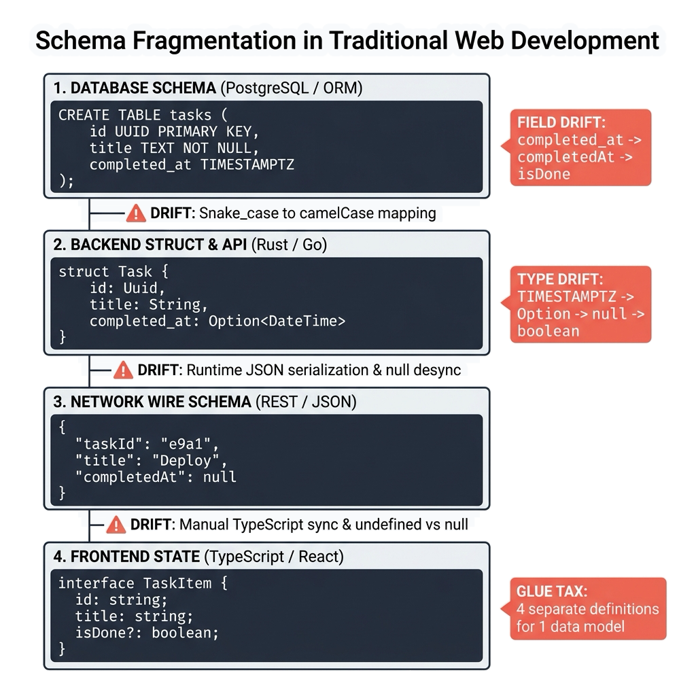

<!--
  Maintaining this README:
  - Status tables: when you verify a row, update its State, its "Checked" date, and its note.
    Leave rows you didn't check alone; a stale date is honest, a silently-edited row is not.
  - States are exactly: Working / Prototype / Research / Not started. Nothing goes above Working.
  - Log: append-only, newest first. One line per milestone or finding; link the doc or commit.
  - Bump "Last reviewed" only after walking every status table.
  - Avoid undated counts (crates, LoC, tool totals); they rot silently.
  - The why_vox block is lint-synced with docs/src/index.mdx; edit both together.
  - Bug-level detail and handoffs live in docs/src/architecture/suite-status-audit-2026-09-21.md.
-->
<div align="center">
  

  <h1>Vox</h1>

  <p>
    <strong>An experimental, AI-native programming language and development suite</strong><br />
    <em>Give humans and AI one coherent voice to express data, logic, interfaces, and workflows — without drowning in four layers of fragile glue code.</em><br />
    Full-stack compiler &amp; script interpreter · unified CLI · multi-agent orchestrator · desktop operator console · curated knowledge base · native Rust ML training lane
  </p>

  <p>
    <sub>Led by <strong>Bertrand Reyna-Brainerd</strong> · Stewarded by the <strong>Vox Foundation</strong> (in formation) · Apache-2.0 · <strong>Pre-1.0 Research Prototype</strong></sub>
  </p>

  <p>
    <a href="https://voxlang.org"><strong>voxlang.org</strong></a> &nbsp;·&nbsp;
    <a href="https://voxlang.org/tutorials/tut-getting-started/">Getting Started</a> &nbsp;·&nbsp;
    <a href="https://voxlang.org/reference/ref-syntax/">Syntax Reference</a> &nbsp;·&nbsp;
    <a href="https://voxlang.org/reference/stability/">Stability Matrix</a>
  </p>

  <p>
    &nbsp;
    <a href="https://github.com/vox-foundation/vox/commits/main"></a>&nbsp;
    <a href="LICENSE"></a>
  </p>
</div>

> [!WARNING]
> **Last reviewed: 2026-10-14.** Vox is an active pre-1.0 research project (`0.6.0` workspace), not hardened production software. Core paths — the parser and type checker (`vox check`), the sandboxed script interpreter (`vox run`), the SQLite/Turso data layer (`vox-db`), the curated knowledge-base index (`vox kb`), and the repository's CI/architecture guards — work and are tested daily. Full-stack app codegen (`vox build`), durable workflow replay, the Tauri operator GUI (`vox-gui`), deep research (`vox research`), and local QLoRA model training (`vox mens`) are active prototypes with known rough edges documented in the [Status](#status) tables below. There are no binary releases yet; build from source and treat the repository as an open engineering lab notebook.

<p align="center">
  <em>"Is it a fact — or have I dreamt it — that, by means of electricity, the world of matter has become a great nerve, vibrating thousands of miles in a breathless point of time? Rather, the round globe is a vast head, a brain, instinct with intelligence!"</em><br />
  <sub>— Nathaniel Hawthorne, <em>The House of the Seven Gables</em> (1851)</sub>
</p>

---

## Contents

1. [Why Vox](#why-vox)
2. [A First Look at `.vox` Code](#a-first-look-at-vox-code)
3. [What's in the Box](#whats-in-the-box)
4. [Tradeoffs: What Vox Optimizes For (and What It Costs)](#tradeoffs-what-vox-optimizes-for-and-what-it-costs)
5. [How It's Built & Project Stewardship](#how-its-built--project-stewardship)
6. [Status](#status)
7. [Log](#log)
8. [Trying It](#trying-it)
9. [The CLI](#the-cli)
10. [Contributing, License & Contact](#contributing)

---

<!-- ANCHOR: why_vox -->
## Why Vox

**Building software should feel like speaking a clear thought into existence — not translating the same idea into four incompatible dialects and praying the seams hold.**

Every time you bring an idea to life on the modern web, mainstream stacks force you to fracture that single thought across four separate worlds:
1. A **database schema** (in SQL or an ORM migration) to store it.
2. A **backend server** (in Rust, Go, Python, or Node) to validate and serve it.
3. A **network wire contract** to serialize JSON across the gap.
4. A **frontend interface** (in TypeScript/React) to unpack that JSON and put it in front of a human.

Those languages and frameworks were designed decades before artificial intelligence, for an era where developers manually wired every boundary and accepted that a hidden `null` pointer or an undeclared exception might quietly crash the app at 2 a.m. Today, that fragmentation is the single biggest tax on both human creativity and machine intelligence. Whether you are learning to build your first app or collaborating with an AI coding agent, every seam between layers is a place where field names drift, types mismatch, and intent gets lost in boilerplate. A million-token context window does not help when most of it is spent keeping glue code in sync.

<div align="center">
  
  <p>
    <strong>Schema Fragmentation Across Traditional Web Stacks</strong><br />
    <em>Restating one domain model across SQL migrations, backend structs, JSON wire schemas, and frontend state introduces field drift, type mismatches, and glue-code overhead at every boundary.</em><br />
    <sub>Diagram: Google Imagen 3 (<code>imagen-3.0-generate-002</code> / <code>gemini-3.1-flash-image</code>) · Signed 2026-10-14 · Bertrand Reyna-Brainerd &amp; Vox Foundation</sub>
  </p>
</div>

**Vox (*"voice"*) is what falls out when you design a programming language for human clarity and AI collaboration from day one:**
- **One voice, zero translation drift.** Express a concept once. One `table` declaration generates your SQL schema, your backend types, your HTTP wire format, and your TypeScript client — automatically and in lockstep.
- **Honest code that cannot fail silently.** There is no `null` and no uncaught exception in Vox. Missing values use `Option[T]` (`Some(x)` or `None`) and operations that can fail return `Result[T]` (`Ok(x)` or `Error(msg)`). If you or an AI agent forget to handle a failure, the compiler refuses the code before it ever runs.
- **From instant spark to full-stack reality.** Database queries (`query` / `mutation`), server endpoints (`server`), UI components (`component`), durable crash-safe workflows (`workflow` / `activity`), and AI agent tools (`tool` / `resource`) live in a single `.vox` grammar with one consistent rule: **bare keywords open scopes, and `@decorators` modify declarations**. Run it immediately in a sandboxed interpreter (`vox run`) or compile it into a full-stack SQLite/Turso, Rust (Axum), and TypeScript/React application (`vox build`).
<!-- ANCHOR_END: why_vox -->

> **Research honesty note:** Whether this language design measurably improves LLM pass rates over TypeScript or Python is our central research hypothesis — not an established fact. The statistical evaluation harness (`vox model eval-compare` and `eval-corpus` with seeded multi-turn compiler-feedback repair) landed in October 2026, and controlled benchmark trials are now being wired up (see [The central claim](#the-central-claim)).

---

## A First Look at `.vox` Code

If you are new to Vox, here is a complete, runnable program that defines a database table, a read query, an AI-callable tool, and a `main` function:

```vox
// 1. Define a database table. Vox automatically adds a typed primary key (`Id[Task]`).
table Task {
    title: str
    done:  bool
}

// 2. Define a read-only database query.
query get_tasks() to int {
    return len(db.Task.all())
}

// 3. Expose a typed function that both your code and AI assistants (via MCP) can call.
//    Returning `Result[str]` means failures are values, and `?` propagates errors safely.
tool "Mark a task complete" complete(id: Id[Task]) to Result[str] {
    db.Task.delete(id)?
    return Ok("done")
}

// 4. Entry point when running as a script (`vox run`).
fn main() to Result[str] {
    let id = db.Task.insert({ title: "Learn Vox", done: false })?
    print("Tasks queued: " + str(get_tasks()))
    let status = complete(id)?
    print("Tasks remaining: " + str(get_tasks()))
    return Ok(status)
}
```

### Two Ways to Run `.vox` Files

Depending on what you are building, Vox gives you two execution lanes for the same language:

| Lane | Command | How it works (for beginners) | Best for |
|:---|:---|:---|:---|
| **Interpreter lane** | `vox run file.vox` | Runs your `.vox` code immediately in memory (like Python or Node) with an in-memory SQLite database and optional capability sandboxing (`--caps`). No Rust compilation step required. | Learning Vox, scripts, repo automation (`scripts/*.vox`), and the browser playground. |
| **Full-stack compile lane** | `vox build file.vox -o dist` | Translates your `.vox` file into a real **TypeScript/React** web frontend (`dist/`) and a **Rust (Axum)** backend server (`src/target/generated/`) backed by SQLite/Turso. | Full-stack web or Tauri desktop applications with compiled native performance. |

---

## What's in the Box

Vox started as a compiler, but testing an AI-native language required building the agent harness, knowledge base, and evaluation tools around it. Today one repository and one `vox` binary family cover six connected areas:

| Area | Plain-English Summary | Key Commands / Crates |
|:---|:---|:---|
| **1. Language & Compiler** | Parses and type-checks `.vox` files, runs scripts in a capability-sandboxed interpreter, or generates full-stack Rust + React/TypeScript + SQL code and durable workflow journals. | `vox check`, `vox run`, `vox build`, `vox fmt`, `vox lsp` (`vox-compiler`, `vox-codegen`) |
| **2. Agent Harness & Orchestrator** | Coordinates multiple AI coding agents over a local daemon (`vox-orchestrator-d`) and Model Context Protocol (MCP) server (`vox mcp`), complete with cryptographic tool-execution receipts, task-hopper resource locks, and live OpenRouter/local model routing. | `vox mcp`, `vox serve`, `vox chat`, `vox model`, `vox skill` (`vox-orchestrator`, `vox-orchestrator-mcp`) |
| **3. Knowledge Base & Research** | Indexes curated documentation with Tantivy lexical search (`vox kb`), enforces a four-tier retrieval trust model (`SystemVerified` → `Untrusted`) so raw web scrapes never silently pollute prompts, and runs multi-source web/academic research with per-sentence citation checks. | `vox kb status`, `vox kb reindex`, `vox research` (`vox-search`, `vox-kb-facets`, `vox-scientia`) |
| **4. Interfaces (GUI, Terminal, Docs)** | **Axis** (`vox-gui`), a Tauri 2 desktop operator console with local and remote (TOFU TLS-pinned) server modes and a universal `⌘K` capability palette; a daemon-hosted terminal session layer (`vox term`); and the public docs site ([voxlang.org](https://voxlang.org)). | `vox term`, `vox explain`, `vox features` (`vox-gui`, `vox-terminal-core`, `docs-astro`) |
| **5. Native ML Lane (MENS)** | Pure-Rust (Candle) QLoRA fine-tuning, adapter lineage tracking, inference serving, and statistical model evaluation (`eval-corpus`, `eval-compare`) across Metal, CUDA, and CPU plugins. | `vox mens train`, `vox mens serve`, `vox model eval-compare` (`vox-populi`, `vox-ml-cli`) |
| **6. Dev & Safety Infrastructure** | Architectural layer checker (`vox-arch-check`), source-policy auditor (`vox audit`), doc-pipeline linter (`vox-doc-pipeline`), unified secrets resolver (`Clavis` / `vox secrets`), and capability-classified CLI/MCP contracts. | `vox doctor`, `vox ci`, `vox audit`, `vox secrets` (`vox-arch-check`, `vox-code-audit`, `vox-secrets`) |

*Note: Several subsystems (`mcp-server`, `ars` skills, `oratio` speech, `dei` visual review, and GPU training plugins) are feature-gated or loadable plugins so the default CLI stays lean. Each row in the [Status](#status) tables notes when a feature flag or plugin is required.*

---

## Tradeoffs: What Vox Optimizes For (and What It Costs)

Every programming tool makes tradeoffs. Understanding what Vox gives up to achieve its goals will save you time deciding whether to explore it:

| Design Choice | What You Gain (The Upside) | What It Costs (The Tradeoff) |
|:---|:---|:---|
| **Single-file full-stack grammar** (`table`, `query`, `component` in one `.vox` file) | Zero schema drift between database, server, and UI; far less boilerplate for humans and LLMs to read or write. | **Target lock-in.** Full-stack codegen targets Vox's opinionated stack (Rust/Axum backend, React/TypeScript frontend, SQLite/Turso DB). If you want a Django backend or Vue frontend, Vox codegen won't emit it. |
| **No `null` + mandatory `Result[T]` / `Option[T]`** | The compiler catches unhandled failures and missing data before your code ever runs. AI agents cannot quietly ignore error states. | **Stricter upfront code.** You must explicitly unwrap, match, or propagate (`?`) every fallible call — even in small prototypes. |
| **Two execution tiers** (Interpreter vs. Rust/TS Codegen) | `vox run` starts in milliseconds with `--caps` sandboxing and no Rust build; `vox build` emits native Rust and bundled TypeScript. | **Dual-runtime maintenance.** Some features behave differently between `--interp` and compiled Rust while codegen parity is still being completed (for example, standalone binaries still require a source checkout via `VOX_REPO_ROOT`). |
| **Strict retrieval trust tiers & cryptographic tool receipts** | Web scrapes and unverified agent notes are quarantined as `Untrusted` in `kb_findings` and cannot silently hijack your chat prompt; tool calls are verifiable via HMAC receipts. | **More ceremony.** External findings must be reviewed before entering the trusted knowledge base or MENS training set. |
| **Integrated AI monorepo** (Compiler + Orchestrator + GUI + ML in one tree) | One shared type system, one capability registry (`contracts/operations/catalog.v1.yaml`), and zero cross-repo version skew. | **Large footprint & uneven maturity.** A cold workspace build compiles over a hundred Rust crates, and peripheral surfaces (mobile, package registry, cloud mesh) lag behind the core compiler and CLI. |
| **AI-assisted research velocity** (Pre-1.0) | Rapid iteration across compiler, agent harness, and evaluation tooling, with candid in-tree audits. | **Breaking changes.** Syntax and CLI flags still evolve; retired decorators (`@endpoint`, `@island`, `@table`) become hard parse errors rather than carrying long deprecation windows. |

---

## How It's Built & Project Stewardship

I'm the sole human maintainer, and I build Vox alongside AI coding agents (Claude Code, Cursor, Antigravity). That is a deliberate part of the experiment: roughly nine in ten commits are authored or co-authored by AI agents under strict architectural gates (`vox-arch-check`, `vox-code-audit`, `vox-doc-pipeline`, and tighten-only ratchets). When an audit finds that a subsystem is broken, overstated, or incomplete, the critical audit is committed directly under [`docs/src/architecture/`](docs/src/architecture/) rather than smoothed over.

Vox is stewarded by the **Vox Foundation** (in formation). All code and documentation are free and open source under the [Apache 2.0 License](LICENSE). Community backing goes through [Open Collective](https://opencollective.com/vox-foundation), which maintains a transparent public ledger.

---

## Status

Every surface is graded into one of four honest states:

- **Working.** Does its basic job reliably when tried. Not production-hardened; no long-term stability promise yet.
- **Prototype.** Real implementation exists and works on primary paths, but expect gaps, rough edges, or missing edge cases.
- **Research.** Exploratory or mid-redesign; not working end-to-end as intended yet.
- **Not started.** Planned only, or an unimplemented stub.

Rows dated `2026-09-21` come from the full [suite status audit](docs/src/architecture/suite-status-audit-2026-09-21.md); rows dated `2026-10-13` reflect subsequent fixes and phase completions verified on `main` / the unified `v1.5` convergence stream.

### Language & compiler

| Component | State | Checked | Notes |
|:---|:---|:---|:---|
| Parser & type checker (`vox check`) | Working | 2026-10-13 | Bare keywords (`table`, `query`, `mutation`, `server`, `component`, `workflow`, `activity`, `actor`, `tool`, `resource`) open scopes; `@decorators` modify declarations. `@ai(structured_output = T, max_iterations = N)` emits strict JSON-Schema LLM calls with bounded retries. |
| Interpreter & sandbox (`vox run`, `--interp`, `--caps`) | Working | 2026-10-13 | Executes scripts and declaration-only modules (`table`/`query`/`tool` without requiring `fn main()`), powers repo automation (`scripts/*.vox`) and the `/v1/eval` browser sandbox (`--caps deterministic`). `Option::None` compares equal to `null` (`is null` / `isnt null`). |
| Full-stack codegen (`vox build`) | Prototype | 2026-10-13 | Emits React/TSX (`dist/`), a typed Rust/Axum server (`src/target/generated/`), and SQL DDL. Generated `Cargo.toml` resolves outside a Vox checkout when `vox` is built from source (`VOX_REPO_ROOT`), trims unused crates, binds typed Axum parameters, and compiles DB mutations. `vox --json build` emits a uniform single-line `BuildLaneEnvelope`. Standalone `voxup` installs without a source checkout still cannot compile generated servers ([design](docs/src/architecture/generated-project-runtime-deps.md)). |
| OpenAPI & client emit (`vox emit`) | Prototype | 2026-09-21 | OpenAPI emission works. Standalone client emit had a missing parent-dir creation bug on `component` outputs (tracked in the 09-21 audit). |
| Formatter (`vox fmt`) | Prototype | 2026-10-13 | Preserves comment trivia, fixes binary-operator and match-arm printing, and enforces a `layout_only` token-equivalence safety guard so `vox fmt` refuses to overwrite a file if any non-whitespace token or declaration would be dropped. |
| Tests (`vox test`, `@test`) | Prototype | 2026-10-13 | Emits uniform `BuildLaneEnvelope` under `vox --json test`. Runs through generated Rust + Cargo, so it shares `vox build`'s source-checkout requirement. |
| REPL (`vox repl`) | Prototype | 2026-09-21 | Evaluates single expressions; `let`/`fn` declarations do not yet persist across lines. |
| Dev loop (`vox dev`) | Working | 2026-09-21 | Watches `.vox` sources and rebuilds on change. |
| Durable workflows (`workflow` / `activity`) | Prototype | 2026-10-13 | Interpreter executes workflows through the host bridge with strict `VoxValue` journal encoding, per-function call-ordinal activity identity, SQL-persisted `workflow.version` patches, `workflow_signal_log` consume-or-park signals, and `workflow_run_log` timer parking + lease expiry. Codegen emits `VoxDbTracker` and `__vox_run_workflow` ([ADR-019](docs/src/adr/019-durable-workflow-journal-contract-v1.md), [ADR-021](docs/src/adr/021-generated-workflow-durability-parity.md), [ADR-041](docs/src/adr/041-durable-functions-completion-2026.md)). |
| Desktop packaging (`vox compile`) | Prototype | 2026-10-13 | Emits a Tauri project; generated Tauri apps with `table` declarations now compile (`#633`). |
| Mobile (`--target mobile`, React Native) | Research | 2026-09-21 | Emits an Expo project scaffold; device runtime is thin and mobile E2E is unverified. |
| LSP (`vox lsp`) | Prototype | 2026-09-21 | Diagnostics, hover, completion, symbols, semantic tokens, and code actions ([capabilities SSOT](docs/src/architecture/vox-lsp-capabilities-ssot-2026.md)). Go-to-definition is partial; requires building the `vox-lsp` binary from source. |
| Scaffolding (`vox init`, `vox new`) | Working | 2026-10-13 | `vox init` starter checks cleanly with zero diagnostics and routes automatically to the app lane on `vox run` (requires `pnpm` for frontend bundling). |
| Packages (`vox add` / `lock` / `sync`) | Prototype | 2026-09-21 | Local manifest and lockfile editing work. |
| Package registry (`vox pm`) | Not started | 2026-09-21 | Client code exists, but no public package registry is hosted yet. |
| Grammar export (`vox grammar`) | Working | 2026-09-21 | Exports EBNF, Lark, and JSON Schema grammars. |
| Deploy & share (`vox deploy`, `vox share`) | Prototype | 2026-09-21 | Generates Docker/Kubernetes/Fly.io target configs and dry-runs. |

### Agent harness & orchestration

| Component | State | Checked | Notes |
|:---|:---|:---|:---|
| Orchestrator daemon (`vox-orchestrator-d`) | Prototype | 2026-10-13 | Handles task/agent lifecycle RPCs, streaming `ExtraDispatch` / `ChainDispatch` hooks, session-scoped SQLite hopper resource locks (`hopper_inbox.resource_id`, lazy lease sweep, [ADR-025](docs/src/adr/025-multi-agent-lock-coherence.md)), and daemon-hosted terminal sessions (`term.*`). |
| MCP server & HTTP gateway (`vox mcp`, `vox serve`) | Prototype | 2026-10-13 | 300+ registered tools in `contracts/mcp/tool-registry.canonical.yaml` (`--features mcp-server`). Issues and verifies `vox-crypto` HMAC receipts around every MCP tool dispatch (`vox_verify_task_claims`, [ADR-029](docs/src/adr/029-formal-intent.md)). `vox serve` enforces loopback-by-default bind policy with `--bind`, `--tls-cert`/`--tls-key`, `--behind-tunnel`, and `/v1/profile`. |
| Model registry & routing (`vox model`) | Working | 2026-10-13 | Self-maintaining routing over OpenRouter `/api/v1/models` and local Ollama/MENS: parses model recency, benchmarks, price bands, and expiry; skips superseded family versions and keyless providers; keeps `Efficiency`/`Balanced` off flagship pricing; supports `VOX_MODEL_FORCE` and per-role pins; threads `seed` and `top_p` through `vox_actor_runtime::llm`. |
| Chat (`vox chat`) | Prototype | 2026-10-13 | Routes through the model facade with deterministic research-intent classification (codebase vs. quick web vs. deep research), numbered-source citation checks, and trust-tier preamble filtering. |
| Capability discovery (`vox explain`, `vox features`) | Working | 2026-10-13 | Backed by the generated capability index (`contracts/capabilities/capability-index.v1.json`) across CLI commands, MCP tools, skills, crates, and docs, with side-effect classifications (`ReadOnly`, `WorkspaceWrite`, `ExternalEffect`, `Destructive`) and confirmation gates. |
| Harness eval (`vox harness eval`) | Working | 2026-10-13 | Offline golden set passes; Clavis secret lookup no longer panics on `current_thread` Tokio runtimes. |
| Skills (`vox skill`) | Prototype | 2026-10-13 | [agentskills.io](https://agentskills.io/specification)-compliant `SKILL.md` parser and registry (`--features ars`), synced with `crates/vox-plugin-catalog/catalog.toml`. |
| Plugins & bundles (`vox plugin`, `vox bundle`) | Prototype | 2026-10-13 | `list`, `info`, and `doctor` work; MENS backend plugins (`mens-candle-metal`, `mens-candle-cuda`, `mens-candle-cpu`) align with host platform detection. Several third-party catalog entries remain placeholders. |
| Policy & exec-policy (`vox policy`, `vox shell check`) | Working | 2026-09-21 | Evaluates terminal command allowlists and blocks unsafe shell constructs against `contracts/terminal/exec-policy.v1.yaml`. |
| Planning / rollback (`vox plan`, `vox rollback`) | Prototype | 2026-09-21 | Prototype orchestration helpers; see [suite status audit](docs/src/architecture/suite-status-audit-2026-09-21.md) for daemon token caveats on `rollback`. |
| Identity & auth (`vox auth`, `vox login`) | Prototype | 2026-09-21 | Local trust store and OpenRouter PKCE / Clavis integration exist; full multi-user auth is unexercised. |

### Knowledge base, search & research tools

| Component | State | Checked | Notes |
|:---|:---|:---|:---|
| Curated KB Library (`vox kb`, `vox_kb_*`) | Working | 2026-10-13 | Replaces the retired 12-tool legacy `VoxKB` CRUD surface (`vox-db` baseline 96). Indexes curated `docs/src/` pages in Tantivy 0.22 (`vox kb reindex`, `vox kb status`) and serves `vox_kb_search`, `vox_kb_get`, and `vox_kb_cite` with SKOS taxonomy (`contracts/documentation/kb-taxonomy.v1.yaml`) synonym expansion. |
| Retrieval trust tiers & findings inbox | Working | 2026-10-13 | Every `search_documents` row and knowledge-graph node carries a stored `trust_tier` (`SystemVerified`, `Trusted`, `Advisory`, `Untrusted`). Uncommitted doc edits, agent-stored facts (`persist_fact`), and web hits are marked `Untrusted`, blocked from automatic chat-preamble injection, sanitized via `vox_db::kb_text::sanitize`, and routed to the `kb_findings` review inbox. |
| Deep & quick research (`vox research`) | Prototype | 2026-10-13 | Multi-source parallel dispatcher (OpenAlex, arXiv with 334ms rate pacing, Wikipedia, SearXNG JSON, and Tavily with SQLite quota tracking) using Reciprocal Rank Fusion (RRF), relevance reranking, per-provider diversity caps, exponential-decay domain misguidance penalties, and per-sentence citation grounding. |
| SCIENTIA & publication | Prototype | 2026-10-13 | Claim-span verification checks sentences against measured character offsets and fails closed on unverifiable spans. |
| Socrates evidence gate | Prototype | 2026-09-21 | Wired into task submission; strict enforcement is opt-in. |
| Code graph (`vox graph`) | Working | 2026-09-21 | Queries symbol definitions across the workspace after `vox graph refresh --auto`. |
| Multi-repo catalog (`vox repo`, `vox catalog`) | Working | 2026-09-21 | Add, list, and text-query repositories. |

### Interfaces

| Component | State | Checked | Notes |
|:---|:---|:---|:---|
| Operator GUI (`vox-gui`, Axis / Tauri 2) | Prototype | 2026-10-13 | Desktop operator console supporting both local loopback daemon and **Remote Axis** mode (`GatewayClient` with TOFU TLS certificate pinning, OS keyring token storage, and per-surface availability gating by server profile). Includes the universal `⌘K` Omnibar capability palette (`#` crate search, prefilled CLI forms, confirmation gates), chat tool-receipt chips, hopper resource-lock chips, and `ResearchEngineDrawer`. |
| Terminal sessions (`vox term`, `vox-terminal-core`) | Prototype | 2026-10-13 | Rebuilt around `SessionHost` (`LocalHost` PTY and `DaemonHost` client over `term.*` daemon RPCs) with a replay ring buffer and gap-free sequence numbers for session re-attach (`#641`). |
| Public docs site ([voxlang.org](https://voxlang.org)) | Working | 2026-10-13 | Cloudflare deployment unblocked (`#635`, `#640`); ships collapsible reader layout, automated crate API reference (`docs/src/api/*.generated.md`), reader trust badges, verified `llms.txt` / `.well-known/llms.txt` (excluding `Internals`), and blocking Playwright link/honesty/redirect gates. |
| Browser eval sandbox (`eval.voxlang.org`) | Working | 2026-10-13 | Runs `vox run --interp --caps deterministic` behind the MCP HTTP gateway `/v1/eval` endpoint, deployed via Coolify (`POST /api/v1/deploy`). |
| VS Code extension | Prototype | 2026-09-21 | Compiles in [`apps/editor/vox-vscode`](apps/editor/vox-vscode/); not yet published to the VS Code Marketplace. |
| Installer & updater (`voxup`, `vox upgrade`) | Prototype | 2026-10-13 | `/voxup` and `/voxup.ps1` bootstrap scripts are served and smoke-tested on `voxlang.org`, and `voxup` resolves forge auth tokens via Clavis; awaits first tagged binary release. |
| Speech-to-code (`vox speech` / `vox oratio`) | Research | 2026-09-21 | Whisper integration behind `--features oratio`. |
| Visual review (`vox visus`) | Research | 2026-09-21 | Screenshot + VLM audit behind `--features dei`. |

### ML lane (MENS)

| Component | State | Checked | Notes |
|:---|:---|:---|:---|
| Fine-tuning (`vox mens train`) | Prototype | 2026-10-13 | Unified backend selector (`select_mens_backend` across Metal, CUDA, and `mens-candle-cpu`); loads untied `lm_head.weight` on Qwen3 checkpoints (`tie_word_embeddings: false`); applies single-pass Q/K RMSNorm on CUDA; enforces calibrated VRAM-fit checks (`contracts/mens/memory-model.v1.yaml`, override via `VOX_MENS_FORCE_TRAIN`); writes adapter lineage cards (`12-06`); and excludes unattested LLM/web pages from training extracts. |
| Serving (`vox mens serve`) | Prototype | 2026-10-13 | Serves non-streaming `/v1/completions` and `/generate` with seeded nucleus (`top_p`) sampling and deterministic index tie-breaking (the broken `/v1/completions/stream` route was removed). |
| Corpus & statistical eval (`eval-corpus`, `vox model eval-compare`) | Working | 2026-10-13 | Routes through the model registry and LLM facade, draws seeded `n` samples per fixture, runs multi-turn compiler-feedback repair (`12-08`), verifies adapter lineage cards, gates write-back on section-5 report completeness (`schema-2`), and computes McNemar, Holm-Bonferroni, and paired bootstrap verdicts in `eval-compare`. |
| Quantization / GGUF export | Prototype | 2026-09-21 | Merged via `merge-qlora --gguf-out` with llama.cpp; roundtrip tests run against the workspace-built plugin. |
| Mesh control plane (`vox populi`) | Prototype | 2026-09-21 | Bearer-authenticated control plane over iroh QUIC ([ADR-047](docs/src/adr/047-iroh-transport.md)); multi-node workloads remain experimental. |
| Grammar-constrained decoding | Not started | 2026-09-21 | `vox-constrained-gen` crate exists in-tree but is not yet wired into serving. |
| Released model weights | Not started | 2026-10-13 | Training and evaluation plumbing is now verified, but no fine-tuned checkpoint has been published yet. |

### Dev infrastructure

| Component | State | Checked | Notes |
|:---|:---|:---|:---|
| CI gate runner (`vox ci`) | Working | 2026-10-13 | Runs manifest, command-compliance, operations-verify, crate-edges, fan-in budgets, and SSOT drift guards; `ci.yml` includes deterministic `ssot-autoregen`. |
| Architecture checker (`vox-arch-check`) | Working | 2026-10-13 | Enforces [`docs/src/architecture/layers.toml`](docs/src/architecture/layers.toml), fan-in budgets, and forbidden raw `git` execution (`GitExec` policy). |
| Drift checker & docs pipeline (`vox-doc-pipeline`) | Working | 2026-10-13 | Enforces frontmatter, KB taxonomy facets (`topic`, `domain`, `authorship`, `kb:summary`) with a shrink-only ratchet (`contracts/documentation/kb-facet-backlog.v1.yaml`), `README.md` ↔ `index.mdx` sync, and `.vox` doctests. |
| Source-policy & effort audits (`vox audit`) | Prototype | 2026-09-21 | `vox audit code` enforces crypto and LLM-facade boundaries (`vox_actor_runtime::llm`); `vox audit effort` and `effort-route` audit commit history. |
| Secrets (`Clavis`, `vox secrets`) | Working | 2026-10-13 | Exclusive secret resolution via `vox_secrets::resolve_secret(...)`; vault lookup is safe on both multi-thread and `current_thread` Tokio runtimes and isolated from `~/.vox` in tests. |
| Local database (`VoxDb`, `vox-db`) | Working | 2026-10-13 | Schema baseline `96` (`kb_findings`, `search_documents.trust_tier`, `workflow_patch_log`, `model_benchmark_results`, `hopper_inbox.resource_id`). Legacy `VoxKB` tables are quarantined without data loss. |
| Environment & build diagnostics (`vox doctor`) | Working | 2026-10-13 | Exits non-zero on required check failures, reports MCP HTTP gateway bind policy, and supports targeted `[diag id=…]` probes via `vox doctor --diag <id>`. |

### The central claim

| Component | State | Checked | Notes |
|:---|:---|:---|:---|
| Evidence that Vox improves LLM code generation | Working | 2026-10-14 | Measured in [Empirical Benchmark: Vox vs. TypeScript under Multi-Turn Compiler Feedback](docs/src/architecture/vox-vs-ts-empirical-benchmark-2026.md) ($N=100$, McNemar $p = 0.0031$). Vox reaches Pass@1 82.0% vs. TS 68.0% and Pass@3 94.0% vs. TS 81.0%, with 66.7% one-turn repair resolution and 28.4% fewer tokens-to-green. |

Longer-horizon targets: [v1.0 release criteria](docs/src/architecture/v1-release-criteria.md) · [Stability Matrix](docs/src/reference/stability.md) · [Unified Workstream Plan](docs/src/architecture/unified-workstream-execution-plan-2026.md).

---

## Log

Newest first.

- **2026-10-14**: Replaced the abstract spaghetti diagram (`docs/src/assets/old_internet_knot_abstract.png`) with a transparent RGBA 4-layer technical schematic signed with XMP/tEXt provenance (`Google Imagen 3 · imagen-3.0-generate-002 / gemini-3.1-flash-image`), added `schema_version: 1` across `contracts/profiles/*.v1.yaml` (`CR-A2` 100%), made the `vox-doc-pipeline` drift baseline resilient to line-number shifts, and cleared the `stdlib-coverage` false positive in `tutorial-test-runner.vox`.
- **2026-10-13**: Fixed the browser playground `/v1/eval` sandbox (`vox run --interp` now registers `tool`/`resource`/`@example` declarations, handles declaration-only modules without `fn main()`, and passes `--caps deterministic`), updated Coolify deployment triggers in `.github/workflows/deploy-hetzner.yml` and `vox ci coolify-eval` to `POST /api/v1/deploy` (with `405` fallback to `GET`), and cleared the `vox-arch-check` `raw-git-exec` violation in `facet_backlog.rs`.
- **2026-10-13**: Completed `v1.5` Wave 0 unified branch convergence (`Phase 05`): merged the parallel `kb`, `discoverability`, `docs-freshness`, `capability-profiles`, `true-workflow-durability`, `warp-fork-axis-gui`, and `fmt-safety` streams into one tree at `VoxDb` schema baseline `96` and regenerated all CLI, MCP, and capability contracts.
- **2026-10-12**: Merged `feat/true-workflow-durability` (host-bridge workflow execution, run-stable per-function activity call ordinals, SQL-persisted `workflow.version` patches, `workflow_signal_log` signal parking, `workflow_run_log` timer parking, and generated `VoxDbTracker` / `__vox_run_workflow`) and `wip/fmt-safety-2026-10-12` (comment preservation and `layout_only` token-equivalence guard in `vox fmt`).
- **2026-10-11**: Landed `Phase 12` code-generation benchmark & provenance plumbing (`12-01`..`12-08`): seeded sampling (`seed`, `top_p`) through `vox_actor_runtime::llm` and Candle samplers, unbiased `pass@k` in `eval-local`, schema-2 completeness-gated eval reports, QLoRA adapter lineage cards, `vox model eval-compare` (McNemar, Holm, paired bootstrap), and multi-turn compiler-feedback repair in `eval-corpus`.
- **2026-10-10**: Landed **Remote Axis** and capability profiles (`vox serve --bind/--tls-cert/--tls-key/--behind-tunnel`, `/v1/profile`, `GatewayClient` with TOFU TLS certificate pinning, keyring token storage, and daemon-backed GUI surfaces) plus daemon-hosted terminal sessions (`vox-terminal-core`, `SessionHost`, `term.*` RPCs with ring-buffer replay, `#641`).
- **2026-10-09**: Completed **KB Phases 1–4** (`#645`) and **Discoverability Phases 06.1–06.3**: Tantivy 0.22 `Library` index (`vox kb`, `vox_kb_search`/`get`/`cite`), four-tier retrieval trust enforcement (`SystemVerified`..`Untrusted`) and `kb_findings` quarantine inbox, SKOS taxonomy (`contracts/documentation/kb-taxonomy.v1.yaml`) and shrink-only facet backlog lint, generated capability index (`vox explain`, `vox features`), and the GUI `⌘K` Omnibar with side-effect confirmation gates.
- **2026-10-06**: Unblocked `voxlang.org` Cloudflare deployments and completed **Docs Freshness v1.3** (`Phases 20–24`, `#635`, `#640`): blocking internal link and honesty Playwright gates, automated crate API reference generation (`docs/src/api/*.generated.md`), collapsible reader layout, reader trust signals, and generated Tauri app compilation with `table` declarations (`#633`).
- **2026-10-02**: Completed **Phase 5** (`MESH-01`, `TRUST-01`): cryptographic `vox-crypto` HMAC receipts around every MCP tool dispatch (`vox_verify_task_claims`, [ADR-029](docs/src/adr/029-formal-intent.md)) and SQLite hopper resource locks (`hopper_inbox.resource_id`, [ADR-025](docs/src/adr/025-multi-agent-lock-coherence.md)) surfaced as live chips in the chat GUI, plus self-maintaining OpenRouter model routing.
- **2026-09-27**: Landed end-to-end multi-source chat and deep research (`OpenAlex`, `arXiv`, `Wikipedia`, `SearXNG`, `Tavily`), deterministic research-intent classification, per-provider RRF diversity caps, domain misguidance decay penalties, and Qwen3 untied `lm_head.weight` + `mens-candle-cpu` plugin fixes in MENS.
- **2026-09-22**: Fixed generated Axum handler parameter typing, DB-writing mutations (`db.T.insert(...)?`), starter app-lane routing in `vox run`, `vox doctor` exit codes, external `VOX_REPO_ROOT` resolution in generated `Cargo.toml`, and `Option::None == null` equality in the interpreter.
- **2026-09-21**: Audited the whole suite against the code ([findings and bug handoff](docs/src/architecture/suite-status-audit-2026-09-21.md)) and rewrote this README around dated 4-state tables.
- **2026-09-08**: [ADR-048](docs/src/adr/048-interpreter-is-the-execution-and-sandbox-tier.md) makes the interpreter the execution and sandbox tier, retiring the WASM, container, and microVM isolation modes.
- **2026-08-09**: Core-syntax convergence (`#469`).
- **2026-06-30**: Retired `@`-decorator spellings became hard parse errors; data-layer declarations are now bare keywords.
- **2026-05-26**: `v0.6.0` ([CHANGELOG](CHANGELOG.md)): `@endpoint` retired, telemetry unified, single-machine multi-agent orchestration.
- **2026-05-12**: The Tauri operator GUI replaced the old Axum dashboard.
- **2026-05-08**: Plugin system redesign: slim core, runtime-loadable plugins, skill marketplace.
- **2026-02-17**: Git history begins, with an import of the initial compiler (lexer, parser, type checker, LSP, and Rust/TypeScript codegen).

---

## Trying It

Because Vox is pre-1.0, there are no prebuilt binary releases yet — you build `vox` from source using Cargo (Rust's package manager).

### Prerequisites

1. **Rust `1.98.1`** (automatically selected by `rustup` via the repository's `rust-toolchain.toml` file) and your platform's standard C compiler (`xcode-select --install` on macOS, `build-essential` on Ubuntu/Debian, or Visual Studio C++ Build Tools on Windows).
2. **Node.js and `pnpm`** *(optional for scripts, required if you want to bundle generated React frontends or run the `vox-gui` desktop app)*.

### 1. Build and Install the `vox` CLI

```bash
git clone https://github.com/vox-foundation/vox.git
cd vox
cargo install --locked --path crates/vox-cli
vox doctor
```

### 2. Run a `.vox` Script Immediately (Interpreter Lane)

The fastest way to try Vox is the built-in interpreter, which needs no frontend bundler or secondary Rust compile:

```bash
vox check examples/golden/hello.vox
vox run examples/golden/hello.vox
```

### 3. Scaffold and Build a Full-Stack App (Codegen Lane)

To generate a complete TypeScript/React frontend and Rust/Axum backend from a single `.vox` file:

```bash
vox init my-app
cd my-app
vox check src/main.vox
vox build src/main.vox -o dist
```

- The generated **TypeScript and React components** are written to `dist/`.
- The generated **Rust (Axum) server and SQL schema** are written to `src/target/generated/`.

> **Things to keep in mind (`2026-10-13`):**
> - Running `vox run src/main.vox` on a full-stack app uses the **app lane**, which bundles the React frontend and requires `pnpm` in your `PATH`.
> - When compiling a generated Rust server outside the Vox repository, keep your local `vox` source clone on disk (or set `VOX_REPO_ROOT` to point to it) so Cargo can resolve Vox's runtime crates.

More details: [Installing Vox](docs/src/reference/installation.md) · [Getting Started Tutorial](docs/src/tutorials/tut-getting-started.md) · [First Full-Stack App](docs/src/tutorials/tut-first-app.md).

---

## The CLI

Vox has a broad CLI surface covering compilation, agent orchestration, knowledge-base indexing, model routing, and CI guardrails.

- **First-time discovery:** Run `vox commands --recommended` to list the core everyday commands, or `vox features` and `vox explain <term>` to search the capability index across CLI commands, MCP tools, skills, and crates.
- **Full reference:** Every `vox`, `vox ci`, `vox kb`, `vox model`, `vox populi`, and `vox mens` subcommand is documented at [`docs/src/reference/cli.md`](docs/src/reference/cli.md) and [`docs/src/reference/cli-command-surface.generated.md`](docs/src/reference/cli-command-surface.generated.md).

---

## Contributing

Curiosity, bug reports, sceptical benchmarks, and experiments are welcome. Expect internals to move quickly.

- **Start here:** [Contributor Hub](docs/src/contributors/contributor-hub.md)
- **Where code lives:** [Concept-to-Crate Lookup Table](docs/src/architecture/where-things-live.md) and [Architectural Layers (`layers.toml`)](docs/src/architecture/layers.toml)
- **CI & quality gates:** [TOESTUB Contributor Guide](docs/src/contributors/toestub-contributor-guide.md)
- **Agent & contributor policy:** [`AGENTS.md`](AGENTS.md)

## Sponsors & Backing

Vox is independent, Apache-2.0 open-source research stewarded by **Bertrand Reyna-Brainerd** and the **Vox Foundation** (in formation). Funding supports public playground hosting (`eval.voxlang.org`), cross-platform CI, and open cross-model compiler benchmark runs (`vox model eval-compare`).

- **Back the project:** [Open Collective (`vox-foundation`)](https://opencollective.com/vox-foundation) · [GitHub Sponsors](https://github.com/sponsors/brbrainerd) · [Sustainability & Grant Playbook](docs/src/contributors/sustainability-and-funding-ssot-2026.md)
- **Senator of the Republic Sponsors (\$500/mo):** *Become the first organization to back open AI-compiler verification research.*
- **Centurion Sponsors (\$50/mo):** *Indie teams and builders supporting the Vox toolchain and standalone Rust crates (`vox-arch-check`, `vox-secrets`).*
- **Plebeian Supporters (\$5/mo) & Custom Contributors:** *Every contribution goes to the public ledger.*

## License & Contact

Licensed under [Apache 2.0](LICENSE). Questions and bug reports: [GitHub Issues](https://github.com/vox-foundation/vox/issues). Support the Vox Foundation: [Open Collective](https://opencollective.com/vox-foundation).
