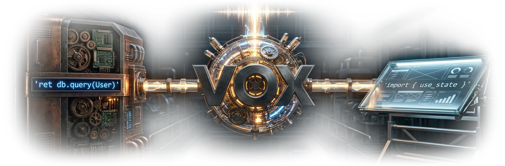

<!--
  Maintaining this README:
  - Status tables: when you verify a row, update its State, its "Checked" date, and its note.
    Leave rows you didn't check alone; a stale date is honest, a silently-edited row is not.
  - States are exactly: Working / Prototype / Research / Not started. Nothing goes above Working.
  - Log: append-only, newest first. One line per milestone or finding; link the doc or commit.
  - Bump "Last reviewed" only after walking every status table.
  - Avoid undated counts (crates, LoC, tool totals); they rot silently.
  - The why_vox block is lint-synced with docs/src/index.mdx; edit both together.
  - Bug-level detail and handoffs live in docs/src/architecture/suite-status-audit-2026-09-21.md.
-->
<div align="center">
  

  <p>
    <strong>An experimental programming language and development suite</strong><br />
    <em>One <code>.vox</code> file can declare data, server logic, UI, and agent tools.</em><br />
    Compiler and script interpreter · CLI · multi-agent orchestrator · desktop console · knowledge-base index · Rust ML training lane
  </p>

  <p>
    <sub>Led by <strong>Bertrand Reyna-Brainerd</strong> · Stewarded by the <strong>Vox Foundation</strong> (in formation) · Apache-2.0 · <strong>Pre-1.0 Research Prototype</strong></sub>
  </p>

  <p>
    <a href="https://voxlang.org"><strong>voxlang.org</strong></a> &nbsp;·&nbsp;
    <a href="https://voxlang.org/tutorials/tut-getting-started/">Getting Started</a> &nbsp;·&nbsp;
    <a href="https://voxlang.org/reference/ref-syntax/">Syntax Reference</a> &nbsp;·&nbsp;
    <a href="https://voxlang.org/reference/stability/">Stability Matrix</a>
  </p>

  <p>
    &nbsp;
    <a href="https://github.com/vox-foundation/vox/commits/main"></a>&nbsp;
    <a href="LICENSE"></a>
  </p>
</div>

> [!WARNING]
> **Last reviewed: 2026-11-02.** Vox is an active pre-1.0 research project (`0.6.0` workspace), not production software. Core paths — the parser and type checker (`vox check`), the sandboxed script interpreter (`vox run`), the SQLite/Turso data layer (`vox-db`, schema baseline 97), the curated knowledge-base index (`vox kb`), and the repository's CI and architecture guards — work and are tested on `main`. Full-stack codegen (`vox build`), durable workflow replay, the Tauri operator GUI (`vox-gui`), deep research (`vox research`), and local QLoRA training (`vox mens`) are prototypes. Limits are in the [Status](#status) tables. Public Qwen3 adapters are on Hugging Face ([ML lane](#ml-lane-mens)). There is no stable release tag. Build from source. Draft nightly tags are not the supported install.

<div align="center">
  
</div>
<p align="center">
  <em>"Is it a fact — or have I dreamt it — that, by means of electricity, the world of matter has become a great nerve, vibrating thousands of miles in a breathless point of time? Rather, the round globe is a vast head, a brain, instinct with intelligence!"</em><br />
  <sub>— Nathaniel Hawthorne, <em>The House of the Seven Gables</em> (1851)</sub>
</p>

---

## Contents

1. [Why Vox](#why-vox)
2. [A First Look at `.vox` Code](#a-first-look-at-vox-code)
3. [What this repository contains](#what-this-repository-contains)
4. [Tradeoffs: What Vox Optimizes For (and What It Costs)](#tradeoffs-what-vox-optimizes-for-and-what-it-costs)
5. [How It's Built & Project Stewardship](#how-its-built--project-stewardship)
6. [Status](#status)
7. [Log](#log)
8. [Trying It](#trying-it)
9. [The CLI](#the-cli)
10. [Contributing, License & Contact](#contributing)

---

<!-- ANCHOR: why_vox -->
## Why Vox

A typical web app restates one domain model in four places:

1. A **database schema** (SQL or an ORM migration).
2. A **backend** (Rust, Go, Python, or Node) that validates and serves it.
3. A **wire contract**, usually JSON.
4. A **frontend** (TypeScript/React) that reads that JSON.

Names and types can drift at each boundary. People and coding agents both spend time keeping the copies aligned.

<div align="center">
  
  <p>
    <strong>One field, written four times</strong><br />
    <em>completed_at, completedAt, and isDone are the same fact. Each boundary renames it or changes its type. A Vox table states it once, and every layer keeps that name and type.</em>
  </p>
</div>

These are the choices that follow from that, and what each one buys.

**One declaration, projected.** A second schema, written by hand, drifts, and an agent copying it drifts the same way. A `table` is the source. SQL, the server types, the JSON shape, and the TypeScript client are generated from it. `vox build` emits SQLite/Turso, Rust (Axum), and React/TypeScript, because one stack is what the tests can actually cover. Django, Vue, and other frameworks are outside that path.

**Missing values and failures are typed.** Generated code skips a failure it cannot see. `Option[T]` is `Some(x)` or `None`. `Result[T]` is `Ok(x)` or `Error(msg)`. Code that ignores either case does not type-check. `?` returns the error to the caller.

**Ids are typed.** A task id and a user id are different facts. A boundary takes `Id[Task]` rather than a bare string, so the two cannot be swapped.

**Keywords open scopes. Decorators modify them.** `table`, `query`, `mutation`, `server`, `component`, `workflow`, `activity`, `tool`, and `resource` each open a scope. `@auth`, `@pure`, `@durable`, and `@uses` change how a declaration runs. One spelling means people and agents copy the same form. A new behavior is a decorator, so the keyword list stays stable.

**The same file runs now, or compiles.** Scripts, repo automation, and the browser playground should start without a Rust build. A shipped app should be ordinary Rust and TypeScript. `vox run` interprets the file. `--caps` is the list of effects the host grants (filesystem, network, and the rest). `vox build` emits the database, the server, and the client from that same file. The two executors are still being matched, and a generated server build needs a Vox source checkout (`VOX_REPO_ROOT`).

**A tool is a function in the same file.** An agent tool kept in a side schema drifts like a hand-written JSON contract. `tool` is a typed function plus a short description. The program and an MCP client call that declaration, and a failure comes back as `Result`.
<!-- ANCHOR_END: why_vox -->

> Measured comparison with TypeScript: [The central claim](#the-central-claim). The harness is `vox model eval-compare` and `eval-corpus`.

---

## A First Look at `.vox` Code

If you are new to Vox, here is a complete, runnable program that defines a database table, a read query, an AI-callable tool, and a `main` function:

```vox
// 1. Define a database table. Vox automatically adds a typed primary key (`Id[Task]`).
table Task {
    title: str
    done:  bool
}

// 2. Define a read-only database query.
query get_tasks() to int {
    return len(db.Task.all())
}

// 3. Expose a typed function that both your code and AI assistants (via MCP) can call.
//    Returning `Result[str]` means failures are values, and `?` propagates errors safely.
tool "Mark a task complete" complete(id: Id[Task]) to Result[str] {
    db.Task.delete(id)?
    return Ok("done")
}

// 4. Entry point when running as a script (`vox run`).
fn main() to Result[str] {
    let id = db.Task.insert({ title: "Learn Vox", done: false })?
    print("Tasks queued: " + str(get_tasks()))
    let status = complete(id)?
    print("Tasks remaining: " + str(get_tasks()))
    return Ok(status)
}
```

### Two Ways to Run `.vox` Files

Depending on what you are building, Vox gives you two execution lanes for the same language:

| Lane | Command | How it works (for beginners) | Best for |
|:---|:---|:---|:---|
| **Interpreter lane** | `vox run file.vox` | Runs your `.vox` code immediately in memory (like Python or Node) with an in-memory SQLite database and optional capability sandboxing (`--caps`). No Rust compilation step required. | Learning Vox, scripts, repo automation (`scripts/*.vox`), and the browser playground. |
| **Full-stack compile lane** | `vox build file.vox -o dist` | Translates your `.vox` file into a real **TypeScript/React** web frontend (`dist/`) and a **Rust (Axum)** backend server (`src/target/generated/`) backed by SQLite/Turso. | Full-stack web or Tauri desktop applications with compiled native performance. |

---

## What this repository contains

Vox started as a compiler, but testing an AI-native language required building the agent harness, knowledge base, and evaluation tools around it. Today one repository and one `vox` binary family cover six connected areas:

| Area | Plain-English Summary | Key Commands / Crates |
|:---|:---|:---|
| **1. Language & Compiler** | Parses and type-checks `.vox` files, runs scripts in a capability-sandboxed interpreter, or generates full-stack Rust + React/TypeScript + SQL code and durable workflow journals. | `vox check`, `vox run`, `vox build`, `vox fmt`, `vox lsp` (`vox-compiler`, `vox-codegen`) |
| **2. Agent Harness & Orchestrator** | Coordinates multiple AI coding agents over a local daemon (`vox-orchestrator-d`) and Model Context Protocol (MCP) server (`vox mcp`), complete with cryptographic tool-execution receipts, task-hopper resource locks, and live OpenRouter/local model routing. | `vox mcp`, `vox serve`, `vox chat`, `vox model`, `vox skill` (`vox-orchestrator`, `vox-orchestrator-mcp`) |
| **3. Knowledge Base & Research** | Indexes curated documentation with Tantivy lexical search (`vox kb`), enforces a four-tier retrieval trust model (`SystemVerified` → `Untrusted`) so raw web scrapes never silently pollute prompts, and runs multi-source web/academic research with per-sentence citation checks. | `vox kb status`, `vox kb reindex`, `vox research` (`vox-search`, `vox-kb-facets`, `vox-scientia`) |
| **4. Interfaces (GUI, Terminal, Docs)** | **Axis** (`vox-gui`), a Tauri 2 desktop operator console with local and remote (TOFU TLS-pinned) server modes and a universal `⌘K` capability palette; a daemon-hosted terminal session layer (`vox term`); and the public docs site ([voxlang.org](https://voxlang.org)). | `vox term`, `vox explain`, `vox features` (`vox-gui`, `vox-terminal-core`, `docs-astro`) |
| **5. Native ML Lane (MENS)** | Pure-Rust (Candle) QLoRA fine-tuning, adapter lineage tracking, inference serving, and statistical model evaluation (`eval-corpus`, `eval-compare`) across Metal, CUDA, and CPU plugins. Public adapters are listed under [ML lane](#ml-lane-mens). | `vox mens train`, `vox mens serve`, `vox model eval-compare` (`vox-populi`, `vox-ml-cli`) |
| **6. Dev & Safety Infrastructure** | Architectural layer checker (`vox-arch-check`), source-policy auditor (`vox audit`), doc-pipeline linter (`vox-doc-pipeline`), unified secrets resolver (`Clavis` / `vox secrets`), and capability-classified CLI/MCP contracts. | `vox doctor`, `vox ci`, `vox audit`, `vox secrets` (`vox-arch-check`, `vox-code-audit`, `vox-secrets`) |

*Note: Several subsystems (`mcp-server`, `ars` skills, `oratio` speech, `dei` visual review, and GPU training plugins) are feature-gated or loadable plugins so the default CLI stays lean. Each row in the [Status](#status) tables notes when a feature flag or plugin is required.*

---

## Tradeoffs: What Vox Optimizes For (and What It Costs)

The reasons and the benefits are in [Why Vox](#why-vox). This table is the cost of each choice:

| Design Choice | What You Gain (The Upside) | What It Costs (The Tradeoff) |
|:---|:---|:---|
| **Single-file full-stack grammar** (`table`, `query`, `component` in one `.vox` file) | Zero schema drift between database, server, and UI; far less boilerplate for humans and LLMs to read or write. | **Target lock-in.** Full-stack codegen targets Vox's opinionated stack (Rust/Axum backend, React/TypeScript frontend, SQLite/Turso DB). If you want a Django backend or Vue frontend, Vox codegen won't emit it. |
| **No `null` + mandatory `Result[T]` / `Option[T]`** | The compiler catches unhandled failures and missing data before your code ever runs. AI agents cannot quietly ignore error states. | **Stricter upfront code.** You must explicitly unwrap, match, or propagate (`?`) every fallible call — even in small prototypes. |
| **Two execution tiers** (Interpreter vs. Rust/TS Codegen) | `vox run` starts in milliseconds with `--caps` sandboxing and no Rust build; `vox build` emits native Rust and bundled TypeScript. | **Dual-runtime maintenance.** Some features behave differently between `--interp` and compiled Rust while codegen parity is still being completed (for example, standalone binaries still require a source checkout via `VOX_REPO_ROOT`). |
| **Strict retrieval trust tiers & cryptographic tool receipts** | Web scrapes and unverified agent notes are quarantined as `Untrusted` in `kb_findings` and cannot silently hijack your chat prompt; tool calls are verifiable via HMAC receipts. | **More ceremony.** External findings must be reviewed before entering the trusted knowledge base or MENS training set. |
| **Integrated AI monorepo** (Compiler + Orchestrator + GUI + ML in one tree) | One shared type system, one capability registry (`contracts/operations/catalog.v1.yaml`), and zero cross-repo version skew. | **Large footprint & uneven maturity.** A cold workspace build compiles over a hundred Rust crates, and peripheral surfaces (mobile, package registry, cloud mesh) lag behind the core compiler and CLI. |
| **AI-assisted research velocity** (Pre-1.0) | Rapid iteration across compiler, agent harness, and evaluation tooling, with candid in-tree audits. | **Breaking changes.** Syntax and CLI flags still evolve; retired decorators (`@endpoint`, `@island`, `@table`) become hard parse errors rather than carrying long deprecation windows. |

---

## How It's Built & Project Stewardship

I'm the sole human maintainer, and I build Vox alongside AI coding agents (Claude Code, Cursor, Antigravity). That is a deliberate part of the experiment: roughly nine in ten commits are authored or co-authored by AI agents under strict architectural gates (`vox-arch-check`, `vox-code-audit`, `vox-doc-pipeline`, and tighten-only ratchets). When an audit finds that a subsystem is broken, overstated, or incomplete, the critical audit is committed directly under [`docs/src/architecture/`](docs/src/architecture/) rather than smoothed over.

Vox is stewarded by the **Vox Foundation** (in formation). All code and documentation are free and open source under the [Apache 2.0 License](LICENSE). Community backing goes through [Open Collective](https://opencollective.com/vox-foundation), which maintains a transparent public ledger.

---

## Status

Every surface is graded into one of four honest states:

- **Working.** Does its basic job reliably when tried. Not production-hardened; no long-term stability promise yet.
- **Prototype.** Real implementation exists and works on primary paths, but expect gaps, rough edges, or missing edge cases.
- **Research.** Exploratory or mid-redesign; not working end-to-end as intended yet.
- **Not started.** Planned only, or an unimplemented stub.

Rows dated `2026-09-21` were not re-opened this pass (Socrates, GGUF export); detail is in the [suite status audit](docs/src/architecture/suite-status-audit-2026-09-21.md). Rows dated `2026-11-02` were re-checked against `main`: the named `vox` command is still registered in `crates/vox-cli/src/lib.rs`, and the mechanisms named in that day's notes were re-read in source (interpreter `is null`, formatter `layout_only`, workflow `VoxDbTracker` / `__vox_run_workflow`, retrieval `trust_tier`, MENS `select_mens_backend`, schema baseline 97, OpenRouter `~family-latest` aliases, the public Hugging Face adapters). Those rows were not re-executed end to end. The central-claim benchmark was not re-measured.

### Language & compiler

| Component | State | Checked | Notes |
|:---|:---|:---|:---|
| Parser & type checker (`vox check`) | Working | 2026-11-02 | Bare keywords (`table`, `query`, `mutation`, `server`, `component`, `workflow`, `activity`, `actor`, `tool`, `resource`) open scopes; `@decorators` modify declarations. `@ai(structured_output = T, max_iterations = N)` still lowers to a declared output type (`vox-compiler` tests). |
| Interpreter & sandbox (`vox run`, `--interp`, `--caps`) | Working | 2026-11-02 | Executes scripts and declaration-only modules (`table`/`query`/`tool` without requiring `fn main()`), powers repo automation (`scripts/*.vox`) and the `/v1/eval` browser sandbox (`--caps deterministic`). `Option::None` still compares equal to `null` (`is null` / `isnt null`) in `vox-compiler` eval. |
| Full-stack codegen (`vox build`) | Prototype | 2026-11-02 | Command still registered. Emits React/TSX (`dist/`), a typed Rust/Axum server (`src/target/generated/`), and SQL DDL. Generated `Cargo.toml` resolves outside a Vox checkout when `vox` is built from source (`VOX_REPO_ROOT`). Standalone `voxup` installs without a source checkout still cannot compile generated servers ([design](docs/src/architecture/generated-project-runtime-deps.md)). |
| OpenAPI & client emit (`vox emit`) | Prototype | 2026-11-02 | Command still registered (`emit client`, …). The 2026-09-21 parent-dir bug on standalone `component` emit was not re-run. |
| Formatter (`vox fmt`) | Prototype | 2026-11-02 | `layout_only` is still the safety guard: `vox fmt` refuses to overwrite a file when a non-whitespace token or declaration would be dropped. Comment trivia is preserved. |
| Tests (`vox test`, `@test`) | Prototype | 2026-11-02 | Command still registered. Runs through generated Rust + Cargo, so it shares `vox build`'s source-checkout requirement. |
| REPL (`vox repl`) | Prototype | 2026-11-02 | Command still registered. Single-expression eval; `let`/`fn` declarations still do not persist across lines (not re-run this pass). |
| Dev loop (`vox dev`) | Working | 2026-11-02 | Still watches `.vox` sources and rebuilds through `vox-compilerd`. |
| Durable workflows (`workflow` / `activity`) | Prototype | 2026-11-02 | `VoxDbTracker` still persists workflow patches in `vox-workflow-runtime`. Codegen still emits `__vox_run_workflow` ([ADR-019](docs/src/adr/019-durable-workflow-journal-contract-v1.md), [ADR-021](docs/src/adr/021-generated-workflow-durability-parity.md), [ADR-041](docs/src/adr/041-durable-functions-completion-2026.md)). |
| Desktop packaging (`vox compile`) | Prototype | 2026-11-02 | Command still registered. Emits a Tauri project; generated Tauri apps with `table` declarations compile (`#633`, not re-run this pass). |
| Mobile (`--target mobile`, React Native) | Research | 2026-11-02 | `vox compile` still takes a mobile target. Expo scaffold only; device runtime and mobile E2E were not re-run. |
| LSP (`vox lsp`) | Prototype | 2026-11-02 | Command still registered. Diagnostics, hover, completion, symbols, semantic tokens, and code actions ([capabilities SSOT](docs/src/architecture/vox-lsp-capabilities-ssot-2026.md)). Go-to-definition remains partial. |
| Scaffolding (`vox init`, `vox new`) | Working | 2026-11-02 | Both commands still registered. `vox new` scaffolds from presets (`vox new web`). The zero-diagnostic starter check was not re-run. |
| Packages (`vox add` / `lock` / `sync`) | Prototype | 2026-11-02 | `add`, `lock`, and `sync` still edit the local manifest and lockfile. `vox remove` is the matching uninstall. |
| Package registry (`vox pm`) | Not started | 2026-11-02 | `vox pm` is still the client (`search`, `publish`, `vendor`). No public registry is hosted. |
| Diagrams (`vox diagram`) | Working | 2026-11-02 | Check, format, render SVG, export Mermaid, and import Mermaid (`#681`). This is the docs authoring surface; leftover mermaid fences still render in the browser. |
| Grammar export (`vox grammar`) | Working | 2026-11-02 | Command still registered. Exports EBNF, Lark, and JSON Schema grammars (formats not re-exported this pass). |
| Deploy & share (`vox deploy`, `vox share`) | Prototype | 2026-11-02 | Both commands still registered. `vox deploy` reads `Vox.toml` `[deploy]` (OCI, compose, Kubernetes, or SSH). Dry-run behavior was not re-executed. |

### Agent harness & orchestration

| Component | State | Checked | Notes |
|:---|:---|:---|:---|
| Orchestrator daemon (`vox-orchestrator-d`) | Prototype | 2026-11-02 | Binary still separate from `vox`. Task/agent lifecycle, hopper resource locks (`hopper_inbox.resource_id`, [ADR-025](docs/src/adr/025-multi-agent-lock-coherence.md)), and daemon-hosted `term.*` sessions were not re-run this pass. |
| MCP server & HTTP gateway (`vox mcp`, `vox serve`) | Prototype | 2026-11-02 | Both commands still registered. The canonical registry lists 376 tools (`contracts/mcp/tool-registry.canonical.yaml`, `--features mcp-server`). HMAC receipts on dispatch ([ADR-029](docs/src/adr/029-formal-intent.md)) and `vox serve`'s loopback bind policy were not re-run. |
| Model registry & routing (`vox model`) | Working | 2026-11-02 | Self-maintaining routing over OpenRouter `/api/v1/models` and local Ollama/MENS. OpenRouter roles in `contracts/orchestration/model-defaults.v1.yaml` default to live `~family-latest` aliases (`#682`). Supports `VOX_MODEL_FORCE` and per-role pins, and threads `seed` and `top_p` through `vox_actor_runtime::llm`. |
| Chat (`vox chat`) | Prototype | 2026-11-02 | Still routes through the model facade. Offered tools are ranked against the turn before the cap (`#686`). Research-intent classification and trust-tier preamble filtering were not re-run. |
| Capability discovery (`vox explain`, `vox features`) | Working | 2026-11-02 | Both commands still answer from `contracts/capabilities/capability-index.v1.json`. |
| Harness eval (`vox harness eval`) | Working | 2026-11-02 | Command still registered. The offline golden set was not re-run this pass. |
| Skills (`vox skill`) | Prototype | 2026-11-02 | Still behind `--features ars`. agentskills.io `SKILL.md` registry, synced with `crates/vox-plugin-catalog/catalog.toml`. |
| Plugins & bundles (`vox plugin`, `vox bundle`) | Prototype | 2026-11-02 | Both commands still registered. MENS backend plugins remain `mens-candle-metal`, `mens-candle-cuda`, and `mens-candle-cpu`. |
| Policy & exec-policy (`vox policy`, `vox shell check`) | Working | 2026-11-02 | Both commands still registered against `contracts/terminal/exec-policy.v1.yaml`. |
| Planning / rollback (`vox plan`, `vox rollback`) | Prototype | 2026-11-02 | Both commands still registered. `vox rollback` still needs a running `vox-orchestrator-d`. Daemon-token caveats in the [suite status audit](docs/src/architecture/suite-status-audit-2026-09-21.md) were not re-tested. |
| Identity & auth (`vox auth`, `vox login`) | Prototype | 2026-11-02 | Both commands still registered. `vox logout` clears the local vault credentials. Multi-user auth is still unexercised. |

### Knowledge base, search & research tools

| Component | State | Checked | Notes |
|:---|:---|:---|:---|
| Curated KB Library (`vox kb`, `vox_kb_*`) | Working | 2026-11-02 | `vox kb` still has `status`, `reindex`, and `eval`. The Library index (`vox_kb_search` / `get` / `cite`) replaced the retired `VoxKB` CRUD tools. Current schema baseline is 97; that retirement landed at 96. |
| Retrieval trust tiers & findings inbox | Working | 2026-11-02 | `search_documents.trust_tier` and `kb_findings` are still in the baseline. Tiers remain `SystemVerified`, `Trusted`, `Advisory`, and `Untrusted`. |
| Deep & quick research (`vox research`) | Prototype | 2026-11-02 | Command still registered. OpenAlex, arXiv, Wikipedia, SearXNG, and Tavily dispatch was not re-run. |
| SCIENTIA & publication | Prototype | 2026-11-02 | `vox scientia` still delegates to the research facade. Claim-span checks were not re-run. `vox-constrained-gen` is still not the publication emitter. |
| Socrates evidence gate | Prototype | 2026-09-21 | Wired into task submission; strict enforcement is opt-in. Not re-opened this pass. |
| Code graph (`vox graph`) | Working | 2026-11-02 | Still `vox graph` (aliases `graphify` and `search`). `vox graph refresh --auto` rebuilds a stale corpus. |
| Multi-repo catalog (`vox repo`, `vox catalog`) | Working | 2026-11-02 | Both commands still registered. Add, list, and text query were not re-run. |

### Interfaces

| Component | State | Checked | Notes |
|:---|:---|:---|:---|
| Operator GUI (`vox-gui`, Axis / Tauri 2) | Prototype | 2026-11-02 | `vox gui` (alias `vox axis`) is still behind `--features gui`. Local and Remote Axis, the `⌘K` palette, and receipt chips were not re-exercised. |
| Terminal sessions (`vox term`, `vox-terminal-core`) | Prototype | 2026-11-02 | `vox term` is still the ratatui shell. Daemon re-attach (`#641`) was not re-run. |
| Public docs site ([voxlang.org](https://voxlang.org)) | Working | 2026-11-02 | One chevron hides the sidebar and one hides the outline (`#687`). Diagrams are authored as VoxDiagram; leftover mermaid fences render by joining code lines. Cloudflare deploy from `main` is the live site. |
| Browser eval sandbox (`eval.voxlang.org`) | Working | 2026-11-02 | Still `vox run --interp --caps deterministic` behind `/v1/eval`. Coolify `POST /api/v1/deploy` was not re-fired. |
| VS Code extension | Prototype | 2026-11-02 | Still in [`apps/editor/vox-vscode`](apps/editor/vox-vscode/). Not on the Marketplace. |
| Installer & updater (`voxup`, `vox upgrade`) | Prototype | 2026-11-02 | `/voxup` and `/voxup.ps1` bootstrap scripts are served and smoke-tested on `voxlang.org`, and `voxup` resolves forge auth tokens via Clavis. No stable release tag yet. Draft `nightly-*` GitHub releases are not the supported install. |
| Speech-to-code (`vox speech` / `vox oratio`) | Research | 2026-11-02 | `vox speech` is registered, with `oratio` kept as an alias, and delegates to `vox-ml-cli`. |
| Visual review (`vox visus`) | Research | 2026-11-02 | Still compiled only with `--features dei`. |

### ML lane (MENS)

| Component | State | Checked | Notes |
|:---|:---|:---|:---|
| Fine-tuning (`vox mens train`) | Prototype | 2026-11-02 | `select_mens_backend` still chooses Metal, CUDA, or `mens-candle-cpu` in `vox-populi`. Untied Qwen3 `lm_head.weight` (`tie_word_embeddings: false`) is still handled in the Metal trainer. A training run was not started. |
| Serving (`vox mens serve`) | Prototype | 2026-11-02 | Command still registered. Non-streaming `/v1/completions` and `/generate` were not re-hit. |
| Corpus & statistical eval (`eval-corpus`, `vox model eval-compare`) | Working | 2026-11-02 | `vox model eval-compare` is still a `vox model` subcommand. The McNemar harness was not re-run. |
| Quantization / GGUF export | Prototype | 2026-09-21 | `merge-qlora --gguf-out` via llama.cpp. Not re-run this pass. |
| Mesh control plane (`vox populi`) | Prototype | 2026-11-02 | Command still registered and delegated to `vox-ml-cli`. Multi-node workloads remain experimental ([ADR-047](docs/src/adr/047-iroh-transport.md)). |
| Grammar-constrained decoding | Not started | 2026-11-02 | `vox-constrained-gen` is still not the serving or publication emitter. |
| Published adapters (Hugging Face) | Prototype | 2026-11-02 | Public cards, anonymous fetch: [Qwen3 0.6B](https://huggingface.co/brbrainerd/vox-mens-qwen3-0.6b), [1.7B](https://huggingface.co/brbrainerd/vox-mens-qwen3-1.7b), [4B](https://huggingface.co/brbrainerd/vox-mens-qwen3-4b), and the [adapter index](https://huggingface.co/brbrainerd/vox-mens-index). Each has `main` and no version tags. `vox mens hub upload` creates repos public (`--private` opts out). `vox mens hub download` needs the `mens-hf-hub` feature. The 8B adapter is not public. |

### Dev infrastructure

| Component | State | Checked | Notes |
|:---|:---|:---|:---|
| CI gate runner (`vox ci`) | Working | 2026-11-02 | Command still registered. Hosted CI remains the gate (`Check, Build, and Test (Rust)`); `ssot-autoregen` still runs on pull requests. |
| Architecture checker (`vox-arch-check`) | Working | 2026-11-02 | Still enforces [`docs/src/architecture/layers.toml`](docs/src/architecture/layers.toml). Invoked as `vox audit arch`. |
| Drift checker & docs pipeline (`vox-doc-pipeline`) | Working | 2026-11-02 | Still lints frontmatter, the shrink-only facet backlog, and the `why_vox` sync between this file and `docs/src/index.mdx`. |
| Source-policy & effort audits (`vox audit`) | Prototype | 2026-11-02 | `vox audit` is still registered. `vox audit code` covers crypto and LLM-facade boundaries. `effort` and `effort-route` were not re-run. |
| Secrets (`Clavis`, `vox secrets`) | Working | 2026-11-02 | `vox secrets` (alias `clavis`) is still the only secret command. Resolution stays `vox_secrets::resolve_secret`. |
| Local database (`VoxDb`, `vox-db`) | Working | 2026-11-02 | Schema baseline `97` (`vox_db::schema::BASELINE_VERSION` and `contracts/db/baseline-version-policy.yaml`): trial tables plus the baseline-96 surfaces (`kb_findings`, `search_documents.trust_tier`, `workflow_patch_log`, `model_benchmark_results`, `hopper_inbox.resource_id`). Legacy `VoxKB` tables are quarantined without data loss. |
| Environment & build diagnostics (`vox doctor`) | Working | 2026-11-02 | Command still registered. Required-check exit codes and `--diag` probes were not re-run. |

### The central claim

| Component | State | Checked | Notes |
|:---|:---|:---|:---|
| Evidence that Vox improves LLM code generation | Working | 2026-10-14 | Not re-measured on 2026-11-02. The published result is [Empirical Benchmark: Vox vs. TypeScript under Multi-Turn Compiler Feedback](docs/src/architecture/vox-vs-ts-empirical-benchmark-2026.md) ($N=100$, McNemar $p = 0.0031$): Pass@1 82.0% vs. TypeScript 68.0%, Pass@3 94.0% vs. 81.0%. |

Longer-horizon targets: [v1.0 release criteria](docs/src/architecture/v1-release-criteria.md) · [Stability Matrix](docs/src/reference/stability.md) · [Unified Workstream Plan](docs/src/architecture/unified-workstream-execution-plan-2026.md).

---

## Log

Newest first.

- **2026-11-02**: Why Vox now states the reason and the benefit for each language choice (one declaration, `Option`/`Result`, `Id[T]`, keywords versus decorators, `vox run` versus `vox build`, and `tool` as a function). The same text is on the voxlang.org homepage.
- **2026-11-02**: Re-checked Language & compiler and every status table below it against `main`. Named `vox` commands are still registered, including `vox diagram`. The MCP registry lists 376 tools. Chat ranks offered tools before the cap (`#686`). The docs site uses one chevron per sidebar edge (`#687`).
- **2026-11-02**: Re-checked this README against `main`. Published adapters are public on Hugging Face ([0.6B](https://huggingface.co/brbrainerd/vox-mens-qwen3-0.6b), [1.7B](https://huggingface.co/brbrainerd/vox-mens-qwen3-1.7b), [4B](https://huggingface.co/brbrainerd/vox-mens-qwen3-4b), [index](https://huggingface.co/brbrainerd/vox-mens-index)); current `VoxDb` baseline is 97; OpenRouter defaults are `~family-latest` aliases. No stable release tag.
- **2026-10-31**: Re-verified tutorials and docs CI on the mounted roadmap (`#683`). Model defaults moved from pinned versions to live `~family-latest` aliases (`#682`).
- **2026-10-30**: VoxDiagram, a typed diagram DSL, replaced Mermaid as the authoring surface. Mermaid stays an import/export target (`#681`).
- **2026-10-19**: Closed the v1.7 social/leaderboard split, the v1.9 five-spoke MENS evaluation, and the v2.0 eight-spoke benchmark (phases 89–111), plus the v1.8 operator-GUI surface pass.
- **2026-10-16**: Closed the v1.5 unified stream and the v1.6 MENS flywheel (phases 01–88).
- **2026-10-14**: Replaced the abstract spaghetti diagram (`docs/src/assets/old_internet_knot_abstract.png`) with a transparent RGBA 4-layer technical schematic signed with XMP/tEXt provenance (`Google Imagen 3 · imagen-3.0-generate-002 / gemini-3.1-flash-image`), added `schema_version: 1` across `contracts/profiles/*.v1.yaml` (`CR-A2` 100%), made the `vox-doc-pipeline` drift baseline resilient to line-number shifts, and cleared the `stdlib-coverage` false positive in `tutorial-test-runner.vox`.
- **2026-10-13**: Fixed the browser playground `/v1/eval` sandbox (`vox run --interp` now registers `tool`/`resource`/`@example` declarations, handles declaration-only modules without `fn main()`, and passes `--caps deterministic`), updated Coolify deployment triggers in `.github/workflows/deploy-hetzner.yml` and `vox ci coolify-eval` to `POST /api/v1/deploy` (with `405` fallback to `GET`), and cleared the `vox-arch-check` `raw-git-exec` violation in `facet_backlog.rs`.
- **2026-10-13**: Completed `v1.5` Wave 0 unified branch convergence (`Phase 05`): merged the parallel `kb`, `discoverability`, `docs-freshness`, `capability-profiles`, `true-workflow-durability`, `warp-fork-axis-gui`, and `fmt-safety` streams into one tree at `VoxDb` schema baseline `96` and regenerated all CLI, MCP, and capability contracts.
- **2026-10-12**: Merged `feat/true-workflow-durability` (host-bridge workflow execution, run-stable per-function activity call ordinals, SQL-persisted `workflow.version` patches, `workflow_signal_log` signal parking, `workflow_run_log` timer parking, and generated `VoxDbTracker` / `__vox_run_workflow`) and `wip/fmt-safety-2026-10-12` (comment preservation and `layout_only` token-equivalence guard in `vox fmt`).
- **2026-10-11**: Landed `Phase 12` code-generation benchmark & provenance plumbing (`12-01`..`12-08`): seeded sampling (`seed`, `top_p`) through `vox_actor_runtime::llm` and Candle samplers, unbiased `pass@k` in `eval-local`, schema-2 completeness-gated eval reports, QLoRA adapter lineage cards, `vox model eval-compare` (McNemar, Holm, paired bootstrap), and multi-turn compiler-feedback repair in `eval-corpus`.
- **2026-10-10**: Landed **Remote Axis** and capability profiles (`vox serve --bind/--tls-cert/--tls-key/--behind-tunnel`, `/v1/profile`, `GatewayClient` with TOFU TLS certificate pinning, keyring token storage, and daemon-backed GUI surfaces) plus daemon-hosted terminal sessions (`vox-terminal-core`, `SessionHost`, `term.*` RPCs with ring-buffer replay, `#641`).
- **2026-10-09**: Completed **KB Phases 1–4** (`#645`) and **Discoverability Phases 06.1–06.3**: Tantivy 0.22 `Library` index (`vox kb`, `vox_kb_search`/`get`/`cite`), four-tier retrieval trust enforcement (`SystemVerified`..`Untrusted`) and `kb_findings` quarantine inbox, SKOS taxonomy (`contracts/documentation/kb-taxonomy.v1.yaml`) and shrink-only facet backlog lint, generated capability index (`vox explain`, `vox features`), and the GUI `⌘K` Omnibar with side-effect confirmation gates.
- **2026-10-06**: Unblocked `voxlang.org` Cloudflare deployments and completed **Docs Freshness v1.3** (`Phases 20–24`, `#635`, `#640`): blocking internal link and honesty Playwright gates, automated crate API reference generation (`docs/src/api/*.generated.md`), collapsible reader layout, reader trust signals, and generated Tauri app compilation with `table` declarations (`#633`).
- **2026-10-02**: Completed **Phase 5** (`MESH-01`, `TRUST-01`): cryptographic `vox-crypto` HMAC receipts around every MCP tool dispatch (`vox_verify_task_claims`, [ADR-029](docs/src/adr/029-formal-intent.md)) and SQLite hopper resource locks (`hopper_inbox.resource_id`, [ADR-025](docs/src/adr/025-multi-agent-lock-coherence.md)) surfaced as live chips in the chat GUI, plus self-maintaining OpenRouter model routing.
- **2026-09-27**: Landed end-to-end multi-source chat and deep research (`OpenAlex`, `arXiv`, `Wikipedia`, `SearXNG`, `Tavily`), deterministic research-intent classification, per-provider RRF diversity caps, domain misguidance decay penalties, and Qwen3 untied `lm_head.weight` + `mens-candle-cpu` plugin fixes in MENS.
- **2026-09-22**: Fixed generated Axum handler parameter typing, DB-writing mutations (`db.T.insert(...)?`), starter app-lane routing in `vox run`, `vox doctor` exit codes, external `VOX_REPO_ROOT` resolution in generated `Cargo.toml`, and `Option::None == null` equality in the interpreter.
- **2026-09-21**: Audited the whole suite against the code ([findings and bug handoff](docs/src/architecture/suite-status-audit-2026-09-21.md)) and rewrote this README around dated 4-state tables.
- **2026-09-08**: [ADR-048](docs/src/adr/048-interpreter-is-the-execution-and-sandbox-tier.md) makes the interpreter the execution and sandbox tier, retiring the WASM, container, and microVM isolation modes.
- **2026-08-09**: Core-syntax convergence (`#469`).
- **2026-06-30**: Retired `@`-decorator spellings became hard parse errors; data-layer declarations are now bare keywords.
- **2026-05-26**: `v0.6.0` ([CHANGELOG](CHANGELOG.md)): `@endpoint` retired, telemetry unified, single-machine multi-agent orchestration.
- **2026-05-12**: The Tauri operator GUI replaced the old Axum dashboard.
- **2026-05-08**: Plugin system redesign: slim core, runtime-loadable plugins, skill marketplace.
- **2026-02-17**: Git history begins, with an import of the initial compiler (lexer, parser, type checker, LSP, and Rust/TypeScript codegen).

---

## Trying It

Because Vox is pre-1.0, there is no stable release tag yet. Build `vox` from source with Cargo. Draft nightly GitHub releases are not the supported install.

### Prerequisites

1. **Rust `1.98.1`** (automatically selected by `rustup` via the repository's `rust-toolchain.toml` file) and your platform's standard C compiler (`xcode-select --install` on macOS, `build-essential` on Ubuntu/Debian, or Visual Studio C++ Build Tools on Windows).
2. **Node.js and `pnpm`** *(optional for scripts, required if you want to bundle generated React frontends or run the `vox-gui` desktop app)*.

### 1. Build and Install the `vox` CLI

```bash
git clone https://github.com/vox-foundation/vox.git
cd vox
cargo install --locked --path crates/vox-cli
vox doctor
```

### 2. Run a `.vox` Script Immediately (Interpreter Lane)

The fastest way to try Vox is the built-in interpreter, which needs no frontend bundler or secondary Rust compile:

```bash
vox check examples/golden/hello.vox
vox run examples/golden/hello.vox
```

### 3. Scaffold and Build a Full-Stack App (Codegen Lane)

To generate a complete TypeScript/React frontend and Rust/Axum backend from a single `.vox` file:

```bash
vox init my-app
cd my-app
vox check src/main.vox
vox build src/main.vox -o dist
```

- The generated **TypeScript and React components** are written to `dist/`.
- The generated **Rust (Axum) server and SQL schema** are written to `src/target/generated/`.

> **Things to keep in mind (`2026-10-13`):**
> - Running `vox run src/main.vox` on a full-stack app uses the **app lane**, which bundles the React frontend and requires `pnpm` in your `PATH`.
> - When compiling a generated Rust server outside the Vox repository, keep your local `vox` source clone on disk (or set `VOX_REPO_ROOT` to point to it) so Cargo can resolve Vox's runtime crates.

More details: [Installing Vox](docs/src/reference/installation.md) · [Getting Started Tutorial](docs/src/tutorials/tut-getting-started.md) · [First Full-Stack App](docs/src/tutorials/tut-first-app.md).

---

## The CLI

Vox has a broad CLI surface covering compilation, agent orchestration, knowledge-base indexing, model routing, and CI guardrails.

- **First-time discovery:** Run `vox commands --recommended` to list the core everyday commands, or `vox features` and `vox explain <term>` to search the capability index across CLI commands, MCP tools, skills, and crates.
- **Full reference:** Every `vox`, `vox ci`, `vox kb`, `vox model`, `vox diagram`, `vox populi`, and `vox mens` subcommand is documented at [`docs/src/reference/cli.md`](docs/src/reference/cli.md) and [`docs/src/reference/cli-command-surface.generated.md`](docs/src/reference/cli-command-surface.generated.md).

---

## Contributing

Curiosity, bug reports, sceptical benchmarks, and experiments are welcome. Expect internals to move quickly.

- **Start here:** [Contributor Hub](docs/src/contributors/contributor-hub.md)
- **Where code lives:** [Concept-to-Crate Lookup Table](docs/src/architecture/where-things-live.md) and [Architectural Layers (`layers.toml`)](docs/src/architecture/layers.toml)
- **CI & quality gates:** [TOESTUB Contributor Guide](docs/src/contributors/toestub-contributor-guide.md)
- **Agent & contributor policy:** [`AGENTS.md`](AGENTS.md)

## Sponsors

Apache-2.0 project. Maintainer: Bertrand Reyna-Brainerd. GitHub org: Vox Foundation (legal entity still in formation). Sponsorship pays for `eval.voxlang.org`, CI, and `vox model eval-compare` runs.

- [Open Collective](https://opencollective.com/vox-foundation) · [GitHub Sponsors](https://github.com/sponsors/brbrainerd) · [Grant notes](docs/src/contributors/sustainability-and-funding-ssot-2026.md)
- Suggested amounts, if you want a default: $500/mo, $50/mo, or $5/mo. The ledger is public.

## License & Contact

Licensed under [Apache 2.0](LICENSE). Questions and bug reports: [GitHub Issues](https://github.com/vox-foundation/vox/issues). Support the Vox Foundation: [Open Collective](https://opencollective.com/vox-foundation).
