<!--
  README-SYNC-MAP (Satellite Maintainer Contract — vox-foundation/vox-axis):
  1. Separation of Concerns:
     - `vox-foundation/vox-axis` (this file) owns ONLY the Tauri 2 desktop operator workbench (`vox-gui`),
       the 32 `SURFACE_REGISTRY` views, the `VRBS ROMA` 3D/2.5D codebase simulator, the `AQVAEDUCTUS`
       hydraulic verification cascade, the 4-profile WCAG theme contract, and Local IPC / Remote TOFU TLS transport.
     - Language syntax, compiler internals, and the 48-row suite status matrix live in `vox-foundation/vox/README.md`.
     - Public documentation pipeline and `/v1/eval` sandbox docs live in `vox-foundation/voxlang.org/README.md`.
  2. Mirror Parity:
     - Keep `vox-axis/README.md` and `vox/crates/vox-gui/README.md` byte-identical (`./scripts/sync-readme.sh`).
  3. Anti-Rot Rules:
     - Never hardcode machine-local paths (`/Users/...`); use `${VOX_ROOT:-../vox}` for sibling workspace invocations.
     - Avoid repeating volatile counts from `vox` (total CLI flags or crate counts); cite the generator contract instead.
     - Use real generated raster graphics (`.webp` / `.png`) and Playwright captures only — never `.svg`.
-->
<div align="center">
  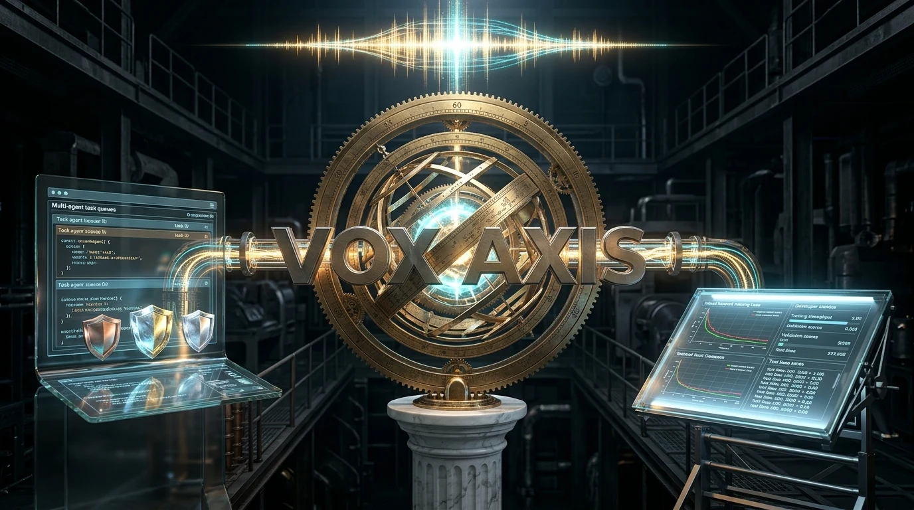

  <p>
    <strong>The native Tauri 2 desktop operator console and spatial codebase simulator for the Vox ecosystem</strong><br />
    <em>32 catalog-generated workbench surfaces · <code>VRBS ROMA</code> 3D/2.5D codebase simulator · <code>AQVAEDUCTUS</code> hydraulic verification cascade · Local IPC &amp; Remote TOFU TLS · 4 enforced WCAG theme profiles</em>
  </p>

  <p>
    <sub>Led by <strong>Bertrand Reyna-Brainerd</strong> · Stewarded by the <strong>Vox Foundation</strong> (in formation) · Apache-2.0 · <strong>Pre-1.0 Research Prototype (<code>v0.6.0</code> Workspace)</strong></sub>
  </p>

  <p>
    <a href="https://voxlang.org/how-to/how-to-axis-workbench/"><strong>Workbench Guide</strong></a> &nbsp;·&nbsp;
    <a href="https://github.com/vox-foundation/vox"><strong>vox-foundation/vox (Language &amp; Compiler)</strong></a> &nbsp;·&nbsp;
    <a href="https://github.com/vox-foundation/voxlang.org"><strong>vox-foundation/voxlang.org (Docs &amp; Sandbox)</strong></a> &nbsp;·&nbsp;
    <a href="https://voxlang.org"><strong>voxlang.org</strong></a>
  </p>

  <p>
    &nbsp;
    <a href="https://github.com/vox-foundation/vox-axis/commits/main"></a>&nbsp;
    <a href="LICENSE"></a>
  </p>
</div>

> [!WARNING]
> **Last reviewed: 2026-11-10 (`v6.8` / `0.6.0` workspace).** **Vox Axis** (`vox-gui`, launched via `vox gui` or `vox axis`) is an active pre-1.0 research prototype, not production software. All **32 workbench views** are generated from [`contracts/operations/catalog.v1.yaml`](https://github.com/vox-foundation/vox/blob/main/contracts/operations/catalog.v1.yaml) (`SURFACE_REGISTRY`) and verified via Playwright visual and WCAG accessibility gates (`axeViolations: 0`). See [Status](#status) for subsystem maturity.

---

## Animated Flagship Workbench Tour (`axis_hero_tour.webp`)

<div align="center">
  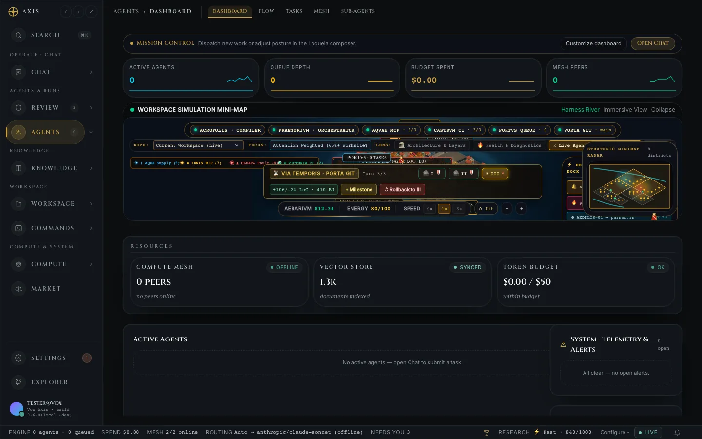
  <p>
    <strong>Vox Axis <code>v6.6–v6.8</code> Flagship Tour (Animated WebP · Real Playwright Captures)</strong><br />
    <em>Cycling through the <code>VRBS ROMA</code> Codebase Civilization Simulator, <code>Imperium Prefecture</code> Blast-Radius DAG Inspector, Mission Control Dashboard, Multi-Dock Chat Workbench, <code>AQVAEDUCTUS</code> 3-Tier Hydraulic Verification Cascade, MENS Corpus &amp; Pipeline Studio, <code>Needs You</code> Live Execution DAG, and the Enforced Theme Contract (<code>Imperial Carrara White &amp; Gold</code> vs. <code>Minimalist Grey-Blue Slate</code>).</em>
  </p>
</div>

---

## Contents

1. [Why Axis Exists & Separation of Concerns](#why-axis-exists--separation-of-concerns)
2. [Architecture & Generated Visual Schematics](#architecture--generated-visual-schematics)
3. [Highlight Surfaces: `VRBS ROMA` Simulator, `AQVAEDUCTUS` Cascade & 4-Profile Theme & Typography Contract](#highlight-surfaces-vrbs-roma-simulator-aqvaeductus-cascade--4-profile-theme--typography-contract)
4. [Complete Visual Reference: All 32 `SURFACE_REGISTRY` Screens Explained](#complete-visual-reference-all-32-surface_registry-screens-explained)
   - [Shell Chrome & Navigation (`⌘K` Palette, Wide Sidebar & Compact Rail)](#shell-chrome--navigation-k-palette-wide-sidebar--compact-rail)
   - [Domain I: Operate (11 Views — Orchestration, Multi-Dock Chat & Governance)](#domain-i-operate-11-views--orchestration-multi-dock-chat--governance)
   - [Domain II: Develop (8 Views — `AQVAEDUCTUS` Harness, PTY Console & Code)](#domain-ii-develop-8-views--aqvaeductus-harness-pty-console--code)
   - [Domain III: Knowledge & Socrates Gate (6 Views — Hybrid RAG & SCIENTIA)](#domain-iii-knowledge--socrates-gate-6-views--hybrid-rag--scientia)
   - [Domain IV: Compute / MENS (4 Views — Rust QLoRA Studio & Model Routing)](#domain-iv-compute--mens-4-views--rust-qlora-studio--model-routing)
   - [Domain V: System & `VRBS ROMA` (3 Views — Clavis, Doctor & Simulator)](#domain-v-system--vrbs-roma-3-views--clavis-doctor--simulator)
5. [Tradeoffs](#tradeoffs)
6. [Status](#status)
7. [Trying It & Satellite Maintainability](#trying-it--satellite-maintainability)
8. [Intellectual Lineage, Prior Art & References](#intellectual-lineage-prior-art--references)

---

## Why Axis Exists & Separation of Concerns

Supervising concurrent coding agents, a local RAG knowledge base, and a QLoRA fine-tuning pipeline inside a scrolling terminal stream obscures four operational hazards:

1. **Silent prompt poisoning.** Terminal transcripts do not visually separate compiler-verified documentation (`SystemVerified`) from unverified external scrapes (`Untrusted`)[^1].
2. **File-lock collisions and unverified tool claims.** Parallel subagents overwrite working-tree files unless file-affinity locks (`hopper_inbox.resource_id`) and cryptographic tool-dispatch receipts (`HMAC-SHA256` / `BLAKE3`) are surfaced in real time[^2].
3. **Undiscoverable CLI/MCP capabilities.** Every operation in `contracts/operations/catalog.v1.yaml` needs a schema-generated form and keyboard-first entry point rather than requiring operators to memorize subcommand flags.
4. **Spatial blindness across layered workspaces.** Multi-crate repositories have topological layers (`L0`–`L5`), fan-in keystones, and active git churn that a flat directory tree cannot convey[^3].

**How Axis solves them:**

- **Catalog-driven surface generation (`SURFACE_REGISTRY`).** `vox ci gui-surface-registry --write` compiles `contracts/operations/catalog.v1.yaml` directly into [`surfaceRegistry.generated.ts`](https://github.com/vox-foundation/vox/blob/main/crates/vox-gui/ui/src/generated/surfaceRegistry.generated.ts). Every registered CLI and MCP operation is bound to one of **32 views** or the **`⌘K` Universal Capability Palette** (enforced on every PR by `vox ci gui-surface-coverage`).
- **Diegetic spatial telemetry (`VRBS ROMA` & `AQVAEDUCTUS`).** Drawing on Wettel & Lanza's *CodeCity*[^3] and classical Vitruvian cartography[^4], Axis projects topological crate layers (`L0`–`L5`), live git diffs (`+LoC / -LoC`), and active agent patrols onto an interactive isometric metropolis (`LudusSandbox.tsx`) and a 3-tier hydraulic verification cascade (`HarnessRiverPanel.tsx`).
- **Dual-Mode Transport (`transport.ts`).** The same React 19 bundle runs **100% offline in Local Mode** over in-process Tauri 2 IPC (`window.__TAURI_INTERNALS__.invoke` → local `VoxDb` v97 & `Clavis` keyring) or connects in **Remote Mode** over **TOFU SPKI SHA-256 TLS pinning**[^5] to a headless `vox-orchestrator-d` and GPU mesh node.

### Repository Separation of Concerns

| Concern | Owning Repository | Boundary Contract |
|:---|:---|:---|
| **32 GUI views, `VRBS ROMA` simulator, 4-profile CSS token contract, and Playwright visual regression** | [**`vox-foundation/vox-axis`**](https://github.com/vox-foundation/vox-axis) *(this repo)* | `contracts/gui/theme-contract.v1.json`, `contracts/reports/gui-surface-{registry,coverage}.v1.json` |
| **`.vox` language grammar, compiler, interpreter, MCP server, `VoxDb`, and MENS trainer** | [**`vox-foundation/vox`**](https://github.com/vox-foundation/vox) | `contracts/operations/catalog.v1.yaml`, `contracts/ipc/`, `contracts/wire/` |
| **Public Starlight documentation site & `/v1/eval` deterministic browser playground** | [**`vox-foundation/voxlang.org`**](https://github.com/vox-foundation/voxlang.org) | `contracts/documentation/kb-taxonomy.v1.yaml` |

---

## Architecture & Generated Visual Schematics

### 1. Dual-Mode Transport: Local Tauri 2 IPC vs. Remote TOFU TLS Daemon

<div align="center">
  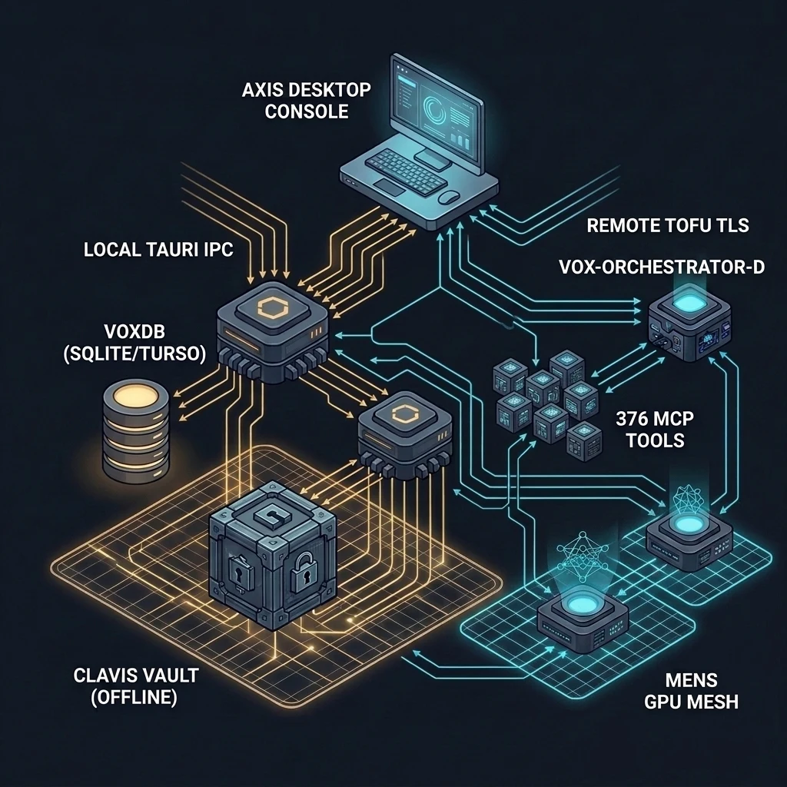
  <p>
    <strong>Single Frontend Bundle, Two Transport Paths (<code>transport.ts</code>)</strong><br />
    <em>Local Mode calls Rust commands in-process via Tauri 2 IPC against local <code>VoxDb</code> (schema v97) and <code>Clavis</code> with zero network dependency. Remote Mode connects over a Trust-On-First-Use (TOFU) SPKI SHA-256 pinned TLS session to <code>vox-orchestrator-d</code> (<code>vox serve --tls-cert/--tls-key</code>).</em>
  </p>
</div>

### 2. The 5 Workbench Domains & `⌘K` Universal Capability Palette

<div align="center">
  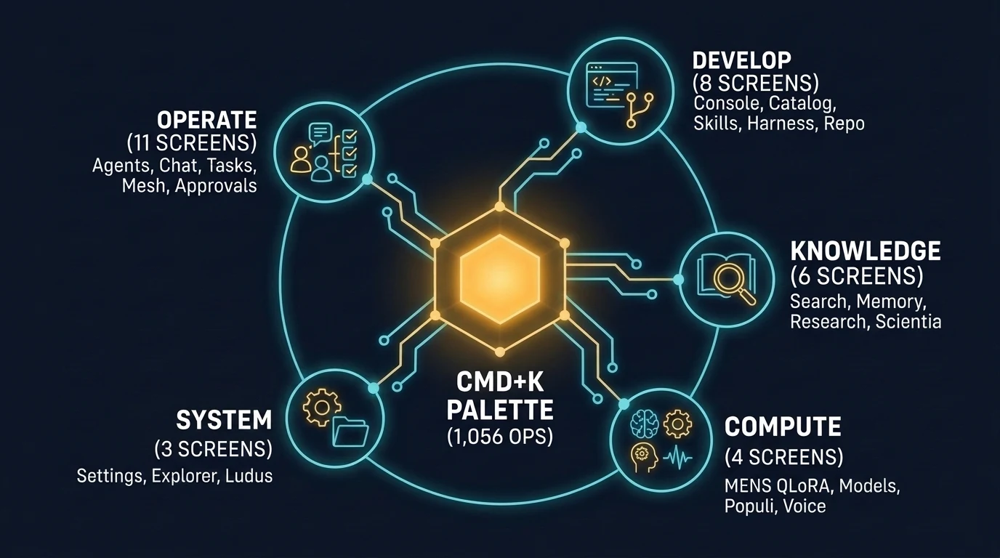
  <p>
    <strong>5 Workbench Domains · 32 Registered Surfaces · Catalog-Generated Coverage</strong><br />
    <em>Defined in <a href="https://github.com/vox-foundation/vox/blob/main/crates/vox-gui/ui/src/lib/navigation.ts"><code>navigation.ts</code></a> and <a href="https://github.com/vox-foundation/vox/blob/main/crates/vox-gui/ui/src/generated/surfaceRegistry.generated.ts"><code>surfaceRegistry.generated.ts</code></a>: <strong>Operate</strong> (11), <strong>Develop</strong> (8), <strong>Knowledge</strong> (6), <strong>Compute / MENS</strong> (4), and <strong>System &amp; VRBS ROMA</strong> (3).</em>
  </p>
</div>

### 3. End-to-End Trust Pipeline: Retrieval Tiers, Socrates Gate & `AQVAEDUCTUS` Sluices

<div align="center">
  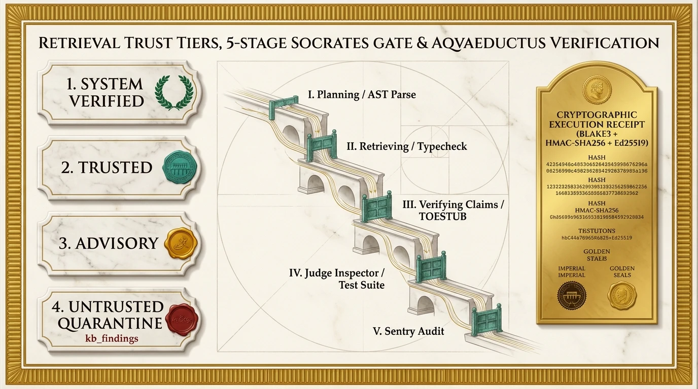
  <p>
    <strong>Four Retrieval Trust Tiers &amp; Five Verification Gates</strong><br />
    <em>External scrapes land in <code>kb_findings</code> as <code>Untrusted</code> and must pass the 5-stage Socrates HITL gate before promotion. Tool dispatches emit verifiable <code>BLAKE3</code> / <code>HMAC-SHA256</code> receipts (<a href="https://voxlang.org/adr/029-formal-intent/">ADR-029</a>).</em>
  </p>
</div>

---

## Highlight Surfaces: `VRBS ROMA` Simulator, `AQVAEDUCTUS` Cascade & 4-Profile Theme & Typography Contract

### 1. `VRBS ROMA` — Polyglot Codebase Civilization & Blast-Radius Simulator (`gamify`)

| Simulator State | Real Playwright Capture (`1440×900`) | Engineering Mechanism & Controls |
|:---|:---|:---|
| **Isometric Metropolis & `Forma Urbis` 7-Tier Astrolabe Radar**<br/>(`urbs-civilization.png`) | 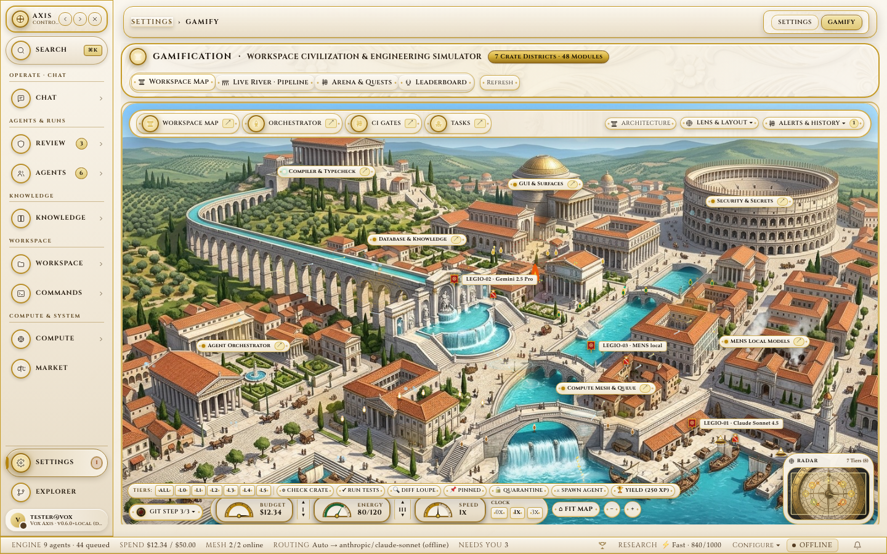 | `workspace_town.rs` scans any repository (Cargo `crates/*`, TS `packages/*`, Python, Go) and computes Kahn topological layers (`L0`–`L5`) + Tarjan SCCs (`topology.ts`)[^3]. Attention-weighted layout (`layout.ts`) inflates dirty/failing districts (`1.0×–3.2×`). Autonomous A* magistrate agents (`LEGIO-01..03`) patrol active crate roads while the bottom-right **`FORMA VRBIS` 7-Tier Astrolabe Radar** provides click-to-pan frustum navigation. |
| **`Imperium Prefecture` Dock & Blast-Radius DAG Inspector**<br/>(`urbs-imperium-inspector.png`) | 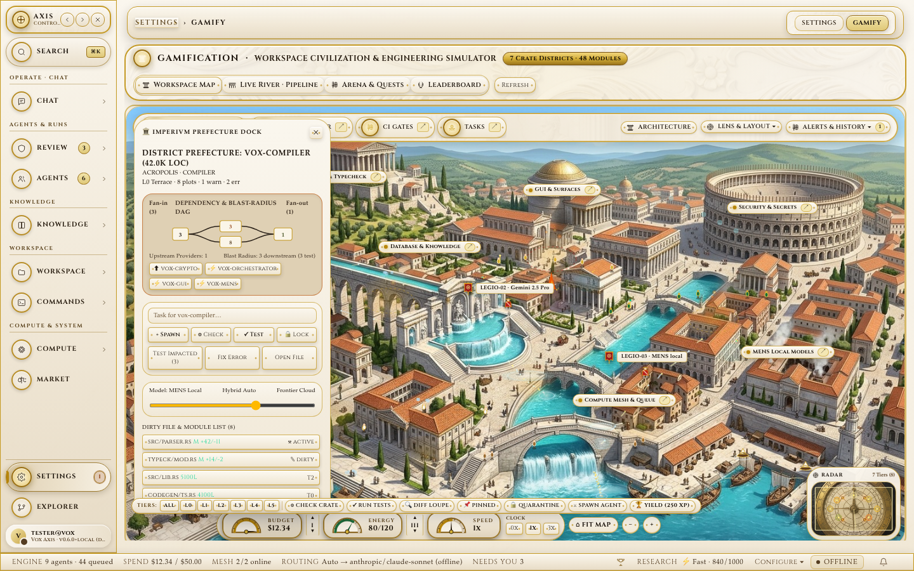 | Clicking any monument (`COMPILER & TYPECHECK`, `AGENT ORCHESTRATOR`, `GUI & SURFACES`, `SECURITY & SECRETS`) opens `ImperiumInspector.tsx` (`bottom-[82px]` bounded so it never occludes toolbars), rendering upstream providers, downstream blast radius, per-file `+LoC / -LoC` diff slabs, and 1-click `[+ SPAWN]`, `[CHECK]`, `[✓ TEST]`, `[TEST IMPACTED]`, and `[FIX ERROR]` dispatch buttons. |

### 2. Multi-Dock Responsive Chat Workbench & `AQVAEDUCTUS` 3-Tier Hydraulic Cascade

| Workbench Surface | Real Playwright Capture (`1440×900`) | Engineering Mechanism & Controls |
|:---|:---|:---|
| **Multi-Dock Chat + Simulator + Cascade**<br/>(`chat-multidock.png`) | 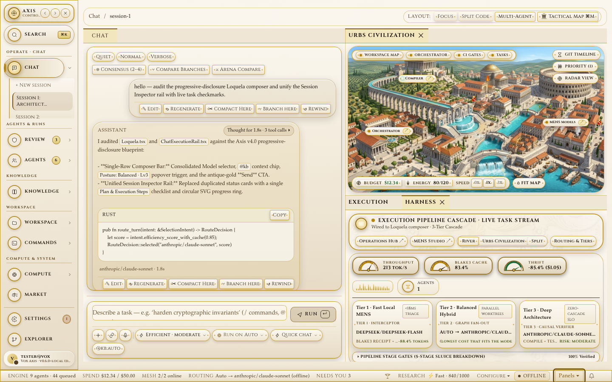 | `ChatSurface.tsx` supports `FOCUS`, `SPLIT CODE`, `MULTI-AGENT`, and `TACTICAL MAP ⌘M` layouts (auto-consolidating to 2 columns below `1560px`), pairing multi-model consensus (`CONSENSUS 2–4`), git LCA branch diffing (`COMPARE BRANCHES`), and the single-row `Loquela` posture bar (`Alt+1..4`)[^6] with live companion docks. |
| **`AQVAEDUCTUS · CASTELLVM DIVISORIVM`**<br/>(`harness.png`) | 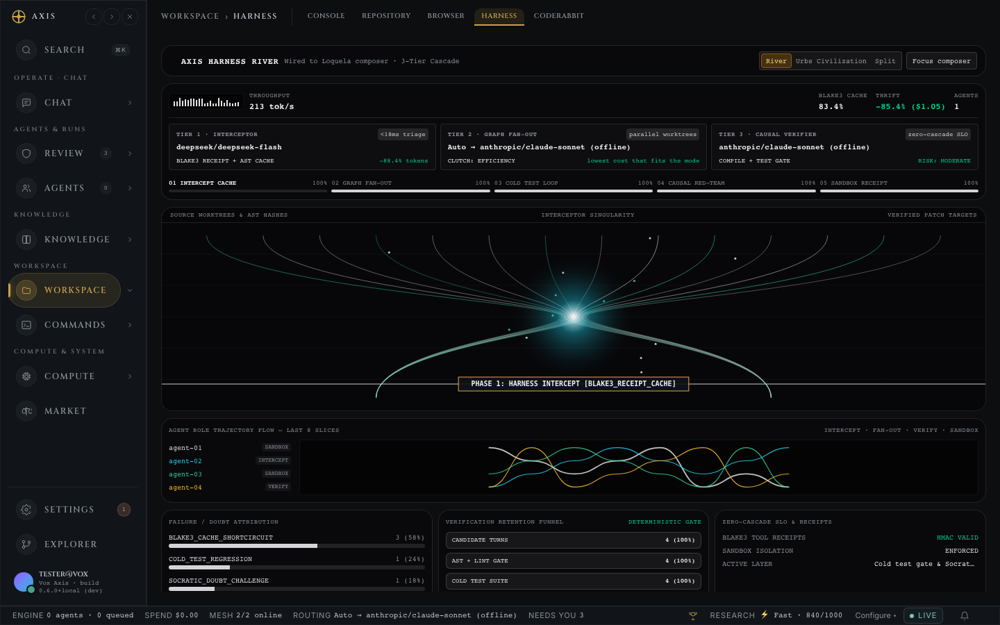 | `HarnessRiverPanel.tsx` visualizes live model routing and verification as a 3-tier Roman hydraulic sluice cascade (`CURSUS I · Fast Local MENS`, `CURSUS II · Balanced Hybrid`, `CURSUS III · Deep Frontier`) flowing through 4 verification gates (`AST PARSE` → `TYPECHECK` → `TOESTUB` → `TEST SUITE`) above the `Parallel Agent Execution Braid`. |

### 3. Enforceable 4-Profile Theme & Typography Contract (`contracts/gui/theme-contract.v1.json`)

Every `.tsx`, `.ts`, and `.css` file under `crates/vox-gui/ui/src/` is statically gated by `vox-code-audit` detector `vox/ui/theme-contract-drift` (`Severity::Error`) and Style-Dictionary token generation (`22/22` semantic CSS variables, WCAG 2.1 contrast $\ge 4.5:1$, and the unified 4-token typography contract `--font-display`, `--font-serif`, `--font-sans`, `--font-mono`):

| Default: `Imperial Carrara White & Gold` (`arcane`) | Dark Mode: `Minimalist Grey-Blue Slate` (`slate`) |
|:---:|:---:|
| 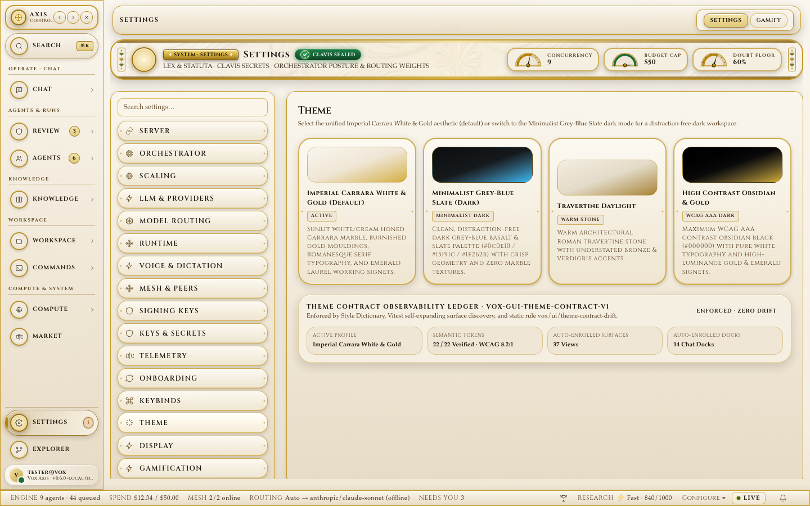 | 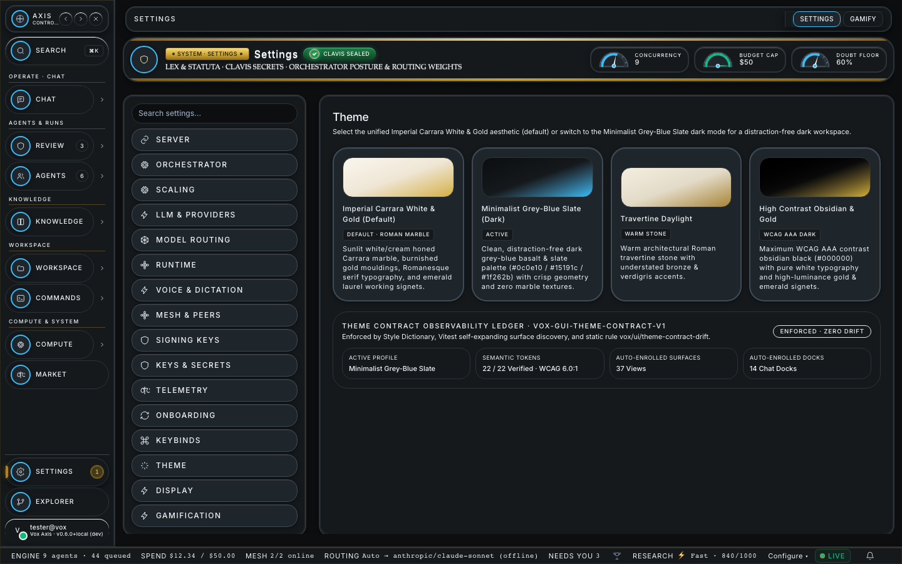 |
| *Sunlit honed Carrara marble (`#FAF6EE`), burnished gold mouldings (`#C59B27`), deep espresso ink (`#1C140C`), Romanesque serif (`Cinzel` / `Palatino`), and emerald laurel working signets (`#1B6B3A`).* | *Distraction-free basalt/slate dark palette (`#0c0e10` / `#15191c` / `#1f262b`), steel-blue & emerald active indicators, crisp geometry, and zero marble textures.* |

*(Also ships with **`Travertine Daylight` (`glacier`)** [`assets/screens/theme-glacier.png`](assets/screens/theme-glacier.png) and **`High Contrast Obsidian & Gold` (`high-contrast`, WCAG AAA)** [`assets/screens/theme-high-contrast.png`](assets/screens/theme-high-contrast.png).)*

---

## Complete Visual Reference: All 32 `SURFACE_REGISTRY` Screens Explained

### Shell Chrome & Navigation (`⌘K` Palette, Wide Sidebar & Compact Rail)

| Shell Mode | Real Playwright Capture | Purpose & Key Shortcuts |
|:---|:---|:---|
| **Universal `⌘K` Capability Palette**<br/>(`_command-palette.png`) | 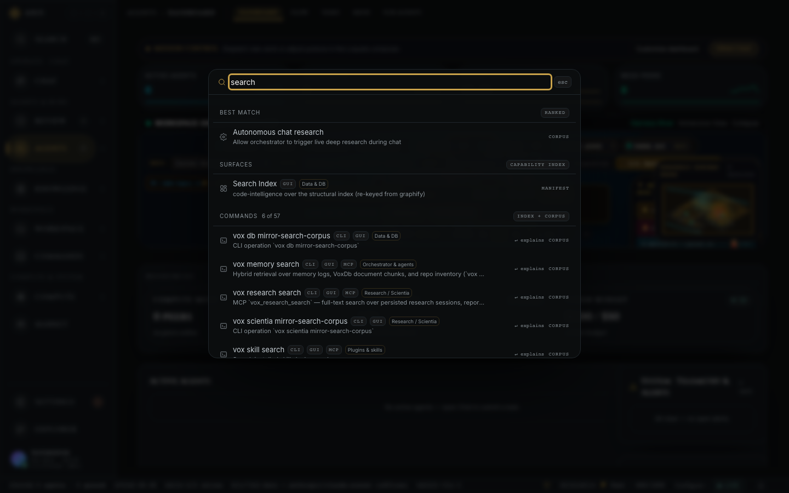 | Hybrid Tantivy BM25 + RRF semantic search over all cataloged CLI operations, MCP tools, and 32 GUI views (`contracts/capabilities/capability-index.v1.json`). Enforces side-effect confirmation gates before running mutating commands. |
| **Wide Grouped Sidebar & Hidden/Rail Mode**<br/>(`_sidebar-wide.png` / `_sidebar-rail.png`) | 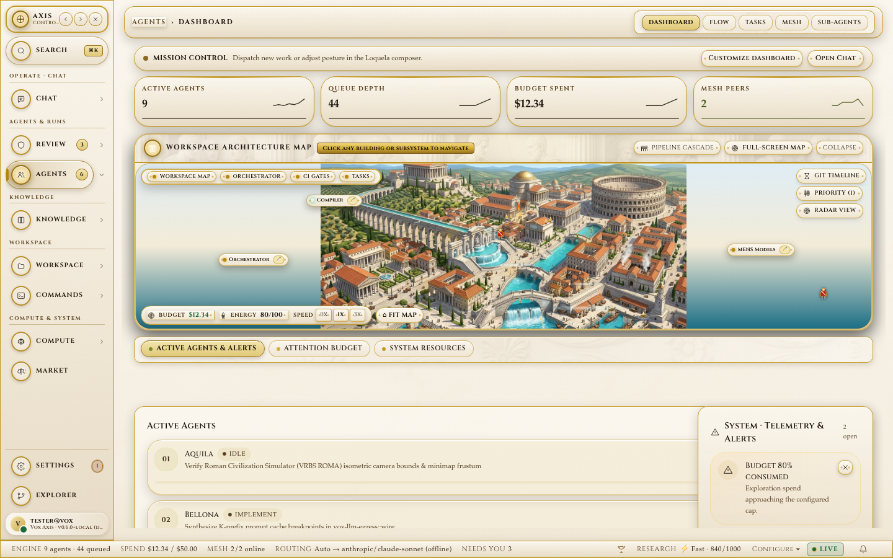<br/>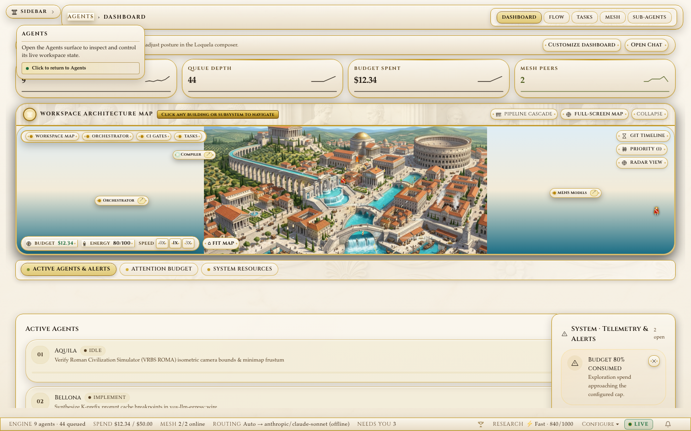 | Switches between the 5-domain grouped sidebar (`OPERATE · CHAT`, `AGENTS & RUNS`, `KNOWLEDGE`, `WORKSPACE`, `COMPUTE & SYSTEM`) and collapsed full-canvas mode while pinning the interactive bottom status bar (`ENGINE`, `SPEND`, `MESH`, `ROUTING`, `NEEDS YOU`, `RESEARCH`, `CONFIGURE ▾`). |

---

### Domain I: Operate (11 Views — Orchestration, Multi-Dock Chat & Governance)

<div align="center">
  
</div>

| # | `viewKey` & Title | Real Screenshot (`v6.6`) | Why It Exists & What It Does | Backing CLI / Crate |
|:---|:---|:---|:---|:---|
| **1** | `dashboard`<br/>**Mission Control** | 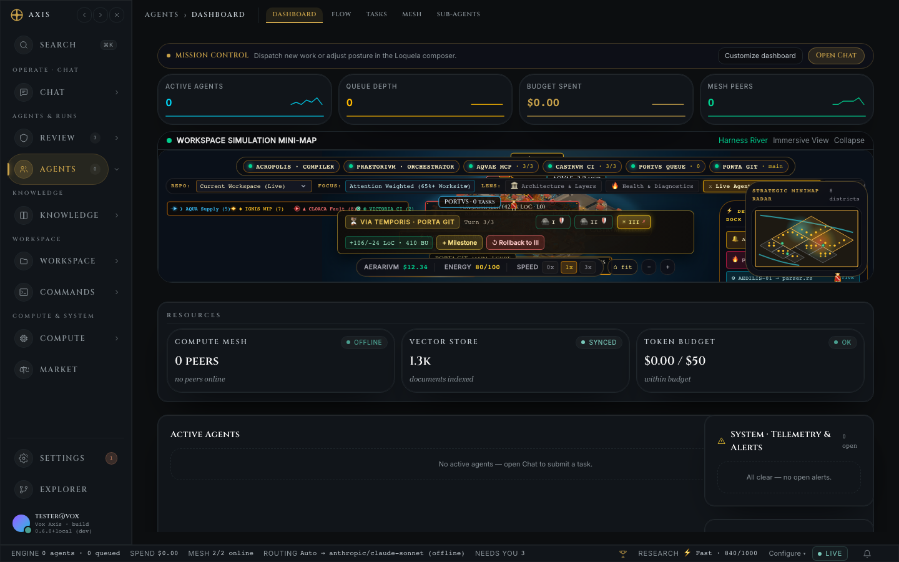 | At-a-glance health cockpit: 4 sparkline KPIs (`Active Agents`, `Queue Depth`, `Budget Spent`, `Mesh Peers`), embedded interactive `VRBS ROMA` architecture map (`260px`), active agent cards, and telemetry alerts. | `vox status`<br/>`vox-orchestrator-d` |
| **2** | `chat`<br/>**Chat Workbench (`Loquela`)** | 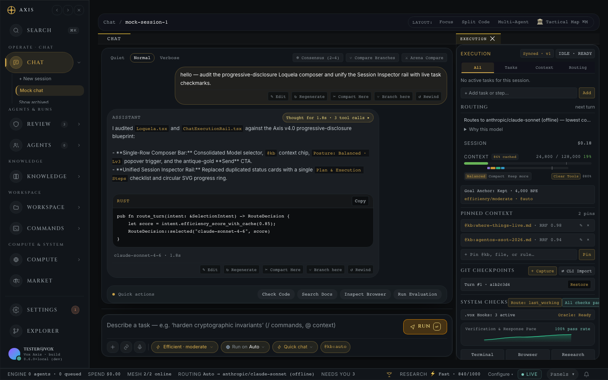 | Multi-turn engineering chat with single-row progressive-disclosure posture controls (`Loquela.tsx`), BPE compaction receipts (`Goal Anchor: Kept`), retrieval trust chips, HMAC tool receipts, and multi-dock tiling. | `vox chat`<br/>`vox_actor_runtime::llm` |
| **3** | `tasks`<br/>**Tasks (Hopper Queue)** | 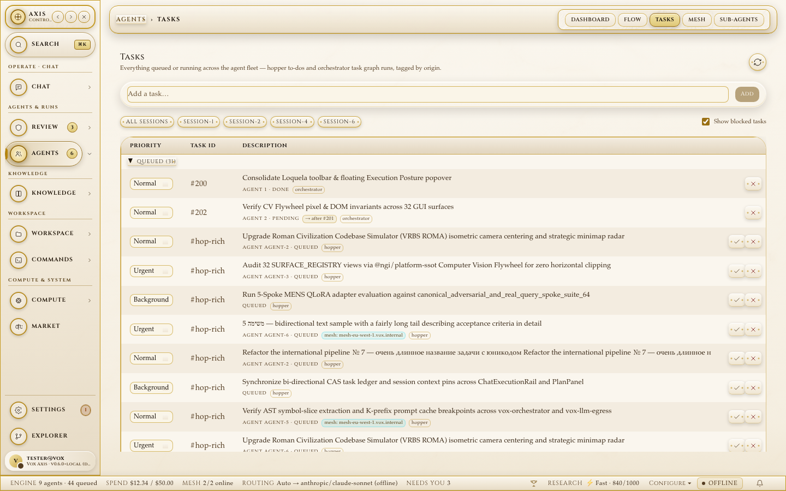 | Prevents concurrent file-write races by surfacing `hopper_inbox` task ordering, priority (`Urgent`/`Normal`/`Background`), and per-file `resource_id` lock ownership ([ADR-025](https://voxlang.org/adr/025-multi-agent-lock-coherence/)). | `vox plan`<br/>`vox_orchestrator::hopper` |
| **4** | `sub-agents`<br/>**Sub-Agents Tree** | 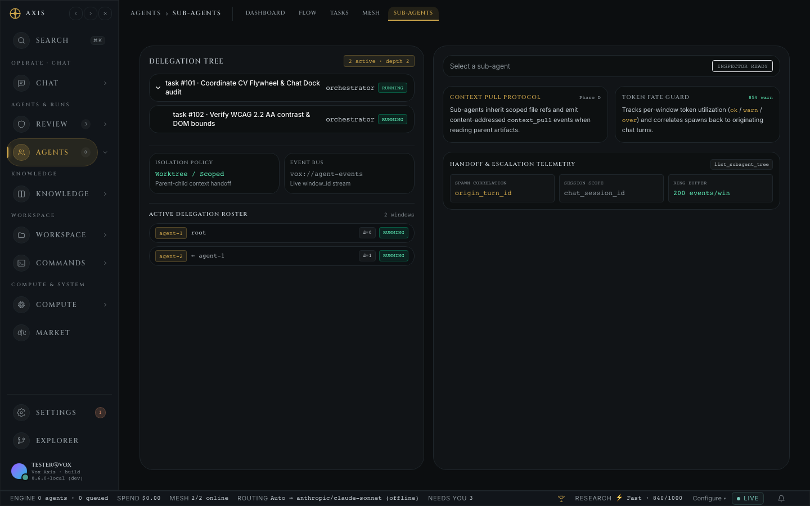 | Live parent→child subagent supervision tree showing workspace isolation (`inherit`, `branch`, `share`), role assignments, turn progress, and kill-switch controls. | `vox-orchestrator`<br/>`mcp_agent_*` |
| **5** | `flow`<br/>**Durable Workflows** | 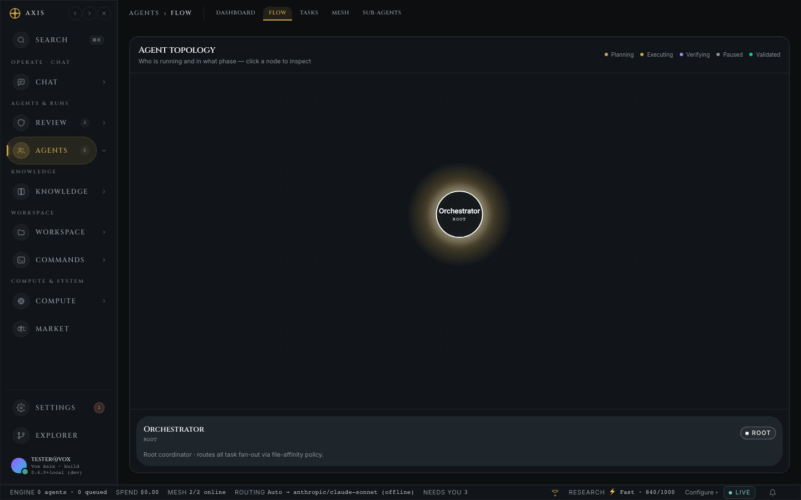 | Visualizes event-sourced `.vox` `workflow` and `activity` replay journals (`workflow_patch_log`, activity ordinals, signal/timer parking per [ADR-019](https://voxlang.org/adr/019-durable-workflow-journal-contract-v1/)). | `vox workflow`<br/>`vox-workflow-runtime` |
| **6** | `mesh`<br/>**Populi Mesh Topology** | 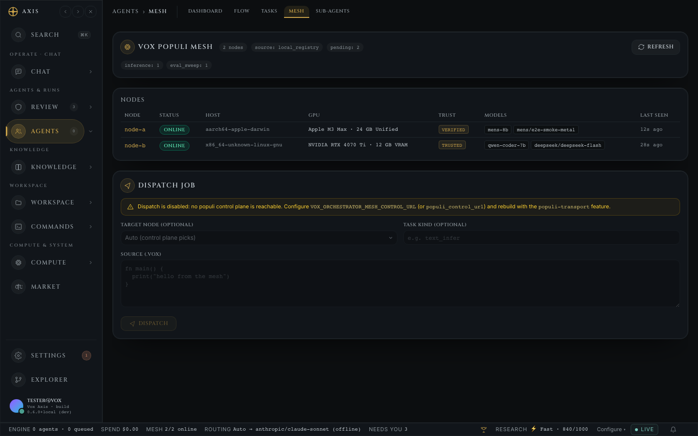 | Displays Iroh QUIC peer-to-peer nodes ([ADR-047](https://voxlang.org/adr/047-iroh-transport/)), ALPN negotiation, direct vs. relay paths, and `donations.vox` worker quotas. | `vox populi`<br/>`vox-plugin-populi-mesh` |
| **7** | `runs`<br/>**Execution Runs Ledger** | 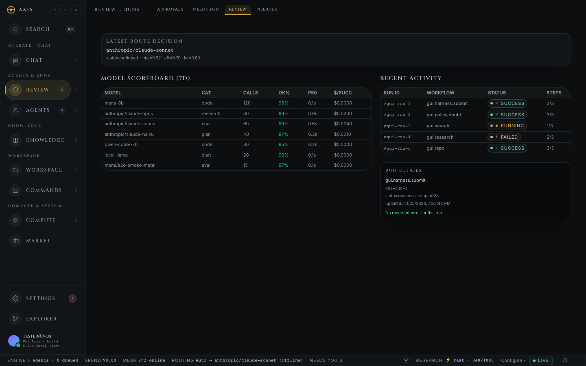 | Auditable ledger of past agent episodes, script runs, and workflow executions with duration, token cost, exit code, and commit SHA links. | `vox-db` execution store |
| **8** | `needs-you`<br/>**Needs You (Attention Gate)** | 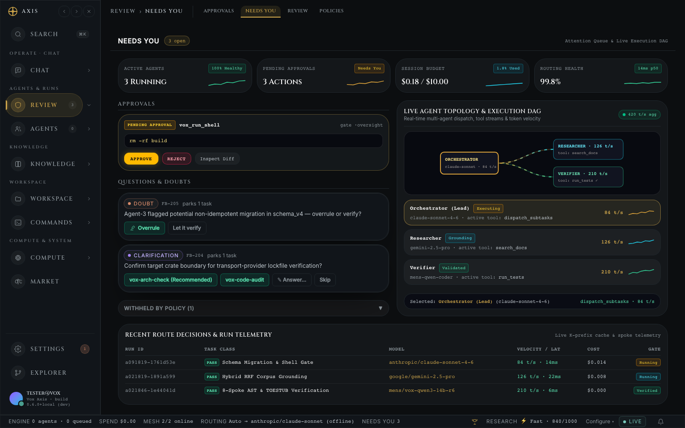 | Filters out low-value agent interruptions using expected-information-gain scoring (`attention_policy.rs`)[^2], pairing pending approvals/doubts with the **Live Agent Topology & Execution DAG**. | `vox attention`<br/>`vox-orchestrator-mcp` |
| **9** | `approvals`<br/>**Approvals & Diff Gate** | 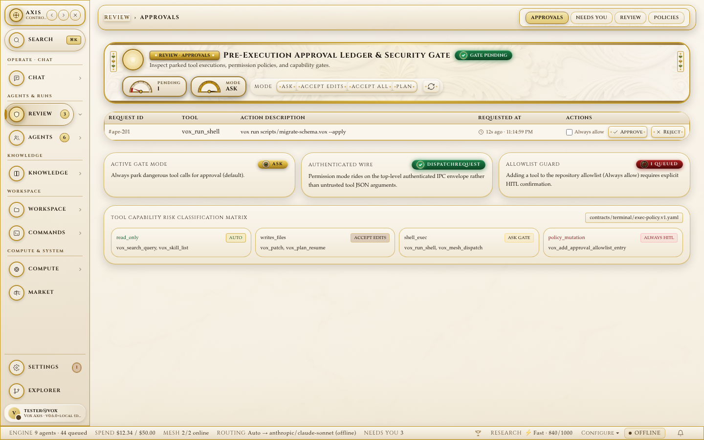 | Human-in-the-loop sign-off queue for privileged shell commands, secret resolutions, and schema migrations with inline `Inspect Diff` previews. | `vox policy`<br/>`vox-orchestrator-mcp` |
| **10** | `policies`<br/>**Execution & Safety Policies** | 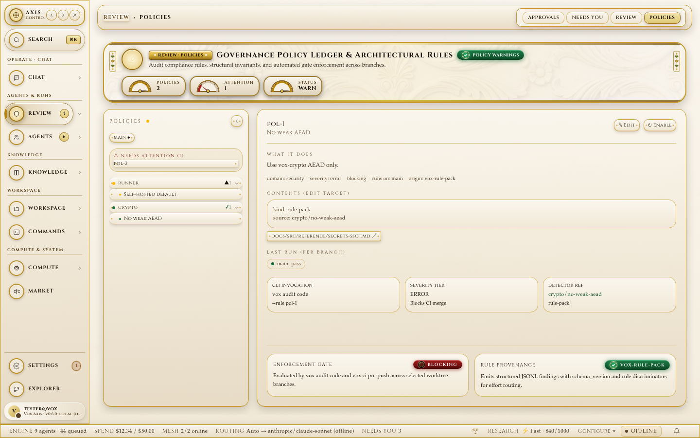 | Inspects terminal allowlists (`contracts/terminal/exec-policy.v1.yaml`), scaling budgets (`contracts/scaling/policy.yaml`), and Socrates confidence thresholds. | `vox shell check`<br/>`vox-scaling-policy` |
| **11** | `mercatus`<br/>**Mercatus (Token & Cost Market)** | 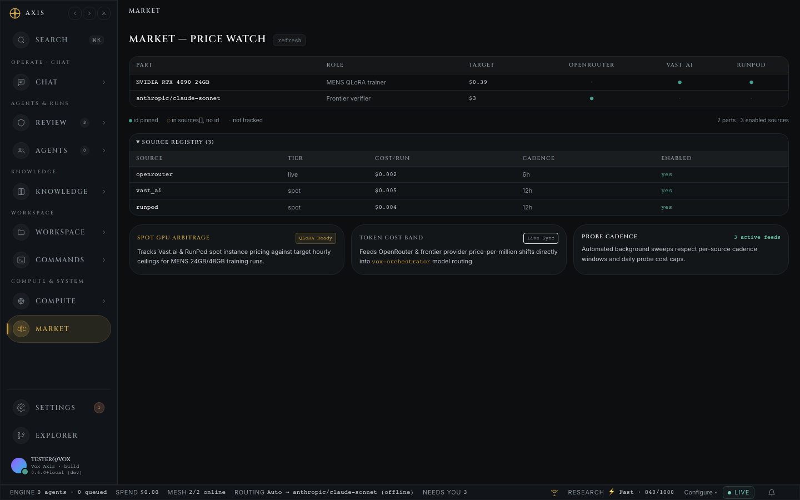 | Tracks real-time token spend and battery units (`1 BU = $0.001`) across OpenRouter providers vs. local MENS QLoRA inference savings. | `vox model`<br/>`vox-orchestrator-models` |

---

### Domain II: Develop (8 Views — `AQVAEDUCTUS` Harness, PTY Console & Code)

<div align="center">
  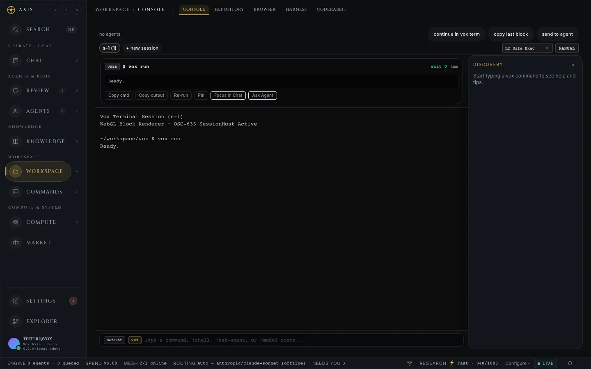
</div>

| # | `viewKey` & Title | Real Screenshot (`v6.6`) | Why It Exists & What It Does | Backing CLI / Crate |
|:---|:---|:---|:---|:---|
| **12** | `console`<br/>**Daemon PTY Console** | 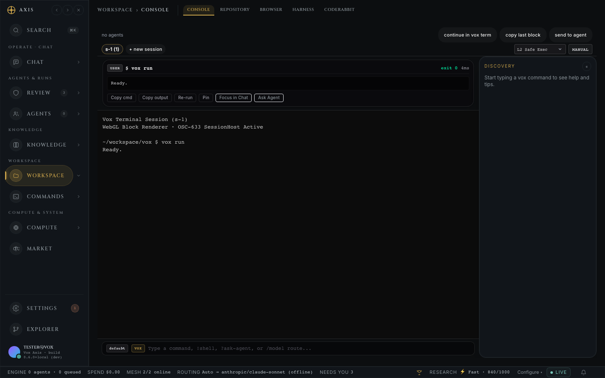 | Persistent daemon-hosted terminal sessions (`SessionHost`, `term.*` RPCs with ring-buffer replay, `#641`) that survive GUI restarts and work over Remote Mode. | `vox term`<br/>`vox-terminal-core` |
| **13** | `catalog`<br/>**Capability Catalog** | 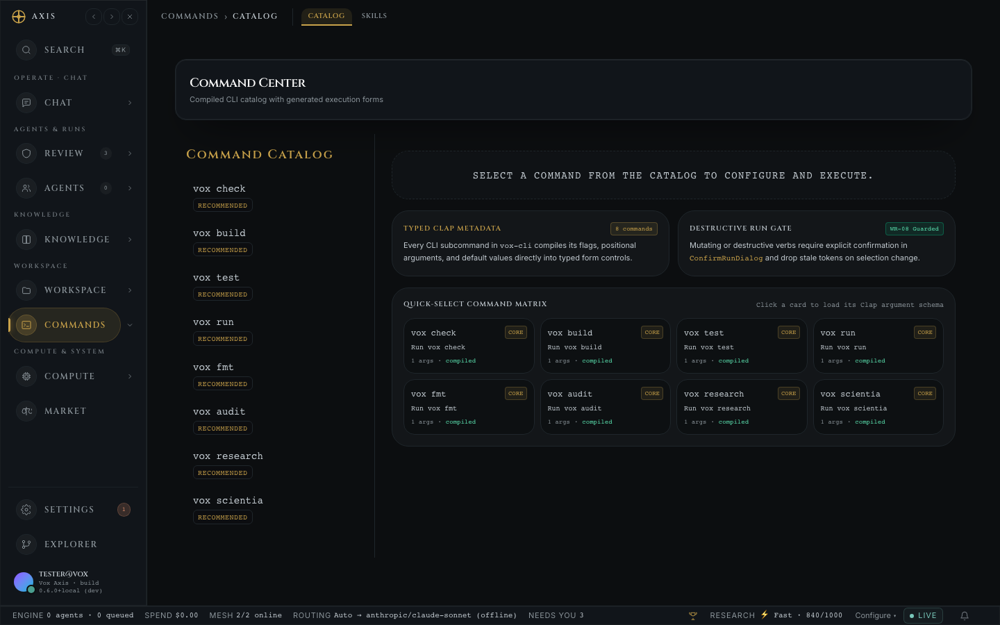 | Interactive browser and parameter form runner for every operation in `contracts/operations/catalog.v1.yaml` with `[OPEN FORM]`, `[EXPLAIN CAPABILITY]`, and `[OPEN DOCS]` actions. | `vox commands`<br/>`vox explain` |
| **14** | `skills`<br/>**Agent Skills Registry** | 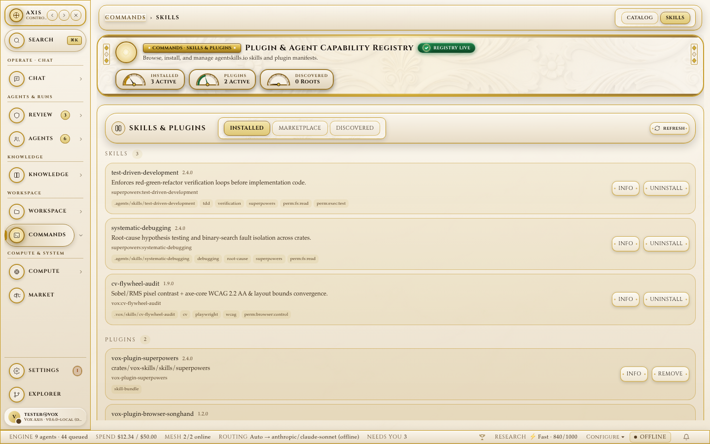 | Discovers and searches [agentskills.io](https://agentskills.io/specification) `SKILL.md` directories (`.vox/skills/`, `.agents/skills/`, Superpowers) via `vox-search`. | `vox skill list`<br/>`vox-skills` |
| **15** | `harness`<br/>**`AQVAEDUCTUS` Pipeline Cascade** |  | 3-tier hydraulic sluice cascade (`Fast Local MENS`, `Balanced Hybrid`, `Deep Architecture`) + 4-stage verification gates (`AST Parse`, `Typecheck`, `TOESTUB`, `Test Suite`) + `Parallel Agent Execution Braid`. | `vox harness eval`<br/>`vox-orchestrator` |
| **16** | `harness-health`<br/>**Harness Health (`vox audit`)** | 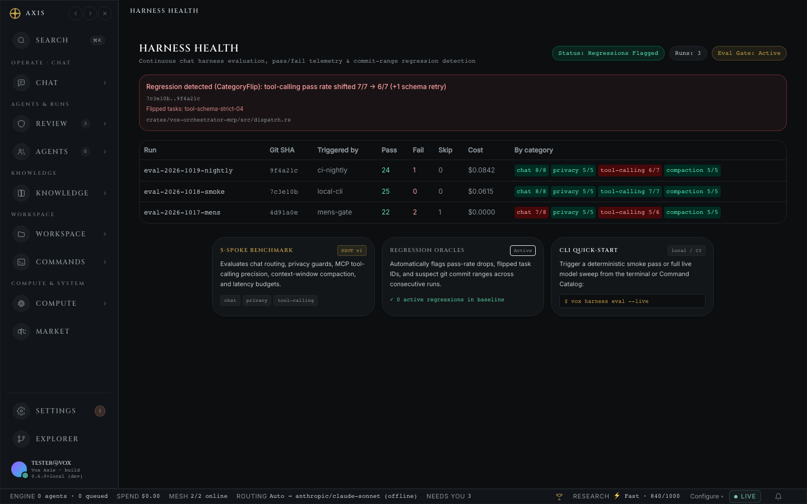 | Aggregates static audit findings from `vox audit code` (`toestub`), `vox audit arch` (`layers.toml`), `vox audit retirement`, and `vox audit effort`. | `vox audit`<br/>`vox-code-audit` |
| **17** | `repository`<br/>**4-Repo Federation** | 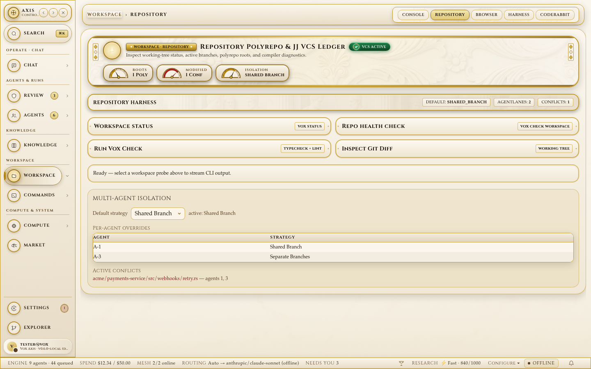 | Displays `.vox/repositories.yaml` status across `vox`, `vox-axis`, `voxlang.org`, and `vox-ops`, verifying shared `BLAKE3` contract digests and federated symbol-graph nodes. | `vox repo`<br/>`vox-repository` |
| **18** | `browser`<br/>**App Preview & DOM Inspector** | 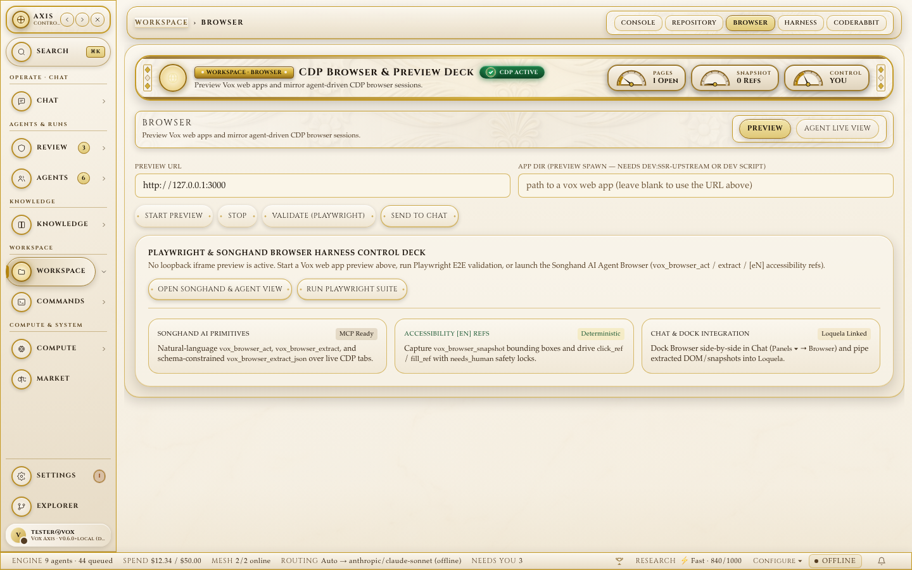 | Live preview frame for full-stack `.vox` apps (`vox dev` / `vox build`) with responsive viewport presets and console/DOM diagnostic capture. | `vox dev`<br/>`vox-codegen` |
| **19** | `coderabbit`<br/>**AI Diff Review** | 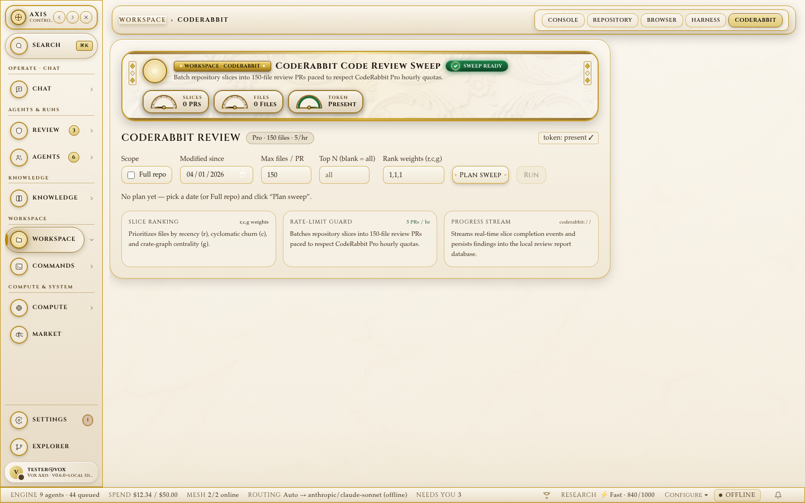 | Runs structured pre-merge diff reviews grouped by semantic domain (`contracts/review/coderabbit-semantic-groups.v1.yaml`) and severity. | `vox review`<br/>`vox-code-audit` |

---

### Domain III: Knowledge & Socrates Gate (6 Views — Hybrid RAG & SCIENTIA)

<div align="center">
  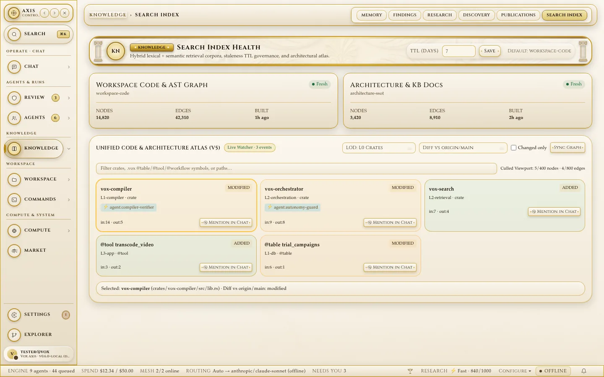
</div>

| # | `viewKey` & Title | Real Screenshot (`v6.6`) | Why It Exists & What It Does | Backing CLI / Crate |
|:---|:---|:---|:---|:---|
| **20** | `vox-search`<br/>**Hybrid Search (`vox kb`)** | 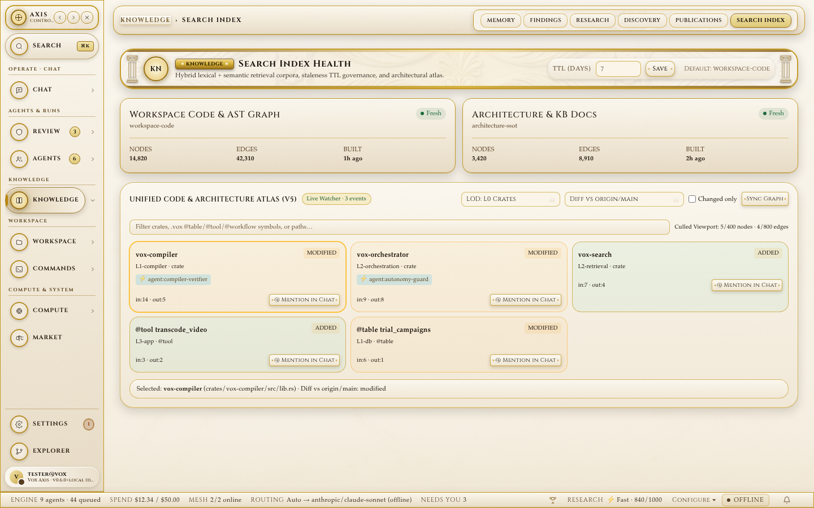 | Queries the Tantivy 0.22 lexical + semantic RRF index (`search_documents`), filtering by trust tier (`SystemVerified` → `Untrusted`) and W3C SKOS facets (`kb-taxonomy.v1.yaml`). | `vox kb search`<br/>`vox-search` |
| **21** | `memory`<br/>**Episodic & Fact Memory** | 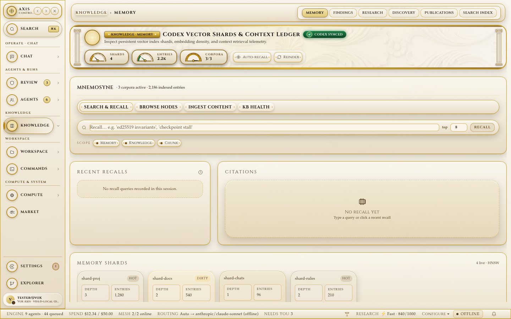 | Inspects and prunes persistent agent facts (`MemoryManager::persist_fact` / `lookup_fact_by_key`) and session handoff bundles stored in `VoxDb`. | `vox memory`<br/>`vox-orchestrator` |
| **22** | `activity`<br/>**Discovery Scout Feed** | 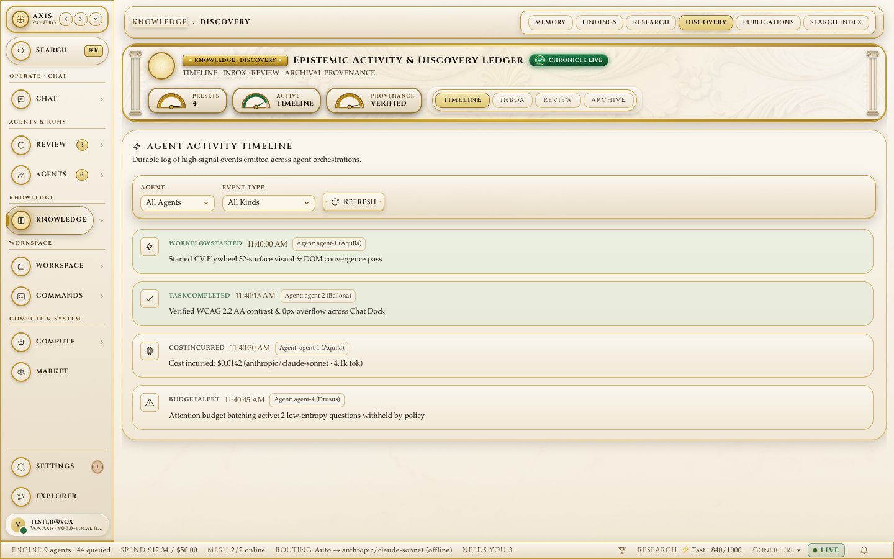 | Triages incoming research signals from Phase A/F signal producers (`vox-scientia-producers`) before promoting them to full investigations. | `vox scientia scout`<br/>`vox-scientia` |
| **23** | `research`<br/>**Deep Research & 5-Stage Socrates Gate** | 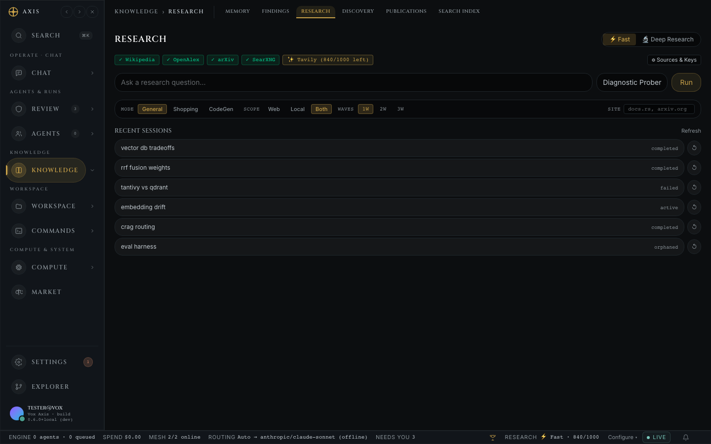 | Steerable multi-source research (`OpenAlex`, `arXiv`, `Wikipedia`, `SearXNG`, `Tavily`) with per-provider RRF diversity caps and the 5-stage Socrates HITL stepper (`Planning` → `Retrieving` → `Verifying Claims` → `Judge Inspector` → `Sentry Audit`). | `vox research`<br/>`vox-scientia` |
| **24** | `scientia`<br/>**SCIENTIA Findings Ledger** | 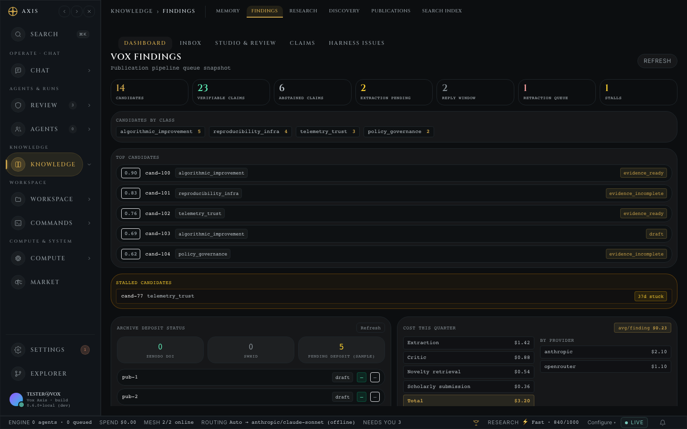 | Structured ledger of verified empirical findings (`kb_findings`), replay receipts, McNemar benchmark proofs, and nanopublication attestations. | `vox scientia`<br/>`vox-scientia-core` |
| **25** | `publications`<br/>**Publications Studio** | 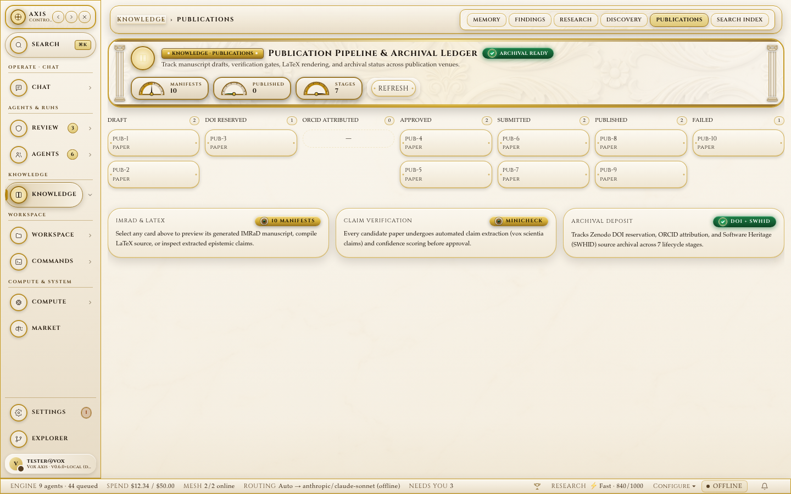 | Scaffolds citation-locked technical reports and manuscript sections from verified SCIENTIA findings (`vox-manuscript-scaffold`). | `vox scientia`<br/>`vox-findings-site` |

---

### Domain IV: Compute / MENS (4 Views — Rust QLoRA Studio & Model Routing)

<div align="center">
  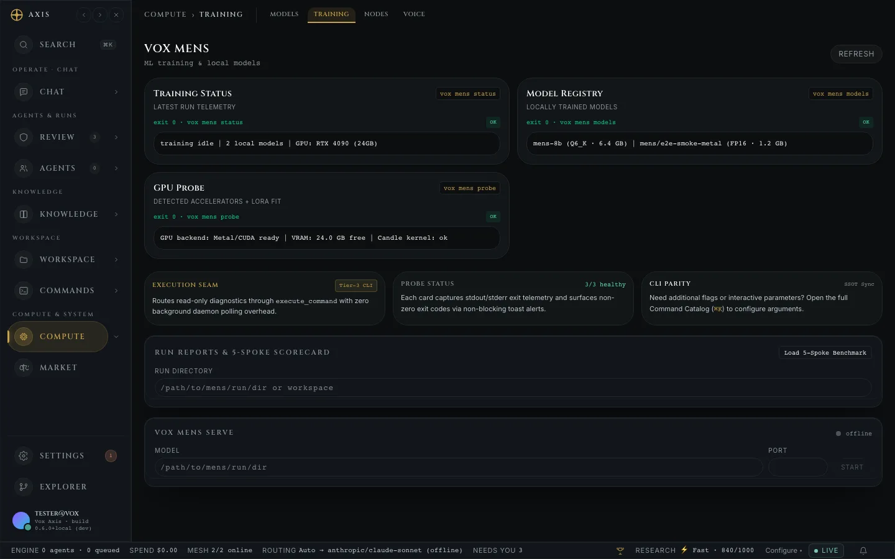
</div>

| # | `viewKey` & Title | Real Screenshot (`v6.6`) | Why It Exists & What It Does | Backing CLI / Crate |
|:---|:---|:---|:---|:---|
| **26** | `mens`<br/>**MENS Corpus & Pipeline Studio** | 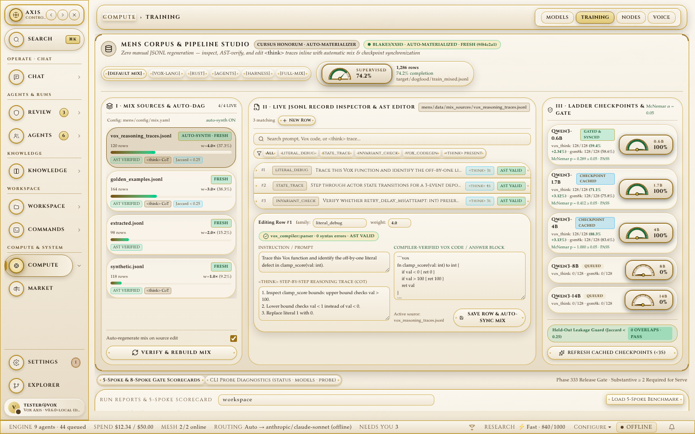 | Pure-Rust (Candle) QLoRA studio across Qwen3 (`0.6B`–`32B`) and 8 domain spokes: `Mix Sources & Auto-DAG`, `Live JSONL Record Inspector & AST Editor` (inline `vox_compiler::parser` verification), and `Ladder Checkpoints & McNemar α=0.05 Gate`. | `vox mens train`<br/>`vox-populi` |
| **27** | `models`<br/>**Models Router & Leaderboard** | 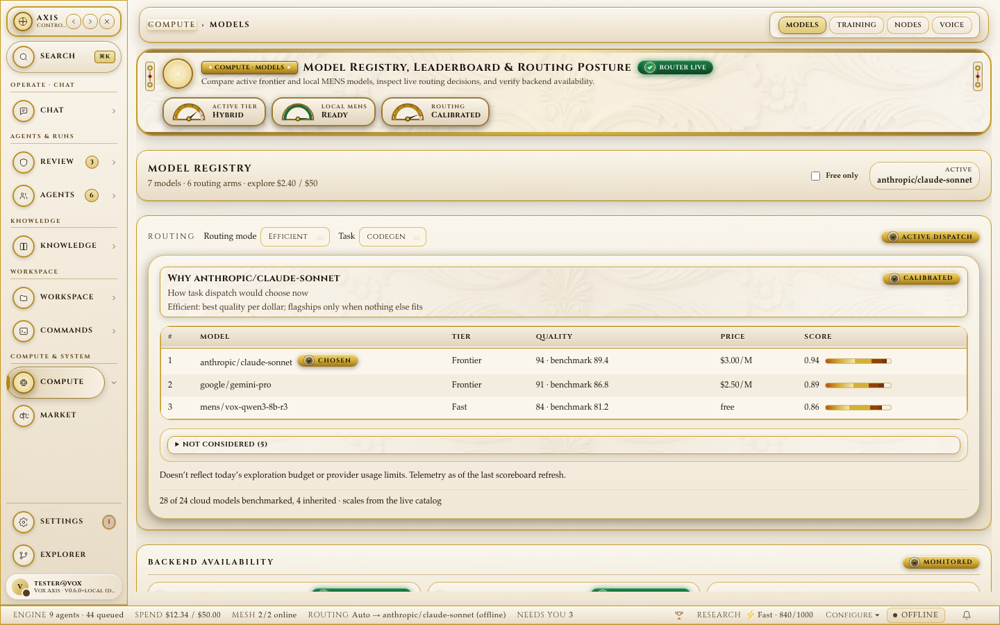 | Inspects `vox-orchestrator-models` registry scores, OpenRouter `~family-latest` aliases, multi-benchmark priors (`SweBench`, `LiveBench`), and McNemar `eval-compare` leaderboards. | `vox model`<br/>`vox-orchestrator-models` |
| **28** | `populi`<br/>**Populi Compute Nodes** | 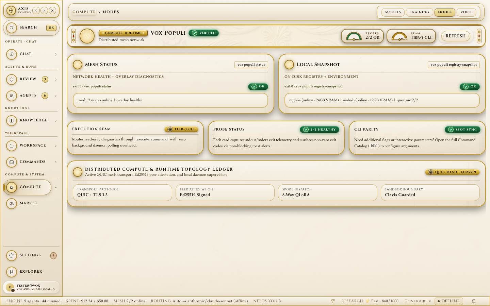 | Hardware-aware model selector (`select_mens_backend`) over Apple Silicon Metal (`monitor_metal`) and CUDA (`nvidia-smi` `accelerator_free_mb`) with VRAM floor guardrails. | `vox populi`<br/>`vox-populi` |
| **29** | `oratio`<br/>**Oratio (Speech-to-Code)** | 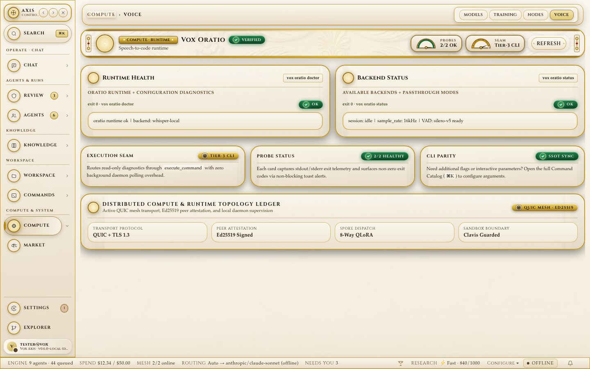 | Grammar-aware speech-to-code capture (`vox-tauri-stt` / `vox-speech`), ASR filler normalization, and spoken-operator lowering. | `vox speech`<br/>`vox-speech` |

---

### Domain V: System & `VRBS ROMA` (3 Views — Clavis, Doctor & Simulator)

| # | `viewKey` & Title | Real Screenshot (`v6.6`) | Why It Exists & What It Does | Backing CLI / Crate |
|:---|:---|:---|:---|:---|
| **30** | `settings`<br/>**Settings, Clavis & Theme Contract** | 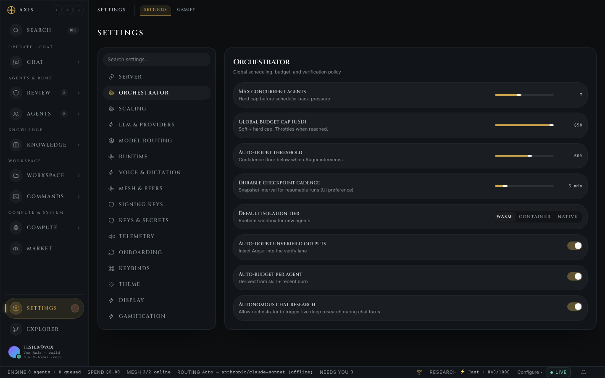 | Manages **Clavis** secrets (`vox-secrets`), Local IPC vs. Remote TOFU TLS connection pins, orchestrator concurrency/budget caps, and the **4-Profile Theme Contract** with live DOM WCAG observability (`22/22 Verified`). | `vox secrets`<br/>`vox config` |
| **31** | `explorer`<br/>**System Explorer (`vox doctor`)** | 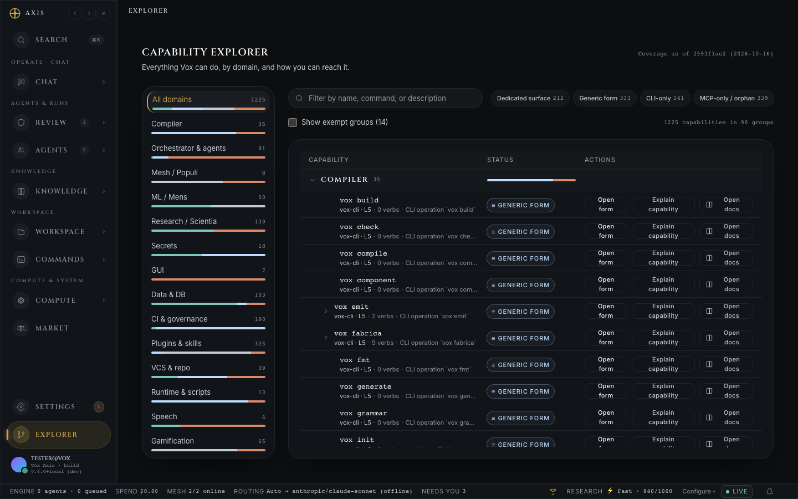 | Runs diagnostic probes across toolchain, build-broker shim (`vox-cargo-shim`), `VoxDb` schema baseline (`v97`), and Clavis secret parity. | `vox doctor`<br/>`vox-cli-diagnostics` |
| **32** | `gamify`<br/>**`VRBS ROMA` Simulator & Ludus Arena** | 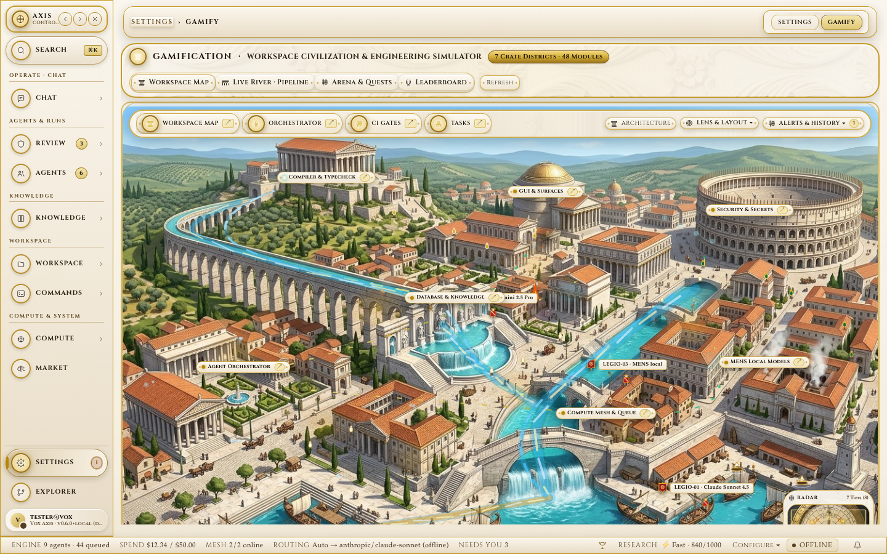 | Combines the **`VRBS ROMA` Workspace Civilization & Engineering Simulator** (`WORKSPACE MAP`), `LIVE RIVER · PIPELINE`, `ARENA & QUESTS`, and `BLAKE3 + Ed25519` signed `LEADERBOARD` snapshots. | `vox ludus`<br/>`vox-gamify` |

---

## Tradeoffs

The operational benefits of Axis are covered in [Why Axis Exists](#why-axis-exists--separation-of-concerns). Below are the engineering costs and constraints of its design:

| Design Choice | Engineering Cost & Operational Constraint |
|:---|:---|
| **Catalog-generated 32-surface registry (`SURFACE_REGISTRY`)** | **Navigation density.** Exposing every CLI/MCP capability produces 32 views across 5 domains; operators rely on the `⌘K` palette and progressive-disclosure tabs rather than memorizing routes. |
| **Tauri 2 native desktop shell + React 19** | **Platform WebView dependencies.** Building `vox-gui` on Linux requires `libwebkit2gtk-4.1-dev`, so `vox-gui` is excluded from default headless Cargo builds (`default-members = ["crates/vox-cli"]`). |
| **Enforced 4-profile CSS & font contract (`vox/ui/theme-contract-drift`)** | **Strict styling discipline.** Hardcoded hex literals (`bg-[#120E09]`) or unapproved font stacks fail `vox audit code` with `Severity::Error`; all styling must route through the 22 semantic tokens. |
| **TOFU SPKI SHA-256 TLS pinning (`Remote Mode`)** | **Manual key rotation.** Rotating a remote `vox-orchestrator-d` TLS certificate requires re-approving the pinned SPKI fingerprint in `Settings → Server`. |

---

## Status

Graded into four honest states (`Working`, `Prototype`, `Research`, `Not started`):

| Subsystem | State | Checked | Notes |
|:---|:---|:---|:---|
| **App Shell, 5-Domain Sidebar, Status Bar & `⌘K` Palette** | Working | 2026-11-10 | Verified across `1280×800`, `1440×900`, and `1920×1080` in `cv-flywheel.spec.ts` (`0` occlusions, `0` clipped controls). |
| **4-Profile Theme Contract (`arcane`, `slate`, `glacier`, `high-contrast`)** | Working | 2026-11-10 | Enforced by Style-Dictionary, `themeContract.test.ts` (`37` views + `14` docks), and `vox/ui/theme-contract-drift` (`Severity::Error`). |
| **`VRBS ROMA` Simulator (`LudusSandbox`) & `AQVAEDUCTUS` Cascade (`HarnessRiverPanel`)** | Working | 2026-11-10 | Synchronized panorama camera, `ImperiumInspector` blast-radius DAG, 7-tier `Forma Urbis` radar, and 3-tier hydraulic cascade verified in Phase 385–386. |
| **Multi-Dock Chat (`ChatSurface`, `Loquela`, `ChatExecutionRail`)** | Prototype | 2026-11-10 | Responsive 2-column auto-consolidation (`< 1560px`), `432` posture combinations, BPE compaction receipts, and LCA branch comparison work on primary paths. |
| **Dual Transport (`Local Tauri 2 IPC` & `Remote TOFU TLS`)** | Prototype | 2026-11-10 | `VoxDb` file-lock contention between `ModelRegistry` and `step_db` resolved (`Phase 385`). Multi-day remote packet-loss recovery is still being hardened. |
| **MENS Corpus & Crucible Studio (`mens`, `models`, `populi`)** | Prototype | 2026-11-10 | Inline `vox_compiler::parser` AST verification of `<think>` JSONL rows and McNemar gate scorecards work; `oratio` voice dictation remains `Research`. |

---

## Trying It & Satellite Maintainability

```bash
# 1. Build UI tokens & verify TypeScript + Vitest theme/surface contracts (standalone in vox-axis):
./scripts/build.sh
./scripts/test.sh

# 2. Run the multi-resolution Playwright CV Flywheel (1280x800, 1440x900, 1920x1080):
pnpm --dir crates/vox-gui/ui exec playwright test e2e/review/cv-flywheel.spec.ts --project=chromium

# 3. Launch the native Tauri 2 desktop app or verify cross-repo parity against a sibling vox checkout:
VOX_ROOT="${VOX_ROOT:-../vox}"
cargo run --manifest-path "$VOX_ROOT/Cargo.toml" -p vox-cli --features gui -- gui
cargo run --manifest-path "$VOX_ROOT/Cargo.toml" -p vox-cli -- ci cross-repo-parity
```

**Satellite Maintenance Rules (`README-SYNC-MAP`):**
1. **Shared Contracts (`contracts/gui/`, `contracts/telemetry/`):** Synchronized with [`vox-foundation/vox`](https://github.com/vox-foundation/vox) and verified by `vox ci cross-repo-parity`.
2. **README Mirror Parity:** `vox-axis/README.md` and `vox/crates/vox-gui/README.md` are kept byte-identical (`cp README.md "${VOX_ROOT:-../vox}/crates/vox-gui/README.md"`).
3. **Refreshing Captures & Tours:** Run `cv-flywheel.spec.ts`, copy `artifacts/cv-flywheel/surfaces/*-after.png` to `assets/screens/`, and rebuild `assets/tours/*.webp` via `img2webp`.

---

## Intellectual Lineage, Prior Art & References

Citations below cover the **GUI, spatial visualization, human-computer interaction, and remote transport** foundations specific to **Vox Axis**. For compiler, type-system, durable workflow, Tantivy RRF, SKOS, and QLoRA references, see [`vox-foundation/vox/README.md §Intellectual Lineage`](https://github.com/vox-foundation/vox#intellectual-lineage-prior-art--references).

[^1]: **Visual Quarantine for Indirect Prompt Injection:** Visually segregating `SystemVerified` corpus documents from `Untrusted` external scrapes in `vox-search`, `research`, and `chat` follows Kai Greshake et al., *"Not What You've Signed Up For: Compromising Real-World LLM-Integrated Applications with Indirect Prompt Injection"* ([arXiv:2302.12173](https://arxiv.org/abs/2302.12173), 2023).
[^2]: **Mixed-Initiative Attention Gating & Lock Coherence (`needs-you`, `tasks`):** Expected-information-gain interruption filtering in `attention_policy.rs` builds on Eric Horvitz, *"Principles of Mixed-Initiative User Interfaces"* (*ACM CHI* 1999), paired with SQLite per-file resource lock visualization ([ADR-025](https://voxlang.org/adr/025-multi-agent-lock-coherence/)) and HMAC-SHA256 tool receipts ([ADR-029](https://voxlang.org/adr/029-formal-intent/)).
[^3]: **3D Software City Metaphor (`VRBS ROMA`):** Mapping crates, LoC, and git churn into an interactive 3D/2.5D city credits Richard Wettel & Michele Lanza, *"Visualizing Software Systems as Cities"* (*CodeCity*, *IEEE VISSOFT* 2007), combined with Arthur B. Kahn's topological layering (*CACM* 1962), Robert Tarjan's strongly connected components (*SIAM J. Comput.* 1972), and Impressions Games' *Caesar III* (1998) civic telemetry walkers.
[^4]: **Roman Cartography (`Forma Urbis Romae` & Vitruvian Proportions):** The 7-Regio astrolabe radar and architectural hierarchy draw from the Severan Marble Plan (*Forma Urbis Romae*, c. 203–211 CE) and Vitruvius, *De Architectura* (Book III module proportions and *firmitas, utilitas, venustas*).
[^5]: **Trust-On-First-Use (TOFU) & SPKI Pinning (`Remote Mode`):** Remote daemon TLS authentication adapts Dan Wendlandt, David G. Andersen, & Adrian Perrig, *"Perspectives: Improving SSH-style Host Authentication with Multi-Path Probing"* (*USENIX ATC* 2008) and RFC 7469 Subject Public Key Info (SPKI) SHA-256 fingerprinting.
[^6]: **T3 Harness UI Patterns & Enforceable WCAG Design Tokens:** Stream resumption (`ResumableTurnStreamBuffer`), single-row posture bars (`Loquela`), and static token hygiene adapt patterns from [`pingdotgg/t3code`](https://github.com/pingdotgg/t3code) and [`vibheksoni/t3router`](https://github.com/vibheksoni/t3router) ([blueprint](https://github.com/vox-foundation/vox/blob/main/docs/src/architecture/t3-vs-vox-harness-router-blueprint-2026.md)), governed by [W3C WCAG 2.1](https://www.w3.org/TR/WCAG21/) contrast invariants.
