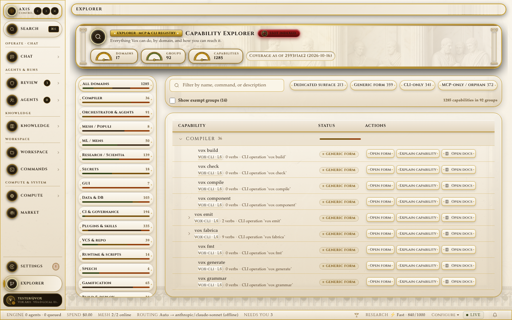
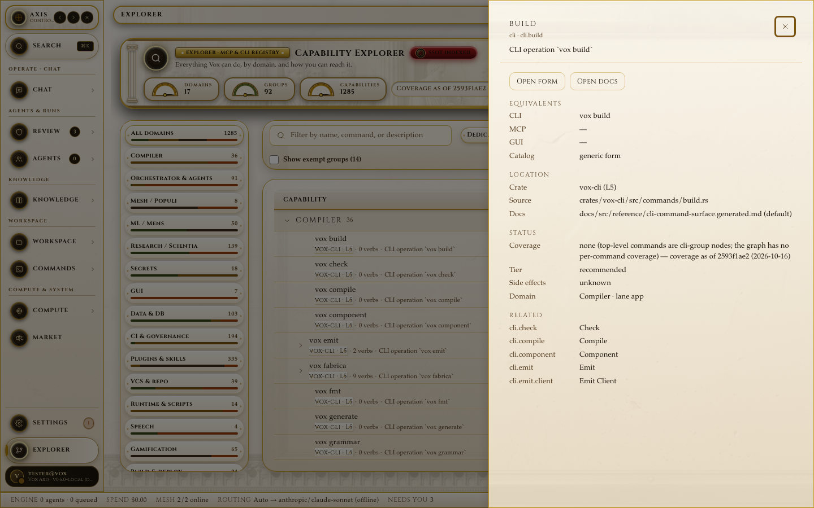
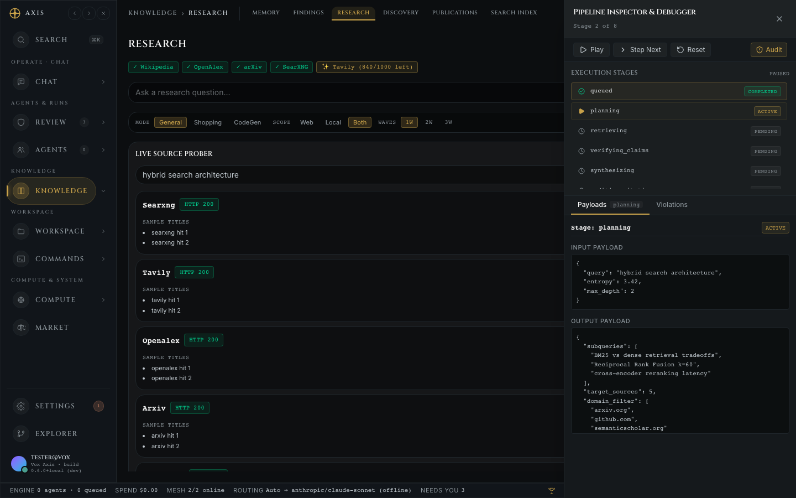
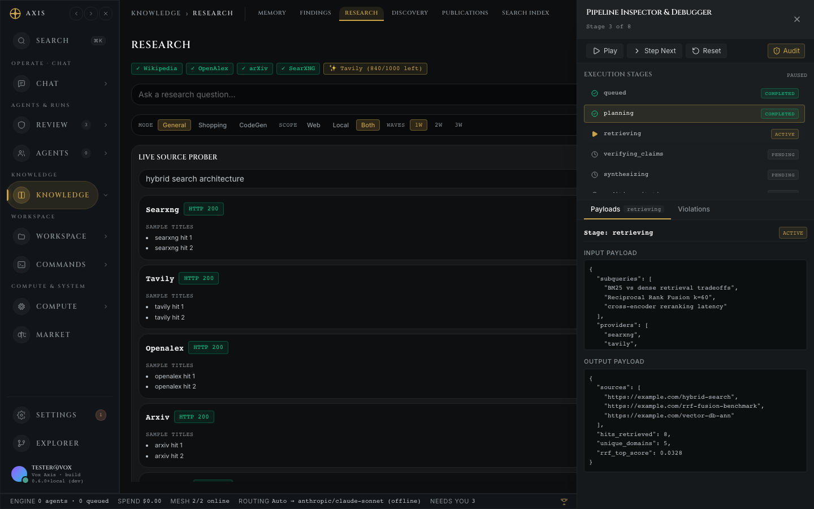
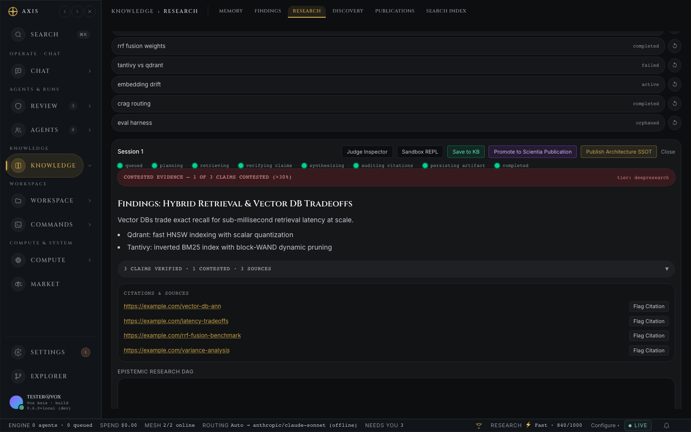
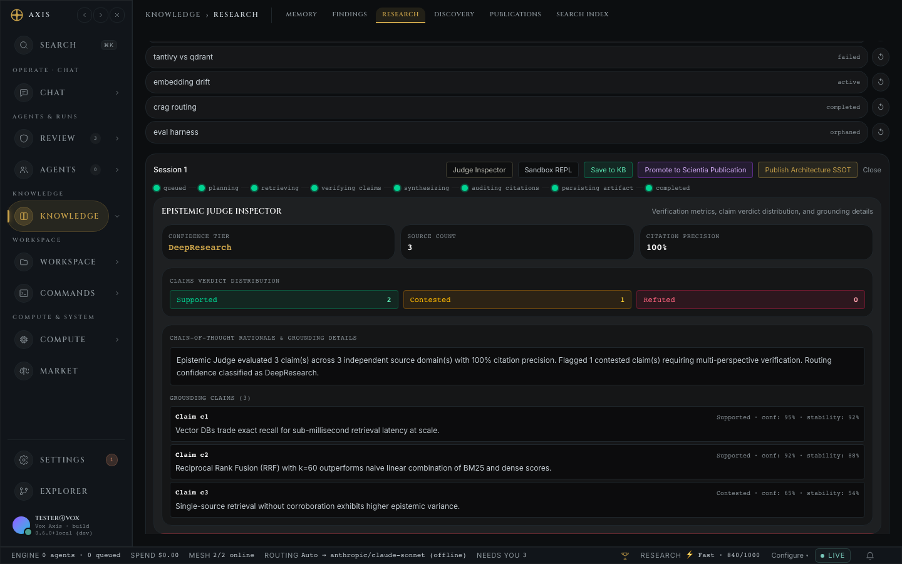
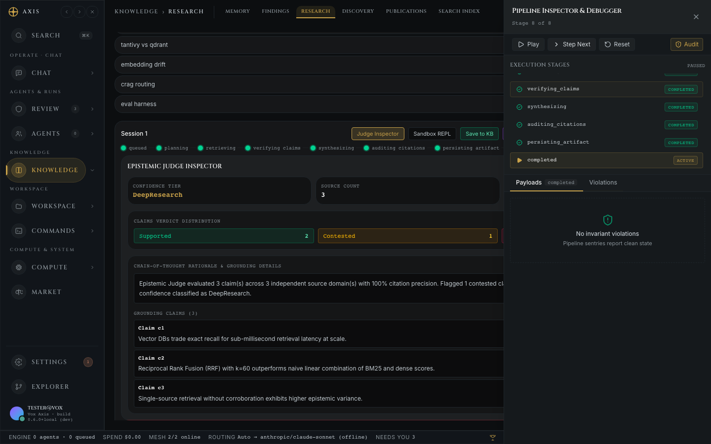
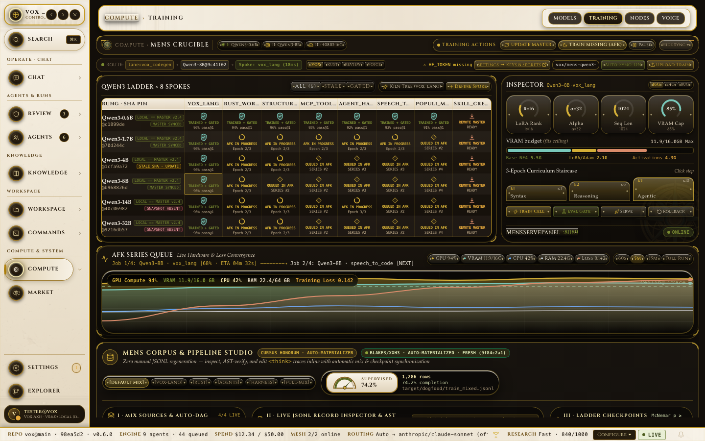
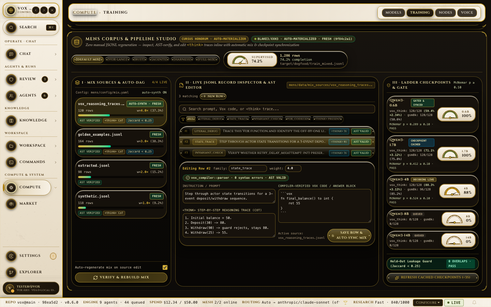

<!--
  Maintaining this README:
  - Status tables: when you verify a row, update its State, its "Checked" date, and its note.
    Leave rows you didn't check alone; a stale date is honest, a silently-edited row is not.
  - States are exactly: Working / Prototype / Research / Not started. Nothing goes above Working.
  - Every GUI screen in SURFACE_REGISTRY (crates/vox-gui/ui/src/generated/surfaceRegistry.generated.ts)
    must have a real screenshot under assets/screens/<view>.png and an explanation below.
  - Regenerate animated WebP tours when screen captures change (`vox ci gui-surface-registry --write`
    + Playwright `screenshots.spec.ts` + `img2webp`).
-->
<div align="center">
  

  <p>
    <strong>The desktop operator console for the Vox language, multi-agent harness, and MENS ML studio</strong><br />
    <em>32 typed operational surfaces · Local Tauri 2 IPC &amp; Remote TOFU TLS daemon modes · Cryptographic tool receipts · Universal <code>⌘K</code> capability palette</em>
  </p>

  <p>
    <sub>Led by <strong>Bertrand Reyna-Brainerd</strong> · Stewarded by the <strong>Vox Foundation</strong> (in formation) · Apache-2.0 · <strong>Pre-1.0 Research Prototype</strong></sub>
  </p>

  <p>
    <a href="https://voxlang.org"><strong>voxlang.org</strong></a> &nbsp;·&nbsp;
    <a href="https://github.com/vox-foundation/vox"><strong>vox-foundation/vox</strong></a> &nbsp;·&nbsp;
    <a href="https://github.com/vox-foundation/vox-axis"><strong>vox-foundation/vox-axis</strong></a> &nbsp;·&nbsp;
    <a href="https://github.com/vox-foundation/voxlang.org"><strong>vox-foundation/voxlang.org</strong></a>
  </p>

  <p>
    &nbsp;
    <a href="https://github.com/vox-foundation/vox-axis/commits/main"></a>&nbsp;
    <a href="LICENSE"></a>
  </p>
</div>

> [!WARNING]
> **Last reviewed: 2026-11-10.** **Vox Axis** (`vox-gui`, invoked via `vox gui` or `vox axis`) is an active pre-1.0 research prototype (`0.6.0` workspace), not production software. Its 32 surfaces are generated from the canonical operations catalog (`contracts/operations/catalog.v1.yaml` → `SURFACE_REGISTRY`) and verified via Playwright multi-resolution visual audits (`1280×800`, `1440×900`, `1920×1080`, `axeViolations: 0`). Local Tauri IPC, Remote TOFU TLS certificate pinning, the `⌘K` universal capability palette, the 4-profile theme engine (`carrara`, `slate`, `void`, `high-contrast`), and the 6-tab MENS Crucible Studio work on primary paths; edge cases and live multi-node mesh telemetry remain under active iteration. Limits are documented in the [Status](#status) tables below.

---

## Animated Visual Tour (`axis_hero_tour.webp`)

<div align="center">
  
  <p>
    <strong>Vox Axis Flagship Tour (Animated WebP)</strong><br />
    <em>Real Playwright captures cycling through the Operator Dashboard, Multi-Dock Chat with Trust Chips, Universal <code>⌘K</code> Palette, Task Hopper Queue, MENS Crucible QLoRA Studio, Capability Explorer, SCIENTIA Findings Ledger, and Clavis Settings.</em>
  </p>
</div>

---

## Contents

1. [Why Axis Exists](#why-axis-exists)
2. [Architecture & Visual Diagrams](#architecture--visual-diagrams)
3. [Complete Visual Tour: Every GUI Screen Explained (All 32 Surfaces)](#complete-visual-tour-every-gui-screen-explained-all-32-surfaces)
   - [Shell & Navigation Modes (`⌘K` Palette, Sidebar Rail & Wide)](#shell--navigation-modes-k-palette-sidebar-rail--wide)
   - [Lane 1: Operate (11 Screens — Multi-Agent Orchestration & Governance)](#lane-1-operate-11-screens--multi-agent-orchestration--governance)
   - [Lane 2: Develop (8 Screens — Code, Terminals, Capabilities & Diagnostics)](#lane-2-develop-8-screens--code-terminals-capabilities--diagnostics)
   - [Lane 3: Knowledge & 5-Stage Socrates HITL Gate (6 Screens + 5 HITL Stages)](#lane-3-knowledge--5-stage-socrates-hitl-gate-6-screens--5-hitl-stages)
   - [Lane 4: Compute / MENS Native ML Studio (4 Screens)](#lane-4-compute--mens-native-ml-studio-4-screens)
   - [Lane 5: System (3 Screens — Clavis Vault, Doctor Explorer & Ludus)](#lane-5-system-3-screens--clavis-vault-doctor-explorer--ludus)
4. [Tradeoffs: What Axis Optimizes For (and What It Costs)](#tradeoffs-what-axis-optimizes-for-and-what-it-costs)
5. [Status](#status)
6. [Trying It (Local & Remote Modes)](#trying-it-local--remote-modes)
7. [Cross-Repo Federation & Agent Awareness](#cross-repo-federation--agent-awareness)

---

## Why Axis Exists

When you coordinate multiple AI coding agents, a local RAG knowledge base, and a QLoRA fine-tuning loop over a terminal stream, four operational hazards stay invisible:

1. **Silent prompt pollution from untrusted retrieval.** A terminal chat log does not show whether a retrieved chunk came from a compiler-verified SSOT doc (`SystemVerified`) or an unverified web scrape (`Untrusted`).
2. **Unverified tool execution and lock collisions.** When three subagents edit a repository concurrently, stdout scrolling hides which agent holds a resource lock in `hopper_inbox` and whether a tool call produced a valid cryptographic HMAC receipt.
3. **Orphaned CLI and MCP capabilities.** As Vox grew to **1,056 CLI operations** and **376 MCP tools**, capabilities added in Rust were invisible unless you memorized subcommands.
4. **Split local vs. remote workflows.** You edit code on a laptop, but run `vox-orchestrator-d` and `vox mens train` on a headless GPU box. Running a separate web app introduces a second auth/schema surface to maintain.

**Vox Axis** solves these four problems in a single Tauri 2 + React 19 operator console:

- **One capability registry generates the UI map.** `SURFACE_REGISTRY` is generated directly from `contracts/operations/catalog.v1.yaml` via `vox ci gui-surface-registry --write`. Every CLI command group and MCP tool namespace maps to one of **32 surfaces** or the **Universal `⌘K` Capability Palette** — enforced by CI (`gui-surface-coverage`).
- **Retrieval trust tiers and HMAC tool receipts are first-class widgets.** Every chat turn and research trace displays color-coded trust chips (`SystemVerified` → `Trusted` → `Advisory` → `Untrusted`) and verifiable HMAC-SHA256 tool-call receipts.
- **One transport layer supports both Local Tauri IPC and Remote TOFU TLS.** Flipping a single switch in Axis transitions every panel from in-process Tauri IPC (`window.__TAURI_INTERNALS__.invoke`) to a remote `vox-orchestrator-d` daemon over a **Trust-On-First-Use (TOFU) SPKI SHA-256 TLS-pinned** connection.

---

## Architecture & Visual Diagrams

### 1. Dual-Mode Transport: Local Tauri 2 IPC vs. Remote TOFU TLS-Pinned Daemon

<div align="center">
  
  <p>
    <strong>One Console, Two Transport Paths</strong><br />
    <em>All 32 React 19 surfaces call a single typed transport facade (<code>transport.ts</code>). In Local Mode, calls route via Tauri 2 IPC to local <code>VoxDb</code> (schema v97) and <code>Clavis</code> with zero network dependency. In Remote Mode, calls route over a TOFU SPKI-pinned TLS WebSocket/HTTPS channel to a remote <code>vox-orchestrator-d</code> and GPU mesh host.</em>
  </p>
</div>

### 2. The 32-Surface Operational Taxonomy & `⌘K` Universal Palette

<div align="center">
  
  <p>
    <strong>5 Operational Lanes, 32 Surfaces, 1,056 Cataloged Operations</strong><br />
    <em>Axis organizes every Vox capability into five cognitive lanes — <strong>Operate</strong> (11), <strong>Develop</strong> (8), <strong>Knowledge</strong> (6), <strong>Compute / MENS</strong> (4), and <strong>System</strong> (3) — unified by the <code>⌘K</code> Universal Capability Palette.</em>
  </p>
</div>

### 3. End-to-End Trust Boundary: Retrieval Trust Tiers, 5-Stage Socrates Gate & HMAC Receipts

<div align="center">
  
  <p>
    <strong>Inspectable Trust from Ingest to Execution</strong><br />
    <em>Raw external scrapes are quarantined as <code>Untrusted</code> in <code>kb_findings</code> and must clear the 5-stage Socrates HITL verification stepper before entering trusted context. Every MCP tool dispatch returns a cryptographic HMAC-SHA256 receipt chip.</em>
  </p>
</div>

---

## Complete Visual Tour: Every GUI Screen Explained (All 32 Surfaces)

Every screenshot below is a **real automated Playwright capture** (`1440×900` Chromium against `SURFACE_REGISTRY` in [`screenshots.spec.ts`](file:///Users/brbrainerd/dev/vox/crates/vox-gui/ui/e2e/screenshots.spec.ts) and [`cv-flywheel.spec.ts`](file:///Users/brbrainerd/dev/vox/crates/vox-gui/ui/e2e/review/cv-flywheel.spec.ts)).

---

### Shell & Navigation Modes (`⌘K` Palette, Sidebar Rail & Wide)

Before diving into the 32 domain views, Axis provides three shell-level navigation mechanisms that stay accessible from every screen:

| Shell Mode | Screenshot | Why It Exists & What It Can Do |
|:---|:---|:---|
| **Universal `⌘K` Command Palette**<br/>(`_command-palette`) |  | **Why it exists:** With 32 GUI screens, 376 MCP tools, and 1,056 CLI operations, hunting through nested menus slows operators down.<br/>**What it does:** Pressing `⌘K` (or `Ctrl+K`) opens an instant hybrid lexical + RRF semantic search overlay over `capability-index.v1.json`, allowing you to jump to any view, execute a CLI/MCP operation, or submit a task directly from the keyboard. |
| **Sidebar — Wide Mode (`_sidebar-wide`) & Compact Rail Mode (`_sidebar-rail`)** | <br/> | **Why it exists:** Operators need labeled group hierarchy when learning the 5 lanes, and maximum horizontal canvas when tiling code, chat, and traces.<br/>**What it does:** Toggles seamlessly between full grouped labels (`Operate`, `Develop`, `Knowledge`, `Compute`, `System`) and a zero-occlusion icon rail while keeping the live bottom status bar (`Local`/`Remote` connection badge, active model, daemon lock health, and theme selector) pinned. |

---

### Lane 1: Operate (11 Screens — Multi-Agent Orchestration & Governance)

<div align="center">
  
  <p><em>Animated Tour — Lane 1: Operate (`Dashboard` → `Chat` → `Tasks` → `Sub-Agents` → `Flow` → `Mesh` → `Runs` → `Needs You` → `Approvals` → `Policies` → `Mercatus`)</em></p>
</div>

| # | Screen (`viewKey`) | Real Screenshot | Why It Exists | What It Can Do & Backing Surface |
|:---|:---|:---|:---|:---|
| **1** | **Dashboard**<br/>(`dashboard`) |  | Operators need a single at-a-glance cockpit showing whether the orchestrator daemon, active agents, task hopper, and model router are healthy before dispatching work. | Displays live agent count, hopper queue depth, recent turn traces, active model routing pins, and one-click quick actions into Chat, Tasks, and MENS Studio. (`vox status`, `vox-orchestrator-d`) |
| **2** | **Chat Workbench**<br/>(`chat`) |  | Standard chat UIs hide retrieval provenance, model-routing choices, and tool-execution proofs. | Multi-dock 2D tiling chat workbench with session rail, per-turn retrieval **Trust Chips** (`SystemVerified`..`Untrusted`), **HMAC-SHA256 tool receipt chips**, `/skill-name` invocation, and live Orchestrator→Spoke routing badges. (`vox chat`, `vox_actor_runtime::llm`) |
| **3** | **Tasks (Hopper Queue)**<br/>(`tasks`) |  | Multi-agent runs deadlock or overwrite files without explicit task dependency ordering and resource lock visibility. | Inspects, submits, prioritizes (`Urgent`, `Normal`, `Background`), and cancels tasks in the `hopper_inbox` queue, showing `resource_id` lock owners per ADR-025. (`vox plan`, `vox_orchestrator::hopper`) |
| **4** | **Sub-Agents**<br/>(`sub-agents`) |  | Parallel subagent waves require live visibility into each child agent's role, workspace mode (`inherit`/`branch`/`share`), and current step. | Visualizes the active parent→child subagent tree, live state (`running`, `idle`, `blocked`), conversation transcripts, and emergency kill controls. (`vox-orchestrator`, `mcp_agent_*`) |
| **5** | **Flow (Durable Workflows)**<br/>(`flow`) |  | Long-running `.vox` `workflow` and `activity` declarations persist journal state in `VoxDb` (`workflow_patch_log`) and need visual replay inspection. | Renders the directed execution graph of durable workflows, showing completed steps, replay checkpoints, retries, and failure spans per ADR-019/041. (`vox workflow`, `vox-workflow-runtime`) |
| **6** | **Mesh Topology**<br/>(`mesh`) |  | When orchestrating across local and remote nodes over Iroh QUIC transport (ADR-047), operators need to see peer reachability and latency. | Displays connected mesh peers, ALPN protocol negotiation status, relay vs. direct QUIC paths, and federated task-routing health. (`vox populi`, `vox-plugin-populi-mesh`) |
| **7** | **Runs History**<br/>(`runs`) |  | Past agent episodes, script executions, and workflow runs must be auditable after completion or failure. | Lists historical execution runs with duration, exit status, token consumption, linked commit SHA, and drill-down logs. (`vox-db` execution ledger) |
| **8** | **Needs You (Attention Gate)**<br/>(`needs-you`) |  | Agents interrupting the human on every trivial step cause alert fatigue; silent execution on high-risk steps (`deploy`, `publish`, `delete`) is dangerous. | Implements the information-theoretic **Attention Policy** (`attention_policy.rs`), surfacing only high-expected-gain / high-risk decisions that require human intervention. (`vox attention`) |
| **9** | **Approvals & Secrets Gate**<br/>(`approvals`) |  | High-privilege tool invocations, secret resolutions, and destructive shell commands require explicit operator sign-off with an audit trail. | Presents pending capability/tool approval requests with exact diff/command previews and records cryptographic approval receipts. (`vox secrets`, `vox-orchestrator-mcp`) |
| **10** | **Policies**<br/>(`policies`) |  | Terminal execution allowlists (`exec-policy.v1.yaml`), Socrates confidence thresholds, and scaling budgets must be inspectable without digging through YAML files. | Displays and validates active execution policies, capability classifications, and guardrail rules enforced across CLI, MCP, and GUI. (`vox policy`, `vox shell check`) |
| **11** | **Mercatus (Token & Cost Market)**<br/>(`mercatus`) |  | Multi-model routing across OpenRouter frontier models and local MENS adapters requires real-time cost-per-token and budget tracking. | Tracks spend by provider, model family, and task category, comparing cloud inference cost against local MENS QLoRA execution savings. (`vox-orchestrator-models`) |

---

### Lane 2: Develop (8 Screens — Code, Terminals, Capabilities & Diagnostics)

<div align="center">
  
  <p><em>Animated Tour — Lane 2: Develop (`Console` → `Catalog` → `Capability Explorer` → `Skills` → `Harness` → `Harness Health` → `Repository` → `Browser` → `CodeRabbit`)</em></p>
</div>

| # | Screen (`viewKey`) | Real Screenshot | Why It Exists | What It Can Do & Backing Surface |
|:---|:---|:---|:---|:---|
| **12** | **Console (Daemon PTY Workbench)**<br/>(`console`) |  | Terminal sessions started by an agent or operator should survive GUI restarts and work identically over remote TOFU connections. | Connects to daemon-hosted `term.*` PTY sessions (`vox-terminal-core`), supporting multi-tab persistent shells, command policy checks, and live output streaming. (`vox term`) |
| **13** | **Capability Catalog & Explorer**<br/>(`catalog`) | <br/> | Ensures zero hidden capabilities: every CLI subcommand, MCP tool, and GUI view in `contracts/operations/catalog.v1.yaml` is browsable and executable in one place. | Filters all **1,056 cataloged operations** by domain, surface parity badge (`CLI`, `MCP`, `GUI`), exemption status, and opens an interactive **Explain Drawer** (`vox explain`) with typed parameter forms. (`vox commands`, `vox features`) |
| **14** | **Skills (`SKILL.md` Registry)**<br/>(`skills`) |  | Vox shares [agentskills.io](https://agentskills.io/specification) `SKILL.md` packages across 40+ harnesses (Claude Code, Cursor, Antigravity, Gemini CLI). Operators need to see which skills are discovered and active. | Searches (`vox-search` hybrid lexical+RRF), inspects frontmatter/permissions, and previews instructions for all workspace, user, and built-in Superpowers skills. (`vox skill list`, `vox skill search`) |
| **15** | **Harness Evaluation**<br/>(`harness`) |  | Agent harness changes can silently degrade multi-turn tool selection or compiler-feedback recovery if not benchmarked against golden episodes. | Runs and inspects `vox harness eval` offline golden sets and multi-turn agent trajectories with pass/fail breakdowns. (`vox harness eval`) |
| **16** | **Harness Health (`vox audit`)**<br/>(`harness-health`) |  | Architectural layer violations (`vox-arch-check`), stub/magic-value drift (`toestub`), and crypto/LLM-boundary violations need a unified visual gate. | Surfaces live findings from `vox audit code`, `vox audit arch`, `vox audit retirement`, and `vox audit effort` with file/line deep links. (`vox audit`, `vox-code-audit`) |
| **17** | **Repository & 4-Repo Federation**<br/>(`repository`) |  | After defactoring into `vox`, `vox-axis`, `voxlang.org`, and `vox-ops`, operators and LLMs need live visibility into cross-repo contract parity and symbol edges. | Displays the 4 registered repositories from `.vox/repositories.yaml`, BLAKE3 contract digest parity (`55/55` files), federated symbol graph nodes (`404` nodes), and Cargo `[patch]` link status. (`vox repo`, `vox ci cross-repo-parity`) |
| **18** | **Browser Preview & DOM Inspector**<br/>(`browser`) |  | Full-stack `.vox` apps (`vox build` / `vox dev`) emit React/TSX frontends that agents and humans need to preview and visually audit inside the workbench. | Embeds a live preview frame with viewport responsiveness presets, console error capture, and DOM/accessibility inspection hooks. (`vox dev`) |
| **19** | **CodeRabbit AI Review**<br/>(`coderabbit`) |  | Pre-merge diffs benefit from structured multi-axis AI code review (correctness, security, architecture, over-engineering) before hitting CI. | Runs `vox review` against working-tree or branch diffs, grouping findings by severity (`Critical`, `Warning`, `Info`) with one-click file navigation. (`vox review`, `vox-code-audit::review`) |

---

### Lane 3: Knowledge & 5-Stage Socrates HITL Gate (6 Screens + 5 HITL Stages)

<div align="center">
  
  <p><em>Animated Tour — Lane 3: Knowledge &amp; Socrates HITL (`Search Index` → `Memory` → `Discovery` → `Research` → `SCIENTIA Findings` → `Publications` → `Stages 1–5 HITL Inspector`)</em></p>
</div>

| # | Screen (`viewKey`) | Real Screenshot | Why It Exists | What It Can Do & Backing Surface |
|:---|:---|:---|:---|:---|
| **20** | **Search Index (`vox-search`)**<br/>(`vox-search`) |  | Operators need to query the curated KB Library (`vox kb`) and inspect Tantivy lexical + semantic RRF fusion scores and `trust_tier` tags directly. | Executes hybrid queries across `search_documents` (`VoxDb` v97), filtering by `SystemVerified`, `Trusted`, `Advisory`, or `Untrusted` tiers and KB taxonomy facets. (`vox kb`, `vox-search`) |
| **21** | **Episodic Memory**<br/>(`memory`) |  | Long-horizon coding and research sessions accumulate facts, architectural decisions, and session summaries that persist across context resets. | Browses, searches, and prunes persistent agent memory entries and temporal knowledge-graph triples stored in `VoxDb`. (`vox memory`) |
| **22** | **Discovery (`vox scientia scout`)**<br/>(`activity`) |  | Research signals from repositories, benchmarks, and literature feeds arrive continuously and need triage before full investigation. | Streams incoming Phase A/F signal producers (`vox-scientia-producers`) so operators can promote high-value signals into full research investigations. (`vox scientia scout`) |
| **23** | **Deep Research & 5-Stage Socrates HITL Stepper**<br/>(`research`) | <br/> <br/> <br/> | Black-box "deep research" tools hallucinate citations or blend untrusted web scrapes into prose. Axis makes every stage of the research pipeline pauseable, inspectable, and human-steerable. | Walks through all **5 Socrates HITL stages**:<br/>1. **Stage 1 — Planning:** Query decomposition & source budget<br/>2. **Stage 2 — Retrieving:** Federated fetch across OpenAlex, arXiv, Wikipedia, SearXNG, Tavily & local KB<br/>3. **Stage 3 — Verifying Claims:** Per-sentence claim-span grounding<br/>4. **Stage 4 — Judge Inspector:** Contradiction & confidence scoring<br/>5. **Stage 5 — Sentry Audit:** Quarantine vs. promotion into trusted KB (`vox research`) |
| **24** | **SCIENTIA Findings Ledger**<br/>(`scientia`) |  | Verified empirical findings (`kb_findings`), replay receipts, and critic-gate scores need a structured ledger separate from raw notes. | Inspects verified research findings, statistical benchmark proofs (McNemar $p$-values), and nanopub attestation readiness. (`vox scientia`, `vox-scientia`) |
| **25** | **Publications Studio**<br/>(`publications`) |  | Turning verified SCIENTIA findings and reproducible benchmarks into structured manuscripts or technical reports requires citation-locked scaffolding. | Scaffolds, previews, and exports citation-backed technical reports and manuscript sections via `vox-manuscript-scaffold` and `vox-findings-site`. (`vox scientia`) |

---

### Lane 4: Compute / MENS Native ML Studio (4 Screens)

<div align="center">
  
  <p><em>Animated Tour — Lanes 4 &amp; 5: Compute / MENS (`MENS Crucible Studio` → `Corpus Inspector` → `Models` → `Populi Nodes` → `Oratio Voice`) &amp; System (`Settings` → `Explorer` → `Gamify`)</em></p>
</div>

| # | Screen (`viewKey`) | Real Screenshot | Why It Exists | What It Can Do & Backing Surface |
|:---|:---|:---|:---|:---|
| **26** | **MENS Training & Crucible Studio**<br/>(`mens`) | <br/> | Fine-tuning pure-Rust (Candle) QLoRA adapters across Qwen3 model sizes (`0.6B`, `1.7B`, `4B`, `8B`, `14B`, `32B`) and 8 domain spokes requires live loss/VRAM telemetry, synthetic topic-tree curation (`Kiln`), and statistical gate verification. | Provides the **6-tab MENS Crucible Studio**:<br/>• **Ladder & Hub Status:** Tracks trained vs. published adapters on Hugging Face<br/>• **Crucible Config:** Configures rank, alpha, learning rate, and backend (`Metal`, `CUDA`, `CPU`)<br/>• **Corpus Studio Inspector:** Inspects `SpokeTopicTreeV1` synthetic pairs and Oracle-Fail→DPO repairs<br/>• **Live Training Telemetry:** Loss curves, tokens/sec, and VRAM floor guardrails (`vox mens train`, `vox-populi`) |
| **27** | **Models Router & Leaderboard**<br/>(`models`) |  | Vox routes every LLM call through `vox_actor_runtime::llm` using live OpenRouter `/api/v1/models` metadata alongside local Ollama and MENS revisions. | Inspects registered models, per-task-class scores (latency, cost, quality, locality), `~family-latest` role pins, `eval-compare` McNemar leaderboards, and interactive routing explainers. (`vox model`) |
| **28** | **Populi Compute Nodes**<br/>(`populi`) |  | Selecting the largest Qwen3 QLoRA model that fits available VRAM across local Apple Silicon (`monitor_metal`) or remote CUDA nodes (`nvidia-smi`) requires live hardware telemetry. | Displays discovered local and mesh GPU nodes, `accelerator_free_mb` fit calculations, and active training/serving worker assignments. (`vox populi`) |
| **29** | **Oratio (Voice / Speech-to-Code)**<br/>(`oratio`) |  | Dictating `.vox` declarations or agent instructions requires grammar-aware speech transcription tuned to Vox identifiers and keywords. | Provides audio capture controls, transcription confidence inspection, and speech-to-code dataset rubric labeling. (`vox speech` / `vox oratio`) |

---

### Lane 5: System (3 Screens — Clavis Vault, Doctor Explorer & Ludus)

| # | Screen (`viewKey`) | Real Screenshot | Why It Exists | What It Can Do & Backing Surface |
|:---|:---|:---|:---|:---|
| **30** | **Settings, Clavis Vault & Theme Engine**<br/>(`settings`) |  | API keys (`OPENROUTER_API_KEY`, `HF_TOKEN`, `COOLIFY_TOKEN`), Local/Remote TOFU connection pins, and UI themes must be managed through `Clavis` (`vox-secrets`) rather than scattered `.env` files. | Configures **Clavis** secret sources, switches between **Local Tauri IPC** and **Remote TOFU Daemon** modes, manages spend caps, and selects between the 4 enforced theme profiles (`Carrara Marble`, `Slate`, `Void`, `High Contrast`). (`vox config`, `vox secrets`) |
| **31** | **Explorer (`vox doctor` & DB Diagnostics)**<br/>(`explorer`) |  | When a build tool, sccache wrapper, `VoxDb` schema migration, or secret key is misconfigured, operators need structured diagnostic probes with one-click remediation hints. | Runs `vox doctor` health checks across toolchain, `VoxDb` (schema baseline v97), Clavis secrets parity, and workspace build-broker state. (`vox doctor`, `vox diag`) |
| **32** | **Gamify (`Ludus` Verified Quests)**<br/>(`gamify`) |  | Turns verified engineering contributions (passing doctests, closing TOESTUB findings, running 5-spoke MENS evaluations) into cryptographically signed quests and leaderboard snapshots. | Displays active engineering quests, BLAKE3 hash-chained contribution receipts, and `VerifiedLeaderboardSnapshotV1` standings. (`vox gamify`, `extras-ludus`) |

---

## Tradeoffs: What Axis Optimizes For (and What It Costs)

| Design Choice | What You Gain (The Upside) | What It Costs (The Tradeoff) |
|:---|:---|:---|
| **Catalog-generated 32-surface registry (`SURFACE_REGISTRY`)** | Zero drift between CLI, MCP, and GUI: adding an operation to `contracts/operations/catalog.v1.yaml` automatically requires a GUI surface mapping or explicit exemption (`vox ci gui-surface-coverage`). | **High surface count.** 32 distinct panels is a wide console; new users rely heavily on the `⌘K` Universal Palette and compact sidebar rail until they learn the 5-lane layout. |
| **Tauri 2 native desktop shell + React 19 UI** | Native OS windowing, tiny memory footprint compared to Electron, direct in-process Rust IPC (`window.__TAURI_INTERNALS__`) in Local Mode, and zero separate local web server required. | **Platform WebView dependencies.** Building `vox-gui` from source on Linux requires system WebKitGTK (`libwebkit2gtk-4.1-dev`) headers, which is why `vox-gui` is excluded from default Cargo builds (`default-members = ["crates/vox-cli"]`). |
| **Strict 4-profile CSS token contract (`carrara`, `slate`, `void`, `high-contrast`)** | Every screen passes automated contrast (`axeViolations: 0`) and zero-dark-hex-drift gates across both light (Carrara marble/gold) and dark/minimalist (Slate/Void) themes. | **Strict styling rules.** Ad-hoc hardcoded hex colors in `.tsx` or `.css` files are rejected by `index.css.test.ts` and `cv-flywheel.spec.ts`. |
| **TOFU SPKI SHA-256 TLS pinning for Remote Mode** | Connects securely to headless GPU / daemon boxes without requiring public CA certificates or exposing unauthenticated ports. | **First-connect fingerprint ceremony.** Rotating a remote daemon's TLS key requires explicitly clearing or re-approving the pinned SPKI digest in Settings. |

---

## Status

Every Axis surface is graded into one of four honest states (`Working`, `Prototype`, `Research`, `Not started`):

| Surface Group | State | Checked | Notes |
|:---|:---|:---|:---|
| **App Shell, 5-Lane Sidebar & `⌘K` Universal Palette** | Working | 2026-11-10 | Tested across `1280×800`, `1440×900`, and `1920×1080` in `screenshots.spec.ts` and `universal-palette.spec.ts`. Zero console or page errors across all 32 views. |
| **4-Profile Theme Engine (`carrara`, `slate`, `void`, `high-contrast`)** | Working | 2026-11-10 | Enforced by `index.css.test.ts` and Playwright CV Flywheel (`axeViolations: 0`). |
| **Dual Transport (`Local Tauri IPC` & `Remote TOFU TLS`)** | Prototype | 2026-11-10 | `transport.ts` and `ipcBoundaries.test.ts` verify boundary safety; Remote mode tested via `axis-remote.spec.ts` and `chat-remote.spec.ts`. Live multi-day remote reconnection under packet loss is still being hardened. |
| **Operate Lane (`dashboard`, `chat`, `tasks`, `sub-agents`, `flow`, `mesh`, `runs`, `needs-you`, `approvals`, `policies`, `mercatus`)** | Prototype | 2026-11-10 | Multi-dock chat, trust chips, HMAC receipt chips, and hopper task submission work on primary paths. Live multi-node Iroh mesh visualization (`mesh`) remains experimental. |
| **Develop Lane (`console`, `catalog`, `skills`, `harness`, `harness-health`, `repository`, `browser`, `coderabbit`)** | Working | 2026-11-10 | Capability Explorer (`catalog`) covers all 19 interaction states in `capability-explorer.spec.ts`; `repository` reflects live 4-repo federation (`vox`, `vox-axis`, `voxlang.org`, `vox-ops`). |
| **Knowledge Lane & 5-Stage Socrates HITL (`vox-search`, `memory`, `activity`, `research`, `scientia`, `publications`)** | Prototype | 2026-11-10 | All 5 HITL stages (`Planning` → `Sentry Audit`) and trust-tier badges render and pass `stepper.spec.ts`. End-to-end manuscript export (`publications`) is prototype-grade. |
| **Compute / MENS Studio (`mens`, `models`, `populi`, `oratio`)** | Prototype | 2026-11-10 | 6-tab MENS Crucible Studio (`mens`), Clavis `HF_TOKEN` deep-link, and model routing explainer (`models`) verified in Pass 8 CV Flywheel (`visualAfterScore: 0.9352`). `oratio` voice lane is research-grade. |
| **System Lane (`settings`, `explorer`, `gamify`)** | Working | 2026-11-10 | `settings` (Clavis secret management + theme/remote toggles) and `explorer` (`vox doctor` checks) work reliably. `gamify` (`Ludus`) requires `--features extras-ludus`. |

---

## Trying It (Local & Remote Modes)

### 1. Run the UI Workbench & Playwright Visual Suite (Fastest)

```bash
# From the standalone vox-axis checkout (or crates/vox-gui in vox):
./scripts/build.sh
./scripts/test.sh

# Run the full 32-surface Playwright visual audit in Chromium:
pnpm --dir /Users/brbrainerd/dev/vox/crates/vox-gui/ui exec playwright test screenshots.spec.ts --project=chromium
```

### 2. Launch the Native Tauri 2 Desktop App

```bash
# From the vox workspace root:
cargo run -p vox-cli --features gui -- gui
# (or alias: `vox axis`)
```

---

## Cross-Repo Federation & Agent Awareness

`vox-foundation/vox-axis` is part of the 4-repository **Vox Foundation** federation:

| Repository | Visibility | Role & Shared Contracts |
|:---|:---|:---|
| **[`vox-foundation/vox`](https://github.com/vox-foundation/vox)** | Public (`Apache-2.0`) | Sovereign core compiler, interpreter, orchestrator, `VoxDb`, CLI, and canonical `docs/src/` SSOT. Runs 100% offline (`VOX_OFFLINE=1`). |
| **[`vox-foundation/vox-axis`](https://github.com/vox-foundation/vox-axis)** | Public (`Apache-2.0`) | Desktop Tauri 2 operator console (`vox-gui`). Synchronizes `contracts/gui/` and `contracts/telemetry/` via BLAKE3 digest parity. |
| **[`vox-foundation/voxlang.org`](https://github.com/vox-foundation/voxlang.org)** | Public (`Apache-2.0`) | Astro 7.4 + Starlight 0.42 documentation site and Coolify `/v1/eval` browser playground client. Synchronizes `contracts/documentation/`. |
| **`vox-foundation/vox-ops`** | Private (`Proprietary`) | Opt-in OTLP/ClickHouse telemetry ingest (`telemetry.voxlang.org`) and cloud GPU provider adapters (`RunPod`, `Vast.ai`, `Together`). Synchronizes `contracts/{wire,ipc,telemetry}/`. |

### Mandatory Agent & Contributor Sync Rules

Every coding agent working in `vox-axis` (read via [`AGENTS.md`](AGENTS.md) and [`/Users/brbrainerd/dev/AGENTS.md`](file:///Users/brbrainerd/dev/AGENTS.md)) is bound by three cross-repo invariants:

1. **Contract Parity Gate:** Any edit to `contracts/gui/` or `contracts/telemetry/` MUST pass `vox ci cross-repo-parity` (`55/55` shared contract files verified by BLAKE3 digest across all 4 repos).
2. **Surface Registry & Screenshot Sync:** Adding, renaming, or removing a GUI view or CLI/MCP operation requires running `vox ci gui-surface-registry --write`, re-running `playwright test screenshots.spec.ts`, and updating the corresponding screen row and animated `.webp` tour in this `README.md`.
3. **Documentation & `voxlang.org` Context:** Architecture SSOTs live in `vox/docs/src/architecture/` and publish to [voxlang.org](https://voxlang.org). Consult `.vox/cache/federated-symbol-graph.v1.json` (`vox ci federated-symbol-graph`) for cross-repo symbol lookup.
