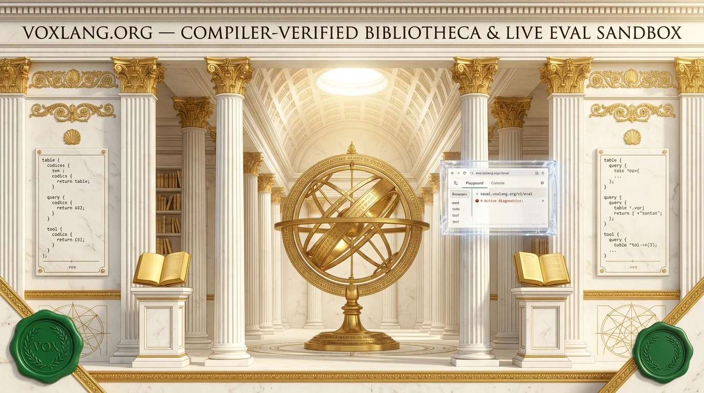
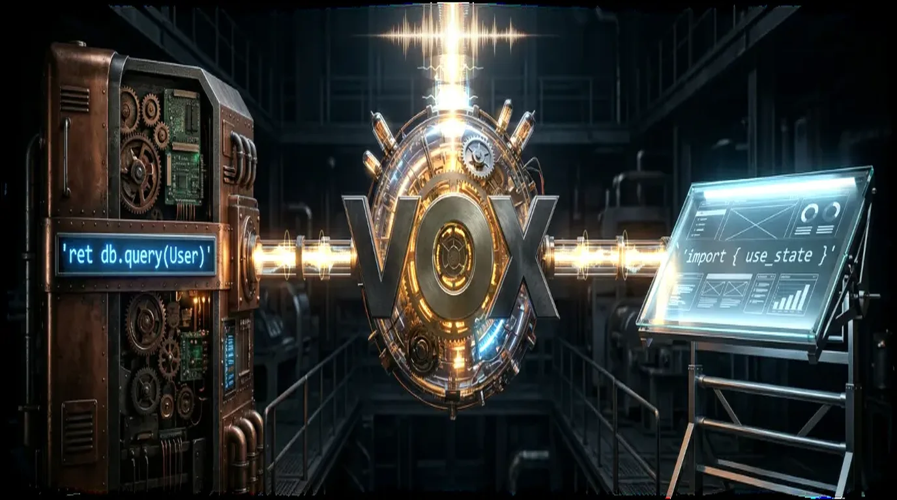
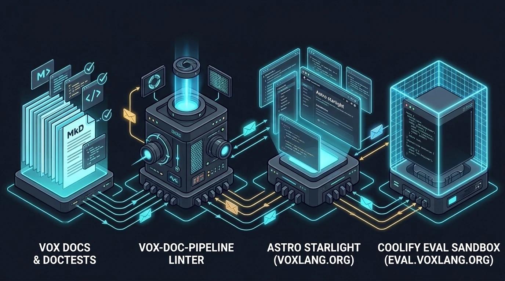

<!--
  README-SYNC-MAP (Satellite Maintainer Contract — vox-foundation/voxlang.org):
  1. Separation of Concerns:
     - `vox-foundation/voxlang.org` (this file, mirrored at `vox/docs-astro/README.md`) owns ONLY the
       public documentation engine (`docs-astro`: Astro 7.4 + Starlight 0.42), the `vox-doc-pipeline`
       verification gates (YAML frontmatter, W3C SKOS facets, Nanopublication provenance, executable `.vox`
       doctests, `why_vox` homepage sync), the `/voxup` bootstrap scripts, and the Coolify `eval.voxlang.org`
       (`/v1/eval`) deterministic browser sandbox.
     - Language grammar, compiler internals, and the 48-row suite status matrix live in `vox-foundation/vox/README.md`.
     - The 32-surface Tauri 2 desktop workbench and `VRBS ROMA` simulator live in `vox-foundation/vox-axis/README.md`.
  2. Mirror Parity:
     - Keep `voxlang.org/README.md`, `voxlang.org/docs-astro/README.md`, and `vox/docs-astro/README.md`
       byte-identical (`cp README.md docs-astro/README.md && cp README.md "${VOX_ROOT:-../vox}/docs-astro/README.md"`).
  3. Anti-Rot Rules:
     - Never hardcode machine-local paths (`/Users/...`); use `${VOX_ROOT:-../vox}` for sibling workspace calls.
     - Never copy-paste CLI command tables or GUI surface lists here; reference pages (`*.generated.md`) are
       emitted automatically from Rust source via `vox ci command-sync`.
     - Use bespoke raster graphics (`.webp` / `.png`) only — never duplicate `vox` or `vox-axis` banners/tours.
-->
<div align="center">
  

  <p>
    <strong>The compiler-verified documentation engine, W3C SKOS knowledge graph, and deterministic browser playground for Vox</strong><br />
    <em>Astro 7.4 + Starlight 0.42 · Executable <code>.vox</code> doctests (<code>vox-doc-pipeline</code>) · Diátaxis + SKOS + Nanopublication facets · Coolify <code>eval.voxlang.org/v1/eval</code> sandbox</em>
  </p>

  <p>
    <sub>Led by <strong>Bertrand Reyna-Brainerd</strong> · Stewarded by the <strong>Vox Foundation</strong> (in formation) · Apache-2.0 · <strong>Pre-1.0 Research Prototype (<code>v0.6.0</code> Workspace)</strong></sub>
  </p>

  <p>
    <a href="https://voxlang.org"><strong>voxlang.org</strong></a> &nbsp;·&nbsp;
    <a href="https://eval.voxlang.org/health"><strong>eval.voxlang.org</strong></a> &nbsp;·&nbsp;
    <a href="https://github.com/vox-foundation/vox"><strong>vox-foundation/vox (Language &amp; Compiler)</strong></a> &nbsp;·&nbsp;
    <a href="https://github.com/vox-foundation/vox-axis"><strong>vox-foundation/vox-axis (Desktop GUI)</strong></a>
  </p>

  <p>
    &nbsp;
    <a href="https://github.com/vox-foundation/voxlang.org/commits/main"></a>&nbsp;
    <a href="LICENSE"></a>
  </p>
</div>

> [!WARNING]
> **Last reviewed: 2026-11-10 (`v6.8` / `0.6.0` workspace).** `voxlang.org` is the public documentation publishing pipeline and interactive browser playground for the [Vox programming language](https://github.com/vox-foundation/vox). Every Markdown page authored under [`docs/src/`](https://github.com/vox-foundation/vox/tree/main/docs/src) is statically linted and type-checked by `vox-doc-pipeline` before Astro 7.4.5 + Starlight 0.42.9 compiles static assets for **Cloudflare Pages** (`voxlang.org`) and routes interactive playground snippets to the **Coolify** deterministic interpreter container (`eval.voxlang.org`).

---

## Animated Documentation & Eval Pipeline Tour (`voxlang_site_tour.webp`)

<div align="center">
  
  <p>
    <strong><code>voxlang.org</code> Publishing &amp; Verification Tour (Animated WebP · Imperial Roman Bibliotheca Series)</strong><br />
    <em>Four bespoke architectural plates cycling through: (I) Daniele Procida's Diátaxis quadrants[^1] unified under the W3C SKOS controlled vocabulary (<code>kb-taxonomy.v1.yaml</code>)[^2] and <code>.well-known/llms.txt</code>[^5]; (II) The <code>vox-doc-pipeline</code> four-arch gate (frontmatter validation, executable <code>.vox</code> doctest compilation, <code>why_vox</code> byte-parity sync, and Nanopublication provenance[^3]); (III) The <code>eval.voxlang.org/v1/eval</code> capability-sandboxed interpreter vault (<code>--caps deterministic</code>)[^4]; and (IV) Astro 7.4 + Starlight 0.42 static synthesis, VoxDiagram rendering, and Cloudflare Pages edge deployment.</em>
  </p>
</div>

---

## End-to-End Architecture Schematic

<div align="center">
  
  <p>
    <strong>From Source Manuscript (<code>docs/src/</code>) to Verified Edge Site &amp; Deterministic Sandbox</strong><br />
    <em>Documentation in Vox is treated as executable, taxonomy-classified code: broken internal links, invalid SKOS facets, drifted homepage anchors, or uncompilable <code>.vox</code> snippets fail CI before deployment.</em>
  </p>
</div>

---

## Why a Dedicated Documentation & Sandbox Pipeline Exists

In fast-moving language projects, documentation rots in three predictable ways:
1. **Uncompilable code examples.** Syntax evolves in the compiler while tutorial snippets silently break.
2. **Unstructured RAG ingestion.** When AI coding agents ingest hundreds of Markdown files without controlled `topic`/`domain` facets or authorship provenance, obsolete notes and current SSOTs blend together.
3. **High onboarding friction.** Asking a reader to clone a Rust workspace just to test a 15-line `.vox` declaration loses most curious developers before they run their first program.

**How `voxlang.org` eliminates all three:**

| Subsystem | Engineering Mechanism | Key Files & Gates |
|:---|:---|:---|
| **1. Suite Portal Frontpage (`docs/src/index.mdx`)** | Serves as the unified public entry point for the entire Vox suite: pairs the interactive `<VoxPlayground />` with animated `.webp` tours (`vox_language_suite_tour.webp` and `axis_hero_tour.webp`), the **Vox Axis** `VRBS ROMA` 3D/2.5D Simulator & `AQVAEDUCTUS` cascade showcase, side-by-side Light/Dark theme captures, and the 4-repository federation map. | `docs/src/index.mdx`, `src/styles/reader-layout.css`, `tests/reader-layout.spec.ts` |
| **2. Compiler-Verified Doctests (`vox-doc-pipeline`)** | Extracts every fenced ```` ```vox ```` block across `docs/src/` and runs `vox check` against the current compiler. A snippet may only bypass compilation if annotated with an explicit `// vox:skip <reason>` marker (reserved for multi-file excerpts). | `vox-doc-pipeline --lint-only`, `Docs Quality/docs-quality` CI job |
| **3. Diátaxis + W3C SKOS + Nanopublication Facets** | Organizes pages into **Diátaxis** quadrants[^1] while requiring YAML frontmatter (`title`, `description`, `category`, `topic`, `domain`, `authorship`) validated against [`contracts/documentation/kb-taxonomy.v1.yaml`](contracts/documentation/kb-taxonomy.v1.yaml)[^2] and a 40–120 word `<!-- kb:summary -->` block[^3]. | `contracts/documentation/kb-taxonomy.v1.yaml`, `kb-facet-backlog.v1.yaml` (shrink-only) |
| **4. Astro 7.4 + Starlight 0.42 Static Engine** | Builds the public site from frontmatter-derived navigation (`src/utils/sidebar.mjs` — `SUMMARY.md` is retired), compiles `vox-diagram` blocks into deterministic SVGs, enforces zero broken internal links via `starlight-links-validator` 0.27.0, and provides a dual-chevron collapsible reader layout (`#687`) with the unified 4-token font contract (`--font-display`, `--font-serif`, `--font-sans`, `--font-mono`). | `astro.config.mjs`, `src/utils/sidebar.mjs`, `src/components/VoxPlayground.astro` |
| **5. Live Browser Eval Sandbox (`eval.voxlang.org`)** | Interactive `<VoxPlayground />` islands send `.vox` snippets to `POST https://eval.voxlang.org/v1/eval`, which runs `vox run --interp --caps deterministic` inside a stateless Coolify container[^4] with an in-memory SQLite `VoxDb` and zero ambient filesystem, network, or secret access. | `vox-eval.compose.yml`, `.github/workflows/deploy-hetzner.yml`, `vox ci coolify-eval` |
| **6. Agent Discovery & Installer Bootstrap** | Publishes [`.well-known/llms.txt`](https://voxlang.org/.well-known/llms.txt)[^5] for LLM context ingestion and serves `/voxup` (POSIX) and `/voxup.ps1` (PowerShell) bootstrap scripts verified by Playwright smoke tests (`tests/smoke.spec.ts`). | `public/voxup`, `public/voxup.ps1`, `tests/smoke.spec.ts` |

---

## Separation of Concerns & Satellite Maintainability

To prevent cross-repository drift, `vox-foundation/voxlang.org` enforces a strict **Single-Source Authoring Contract**:

| Artifact Class | Canonical Source of Truth | How It Reaches `voxlang.org` (Zero Hand-Copy Rule) |
|:---|:---|:---|
| **Language rationale (`Why Vox`)** | `<!-- ANCHOR: why_vox -->` in [`vox-foundation/vox/README.md`](https://github.com/vox-foundation/vox/blob/main/README.md) | Synced into `{/* SYNC-FROM-README: why_vox */}` in `docs/src/index.mdx`; byte-parity enforced by `vox-doc-pipeline`. |
| **CLI, MCP, env-var, config & plugin references** | Rust `clap` definitions & YAML contracts in `vox-foundation/vox` | Emitted into `docs/src/reference/*.generated.md` by `vox ci command-sync` and `vox ci generate-plugin-catalog-docs` (`Docs Quality/generator-drift` CI gate). |
| **Crate API reference pages** | Rustdoc JSON across workspace crates | Emitted into `docs/src/api/*.generated.md` (`linguist-generated` in `.gitattributes`). |
| **Sidebar navigation hierarchy** | Page YAML frontmatter (`category`, `sort_order`, `title`) | Computed dynamically at build time by `src/utils/sidebar.mjs` (never edit a manual table of contents). |
| **Documentation taxonomy & contracts** | `contracts/documentation/*` and `contracts/operations/catalog.v1.yaml` | Verified across `vox` and `voxlang.org` by `vox ci cross-repo-parity` (`BLAKE3` digest check). |

---

## Status

Graded into four honest states (`Working`, `Prototype`, `Research`, `Not started`):

| Subsystem | State | Checked | Notes (`2026-11-10` Verification) |
|:---|:---|:---|:---|
| **Astro 7.4.5 / Starlight 0.42.9 site build** | Working | 2026-11-10 | Compiles all authored and generated pages cleanly; GitHub-style alerts render as native Starlight asides; `starlight-links-validator` 0.27.0 blocks broken internal links. |
| **`vox-doc-pipeline` frontmatter, SKOS & doctest gate** | Working | 2026-11-10 | Verified in `Docs Quality/docs-quality` CI (`0` errors): enforces required YAML keys, SKOS `topic`/`domain` prefLabels, shrink-only facet backlog, `.vox` doctests, and `why_vox` sync. |
| **Cloudflare Pages deployment (`voxlang.org`)** | Working | 2026-11-10 | Deployed from `main` via `wrangler pages deploy dist --project-name=vox-docs`, gated by Playwright layout and smoke checks (`tests/smoke.spec.ts`, `tests/collapsible-sidebars.spec.ts`). |
| **Coolify Browser Eval Sandbox (`eval.voxlang.org`)** | Working | 2026-11-10 | Runs `vox run --interp --caps deterministic` behind `/v1/eval`, declarative compose synced via `vox ci coolify-eval sync-compose --compose vox-eval.compose.yml`. |
| **Ludus Leaderboard Arena (`VoxLeaderboardArena.astro`)** | Prototype | 2026-11-10 | Renders and verifies `Ed25519`-signed `VerifiedLeaderboardSnapshotV1` payloads published by `ops.voxlang.org`. |

---

## Building, Testing & Synchronizing

All commands are portable across machines (using `VOX_ROOT="${VOX_ROOT:-../vox}"` when invoking the sibling Rust compiler workspace):

```bash
# 1. Build & test the Astro + Starlight site locally:
./scripts/build.sh
./scripts/test.sh

# 2. Run the compiler-verified documentation linter & doctest runner from a sibling vox checkout:
VOX_ROOT="${VOX_ROOT:-../vox}"
cargo run --manifest-path "$VOX_ROOT/Cargo.toml" -p vox-doc-pipeline -- --lint-only

# 3. Verify Coolify eval sandbox compose parity & cross-repo BLAKE3 contract digests:
cargo run --manifest-path "$VOX_ROOT/Cargo.toml" -p vox-cli -- ci coolify-eval discover
cargo run --manifest-path "$VOX_ROOT/Cargo.toml" -p vox-cli -- ci cross-repo-parity
```

---

## Intellectual Lineage, Prior Art & References

[^1]: **Diátaxis Documentation Architecture:** Separating documentation into Tutorials, How-To Guides, Reference, and Explanation follows Daniele Procida, *Diátaxis: A systematic approach to technical documentation authoring* ([diataxis.fr](https://diataxis.fr/)).
[^2]: **SKOS Controlled Vocabulary (`kb-taxonomy.v1.yaml`):** Hierarchical `topic` and `domain` `prefLabel` / `broader` / `related` facets follow W3C *SKOS Simple Knowledge Organization System Reference* (Alistair Miles & Sean Bechhofer, W3C Recommendation, 2009).
[^3]: **Nanopublication Provenance (`authorship`, `origin`, `kb:summary`):** Attaching machine-verifiable assertion, provenance, and publication metadata to each knowledge artifact draws from Paul Groth, Andrew Gibson, & Jan Velterop, *"The Anatomy of a Nanopublication"*, *Information Services & Use* 30(1–2), 2010.
[^4]: **Capability-Sandboxed Interpreter (`eval.voxlang.org`):** Executing untrusted browser snippets under `--caps deterministic` with zero ambient authority follows Jack B. Dennis & Earl C. Van Horn (*CACM* 1966), Mark S. Miller (*Robust Composition*, 2006), and the [Bytecode Alliance WASI capability model](https://wasi.dev/).
[^5]: **Machine-Readable LLM Discovery (`.well-known/llms.txt`):** Exposing a structured Markdown index of documentation for coding agents follows Jeremy Howard's [`llms.txt` specification](https://llmstxt.org/) (Answer.AI, 2024).
