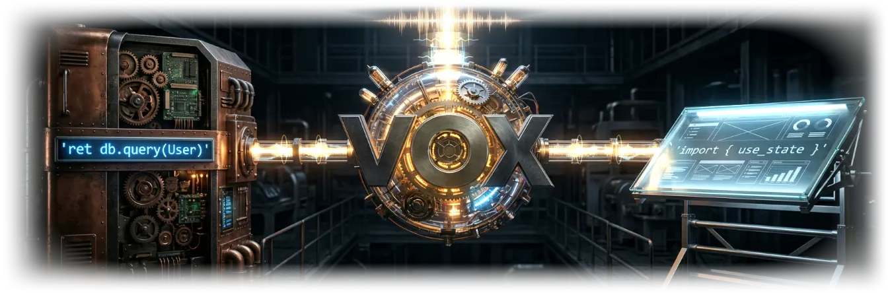

<!--
  Maintaining this README:
  - Status tables: when you verify a row, update its State, its "Checked" date, and its note.
  - States are exactly: Working / Prototype / Research / Not started. Nothing goes above Working.
  - The why_vox section in docs/src/index.mdx is lint-synced with vox-foundation/vox/README.md.
-->
<div align="center">
  

  <p>
    <strong>The public documentation site, curated knowledge base surface, and live browser playground for Vox</strong><br />
    <em>Astro 7.4 + Starlight 0.42 · Compiler-verified <code>.vox</code> doctests · VoxDiagram pre-rendering · Coolify <code>eval.voxlang.org</code> sandbox</em>
  </p>

  <p>
    <sub>Led by <strong>Bertrand Reyna-Brainerd</strong> · Stewarded by the <strong>Vox Foundation</strong> (in formation) · Apache-2.0 · <strong>Pre-1.0 Research Prototype</strong></sub>
  </p>

  <p>
    <a href="https://voxlang.org"><strong>voxlang.org</strong></a> &nbsp;·&nbsp;
    <a href="https://eval.voxlang.org/health"><strong>eval.voxlang.org</strong></a> &nbsp;·&nbsp;
    <a href="https://github.com/vox-foundation/vox"><strong>vox-foundation/vox</strong></a> &nbsp;·&nbsp;
    <a href="https://github.com/vox-foundation/vox-axis"><strong>vox-foundation/vox-axis</strong></a>
  </p>

  <p>
    &nbsp;
    <a href="https://github.com/vox-foundation/voxlang.org/commits/main"></a>&nbsp;
    <a href="LICENSE"></a>
  </p>
</div>

> [!WARNING]
> **Last reviewed: 2026-11-10.** `voxlang.org` is the public documentation and interactive playground surface for the Vox programming language (`0.6.0` workspace). All 900+ pages are authored under [`docs/src/`](https://github.com/vox-foundation/vox/tree/main/docs/src) in `vox-foundation/vox`, validated by `vox-doc-pipeline` (frontmatter taxonomy, `kb:summary` blocks, executable `.vox` doctests, and `why_vox` homepage sync), built with Astro 7.4.5 and Starlight 0.42.9, deployed to Cloudflare Pages (`voxlang.org`), and backed by the Coolify deterministic interpreter sandbox (`eval.voxlang.org`).

---

## Animated Visual Tour (`voxlang_site_tour.webp`)

<div align="center">
  
  <p>
    <strong>voxlang.org Visual Tour (Animated WebP)</strong><br />
    <em>Cycling through the Vox hero identity, single-file 3-layer projection model, 6 suite pillars, collaborative task example, and language pipeline.</em>
  </p>
</div>

---

## Architecture & Deployment Pipeline

<div align="center">
  
  <p>
    <strong>Compiler-Verified Documentation &amp; Live Eval Pipeline</strong><br />
    <em>Every markdown page in <code>docs/src/</code> passes <code>vox-doc-pipeline</code> (taxonomy facets, <code>.vox</code> doctest compilation, VoxDiagram rendering) before Astro 7.4 + Starlight 0.42 builds static assets for Cloudflare Pages (<code>voxlang.org</code>) and connects interactive playground islands to Coolify (<code>eval.voxlang.org</code>).</em>
  </p>
</div>

---

## What This Repository Coordinates

| Subsystem | Plain-English Summary | Key Files / Commands |
|:---|:---|:---|
| **1. Astro 7.4 + Starlight 0.42 Site** | Builds 900+ documentation pages, tutorials, ADRs, reference tables, and `.well-known/llms.txt` with automatic frontmatter-driven sidebar generation (`sidebar.mjs`) and fatal internal-link validation (`starlight-links-validator`). | `docs-astro/astro.config.mjs`, `docs-astro/src/utils/sidebar.mjs`, `./scripts/build.sh` |
| **2. Compiler-Verified Doctests (`vox-doc-pipeline`)** | Every fenced `vox` code block in documentation is type-checked by the Vox compiler (`vox check`) unless explicitly marked `// vox:skip <reason>`, preventing stale syntax examples. | `cargo run -p vox-doc-pipeline -- --lint-only` |
| **3. Live Browser Eval Sandbox (`eval.voxlang.org`)** | Interactive `.vox` code blocks on `voxlang.org` execute against `https://eval.voxlang.org/v1/eval`, which runs `vox mcp` (`vox run --interp --caps deterministic`) inside an isolated Coolify container with zero keys and zero workspace state. | `vox-eval.compose.yml`, `.github/workflows/coolify-eval-sync.yml`, `vox ci coolify-eval` |
| **4. Installer Bootstrap (`/voxup`, `/voxup.ps1`)** | Serves the cross-platform shell and PowerShell bootstrap scripts verified on every deploy by `docs-astro/tests/smoke.spec.ts`. | `docs-astro/public/voxup`, `docs-astro/tests/smoke.spec.ts` |

---

## Status

| Component | State | Checked | Notes |
|:---|:---|:---|:---|
| **Astro 7.4.5 / Starlight 0.42.9 build** | Working | 2026-11-10 | Builds 907+ pages cleanly; GitHub-style alerts render as native asides; broken internal links fail the build via `starlight-links-validator` 0.27.0. |
| **`vox-doc-pipeline` frontmatter & doctest lint** | Working | 2026-11-10 | Enforces `title`, `description`, `category`, `topic`, `domain`, `authorship`, and `<!-- kb:summary -->` against `contracts/documentation/kb-taxonomy.v1.yaml`. |
| **Cloudflare Pages deploy (`voxlang.org`)** | Working | 2026-11-10 | Deployed from `vox-foundation/vox` (`docs-deploy.yml`) via `wrangler pages deploy dist --project-name=vox-docs`, followed by live Playwright smoke verification (`tests/smoke.spec.ts`). |
| **Coolify Eval Sandbox (`eval.voxlang.org`)** | Working | 2026-11-10 | Managed via `vox ci coolify-eval sync-compose --compose vox-eval.compose.yml --domains https://eval.voxlang.org` and `.github/workflows/deploy-hetzner.yml`. |
| **Ludus Leaderboard Arena (`VoxLeaderboardArena.astro`)** | Prototype | 2026-11-10 | Verifies Ed25519-signed `VerifiedLeaderboardSnapshotV1` payloads from `ops.voxlang.org`. |

---

## Trying It & Keeping Docs in Sync

```bash
# 1. Lint documentation frontmatter, KB facets, and doctests:
cargo run -p vox-doc-pipeline --manifest-path /Users/brbrainerd/dev/vox/Cargo.toml -- --lint-only

# 2. Build the Starlight site:
./scripts/build.sh

# 3. Verify Coolify eval sandbox discovery / compose sync:
cargo run -p vox-cli --manifest-path /Users/brbrainerd/dev/vox/Cargo.toml -- ci coolify-eval discover
```

---

## Cross-Repo Agent & Documentation Rules

Any agent working in `voxlang.org` or `vox-foundation/vox` MUST follow [`AGENTS.md`](AGENTS.md) and [`/Users/brbrainerd/dev/AGENTS.md`](file:///Users/brbrainerd/dev/AGENTS.md):

1. **Never edit generated `docs/src/reference/*.generated.md` files by hand** — regenerate via `cargo run -p vox-cli -- ci command-sync` or let `ssot-autoregen` update them.
2. **Keep `README.md` `why_vox` and `docs/src/index.mdx` synchronized** — enforced by `vox-doc-pipeline`.
3. **Verify contract parity across all 4 repos** before pushing: `vox ci cross-repo-parity` and `vox ci federated-symbol-graph`.
