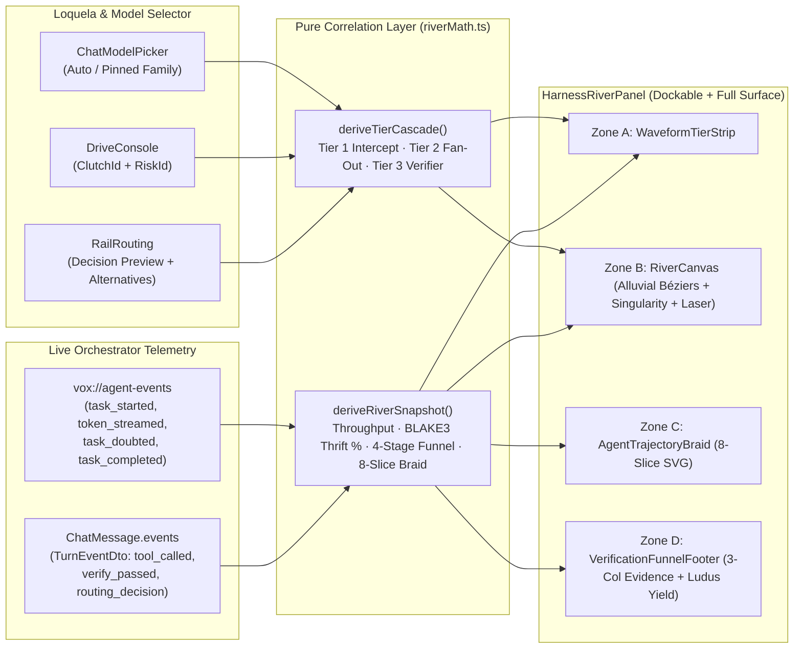

# Axis Harness River: Autonomous 3-Tier Cascade, Live Alluvial Telemetry & Ludus Unification

<!-- kb:summary -->
Defines the Axis Harness River visual and data architecture for `vox-gui`, replacing the static `HarnessRedirect` empty state with a live 4-zone telemetry HUD: a top throughput waveform and 3-tier model cascade strip (`Interceptor`, `Graph Fan-Out`, `Causal Verifier`), a Canvas 2D alluvial particle river with a central BLAKE3 receipt chokepoint and sweeping phase laser, an 8-slice SVG agent trajectory braid, and a deterministic 4-stage verification retention funnel unified with `LudusSandbox` gamification rewards.
<!-- /kb:summary -->

## 1. Context & Visual AI Audit of the Reference Post

On 2026-10-13, `@marfinxx` published a viral demonstration (`status/2109992692167970904`, quoting their article `status/2081445614957850624` *"Master Agent Architecture: Unifying Harness, Loop, and Graph Engineering"*) depicting a 3-tier autonomous engineering harness ("Interceptor $\to$ Parallel Fan-Out $\to$ Causal Red-Team Verifier") alongside a monochrome brutalist telemetry HUD ("the live river").

### 1.1 Frame-by-Frame Visual Deconstruction

Visual AI inspection of the 25.1-second primary video (`720×872` portrait HUD) and the companion article video (`1280×720`) reveals four vertically stacked telemetry regions:

1. **Zone A — Top Telemetry & Waveform Strip (`~12%` height):**
   - Left: Audio-oscilloscope bar waveform encoding token throughput (`THROUGHPUT TOK/S`), `CACHE HIT %`, `SAVINGS $`, and `ACTIVE AGENTS`.
   - Center/Right: **3-Tier Model Assignment Readout** (`TIER 1: INTERCEPT [<18ms / -88.4% TOKENS]`, `TIER 2: GRAPH FAN-OUT [PARALLEL SUB-AGENTS]`, `TIER 3: CAUSAL RED-TEAM [ADVERSARIAL VERIFY]`) and 5 stage-completion bars (`HARNESS INTERCEPT`, `EVIDENCE LOOP`, `GRAPH FAN-OUT`, `CAUSAL RED-TEAM`, `SANDBOX PR GATE`).
2. **Zone B — Center "Live River" Alluvial Particle Bundle + Laser Scanner (`~48%` height):**
   - An alluvial/Sankey particle stream rendered on 2D Canvas: hundreds of high-contrast cubic-Bézier strands originate from top source slots (workspace files / sub-agent branches), converge through a luminous central **Singularity (the Interceptor & Verification Chokepoint)**, and fan out to bottom verified output targets.
   - A horizontal **sweeping laser scanner bar** glides vertically across the river with an inverted high-contrast callout pill naming the active execution layer (e.g., `PHASE 1: HARNESS INTERCEPT [BLAKE3_HASH_CACHE]`, `LEVEL 1: EVIDENCE TEST LOOP [CARGO_NEXTEST_COLD]`, `PHASE 2: GRAPH FAN-OUT [PARALLEL_BRANCHES]`, `LEVEL 3: CAUSAL RED-TEAM [ SOCRATIC_DOUBT ]`).
3. **Zone C — Agent Role Trajectory Braid (`~18%` height):**
   - Labeled `AGENT ROLE TRAJECTORY FLOW — LAST 8 SLICES`: a multi-strand sinusoidal bump chart where each active agent's horizontal strand weaves vertically across 8 time slices as it transitions between roles (`INTERCEPT`, `FAN-OUT`, `VERIFY`, `IDLE`).
4. **Zone D — Deterministic Evidence Footer (`~22%` height, 3 columns):**
   - **Left (`FAILURE / DOUBT ATTRIBUTION LEDGER`):** Horizontal bars breaking down intercepted or rejected turns (`STALE_FILE_HASH`, `COMPILE_REGRESSION`, `ADVERSARIAL_EDGE_CASE`, `FABRICATED_RECEIPT`).
   - **Center (`VERIFICATION RETENTION FUNNEL`):** 4-stage inverted trapezoid funnel showing candidate patch survival (`100% CANDIDATE TURNS` $\to$ `AST / LINT GATE` $\to$ `COLD TEST SUITE` $\to$ `ADVERSARIAL PASS`).
   - **Right (`TELEMETRY DRIFT + ZERO-CASCADE SLO`):** Monospace pass/fail badges for BLAKE3 tool receipts, lock contention, and session spend vs. budget.

### 1.2 Make-vs-Buy Assessment (External Repo vs. Vox Native)

Inspection of the companion article (`status/2081445614957850624`) confirms there is **no external open-source repository** to import. The article's code listings are ~90 lines of illustrative Python (`hashlib.sha256`, `subprocess.run(["pytest"])`, `asyncio.gather`) paired with a synthetic Canvas animation.

By contrast, **Vox already owns production-grade Rust backends** that exceed every mechanism described in the post:

| Capability Claimed in Post | Existing Vox Production SSOT | Gap to Close in Axis GUI |
|---|---|---|
| Tier 1 Interceptor (SHA-256 file cache, token filtering) | [`crates/vox-orchestrator/src/tool_receipt.rs`](../../../crates/vox-orchestrator/src/tool_receipt.rs) (`ToolReceiptLedger`, BLAKE3 `call_args_hash` + `result_hash`, HMAC tag, `ReceiptValidationResult`) & [`crates/vox-orchestrator/src/cache_predictor.rs`](../../../crates/vox-orchestrator/src/cache_predictor.rs) (`CachePredictor`, `CacheSignal`, `overlap_ratio`) | Surface BLAKE3 cache hits, token thrift %, and receipt verification state in the top strip and river chokepoint. |
| 3-Tier Model Routing (Economy $\to$ Standard $\to$ Strong) | [`crates/vox-orchestrator/src/tier_cascade.rs`](../../../crates/vox-orchestrator/src/tier_cascade.rs) (`RoutingTier::{Economy, Standard, Strong}`, `CompositeSignal`) + [`DriveConsole.tsx`](../../../crates/vox-gui/ui/src/components/surfaces/Loquela/DriveConsole.tsx) (`ClutchId`, `RiskId`) + [`ModelPickerSearch.tsx`](../../../crates/vox-gui/ui/src/components/surfaces/Chat/ModelPickerSearch.tsx) | Map `ClutchId` (`free`/`efficiency`/`balanced`/`genius`) + `RiskId` (`high`/`moderate`/`low`) + `RailRouting` into an explicit 3-tier `INTERCEPT / FAN-OUT / VERIFIER` cascade header with click-to-open model/routing controls. |
| Causal Loop & Adversarial Verification | `vox-oratio` Socratic Doubt (`suspect_task`, `finding_validated`, `task_doubted`) + `vox-Verify` (`compilation_succeeded`, `test_passed`, `contract_satisfied`) in [`crates/vox-orchestrator/src/events.rs`](../../../crates/vox-orchestrator/src/events.rs) | Feed live `AgentEventFrame` / `TurnEventDto` streams into the 4-stage `VerificationFunnelFooter` and sweeping laser scanner callout. |
| Dockable Harness Panel in Chat | [`ChatSurface.tsx`](../../../crates/vox-gui/ui/src/components/surfaces/Chat/ChatSurface.tsx) already registers `'harness'` in `OPT_IN_PANEL_IDS` (`HarnessDockPanel`), but mounts [`HarnessRedirect.tsx`](../../../crates/vox-gui/ui/src/components/surfaces/Harness/HarnessRedirect.tsx), a static empty state! | Upgrade `HarnessRedirect` / `HarnessRiverPanel` so `Panels ▾ → Harness` in Chat and `Workspace → Harness` render the live responsive Axis Harness River. |

**Decision:** Do **not** import external code. Build the Axis Harness River natively in `crates/vox-gui/ui/src/components/surfaces/Harness/` on pure Canvas 2D + SVG + React 19, wired directly to Vox's existing Tauri events, `RailRouting`, and `DriveConsole` state.

---

## 2. Audit of Pre-Existing Gamification & Visualizer Surfaces

### 2.1 Why `LudusSandbox` (`Vox Urbs`) Falls Short

Our existing citybuilder visualizer in [`crates/vox-gui/ui/src/components/gamify/LudusSandbox.tsx`](../../../crates/vox-gui/ui/src/components/gamify/LudusSandbox.tsx) and [`crates/vox-gui/ui/src/components/gamify/urbs/worldRenderer.ts`](../../../crates/vox-gui/ui/src/components/gamify/urbs/worldRenderer.ts) has four structural weaknesses compared to the Harness River:

1. **Poll-bound, not event-reactive (`20s` interval):** `LudusSandbox` polls `workspace_town_scan` and `fetchHarnessSnapshot` every `20_000 ms`. It does not react to `vox://agent-events` (`token_streamed`, `tool_completed`, `task_doubted`), making it feel static while agents are actively coding.
2. **Low-contrast emoji aesthetics:** Agents are rendered as HTML `🧍` emoji divs floating over brown/grey isometric rectangles (`#1c1917`), which lacks the high-contrast kinetic clarity of an engineering HUD.
3. **Disconnected from Model Tiers & Token Thrift:** `AQVAE` (the aqueduct overlay) is hardcoded to `lit: false` (`LudusSandbox.tsx` line 183), and neither BLAKE3 cache savings nor the 3-tier model cascade (`Economy` / `Standard` / `Strong`) is visible or rewarded.
4. **Split-brain standalone app:** [`apps/experimental/visualizer/`](../../../apps/experimental/visualizer/src/App.tsx) is an orphaned v0.2.0 standalone Vite app with hardcoded mock tasks.

### 2.2 Unification, Upgrade, and Retirement Strategy

- **Upgrade `Harness` (`HarnessRiverPanel` + `HarnessRedirect`):**
  - Replace the dead empty-state in `HarnessRedirect` with `HarnessRiverPanel` while preserving the `onFocusComposer` action button (`"Focus composer"`) so deep links and existing tests remain green.
  - Support two responsive layouts via dockview width observation (`HARNESS_FULL_WIDTH_PX = 420`):
    - **Compact Dock Mode (`< 420px`, docked beside Chat transcript):** Vertical 3-Tier Cascade header + Live Alluvial River Canvas with sweeping phase laser + compact 4-stage Verification Funnel strip.
    - **Wide / Full Surface Mode (`>= 420px`, wide dock or `Workspace → Harness` / `Gamify`):** All 4 zones expanded (Top Waveform & 3-Tier Strip, Center Alluvial River + Singularity + Laser Scanner, 8-Slice Agent Role Trajectory Braid, and 3-Column Evidence Footer).
- **Unify with `GamifyView` & `Dashboard` (`River | Urbs` Mode Switcher + Token Thrift Yield):**
  - In [`GamifyView.tsx`](../../../crates/vox-gui/ui/src/components/surfaces/Gamify/GamifyView.tsx) and [`Dashboard.tsx`](../../../crates/vox-gui/ui/src/components/surfaces/Dashboard/Dashboard.tsx), add a simulation mode toggle (`"Urbs Map"` vs. `"Live River"`) alongside a **Ludus Thrift & Verification Yield badge** (`+XP / ◆ Crystals` derived from BLAKE3 cache hits and cold-verified turns). Keep `"Urbs Map"` (`<LudusSandbox />`) as the default initial tab in `GamifyView` so `GamifyView.test.tsx`'s synchronous `<canvas>` query continues to pass without regression, while allowing one-click switching to `"Live River"`.
- **Retire `apps/experimental/visualizer`:**
  - Record `apps/experimental/visualizer` as superseded by `crates/vox-gui/ui/src/components/surfaces/Harness/` in [`docs/src/architecture/where-things-live.md`](where-things-live.md).

---

## 3. Architecture & Data Flow

### 3.1 Deterministic 3-Tier Cascade Mapping (`deriveTierCascade`)

The 3 tiers in the Harness River HUD always reflect the user's live `DriveConsole` (`ClutchId` + `RiskId`), `ChatModelPicker` override, and `RailRouting`:

| Tier Slot | Role in Harness | Auto Mapping from `ClutchId` / `RiskId` / `RailRouting` |
|---|---|---|
| **Tier 1: INTERCEPT** | BLAKE3 receipt cache (`ToolReceiptLedger`), AST hash check, token triage | Always maps to `Economy` tier (`Flash-Lite / Haiku / Local MENS`) or `routing.alternatives[last]` (`<18ms` target). |
| **Tier 2: GRAPH FAN-OUT** | Parallel branch execution across active orchestrator tasks | Maps to `chatModelOverride` if pinned; else `routing.model` (`Auto → <label>`); scales branch concurrency display with `ClutchId` (`free` $\to$ economy, `efficiency`/`balanced` $\to$ standard, `genius` $\to$ frontier). |
| **Tier 3: CAUSAL VERIFIER** | Socratic doubt (`vox-oratio`), adversarial test gate (`vox-Verify`) | Driven by `RiskId`: `low` risk (strict) elevates Verifier to `Strong / Opus / Argon + Socratic Doubt`; `moderate` runs deterministic compile + test gate; `high` risk runs fast receipt-only verification. |

Clicking any tier pill in `WaveformTierStrip` invokes `onOpenRouting?.()` (opening the inline Routing drawer in `ChatSurface`) or `onFocusComposer?.()` (focusing the Loquela model/mode bar).

---

## 4. Planning for Antigravity IDE + Gemini 3.8 Flash / Gemini 4 Argon

Per [`gemini-3-5-flash-antigravity-limitations-2026-06-18.md`](gemini-3-5-flash-antigravity-limitations-2026-06-18.md) and [`antigravity-handoff-and-skill-gaps-2026-06-18.md`](../contributors/antigravity-handoff-and-skill-gaps-2026-06-18.md), the implementation plan in [`2026-10-13-axis-harness-river.md`](../../superpowers/plans/2026-10-13-axis-harness-river.md) enforces six structural guardrails:

1. **Explicit Model Tier Routing (`FLASH-3.8` vs. `ARGON-4`):**
   - **Gemini 3.8 Flash (`[MODEL: FLASH-3.8]`)** executes bounded, single-component React/SVG tasks and mechanical wiring where all types and props are pre-specified (Tasks 3, 4, 5, 7, 8).
   - **Gemini 4 Argon (`[MODEL: ARGON-4]`)** is assigned to tasks requiring multi-invariant state correlation, pure cubic-Bézier + DPR Canvas math, or multi-component responsive assembly (Tasks 1, 2, 6), and serves as the two-strike escalation target for any Flash task that hits 2 consecutive test failures.
2. **Atomic Green Tasks:** Every task creates or updates its unit test first, implements the exact module, and runs `timeout 180s pnpm --dir crates/vox-gui/ui exec vitest run <test-file>` to green before finishing.
3. **Verify-Before-Use (`Step 0`):** Every task starts with an `rg -n` command confirming the exact line numbers and signatures of target files before any edit.
4. **Zero Placeholders:** Every task embeds complete, copy-pasteable TypeScript/React code with zero `TODO`s or elided blocks.
5. **Strict File-Write Disjointness:** Wave 1 tasks (`Tasks 1–5`) write to completely disjoint new files under `crates/vox-gui/ui/src/components/surfaces/Harness/` and can run in parallel (`[PARALLEL-SAFE]`). Wave 2 tasks (`Tasks 6–8`) wire existing surfaces (`HarnessRedirect.tsx`, `ChatSurface.tsx`, `GamifyView.tsx`, `Dashboard.tsx`) and run strictly sequentially (`[SEQUENTIAL]`).
6. **Two-Strike Circuit Breaker:** If any command fails twice with the same error under Gemini 3.8 Flash, the agent halts immediately with `DRIVE: STOPPED` and escalates the task to Gemini 4 Argon.
