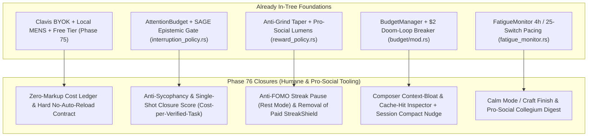

# Humane, Pro-Social & Anti-Addictive AI Tooling Architecture (2026)

<!-- kb:summary -->
Synthesizes industry failure modes in commercial AI coding tools—silent auto-reload billing traps, 20–50% token markups, context-retransmission bloat, sycophantic chat loops, and FOMO streak mechanics—and maps them against Vox's existing architecture and Phase 76 roadmap. Establishes five non-negotiable engineering pillars: zero-markup BYOK/local sovereignty, single-shot compiler-verified accuracy over chatty back-and-forth, information-theoretic attention and cognitive rest protection, pro-social Lumens and anti-FOMO mastery in Ludus, and aesthetic craft (`Art & Genius`) in the Axis workbench.
<!-- /kb:summary -->

> [!IMPORTANT]
> **Normative Principle:** Vox is a precision instrument and atelier for software craft, never a slot machine or rent-seeking billing funnel. Every subsystem in `vox-orchestrator`, `vox-cli`, `vox-gamify`, and `vox-gui` MUST optimize for **task closure (`turns-to-green`)**, **epistemic honesty**, **zero-markup cost transparency**, **cognitive rest**, and **pro-social human collaboration**—never for time-on-screen, token volume, or involuntary credit reloads.

---

## 1. Industry Diagnosis: The Four Extractive Traps in 2025–2026 AI Tooling

Between 2024 and 2026, mainstream commercial AI coding harnesses shifted from flat utility pricing to extractive engagement and consumption models that misalign vendor revenue with developer flourishing:

| Extractive Pattern | How Commercial Harnesses Exploit It | Developer & Codebase Harm |
|---|---|---|
| **1. Financial Dark Patterns ("Auto-Reload & Juiced Prices")** | Mandatory or default-on credit auto-reload pools (\$50–\$100 silent re-bills triggered mid-loop by background subagents), opaque "compute units" that hide 20%–50%+ markups over upstream provider APIs, and artificial throttling tiers (\$100–\$200/mo "Max" plans). | Unpredictable runaway bills; incentive for the tool vendor to maximize token burn rather than solve the task in one turn. |
| **2. Structural Token Bloat ("The Context Tax")** | Re-transmitting 30k–80k tokens of unpruned conversation history, unused MCP tool schemas, and full-file dumps on every step of a 20-step agentic loop; failing to enforce prompt-cache boundaries or bounded `@kb` / AST slices. | Super-linear cost scaling ($O(N^2)$ token spend per bug fix) and degraded reasoning accuracy ("lost in the middle"). |
| **3. Dopamine / Slot-Machine Chat Loops ("Vibe-Coding Addiction")** | Sycophantic validation (*"Great question! You're totally right!"*), partial/unverified code snippets that force 8 follow-up turns of *"fix the compile error"*, and variable-ratio reward anticipation via streaming animations that keep the human glued to the chat pane. | Cognitive atrophy, loss of architectural mental models, "AI slop" repo bloat, and hours lost to compulsive prompting instead of deliberate engineering. |
| **4. Punitive FOMO Gamification** | Daily login streaks that reset to zero on a weekend off, purchasable "streak freezes" that monetize anxiety, and volume-based leaderboards that reward spamming low-quality commits or prompts. | Burnout, weekend guilt, metric gaming, and erosion of intrinsic pride in software craftsmanship. |

---

## 2. Codebase Reality Audit: What Vox Already Ships vs. Remaining Gaps

An audit of `crates/vox-orchestrator`, `crates/vox-gamify`, `crates/vox-cli`, and `crates/vox-gui` shows strong structural foundations already in-tree, alongside five concrete gaps that **Phase 76** closes.

### 2.1 Audited Strengths in the Current Codebase

1. **Sovereign Zero-Markup Routing (`crates/vox-cli/src/commands/chat.rs`, `crates/vox-orchestrator/src/models/select.rs`):**
   - Vox never proxies LLM traffic through a Vox-owned billing meter. Keys resolve locally via Clavis (`vox_secrets::resolve_secret`), and `SotaRoutingMode` (`free`, `auto`, `efficient`, `balanced`, `genius`) treats `$0` `:free` OpenRouter models and local MENS (`Qwen 3.5` / `Qwen 3.8` on Metal/CUDA) as first-class citizens alongside frontier models.
   - `select.rs` enforces a hard flagship exclusion rule (`intent.axes.intelligence < 50` excludes `ModelTier::Elite`) so simple tasks never silently burn frontier-model pricing.
2. **Pre-Dispatch Reservation & Doom-Loop Circuit Breakers (`crates/vox-orchestrator/src/budget/mod.rs`):**
   - `BudgetManager` tracks `cost_since_last_completion` (`CostProgressState`) with a default `$2.00` doom-loop circuit breaker (`doom_loop_threshold_usd`), semantic output-fingerprint drift detection (`DriftState`), and atomic pre-dispatch token reservation (`try_reserve_tenant_tokens`).
3. **Information-Theoretic Interruption & Epistemic Honesty (`crates/vox-orchestrator/src/attention/interruption_policy.rs`):**
   - Implements the SAGE-Agent distinction (`spec_uncertainty` vs. `model_uncertainty`): if the model is uncertain (`model_uncertainty` high) but the user's specification is clear (`spec_uncertainty` low), `evaluate_interruption` **refuses to pester the user** (`unresolvable_model_doubt`), routing to local verification or research instead of conversational nagging.
4. **Cognitive Fatigue Monitoring (`crates/vox-orchestrator/src/fatigue_monitor.rs`):**
   - `FatigueMonitor` detects context thrashing (`> 25` switches in 5 minutes) and unbroken marathon sessions (`> 4.0` hours), emitting `FatigueEvent` rest recommendations.
5. **Pro-Social `Lumens` & Anti-Grind Taper (`crates/vox-gamify/src/reward_policy.rs`):**
   - Repetitive low-signal actions (`message_sent`, `mcp_tool_called`) taper to `0.5x` after 8 occurrences, `0.1x` after 14, and `0.0x` at `GRIND_ZERO_THRESHOLD` (31).
   - High-value **Lumens** (pro-social currency) are awarded exclusively for helping others and improving shared quality: `peer_teach_session` (`+50 lumens`), `bounty_completed` (`+50`), `security_review_passed` (`+50`), `helped_peer` (`+20`), `pr_merged` (`+15`), `toestub_violations_fixed` (`+12`), `code_reviewed` (`+10`), and `conflict_resolved` (`+10`).

### 2.2 Audited Anti-Patterns & Gaps to Remediate in Phase 76

| ID | Audited Location | Identified Issue | Phase 76 Remediation |
|---|---|---|---|
| **G1** | `crates/vox-gamify/src/streak.rs` (`L115-136`) & `crates/vox-gamify/src/shop.rs` (`L44-47`, `L153-156`) | `StreakTracker::record_activity` uses UTC 24-hour calendar days (`SECONDS_PER_DAY = 86400`) and breaks streaks (`BrokenReset`) if a developer takes a weekend or vacation beyond `grace_periods_available`. Worse, `shop.rs` sells `ShopItem::StreakShield { base_cost: 250 }`, reproducing Duolingo-style FOMO anxiety where users grind crystals to avoid losing a streak on rest days. | Replace punitive daily-login streaks with **Rhythm & Mastery Cadence**: auto-exempt weekends/rest days (`RestDayPolicy`), add explicit user-togglable `RestMode` (vacation/deep-rest pause with zero streak decay), and retire paid `StreakShield` from `shop.rs` (shields are earned only by engineering quality like `test_suite_green` or `build_clean_streak_3`). |
| **G2** | `crates/vox-gamify/src/reward_policy.rs` (`L134`: `"message_sent" => BaseReward::new(1, 0)`) & `contracts/gamify/economy.v1.yaml` (`L76`) | Awarding XP for `message_sent` rewards **chat volume** rather than **task closure**. Even with an 8-message grind cap, rewarding raw chat messages subtly incentivizes back-and-forth prompting over single-shot specification. | Set `message_sent` base XP to `0` in `reward_policy.rs` and `economy.v1.yaml`; shift those XP/Lumens into **Single-Shot Verified Closure** (`single_shot_verified` — task or `.vox` script passes compiler/test verification on turn 1 without repair loops) and **Zero-Cost Local Mastery** (`local_mens_verified`). |
| **G3** | `crates/vox-gui/ui/src/components/surfaces/Loquela/Loquela.tsx` (`L484`, `L1020-1024`) & `DriveConsole.tsx` (`L93-111`) | `Loquela.tsx` estimates tokens via `Math.ceil(text.length / 4) + chips.length * 80` and shows `estCost` only when `tierObj.cost != null` (which is `null` on all default `ROUTING_TIERS` and dynamic cards at `L390`). Users cannot see **upstream provider cost vs. $0 local/free savings**, **prompt-cache hit ratio**, or **stale session context bloat** before hitting Run. | Wire live model catalog pricing (`input_per_1m`, `output_per_1m`, `cached_input_per_1m`) into `Loquela.tsx` and `ChatExecutionRail.tsx`, display **Saved via Local/Free/Cache ($X.XX)**, and show a gentle **Session Compact / Fresh Context Nudge** when accumulated session history exceeds the optimal accuracy/cost knee (`> 24k` tokens or `> 12` turns). |
| **G4** | `crates/vox-cli/src/commands/chat.rs` & `crates/vox-orchestrator-mcp/src/chat_tools/` | While `.vox` requests inject the compiler-verified system prompt, general chat/coding turns do not enforce a normative **Anti-Sycophancy & Epistemic Directness Contract** (banning hollow flattery, filler preambles, and speculative unverified claims) or report **Cost-per-Verified-Solution** at turn completion. | Inject a concise **Craft & Accuracy Preamble** across chat/agent turns (zero sycophancy, state assumptions or cite `@kb`/files, prefer compiler-verified single-shot output) and emit a transparent post-turn receipt (`tokens_in`, `tokens_cached`, `tokens_out`, `upstream_cost_usd`, `vox_markup_usd: 0.00`, `compiler_verified`). |
| **G5** | `crates/vox-orchestrator/src/fatigue_monitor.rs` & `crates/vox-gui/ui/src/components/surfaces/Chat/ChatSurface.tsx` | `FatigueMonitor::evaluate_fatigue` exists in `vox-orchestrator::budget`, but is not surfaced in the GUI as a humane **Session Wrap-Up & Rest Card** when a developer hits 4 hours of continuous flow or high context thrashing. | Wire `FatigueEvent` and `AttentionBudget` into a calm, non-nagging **Atelier Pacing & Wrap-Up Banner** in `ChatSurface.tsx` that offers a 1-click **Snapshot & Step Away** summary (saving working state, open todos, and next step to `VoxDb` so the human can close the laptop with zero cognitive residue). |

---

## 3. The Five Architectural Pillars of Humane, Pro-Social Vox Tooling

### Pillar 1: Radical Financial Honesty ("Zero Markup, Zero Auto-Reload, Local-First")

1. **No Vox Middleman Tax (`vox_markup_usd = 0.00`):**
   - Vox is an open-source Apache-2.0 toolchain funded by transparent sponsorships and R&D grants ([`sustainability-and-funding-ssot-2026.md`](../contributors/sustainability-and-funding-ssot-2026.md)), never by skimming a margin on developer token spend.
   - Every cost display in `DriveConsole.tsx`, `ChatExecutionRail.tsx`, and `vox cost` shows raw upstream provider rates (`PricingSource::Catalog` / `OpenRouter` / `LocalZero`) alongside **Avoided Spend** from local MENS inference, `:free` tier routing, and prompt caching.
2. **Structural Ban on Silent Auto-Reload:**
   - `BudgetManager` (`crates/vox-orchestrator/src/budget/mod.rs`) enforces hard, user-owned spend caps (`max_financial_cost_micros`, `doom_loop_threshold_usd`, and Phase 08's atomic `spend_reservations`).
   - When a task or session reaches its cap, Vox **halts cleanly at a resumable checkpoint** (`BudgetSignal::CostExceeded` / `HaltAgent`) and offers to downgrade to `ClutchId::Free` or `Local · Mens`—never silently charging a card or auto-reloading credits.
3. **Context Diet & Sub-Linear Token Scaling:**
   - Instead of re-sending whole files and 50 tool schemas on every turn, Vox combines **Phase 25's budgeted `AtlasQuery` (`lod.rs`)**, **Phase 38's token-budgeted `@kb` context injection**, and **Session Compaction nudges** so turn 15 costs no more than turn 2.

### Pillar 2: Accuracy, Efficiency & Single-Shot Closure Over Chatty Engagement

Commercial chat apps optimize for *session duration* and *messages per DAU*. Vox optimizes for **Minimum Turns to Verified Green (`MTVG`)**:

1. **Compiler-in-the-Loop Before Human Eyes:**
   - Rather than streaming plausible-looking broken code and forcing the human into a 6-turn *"it didn't compile"* loop, `vox chat` (Phase 75) and the orchestrator run `vox_compiler::pipeline::run_frontend_str` (`lex -> parse -> HIR -> typeck`) and `vox_validate_mermaid` (Phase 55) **inside the turn**, self-repairing up to 2 bounded iterations on the fast/efficient tier before presenting the finished artifact.
2. **Epistemic Directness (Anti-Sycophancy Contract):**
   - Models routed through Vox are instructed to skip performative flattery (*"What a brilliant idea!"*), state trade-offs plainly, push back with evidence when a user prompt violates architectural invariants (`layers.toml`, `vox-crypto` policy, Clavis secret boundaries), and cite exact file/line anchors.
3. **SAGE-Calibrated Questioning (`interruption_policy.rs`):**
   - Clarifying questions are gated by expected information gain in bits divided by human interruption cost ($\text{Utility} = \Delta H_{\text{spec}} / C_{\text{user}}$). If the agent can resolve uncertainty by reading the repo (`vox_search_atlas`, `vox_kb_query`) or running a check, it **must not interrupt the human**.

### Pillar 3: Calm Technology & Cognitive Rest ("Step-Away Design")

1. **Attention Budget as a First-Class Resource (`AttentionBudgetMeter.tsx`):**
   - Interrupts are priced using Gloria Mark's recovery baseline (`DEFAULT_INTERRUPT_COST_MS`) scaled by NASA-TLX workload factors and current `FocusDepth` (`Ambient`, `Focused`, `Deep`).
   - In `Deep` focus (`>= 8` interrupts/hr), non-critical A2A and secretary prompts are automatically queued into the batch **Attention Inbox Digest** (`Phase 17` / `Phase 18`) rather than popping toasts.
2. **Session Wrap-Up & Zero-Residue Stopping (`FatigueMonitor`):**
   - When `FatigueMonitor::evaluate_fatigue` triggers (`> 4h` continuous session, `> 25` rapid context switches, or `attention_spent_ratio >= 1.0`), Vox surfaces a calm **Wrap-Up & Rest** action that writes a deterministic handoff note (completed work, clean git/jj status, next single action) so the developer can disconnect cleanly.

### Pillar 4: Pro-Social Collaboration & Anti-FOMO Gamification (`vox-gamify`)

Gamification in developer tools is only ethical when it reinforces **real mastery, code health, and generosity toward peers**—never artificial scarcity or daily login compulsion:

1. **Lumens Over Raw XP (`reward_policy.rs`):**
   - `Lumens` measure pro-social contribution to the commons: mentoring peers (`peer_teach_session`), reviewing code without false positives (`code_reviewed`), fixing structural debt (`toestub_violations_fixed`, `unsafe_removed`), contributing verified training pairs (`ai_example_accepted`, `populi_corpus_contributed`), and resolving merge conflicts (`conflict_resolved`).
2. **Anti-FOMO Streak Hygiene (`streak.rs` & `shop.rs`):**
   - **No Weekend/Rest-Day Punishment:** Healthy engineers rest. `StreakTracker` supports configurable rest days (`RestDayPolicy::WeekendsOff` / `RestMode`) where taking Saturday, Sunday, or declared time off preserves `current_streak` without consuming grace shields.
   - **No Paid Anxiety Relief:** Remove `ShopItem::StreakShield` from the crystal shop; streak shields are granted solely as intrinsic mastery milestones (`build_clean_streak_3`, `test_suite_green`).
   - **Zero XP for Chat Volume:** `message_sent` yields `0 XP`; rewards attach to verified outcomes (`check_clean_first_try`, `single_shot_verified`, `test_coverage_improved`).
3. **Serious Mode Parity (`GamifyMode::Serious`):**
   - One config key (`gamify_mode = "serious"`) disables all overlays, sprites, and notifications while retaining the underlying engineering telemetry and cost/quality accounting.

### Pillar 5: Genius & Art ("The Atelier Workbench")

Replacing addictive hooks does not mean making software sterile. Instead of cheap dopamine (bouncing dots, confetti, slot-machine spinners), Vox invests in **intellectual and visual sublime**—the joy of seeing complex systems rendered with mathematical clarity:

1. **Observability as Art:**
   - **Axis Harness River (`Phase 48`):** 60fps alluvial particle braid and verification retention funnel (`prefers-reduced-motion` aware) showing real AST hashes, worktree isolation, and compiler gates.
   - **Code & Architecture Atlas (`Phases 26–31`):** Viewport-culled ELKjs dependency topography with live branch diff overlays.
   - **Epistemic Research DAG (`Phase 54`):** Visualizes `Query -> Subquery -> Source Domain -> Claim -> Verdict / Contradiction Edge` so the user sees *why* a conclusion holds.
2. **The `genius` Tier Reserved for Deep Synthesis:**
   - `ClutchId::Genius` (`SotaRoutingMode::Genius`) is framed not as a "pay more to unthrottle" tier, but as a deliberate deep-reasoning mode paired with compiler/test verification and epistemic claim checking.

---

## 4. Roadmap Integration: Phase 76 (`HUMANE-01..04`)

To make these findings executable across the unified roadmap (`.planning/ROADMAP.md`), **Phase 76: Humane, Pro-Social & Anti-Addictive Chat, Cost Honesty & Mastery UX (`HUMANE-01..04`)** weaves directly into our existing backend (`vox-gamify`, `vox-orchestrator`, `vox-cli`) and Wave 3 GUI (`Loquela.tsx`, `DriveConsole.tsx`, `ChatExecutionRail.tsx`, `ChatSurface.tsx`) sequence:

| Plan | Scope | Key Deliverables & Verification |
|---|---|---|
| **`76-01-PLAN.md`** | **Anti-FOMO Mastery & Pro-Social Economy (`vox-gamify` & `contracts/gamify/economy.v1.yaml`)** (`HUMANE-01`) | Zero out `message_sent` XP (`0 XP`), add `single_shot_verified` (`+60 XP, +12 crystals, +5 lumens`) and `local_mens_verified` (`+40 XP, +8 crystals, +5 lumens`), add `RestDayPolicy` (`WeekendsExempt` + user `rest_mode_until_ts`) to `StreakTracker` so rest days never break streaks, remove purchasable `StreakShield` from `shop.rs` defaults, and verify with unit tests. |
| **`76-02-PLAN.md`** | **Zero-Markup Cost Ledger, Avoided-Spend Accounting & Context-Bloat Detector (`vox-orchestrator` & `vox-cli`)** (`HUMANE-02`) | Add `TurnCostReceipt` (`upstream_cost_usd`, `vox_markup_usd: 0.0`, `saved_vs_frontier_usd`, `cached_tokens`, `context_bloat_warning`) to `BudgetManager` and `vox chat`, enforce hard no-auto-reload checkpoint halt on `CostExceeded`, and inject the **Anti-Sycophancy & Craft Directness Preamble** into chat/agent turns. |
| **`76-03-PLAN.md`** | **Humane Composer, Live Cost/Savings Pill & Session Compact Nudge (`Loquela.tsx`, `DriveConsole.tsx`, `ChatExecutionRail.tsx`)** (`HUMANE-03`) | Wire real catalog per-1M token pricing into `Loquela.tsx` so `~tok · ~$cost (or $0 local/free · saved $X)` is always truthful, surface cache-hit % and a 1-click **Compact / Fresh Session** pill when context exceeds 24k tokens, and add `Calm / Atelier` display toggle. |
| **`76-04-PLAN.md`** | **Cognitive Rest & Zero-Residue Session Wrap-Up Card (`FatigueMonitor` → `ChatSurface.tsx`)** (`HUMANE-04`) | Bridge `FatigueMonitor::evaluate_fatigue` and `AttentionBudget` to `ChatSurface.tsx`, rendering a non-intrusive **Session Wrap-Up & Step Away** card after marathon/thrashing thresholds with 1-click state bookmarking and Playwright E2E verification. |
