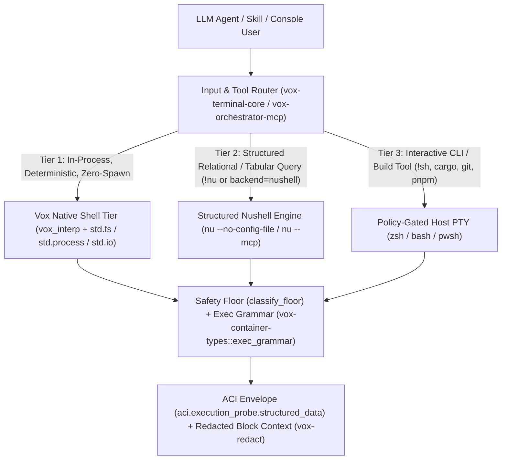
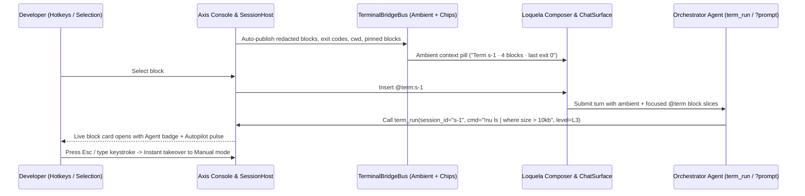
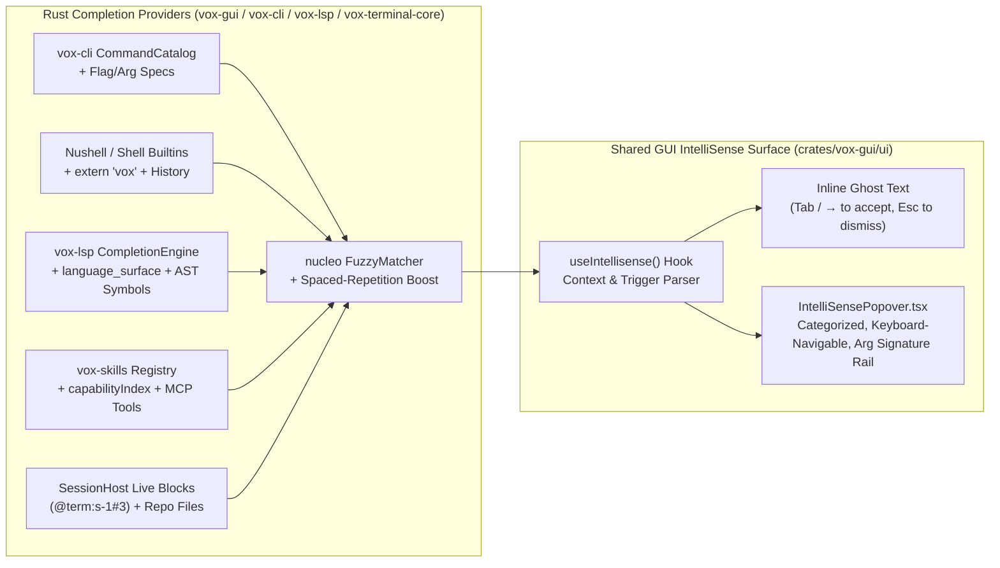

# LLM-First Shell Execution: Nushell, Structured Alternatives, Skills, and MCP Integration Research (2026)

<!-- kb:summary -->
This document evaluates whether Vox should default to or deepen support for Nushell or another structured shell for LLM-first execution, and defines how structured shell execution integrates with Vox Agent Skills, MCP, and bidirectional Chat-to-Terminal co-execution. It compares POSIX shells, PowerShell, Nushell, YSH, Elvish, Murex, and Vox's in-process interpreter (`vox_interp` + `std.*`) across seven axes, specifies a 5-tier user-configurable terminal security model, seamless manual-to-automatic control handoff, zero-copy-paste ambient terminal awareness, and ergonomic `@term` block/line attention chips with hotkeys (`Phases 49–50`).
<!-- /kb:summary -->

## 1. Executive Summary & Architectural Verdict

Giving an LLM agent a traditional POSIX shell (`bash`/`zsh`) forces a cycle of brittle string scraping (`awk`, `sed`, `cut`, fragile regexes) over unstructured text streams. Conversely, **blindly replacing the default human interactive PTY shell with Nushell (`nu`) introduces severe regressions** for both humans and LLM agents when not paired with structured serialization and progressive syntax disclosure.

Our investigation across the Vox codebase and the 2026 structured-shell ecosystem establishes four core findings:

1. **Do NOT make `nu` the unconditional default for human interactive PTYs (`default_shell()`); DO make structured execution the default for agent/MCP data probes.**
   - Changing `default_shell()` to `nu` breaks POSIX/PowerShell copy-paste workflows (`&&`, `FOO=bar cmd`, `2>&1`, `source .venv/bin/activate`) and fails on machines without `nu` installed.
   - Furthermore, running raw `nu -c "ls"` without `| to json --raw` returns **Unicode box-drawing tables (`╭───┬───╮`)**, which consumes **3.1× more tokens** than compact JSON and breaks downstream parsers.
2. **The "Even Better Shell for LLM-First Execution" is Already Half-Built in Vox: A 3-Layer Execution Pyramid.**
   - **Tier 1 — Vox Native (`vox_interp` + `std.fs` / `std.process` / `std.io` / `std.csv` / `std.toml` / `std.yaml`):** In-process, zero subprocess spawn, statically type-checked, argv-first (immune to shell injection), and 100% aligned with MENS training.
   - **Tier 2 — Structured Nushell (`nu` with Auto-JSON Wrapping & `nu --mcp`):** The premier engine for ad-hoc relational/tabular queries (`ls | where size > 10kb`, `ps | where cpu > 5`, `open Cargo.toml | get workspace.members`, `polars`). When invoked by an agent or skill, Vox automatically wraps the pipeline in `do { <pipeline> } | to json --raw` (or connects via `nu --mcp`), returning typed JSON records into `aci.execution_probe.structured_data`.
   - **Tier 3 — Universal Host PTY (`zsh`/`bash`/`pwsh`) + Pure-Rust `vox-exec-grammar`:** Retained for human interactive terminal tabs and external build tools (`cargo`, `git`, `pnpm`), protected by `vox_orchestrator::oversight::floor::classify_floor` and `vox_container_types::exec_grammar`.
3. **Never Embed `nu-engine` / `nu-command` as Cargo Dependencies in `vox-terminal-core`.**
   - Pulling `nu-parser`, `nu-engine`, and `nu-command` into the Cargo graph adds ~85 transitive crates, 2–4 minutes of clean compile time, ~20 MB of binary size, and monthly breaking version churn. Invoking the external `nu` binary (`--no-config-file -c` or `nu --mcp` over stdio) + `nu --ide-ast` achieves 100% of the runtime benefit at **zero Cargo compile cost**.
4. **Skills (`SKILL.md`) Solve Nushell's Pretraining Syntax Gap via Tier-2 Progressive Disclosure.**
   - Because frontier and local LLMs have $100\times$ more Bash training data than Nushell training data, agents frequently hallucinate POSIX syntax inside `nu` (`&&`, `$VAR`, `2>&1`). Injecting a compact **`nushell-structured-shell` skill** on demand (when `backend: "nushell"` or `!nu` is used) eliminates syntax hallucinations without polluting the base system prompt on non-shell turns.

---

## 2. Current Codebase Baseline (Verified 2026-10-14)

| Subsystem | File Path | Shipped State | Identified Gap |
|---|---|---|---|
| Terminal PTY & OSC-633 | [`crates/vox-terminal-core/src/pty.rs`](../../../crates/vox-terminal-core/src/pty.rs) | `default_shell()`, `detect_ai_shell()`, `NU_OSC633`, `ShellKind::{Pty, Nushell}`, `ShellBackend` trait | `detect_ai_shell()` has 0 callers; `NU_OSC633` only emits `633;A` and `633;C` (missing `633;B`, `633;D;<exit_code>`, and `633;E;<cmd>`), so Nushell blocks never close or record exit codes |
| Terminal Session Host | [`crates/vox-terminal-core/src/host.rs`](../../../crates/vox-terminal-core/src/host.rs) | `LocalHost` + `DaemonHost` (`SessionHost` trait), `OpenSpec { cols, rows }`, `redacted_context_bundle` | `OpenSpec` cannot select a per-session shell (`shell: Option<String>`) or working directory (`cwd: Option<PathBuf>`) |
| Terminal Input Classifier | [`crates/vox-terminal-core/src/input.rs`](../../../crates/vox-terminal-core/src/input.rs) | `classify()` routes `/cmd`, `!shell`, `?agent`, and `VoxNative` | No `!nu <pipeline>` structured Nushell intent or auto-JSON pipeline wrapper |
| CLI Shell & AST Check | [`crates/vox-cli/src/commands/runtime/shell/check_terminal.rs`](../../../crates/vox-cli/src/commands/runtime/shell/check_terminal.rs) | Validates PowerShell AST via `pwsh` against [`contracts/terminal/exec-policy.v1.yaml`](../../../contracts/terminal/exec-policy.v1.yaml) | Hard-fails on macOS/Linux if `pwsh` is absent; does not wire [`vox_container_types::exec_grammar`](../../../crates/vox-container-types/src/exec_grammar/mod.rs) fallback or `nu --ide-ast` |
| Nushell Probe Backend | [`crates/vox-cli/src/commands/runtime/shell/backends/nushell.rs`](../../../crates/vox-cli/src/commands/runtime/shell/backends/nushell.rs) | `run_nu_capture(script)` runs `nu -c <script>` | Emits human ASCII box tables instead of structured JSON (`\| to json --raw`); no `--no-config-file` isolation |
| MCP ACI Envelope | [`crates/vox-orchestrator-mcp/src/aci/envelope.rs`](../../../crates/vox-orchestrator-mcp/src/aci/envelope.rs) | Attaches `aci.shell_backend` (`"powershell"` \| `"nushell"`) and `aci.execution_probe` | `execution_probe` only carries `{stdout, stderr, exit_code}` strings, not parsed `structured_data: Option<Value>` |

---

## 3. Comparative Evaluation: Candidate Shells for LLM-First Execution

We evaluated seven shell and execution environments across the criteria that govern autonomous agent reliability, token economics, security gateability, and Vox build invariants:

| Shell / Engine | Data Model | LLM Pretraining Fluency (Zero-Shot) | Token Efficiency on Structured Queries | Pre-Exec AST & Safety Gateability | Cross-Platform Parity (Win/Mac/Linux) | Vox Cargo Build Cost |
|---|---|---|---|---|---|---|
| **POSIX (`bash` / `zsh`)** | Unstructured byte stream | **Very High** ($10^{11}$+ tokens in pretraining) | **Poor** (requires `awk`/`sed`/`jq`; column misalignment errors) | **Low** (complex expansion/subshell bypasses; requires external parser) | **Low** (missing or divergent on Windows vs. macOS/Linux BSD/GNU flags) | **Zero** (OS native) |
| **PowerShell 7 (`pwsh`)** | .NET Object pipeline | **High** | **Medium-High** (requires explicit `\| ConvertTo-Json -Compress`) | **High** (`System.Management.Automation.Language.Parser`) | **Medium-High** (native on Windows; optional install on macOS/Linux) | **Zero** (subprocess) |
| **Nushell (`nu` ≥ 0.108)** | Typed Tables, Records, Lists (`nu-protocol::Value`) | **Medium** (models confuse `&&`, `$VAR`, `2>&1` without a grammar hint; version churn) | **Very High when JSON-wrapped** (`\| to json --raw`); **Poor if raw** (ASCII box tables) | **High** (`nu --ide-ast` / `nu --ide-check` + immutable data pipeline semantics) | **Very High** (identical built-in `ls`, `ps`, `open`, `http` across all 3 OSes) | **Zero** as subprocess / `nu --mcp`; **Unacceptable** (+85 crates) if linked in Cargo |
| **YSH / Oils (`ysh`)** | POSIX bridge + typed Dicts/Lists + `json8` | **Medium-Low** (familiar sh subset, but YSH-specific idioms are sparse in training corpora) | **Medium** (cleaner than Bash, less table-native than Nushell) | **Medium** | **Low** (Unix-centric; Windows requires WSL/translation) | **Zero** (subprocess) |
| **Elvish (`elvish`)** | Typed values + maps/lists + built-in LSP | **Low** (Lisp-inspired pipeline syntax causes high zero-shot LLM syntax error rates) | **Medium-High** | **Medium** (built-in LSP diagnostics) | **Medium** | **Zero** (subprocess) |
| **Murex (`murex`)** | Typed pipes with MIME/data-type annotations | **Very Low** (small corpus footprint → high hallucination rate) | **Medium** | **Low-Medium** | **Medium** | **Zero** (subprocess) |
| **Vox Native (`vox_interp` + `std.*`)** | Statically typed Vox values + `Result[Json]` / `FileRecord` | **High inside Vox** (enforced by `vox check` + MENS training corpus + golden examples) | **Highest** (direct in-memory Rust structs / compact JSON; zero PTY noise) | **Highest** (argv-first `std.process`, no shell expansion, sandboxed caps) | **100% Identical** (compiled into `vox` and `vox-terminal-core`) | **Already Paid** (0 new dependencies) |

### 3.1 Optimizations Gained from First-Class Nushell Support

1. **Elimination of OS-Specific Flag Divergence (`BSD` vs. `GNU` vs. `Windows`):**
   - A classic LLM failure mode on macOS vs. Linux vs. Windows is running `stat -c %s`, `find -printf`, `sed -i`, or `ps aux --sort=-%mem` (which fail on macOS BSD userland and Windows).
   - In Nushell, `ls **/*.rs | where size > 50kb | sort-by modified -r | first 10` or `ps | where cpu > 10 | select pid name cpu mem` executes identically on Windows 11, macOS Sequoia, and Linux.
2. **Universal Polyglot File & Schema Introspection (`open` + `query`):**
   - Nushell's `open` command natively parses `.json`, `.toml`, `.yaml`, `.csv`, `.tsv`, `.xml`, `.ini`, and `.sqlite` databases into queryable tables without spawning `jq`, `yq`, `python3`, or `sqlite3`.
   - Example: `open Cargo.toml | get workspace.dependencies | transpose name spec | where ($it.spec | describe) =~ "record"` returns a typed table in one expression.
3. **Zero-Regex Output Parsing via Auto-JSON Serialization:**
   - When Vox wraps an agent's Nushell query in `do { <expr> } | to json --raw`, the LLM receives a deterministic JSON array/object. Column truncation, whitespace in filenames, and ANSI escape sequences cannot corrupt the parse.
4. **Actionable Diagnostic Spans (`nu --ide-check` / Structured `ShellError`):**
   - Unlike Bash's opaque `syntax error near unexpected token`, Nushell emits labeled span diagnostics that tell the LLM the exact replacement idiom (e.g., *"use `;` or `and` instead of `&&`"*), enabling single-turn self-repair.
5. **Native MCP Server Mode (`nu --mcp` in Nushell ≥ 0.108):**
   - Nushell ships a built-in stdio MCP server (`nu --mcp`, `$nu.is-mcp == true`) that exposes Nushell evaluation with persistent REPL state to MCP hosts.

### 3.2 Downsides & Failure Modes of Defaulting to Nushell (and How Vox Mitigates Each)

| # | Downside / Risk | Severity if Unmitigated | Vox Architectural Mitigation |
|---|---|---|---|
| **D1** | **Pretraining Prior Mismatch (POSIX Hallucinations):** LLMs default to `&&`, `\|\|`, `$VAR`, `export X=1`, `2>&1`, and `$(cmd)` — all of which are syntax errors or behave differently in Nushell (`;`/`and`, `$env.VAR`, `$env.X = 1`, `out+err>`, `(cmd)`). | **High** (wastes 1–2 retry turns per command) | **1)** Pre-execution syntax linter (`nu_lint_posix_isms`) that rewrites or returns an instant hint before spawning. **2)** Tier-2 `nushell-structured-shell` skill injected only when Nushell is active. |
| **D2** | **ASCII Box-Drawing Table Bloat:** Default `nu -c "ls"` renders Unicode box borders (`╭─┬─╮`) sized to terminal width, truncating long paths (`...`) and multiplying token count by ~3×. | **High** (corrupts paths and wastes context) | `run_nu_structured` automatically wraps pipelines in `do { <pipeline> } \| to json --raw` for MCP/agent probes, while keeping human PTY output formatted normally. |
| **D3** | **Human Interactive Friction:** Developers using the Axis Console expect their login shell (`zsh`, `bash`, `pwsh`) and dotfiles/aliases to work unchanged. | **High** if `default_shell()` is overwritten | Keep `default_shell()` as the user's platform login shell for human tabs; expose Nushell as: (a) a one-click `"New Nushell Tab"` / `OpenSpec.shell = Some("nu")`, (b) `!nu <pipeline>` shorthand in any tab, and (c) `backend: "nushell"` for agent/MCP tools. |
| **D4** | **Incomplete `NU_OSC633` Hook in `vox-terminal-core`:** Current `NU_OSC633` in `pty.rs` lacks `633;D;<exit_code>`, `633;B`, and `633;E;<cmd>`. | **Medium** (blocks never close in GUI/TUI) | Upgrade `NU_OSC633` in `crates/vox-terminal-core/src/pty.rs` to emit the full `A`/`B`/`C`/`D`/`E` lifecycle using `$env.LAST_EXIT_CODE` and `commandline`. |
| **D5** | **Cargo Compile-Time Explosion if Embedded:** Linking `nu-engine` + `nu-command` adds ~85 crates and frequent breaking changes. | **Critical** (violates build speed & stability) | **Strict Subprocess + Wire Boundary:** Never add `nu-*` crates to `Cargo.toml`. Interact with `nu` exclusively via PTY (`portable-pty`), `Command::new("nu")` JSON pipes, and stdio MCP (`nu --mcp`). |
| **D6** | **Host Availability:** `nu` may not be installed on a user's machine or minimal CI container. | **Medium** | Graceful capability detection (`which::which("nu")`) in `detect_ai_shell()` and `vox doctor`; automatic fallback to `vox_interp` (`std.*`) or `pwsh`/POSIX shell. |

---

## 4. The Vox 3-Layer LLM-First Shell Architecture



### 4.1 When to Route to Each Layer

| Task Class | Canonical Execution Layer | Example | Why |
|---|---|---|---|
| Project automation, CI gates, corpus scripts, multi-step file migrations | **Tier 1: `.vox` Script (`vox run`) / `vox_interp`** | `std.fs.list_dir_detailed("crates")`, `std.io.open("Vox.toml")` | Enforced by `AGENTS.md §VoxScript-First Glue Code`; type-checked by `vox check`; zero external binary dependency |
| Ad-hoc multi-file tabular queries, process/port filtering, TOML/YAML/JSON/CSV/SQLite joining | **Tier 2: Structured Nushell (`!nu` / `vox_run_shell` `backend="nushell"`)** | `ls crates/*/Cargo.toml \| each {\|f\| open $f.name \| get package.name }` | Expresses in 1 pipeline what takes 15 lines of Bash/Python; returns clean JSON via `\| to json --raw` |
| Standard workspace build/test/VCS commands & interactive TUI programs | **Tier 3: Host PTY (`zsh`/`bash`/`pwsh`) via `SessionHost`** | `cargo test -p vox-terminal-core`, `git status` | Zero translation overhead; streams live ANSI/progress into WebGL xterm.js and `BlockStreamView` |

---

## 5. Integration with Agent Skills (`vox-skills` & `SKILL.md`)

Vox's skill architecture ([`skill-ecosystem-interop-research-2026-06-12.md`](skill-ecosystem-interop-research-2026-06-12.md)) follows the open `agentskills.io` three-tier progressive disclosure specification (`SKILL.md` with YAML frontmatter and `metadata` `vox-*` keys). Structured shell execution integrates with skills at three seams:

### 5.1 Skill Manifest Metadata (`vox-shell` & `vox-tools`)

Skills declare their preferred shell execution backend and tool permissions in `SKILL.md` frontmatter `metadata`:

```yaml
---
name: nushell-structured-shell
description: "Query filesystems, processes, logs, JSON/TOML/YAML configs, and SQLite tables using structured Nushell pipelines (`!nu` or `vox_run_shell` with `backend: nushell`) that return typed JSON instead of fragile text streams."
metadata:
  vox-id: "vox.skills.nushell-structured-shell"
  vox-category: "runtime"
  vox-shell: "nushell"
  vox-structured-output: "true"
  vox-tools: "vox_run_shell,term_run"
  vox-permissions: "process_exec,filesystem_read"
---
```

### 5.2 Progressive Disclosure Eliminating Nushell Syntax Hallucinations

Instead of bloating every LLM call's system prompt with Nushell syntax rules, the `nushell-structured-shell` skill is listed as a ~40-token Tier-1 catalog entry. When an agent selects the skill (or when the orchestrator routes a data-inspection prompt with `backend: "nushell"`), Tier-2 loads the concise **Nushell LLM Idiom Translation Table**:

| POSIX / Bash / jq Idiom (DO NOT USE in `nu`) | Nushell (`nu`) Equivalent |
|---|---|
| `cmd1 && cmd2` | `cmd1; cmd2` (statements in `nu` stop on error by default) |
| `FOO=bar cmd` | `with-env { FOO: "bar" } { cmd }` |
| `echo $HOME` / `$PATH` | `$env.HOME` / `$env.PATH` |
| `cmd 2>&1` | `cmd out+err> /dev/null` or `do -i { cmd } \| complete` |
| `cat file.json \| jq '.items[] \| select(.active)'` | `open file.json \| get items \| where active == true` |
| `find . -name "*.rs" -size +50k` | ` glob **/*.rs \| each {\|p\| ls $p } \| flatten \| where size > 50kb` or `ls **/*.rs \| where size > 50kb` |
| `ps aux \| grep vox` | `ps \| where name =~ "vox"` |

### 5.3 Pre-Flight POSIX-ism Detector (`diagnose_nu_posix_isms`)

Even before invoking `nu`, `vox-terminal-core` and `vox-cli::commands::runtime::shell::backends::nushell` can run a fast, pure-Rust lexical check (`diagnose_nu_posix_isms(script: &str) -> Vec<NuSyntaxHint>`) that catches `&&`, `||`, `2>&1`, and unprefixed `$UPPERCASE_ENV` variables and attaches actionable rewrite hints to the error output so any model self-corrects in a single turn.

---

## 6. Integration with MCP (`vox-orchestrator-mcp`) & `SessionHost`

### 6.1 Structured JSON Execution Probe (`aci.execution_probe.structured_data`)

In [`crates/vox-cli/src/commands/runtime/shell/backends/nushell.rs`](../../../crates/vox-cli/src/commands/runtime/shell/backends/nushell.rs) and [`crates/vox-orchestrator-mcp/src/aci/envelope.rs`](../../../crates/vox-orchestrator-mcp/src/aci/envelope.rs):

- Add `run_nu_structured(script: &str) -> Result<NuStructuredOutput>`:
  - Runs `nu --no-config-file -c "do { <script> } | to json --raw"`.
  - Parses `stdout` into `serde_json::Value` (`structured_data: Option<Value>`).
  - If `<script>` is an external streaming binary whose output is not a structured Nushell value, falls back cleanly to raw UTF-8 `stdout` while preserving `exit_code` and `stderr`.
- Extend `ShellExecutionProbe::to_json_value()` and `contracts/aci/agent-computer-interface.v1.schema.json` with optional `structured_data` and `syntax_hints` fields so MCP clients receive parsed JSON directly inside `aci.execution_probe`.

### 6.2 `vox-terminal-core` `!nu` Shorthand, Complete `NU_OSC633`, and `OpenSpec.shell`

1. **Complete `NU_OSC633` in [`crates/vox-terminal-core/src/pty.rs`](../../../crates/vox-terminal-core/src/pty.rs):**
   - Emit `]633;D;<$env.LAST_EXIT_CODE>` and `]633;A` in `pre_prompt`, `]633;B` at prompt end, and `]633;E;<commandline>` + `]633;C` in `pre_execution`.
2. **`!nu <pipeline>` Intent in [`crates/vox-terminal-core/src/input.rs`](../../../crates/vox-terminal-core/src/input.rs) & `session.rs`:**
   - Prefixing any line in `vox term` or Axis Console with `!nu <pipeline>` executes the pipeline via structured Nushell (`run_nu_structured` when `nu` is on `PATH`, or returns a clear diagnostic with `vox_interp` fallback hint if `nu` is not installed) and records the result in a `Block`.
3. **Per-Session Shell Selection (`OpenSpec.shell`):**
   - Extend `OpenSpec` in `crates/vox-terminal-core/src/host.rs` with `pub shell: Option<String>` so `term.open` (daemon RPC, `vox term --shell nu`, and Axis Console's session bar) can launch dedicated Nushell, PowerShell, or POSIX sessions side-by-side.

### 6.3 Cross-Shell AST Policy Check (`vox shell check --backend auto|pwsh|nu|grammar`)

Upgrade [`crates/vox-cli/src/commands/runtime/shell/check_terminal.rs`](../../../crates/vox-cli/src/commands/runtime/shell/check_terminal.rs) so `vox shell check` is never blocked on non-Windows hosts lacking `pwsh`:
- `--backend pwsh`: Uses PowerShell `Parser::ParseInput` (existing behavior).
- `--backend nu`: Validates Nushell syntax and extracts external/dangerous commands via `nu --ide-check` / `nu --ide-ast` + `diagnose_nu_posix_isms`, then checks extracted commands against `contracts/terminal/exec-policy.v1.yaml`.
- `--backend grammar` (and automatic fallback for `--backend auto` when `pwsh` is not installed): Uses the pure-Rust [`vox_container_types::exec_grammar::parse_pipeline`](../../../crates/vox-container-types/src/exec_grammar/mod.rs) and `ExecPolicy` classifier.

---

## 7. Bidirectional Chat ↔ Terminal Symbiosis, Security Levels, Control Handoff & Attention Directing

To make the terminal and chat behave as a single unified cognitive workspace — where each can invoke the other, security is user-configurable, control shifts smoothly between human and agent, and no copy-pasting is ever required — Vox defines five tightly integrated mechanisms across `vox-terminal-core`, `vox-orchestrator-d`, [`Console.tsx`](../../../crates/vox-gui/ui/src/components/surfaces/Console/Console.tsx), [`Loquela.tsx`](../../../crates/vox-gui/ui/src/components/surfaces/Loquela/Loquela.tsx), and [`ChatSurface.tsx`](../../../crates/vox-gui/ui/src/components/surfaces/Chat/ChatSurface.tsx):



### 7.1 Bidirectional Invocation (Chat Calls Terminal ↔ Terminal Calls Chat)

1. **Chat → Terminal (`term_run` & Inline Live Terminal Blocks in Chat):**
   - Any chat turn or skill can execute commands in the active (or specified) `SessionHost` session via `term_run{session_id, line, backend, security_level}`.
   - The command opens a real `Block` (`BlockOrigin::Agent { agent_id }`) in `SessionHost`, streaming live output simultaneously to:
     - The Axis Console `BlockStreamView` and WebGL `TerminalTab`,
     - Any attached `vox term --attach <id>` CLI client, and
     - An inline collapsible terminal execution card in `ChatTranscript` linked to `session_id` + `block_id`.
2. **Terminal → Chat (`?prompt`, `/ai`, `Ask Agent`, & Inline Block Replies):**
   - From inside any terminal session (`Console` input editor or `vox term`), typing `?why did the linker fail` or clicking **`Ask Agent`** on a failed block routes the prompt + the active session's redacted block context (`term.context`) through `vox_orchestrator::models::route_agent_prompt` and posts the turn to the linked Chat session while streaming the summary back as an `Agent` block in the terminal.

### 7.2 User-Configurable 5-Tier Terminal Security Levels (`TermSecurityLevel`)

Users can configure the terminal execution security posture per-session or globally in the Console header and `Loquela` `DriveConsole`, backed by [`contracts/terminal/exec-policy.v1.yaml`](../../../contracts/terminal/exec-policy.v1.yaml), [`vox_container_types::exec_grammar`](../../../crates/vox-container-types/src/exec_grammar/mod.rs), and `vox_orchestrator::oversight::floor::classify_floor`:

| Level | Name | Agent / Skill Terminal Capabilities | Approval & Gate Behavior |
|---|---|---|---|
| **L1** | **Inspect Only (`ReadOnly`)** | Read-only Vox stdlib (`std.fs.stat`, `std.io.open`), read-only Nushell queries (`ls`, `ps`, `open`, `where`, `select`), and `allowed_cmdlets` (`Get-ChildItem`, `git status`, `git diff`). | Mutations and unknown binaries are **blocked**; zero side effects allowed. |
| **L2** | **Workspace Safe (`WorkspaceBuild`)** | Everything in L1 + allowlisted build/test/lint binaries (`cargo check`, `cargo test`, `rustc`, `pnpm test`, `vox check`, `rg`). | Auto-approved inside workspace root; network fetch and file deletion require HITL approval. |
| **L3** | **Structured & Sandboxed (`StructuredDefault` — Recommended)** | Everything in L2 + full structured Nushell pipelines (`!nu`), `.vox` scripts (`vox run --interp`), and workspace-scoped file writes. | Destructive/external commands park for HITL approval; safety floor (`classify_floor`) always enforced. |
| **L4** | **Full Host Shell (`HostGated`)** | Full POSIX / PowerShell / Nushell commands in workspace, including package installs and local servers. | High-risk mutations (`git push`, `rm`, external network POSTs) require one-click HITL approval in Console/Chat. |
| **L5** | **Autonomous (`AutopilotFloor`)** | Unattended execution of multi-step terminal workflows within the non-bypassable action safety floor. | Only hard safety-floor violations (`rm -rf /`, credential exfiltration, force-push main) are blocked; every command emits a persistent audit badge. |

### 7.3 Smooth Visualization & Seamless Manual ↔ Automatic Control (`TermControlMode`)

Every terminal session tracks a live control state (`Manual` | `CoPilot` | `Autopilot`) rendered in the Console top bar and the docked Terminal panel:

- **`Manual` (Human Driving):** Standard interactive terminal. Agent `term_run` requests queue as a non-intrusive **"Agent wants to run `$ <cmd>` [Run] [Edit] [Dismiss]"** banner above `InputEditor` without stealing cursor focus.
- **`CoPilot` (Shared Turn-Taking — Default):** Agent commands within the active `TermSecurityLevel` run automatically when the user is idle (`>1.5s` since last keystroke) and the PTY has no foreground interactive job (`vim`, `less`, running build).
- **`Autopilot` (Agent Driving):** Agent executes multi-step terminal verification loops with a subtle amber/brass pulse around the active block card and a live step indicator.
- **Instant Human Takeover (Clutch Disengage):**
  - Pressing **`Esc`**, **`⌘.`** (`Ctrl+.`), or **typing any character into the terminal / `InputEditor`** while in `Autopilot` immediately drops the session to **`Manual`** mode, pauses queued agent commands, and hands the prompt to the user with zero state loss.
  - Clicking the control pill or pressing **`⌘⇧M`** (`Ctrl+Shift+M`) cycles `Manual ↔ CoPilot ↔ Autopilot`.

### 7.4 Zero-Copy-Paste Ambient Awareness & Ergonomic Attention Directing (`@term` Chips & Hotkeys)

1. **Always-On Ambient Terminal Awareness (No Copy-Paste Required):**
   - `terminalBridge.ts` maintains a live reactive snapshot of the active terminal session (`session_id`, `shell_backend`, last $N=5$ redacted blocks, latest exit code, and any pinned blocks).
   - `Loquela.tsx` displays a compact **Ambient Terminal Pill** (`term:s-1 · 4 blocks · exit 0` or a red `term:s-1 · exit 101` badge when the last command failed) so the user knows Chat already sees the terminal state without pasting anything.
2. **Ergonomic Attention Directing to Specific Blocks or Line Ranges:**
   - **Whole-Block Focus (`@term:s-1#3`):** Clicking **`Focus in Chat`** (or pressing `F` / `⌘L` on a focused block in `BlockStreamView`) inserts a structured `ChipData` (`kind: 'term'`, `label: '@term:s-1#3'`, `meta: '$ cargo test (exit 101)'`) into `Loquela.tsx`.
   - **Line-Slice / Selection Focus (`@term:s-1#3:L14-29`):** Highlighting any range of lines inside a block's output (or in the xterm viewport) reveals a floating **`Add selection to Chat (⌘L)`** action that attaches only those exact lines (`L14-29`) as a high-priority attention chip in `Loquela.tsx`.
   - **First-Class Keyboard Hotkeys:**
     - `⌥↑` / `⌥↓` (`Alt+Up` / `Alt+Down`): Navigate focus between structured blocks in `BlockStreamView`.
     - `P` (when a block is focused): Pin / unpin block to persistent chat context (`data-pinned="true"`).
     - `F` or `⌘L` (`Ctrl+L`): Direct chat attention to the focused block or selected output lines (`@term:<session>#<block>[:Lstart-end]`).
     - `A` (when a block is focused): Ask Agent immediately about the focused block.
     - `R` (when a block is focused): Re-run the block's command.
     - `⌘J` (`Ctrl+J`): Toggle keyboard focus between the `Loquela` Chat Composer and the `Console` `InputEditor` (or open the dockable Terminal panel beside Chat in `ChatSurface.tsx`).
     - `⌘⇧M` (`Ctrl+Shift+M`): Toggle `Manual ↔ CoPilot ↔ Autopilot` terminal control mode.

---

## 8. Unified IntelliSense, Command Auto-Completion, Dynamic Suggestions & Legacy System Modernization

### 8.1 Audit of Existing & Legacy Completion Silos in Vox

A codebase-wide audit reveals **seven disconnected completion fragments** built across different eras of Vox (including the deprecated `vox-vscode` extension):

| System / File | Current State & Capability | Key Limitations / Debt |
|---|---|---|
| **1. `vox-lsp` (`crates/vox-lsp/src/completions.rs`, `symbols.rs`, `vox_compiler::language_surface`)** | Exposes `LSP_KEYWORD_SNIPPETS`, `LSP_DECORATOR_SNIPPETS`, `LSP_DECORATOR_DOCS`, `SURFACE_TYPE_NAMES`, and `LSP_BUILTIN_SNIPPETS` over stdio JSON-RPC, plus AST `DocumentSymbol` extraction in `symbols.rs`. | `CompletionEngine::completions(_params)` ignores cursor context (`_params`), returns a flat static list, and is not wired into the GUI Console or Chat composer. |
| **2. Legacy `vox-vscode` (`docs/src/adr/031-deprecate-vox-vscode.md`, `docs/src/reference/vscode-mcp-compat.md`)** | Deprecated as primary surface in ADR 031 (retained for `.vox` LSP only). Previously held `mcpToolRegistry.generated.ts`, inline ghost-text `Tab`/`Esc` keybindings (`vox.inlineEdit.accept`/`escapeReject`), and command palette completions. | Inline ghost-text ergonomics, MCP tool completions, and LSP symbol completions were never unified into `vox-gui` (`Loquela.tsx` + `Console.tsx`). |
| **3. CLI `clap_complete` & Doctor Check (`crates/vox-cli/src/lib.rs`, `doctor/checks_standard/completions.rs`)** | `vox completions <shell>` generates completions for `bash`, `zsh`, `fish`, `powershell`, and `elvish`; `vox doctor` checks `~/.bashrc`, `~/.zshrc`, `config.fish`, and `Microsoft.PowerShell_profile.ps1`. | **Missing Nushell (`nu`) `extern "vox"` completion generator** and `config.nu` doctor check; static subcommand tree is not shared with Nushell or GUI `!` shell mode. |
| **4. `vox-cli::fuzzy::FuzzyMatcher` (`crates/vox-cli/src/fuzzy.rs`)** | Wraps `nucleo::Matcher` (`CaseMatching::Smart`, `Normalization::Smart`) for high-speed Helix/Warp-grade fuzzy ranking. | Only used in CLI `--search`; **not used** by `crates/vox-gui/src/commands/discovery.rs` (`match_catalog`), which still uses naive `starts_with` prefix matching and skips subcommand groups (`has_subcommands`). |
| **5. Console `InputEditor.tsx` & `DiscoveryRail.tsx` (`crates/vox-gui/ui/src/components/surfaces/Console/`)** | Shows inline ghost text (`data-testid="ghost"`) from `discoverySuggest(value, 8)` and displays `ActionHelp` in `DiscoveryRail.tsx` with spaced-repetition exposure recording (`vox_gamify_discovery_record`). | Only activates when `value.startsWith('vox')`! Discards suggestions `1..7` (no dropdown list, no `↑`/`↓` selection), has no `--flag` completion, no `/slash` or `!nu` completion, no history/path completion, and no `@term`/`@file` mentions. |
| **6. Terminal `CommandRegistry` (`crates/vox-terminal-core/src/commands.rs`)** | Registers terminal slash verbs (`/help`, `/model`, `/budget`, `/skills`, `/memory`, `/context`, `/sh`, `/ai`). | Not surfaced in `InputEditor.tsx` autocomplete or merged with `slashCommands.ts` / `capabilityIndex.generated.ts`. |
| **7. Chat Composer `Loquela.tsx` & `slashCommands.ts` (`crates/vox-gui/ui/src/components/surfaces/Loquela/Loquela.tsx`)** | `slashOpen` popover merges `BUILTIN_SLASH` + `vox_skill_list`; `showAtPopover` lists `agents` and `list_repo_files`. | `slashOpen` uses strict prefix matching (`cmd.startsWith(q)`), has no inline ghost text or `Tab` completion; `showAtPopover` **lacks keyboard navigation (`↑`/`↓`/`Tab`/`Enter`) entirely** and cannot complete `@term` blocks, `@skill` ids, `@mcp` tools, or `.vox` LSP symbols. |

---

### 8.2 Target Architecture: Unified Multi-Provider IntelliSense Engine (`OmniboxCompletionEngine`)

Instead of maintaining separate ad-hoc popovers in `Loquela.tsx` and `InputEditor.tsx`, Vox converges all seven completion sources into a single two-tier **Unified IntelliSense Engine**:



#### 1. Context-Aware Trigger & Prefix Grammar (Shared Across Chat & Terminal)

| Prefix / Trigger | Active Surface | Provider Sources Queried |
|---|---|---|
| `vox <subcmd> [--flag]` | Terminal & Chat | `vox-cli` `CommandCatalog` (both intermediate subcommand groups and runnable leaves + `--long`/`-s` flag completions + `ActionHelp` arg signatures), ranked by `nucleo` + `vox_gamify` spaced-repetition familiarity score. |
| `/<command>` | Terminal & Chat | Merged `BUILTIN_SLASH` (`/plan`, `/spawn`, `/audit`, `/verify`, `/doubt`, `/memory`, `/rollback`, `/diff`, `/research`), Terminal `CommandRegistry` (`/model`, `/model route`, `/budget`, `/skills`, `/context`, `/sh`, `/ai`, `/nu`, `/security`, `/control`), and all installed `SKILL.md` skills (`/nushell-structured-shell`, etc.). |
| `!<shell>` or `!nu <pipeline>` or bare shell | Terminal | Nushell structured builtins (`ls`, `ps`, `open`, `where`, `select`, `get`, `to json`, `from json`, `polars`, `http get`), recent successful `SessionHost` block commands (history completion), and workspace relative file paths. |
| `?<prompt>` | Terminal | Agent routing suggestions (`?explain last failure`, `?fix compiler error in last block`, `?summarize structured table`) + `@term` / `@file` context mentions. |
| `@<mention>` | Chat & Terminal | **5-category unified `@` mention engine**: (1) **`@term:<session>#<block>[:Lstart-end]`** live terminal blocks (with exit-code badge & failed-first sorting), (2) **`@file:<path>`** fuzzy workspace files (`list_repo_files`), (3) **`@skill:<id>`** installed skills, (4) **`@mcp:<tool>`** canonical MCP tools (`capabilityIndex.generated.ts`), and (5) **`@symbol:<name>`** `.vox` language symbols/decorators from `vox-lsp` / `vox_compiler::language_surface`. |
| `.vox` code / `@decorator` | Editor / LSP / Chat codeblocks | Context-aware `vox-lsp::CompletionEngine` using cursor line/column prefix and trigger character (`@` → decorators with docstrings, `:` / type position → `SURFACE_TYPE_NAMES`, expression position → `LSP_KEYWORD_SNIPPETS` + `LSP_BUILTIN_SNIPPETS` + current-document ` symbols::extract_symbols`). |

#### 2. Dynamic Ranking Formula (`nucleo` + Context + Telemetry Boost)

Every candidate is scored deterministically in `< 5ms`:
$$\text{Score}(c) = w_{\text{fuzzy}} \cdot \text{Nucleo}(q, c) + w_{\text{ctx}} \cdot \text{ContextBoost}(c, \text{state}) + w_{\text{sr}} \cdot \text{DiscoveryNovelty}(c)$$
where:
- $\text{Nucleo}(q, c)$ matches across `label`, `aliases`, `category`, and `description` using `vox_cli::fuzzy::FuzzyMatcher` (`CaseMatching::Smart`).
- $\text{ContextBoost}(c, \text{state})$ boosts:
  - `@term` blocks with `exit_status != 0` and `?fix` / `/audit` commands when the latest terminal block failed,
  - `!nu` pipeline stages (`| where`, `| select`, `| get`, `| to json`) when the active shell backend is Nushell or the line contains `|`,
  - `.vox` commands (`vox check`, `vox run`, `vox test`) when a `.vox` file chip is attached.
- $\text{DiscoveryNovelty}(c)$ integrates with `DiscoveryRail.tsx` and `vox_gamify_discovery_record` so under-discovered high-value capabilities surface organically with an inline preview card.

#### 3. Ergonomic GUI & Keyboard Contract (`IntelliSensePopover.tsx`)

Both `Loquela.tsx` (Chat) and `InputEditor.tsx` (Terminal) render the shared `IntelliSensePopover` + inline ghost overlay:
- **Dual-Mode Feedback:**
  1. **Inline Ghost Text (`data-testid="ghost"`):** Shows the remaining suffix of the selected candidate (`suggestions[activeIndex]`) directly after the caret in muted monospace, plus a subtle `[Tab]` pill hint.
  2. **Categorized Glass Popover (`data-testid="intellisense-popover"`):** Floating above/below the input with category pills (`All`, `Commands`, `Skills`, `Terminal @term`, `Files`, `MCP & Symbols`, `History`), kind icon, syntax-highlighted match spans, source badge (`CLI` / `Skill` / `Nu` / `LSP` / `Term` / `MCP`), and an inline **Signature & Doc Preview Footer** showing required/optional flags (`--backend`, `--shell`, etc.) that synchronizes with `DiscoveryRail.tsx`.
- **Unified Keyboard Navigation (Identical in Chat & Terminal, Fixing the `atOpen` Bug):**
  - `↑` / `↓` (`Ctrl+P` / `Ctrl+N`): Cycle through candidates in the popover (wrapping cleanly) and immediately update the inline ghost text and `DiscoveryRail` preview.
  - `Tab` or `→` (at end of line): Accept the highlighted completion (or ghost suffix) without submitting, advancing the caret into the next argument slot.
  - `Enter`: Accept the highlighted popover item when the popover is open on a token, or submit the command/turn when the token is already complete.
  - `Ctrl+Space`: Explicitly open/re-open IntelliSense at any cursor position (including empty input to show top contextual dynamic suggestions).
  - `Esc`: Dismiss the popover/ghost text first; only if already closed does `Esc` trigger the `Autopilot → Manual` terminal takeover.

#### 4. Native Nushell Completion Generation (`vox completions nushell`)

To make `vox` a first-class citizen inside interactive `nu` sessions (both external terminals and `vox term --shell nu`):
- Extend `vox completions <shell>` and `crates/vox-cli/src/commands/diagnostics/doctor/checks_standard/completions.rs` to support **`nushell` (`nu`)** alongside `bash`, `zsh`, `fish`, `powershell`, and `elvish`:
  - Emits valid Nushell `extern "vox" [...]` definitions + custom completers generated directly from `vox_cli::command_catalog::build_catalog()` so `nu`'s native Reedline menu completes every `vox` subcommand, flag, and description with typed annotations.
  - Updates `vox doctor` to inspect `$nu.config-path` (`~/.config/nushell/config.nu` / `%APPDATA%\nushell\config.nu`) for `vox completions`.

---

## 9. Implementation Roadmap (`Phases 49, 50 & 51` in Unified GSD Stream)

The architecture in this document is sequenced into three cohesive phases in `.planning/workstreams/unified/ROADMAP.md`:

### Phase 49: LLM-First Structured Shell (`Nushell` + `Vox-Shell`), Skills & MCP Execution Bridge (`SHELL-01..04`)
- **`49-01-PLAN.md` (`SHELL-01`, `[MODEL: FLASH-3.8]`)**: Complete `NU_OSC633` (`A`/`B`/`C`/`D`/`E` with `$env.LAST_EXIT_CODE`), add `OpenSpec.shell: Option<String>`, add `!nu <pipeline>` (`InputIntent::StructuredShell`) + `diagnose_nu_posix_isms` in `vox-terminal-core`, and verify with unit/integration tests.
- **`49-02-PLAN.md` (`SHELL-02`, `[MODEL: ARGON-4]`)**: Upgrade `vox-cli` `backends/nushell.rs` (`run_nu_structured` with `do { ... } | to json --raw` and `syntax_hints`), extend `aci_adapter.rs` and `vox-orchestrator-mcp/src/aci/envelope.rs` (`structured_data`), and wire `--backend auto|pwsh|nu|grammar` (with pure-Rust `vox_container_types::exec_grammar` fallback) into `vox shell check`.
- **`49-03-PLAN.md` (`SHELL-03`, `[MODEL: FLASH-3.8]`)**: Author `crates/vox-skills/skills/nushell-structured-shell/SKILL.md` (with `vox-shell: nushell` metadata and the POSIX-to-Nushell idiom table), sync `.agents/skills/`, and wire `/nu` skill hints into `vox-terminal-core::commands`.
- **`49-04-PLAN.md` (`SHELL-04`, `[MODEL: FLASH-3.8]`)**: Add shell backend selector (`Default Shell` / `Nushell Structured` / `Vox Native`) and structured JSON table/record preview in `BlockStreamView.tsx` & `Console.tsx`.

### Phase 50: Bidirectional Chat ↔ Terminal Co-Execution, Security Levels, Control Handoff & Attention Hotkeys (`CTERM-01..04`)
- **`50-01-PLAN.md` (`CTERM-01`, `[MODEL: ARGON-4]`)**: Implement 5-tier `TermSecurityLevel` (`L1 ReadOnly` .. `L5 AutopilotFloor`) and `TermControlMode` (`Manual` | `CoPilot` | `Autopilot`) in `vox-terminal-core` & `vox-orchestrator-d::term_dispatch`, enforcing level-specific policy checks (`exec_grammar` + `classify_floor`) and instant human takeover (`Manual` interrupt on user input).
- **`50-02-PLAN.md` (`CTERM-02`, `[MODEL: FLASH-3.8]`)**: Build `crates/vox-gui/ui/src/lib/terminalBridge.ts` pub/sub store connecting `Console.tsx` and `Loquela.tsx`/`ChatSurface.tsx` — publishing live ambient terminal context (no copy-paste), `TermSecurityLevel` (`L1..L5`), `TermControlMode` (`Manual`/`CoPilot`/`Autopilot`), and bidirectional `runInTerminal` / `askInChat` actions, plus a dockable `terminal` panel in `ChatSurface.tsx`.
- **`50-03-PLAN.md` (`CTERM-03`, `[MODEL: FLASH-3.8]`)**: Add ergonomic attention directing in `BlockStreamView.tsx` and `Loquela.tsx`: `@term:<session>#<block>` and line-range `@term:<session>#<block>:L<start>-<end>` chips (`kind: 'term'`), text-selection floating `"Focus in Chat (⌘L)"` action, block keyboard navigation (`⌥↑`/`⌥↓`, `P`, `F`, `A`, `R`), `⌘J` Chat↔Terminal focus toggle, and `⌘⇧M` / `Esc` control handoff.
- **`50-04-PLAN.md` (`CTERM-04`, `[MODEL: FLASH-3.8]`)**: End-to-end Vitest, Playwright interactive verification, and multimodal computer-vision audit proving: (1) `!nu` structured JSON execution, (2) Chat driving Terminal & Terminal driving Chat without copy-paste, (3) `L1..L5` security level gating, (4) seamless `Autopilot` → `Manual` keystroke takeover, and (5) `@term:block#N:Lstart-end` line-range attention chips and hotkeys.

### Phase 51: Unified IntelliSense, Command Auto-Completion, Dynamic Suggestions & Legacy LSP/VSCode Modernization (`COMP-01..04`)
- **`51-01-PLAN.md` (`COMP-01`, `[MODEL: ARGON-4]`)**: Upgrade `vox-lsp::CompletionEngine` to be cursor/context-aware (filtering by `@` decorator trigger, type context, prefix, and current-document AST `symbols::extract_symbols`), add `vox completions nushell` (`extern "vox"` generator from `command_catalog`) + `config.nu` support in `vox doctor`, and upgrade `crates/vox-gui/src/commands/discovery.rs` (`discovery_suggest`) to use `vox_cli::fuzzy::FuzzyMatcher` (`nucleo`) over subcommands, `--flags`, slash commands, Nushell builtins, and LSP symbols.
- **`51-02-PLAN.md` (`COMP-02`, `[MODEL: FLASH-3.8]`)**: Build the unified frontend completion engine (`crates/vox-gui/ui/src/lib/intellisenseEngine.ts` + `crates/vox-gui/ui/src/components/ui/IntelliSensePopover.tsx`) uniting `CommandCatalog`, `BUILTIN_SLASH` + `CommandRegistry`, `SKILL.md` skills, `capabilityIndex.generated.ts` (canonical MCP tools, replacing legacy `vox-vscode` `mcpToolRegistry`), Nushell pipeline stages, `@term` live blocks, `@file` paths, and `vox-lsp` symbols with dynamic context boosting (e.g. failed block recovery suggestions).
- **`51-03-PLAN.md` (`COMP-03`, `[MODEL: FLASH-3.8]`)**: Wire `IntelliSensePopover` + inline ghost text (`Tab` / `→` accept, `↑`/`↓` cycle, `Ctrl+Space` trigger, `Esc` dismiss) into both Terminal `InputEditor.tsx` (syncing active candidate help + flag signatures to `DiscoveryRail.tsx`) and Chat `Loquela.tsx` (fixing `@` mention keyboard navigation and adding `@term`, `@skill`, `@mcp`, `@symbol`, and `/slash` ghost + popover completions).
- **`51-04-PLAN.md` (`COMP-04`, `[MODEL: FLASH-3.8]`)**: Comprehensive unit, Vitest, Playwright, and computer-vision verification of the Unified IntelliSense & Dynamic Suggestion GUI across Terminal (`InputEditor.tsx` + `DiscoveryRail.tsx`) and Chat (`Loquela.tsx`), plus `cargo test -p vox-lsp` and `vox completions nushell` verification.

