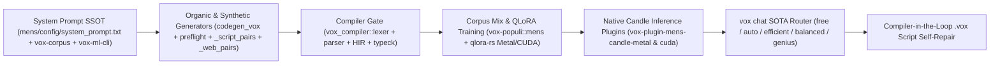

# MENS Training Pipeline, `.vox` Script Writer & SOTA Model Routing SSOT (2026)

<!-- kb:summary -->
Defines the 2026 architecture and end-to-end audit closure for the MENS native Rust ML training and inference pipeline, compiler-verified `.vox` script generation, and five-tier SOTA model routing (`free`, `auto`, `efficient`, `balanced`, `genius`) in `vox chat`. Eliminates legacy colon-block syntax contamination across all system prompts and synthetic/organic generators and wires live compiler-in-the-loop verification.
<!-- /kb:summary -->

> [!IMPORTANT]
> **Single Source of Truth:** All MENS training prompts (`mens/config/system_prompt.txt`, `crates/vox-corpus/src/training/mod.rs`, `crates/vox-ml-cli/src/training/system_prompt.rs`), synthetic/organic corpus generators (`crates/vox-corpus/src/codegen_vox/`, `crates/vox-corpus/src/corpus/preflight/`, `crates/vox-corpus/src/synthetic_gen/bodies/`), and `vox chat` script verification MUST enforce unified 2026 brace-first `.vox` syntax (`fn name(...) to RetType { ... }`, `ret`, `//` comments, `Error(...)`, and `vox run scripts/*.vox` entrypoints).

---

## 1. End-to-End MENS Training & Inference Pipeline Audit



### 1.1 Critical Defects Identified & Remediated

| Subsystem | Audited Location | Root-Cause Defect Found | 2026 Remediation Applied |
|---|---|---|---|
| **MENS System Prompt Split-Brain** | `crates/vox-ml-cli/src/training/system_prompt.rs`, `crates/vox-corpus/src/training/mod.rs`, `mens/config/system_prompt.txt` | `vox-ml-cli` injected retired colon-block syntax (`actor Counter:`, `state count: int = 0`, `@agent_def`, `@action`, `#` comments, JSX `<div>`); `vox-corpus` checked `scripts/vox_system_prompt.txt` instead of `mens/config/system_prompt.txt`. | Unified all three prompt surfaces onto 2026 brace-first `.vox` grammar (`fn ... to ...`, `ret`, `//` comments, `type Name = { ... }`, `actor`, `workflow`, `@mcp.tool`, `routes`) plus dedicated `## VoxScript Automation` guidance. |
| **Organic Corpus Generator (`codegen_vox`)** | `crates/vox-corpus/src/codegen_vox/{part_01.rs, part_02.rs, part_03.rs}` | Emitted JSX (`<div class="card">`), `isnt`, match arms using `to` instead of `->`, actor `state` fields, retired `@server`/`@action` decorators, and bypassed `verify_parse` via `#[cfg(feature = " analogous")]`. | Rewrote all 8 declaration templates + added 9th `VoxScript` automation template in 2026 `.vox` syntax; enabled unconditional compiler verification (`vox_compiler::lexer::lex` + `parser::parse`) in `verify_parse`. |
| **Preflight & Synthetic Corpus Pairs** | `crates/vox-corpus/src/corpus/preflight/preflight_part1.rs`, `synthetic_gen/bodies/{_web_pairs.inc, _script_pairs.inc}` | Preflight pairs used `@traced`, semicolons, `Err(...)`, and taught `->` return type arrows in `BrokenKind` explanations; `_script_pairs.inc` had zero `.vox` script pairs; `_web_pairs.inc` used JSX `view: <nav>`. | Updated preflight pairs and `BrokenKind` hints to `to` return types and `Error(...)`; updated `WEB_CONSTRUCTS` to `fn ...() to Element`; added compiler-valid `vox_script` + `vox_organic` pairs to `_script_pairs.inc`. |
| **Metal Hybrid GatedDeltaNet Decode** | `crates/vox-plugin-mens-candle-metal/src/{model.rs, inference.rs}` | `Qwen35LayerCache` stores `Option<(Tensor, Tensor)>` for full-attention layers only; calling `forward_cached` on hybrid Qwen3.5 3:1 `linear_attention` layers bypassed recurrent state after token 1. | Added `uses_linear_attention(&self) -> bool` on `Qwen35Model` and updated `InferenceEngine::generate` to use full-sequence `forward(&input)` when hybrid linear-attention layers are active, preserving `forward_cached` for pure full-attention models. |
| **CUDA Inference Parity** | `crates/vox-plugin-mens-candle-cuda/src/{model.rs, inference.rs}` | Missing `Qwen35LayerCache`, `forward_cached`, `uses_linear_attention`, and `eos_token_ids` array parsing from `config.json`. | Ported slot-based `Qwen35LayerCache`, `forward_cached`, `uses_linear_attention` hybrid fallback, and multi-ID `eos_token_ids` termination to `vox-plugin-mens-candle-cuda`. |

---

## 2. SOTA 5-Tier Model Routing in `vox chat`

`crates/vox-cli/src/commands/chat.rs` routes `--model <mode>` through `vox_orchestrator::models::decide()` backed by the live 386-model catalog (`~/.vox/cache/model-catalog.v1.json` populated via `vox model discover --force`), Artificial Analysis `intelligence_index` priors, Clavis secret resolution (`vox_secrets::resolve_secret`), and live local MENS reachability probing:

| Mode (`--model <mode>`) | `CostPreference` & Constraints | Primary Task Category | Top-K Cascade & Fallback Behavior |
|---|---|---|---|
| **`free`** (`auto-free`, `zero-cost`) | `CostPreference::Efficiency`, `free_only: true` | `CodeGen` (for `.vox`/code prompts) or `Chat` | Ranks verified `$0` OpenRouter `:free` models (`qwen/qwen3-coder:free`, `openai/gpt-oss-120b:free`, `z-ai/glm-4.5-air:free`) + reachable local models, with `openrouter/free` router fallback. |
| **`auto`** (default SOTA selector) | `CostPreference::Performance` (`CodeGen`, complexity `7`) / `Balanced` (`Chat`, complexity `5`) | Dynamic (`CodeGen` vs `Chat`) | Selects highest utility-per-cost model across all keyed providers with top-4 cascade + `openrouter/auto` fallback. |
| **`efficient`** (`fast`, `efficiency`) | `CostPreference::Efficiency`, `complexity: 3`, `free_only: false` | Dynamic (`CodeGen` vs `Chat`) | Prioritizes low-latency, high-throughput flash/mini SOTA models across keyed providers. |
| **`balanced`** (`standard`) | `CostPreference::Balanced`, `complexity: 6`, `free_only: false` | Dynamic (`CodeGen` vs `Chat`) | Optimizes Pareto quality-to-cost across mid/pro tiers (`gemini-2.5-flash`, `claude-sonnet`, `qwen3-coder`). |
| **`genius`** (`sota`, `frontier`, `max`) | `CostPreference::Performance`, `complexity: 9`, `free_only: false` | `CodeGen` (coding) or `Reasoning` (analysis) | Routes to frontier SOTA reasoning and coding models (`claude-opus-4.6`, `gpt-5.4-pro`, `gemini-3.1-pro`) with top-K cascade. |

### 2.1 Compiler-in-the-Loop `.vox` Script Verification

When `vox chat` detects a `.vox` script/code request (`is_vox_script_request`):
1. **Canonical Prompt Injection:** Automatically injects the unified 2026 `.vox` Script Writer System Prompt (`vox_corpus::training::generate_system_prompt()`) when `--system` is not overridden.
2. **Frontend Compiler Gate:** Extracts ```` ```vox ... ``` ```` blocks and runs `vox_compiler::pipeline::run_frontend_str` (`lex -> parse -> HIR -> typeck`).
3. **Bounded Self-Repair:** If compiler errors are detected, `vox chat` feeds the exact `Line X, Col Y` compiler diagnostics back to the active model (up to 2 repair turns) until `vox-script-verify: PASS (compiler frontend 0 errors)` is achieved.
