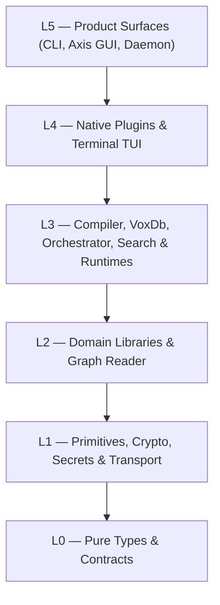

# Subsystem Architecture Atlas (L0–L5)

Machine-generated overview of the 6 architectural layers (`L0`–`L5`) and domain subsystem SSoTs in the Vox workspace.

## Layer Dependency Hierarchy

## Architectural Layers (`L0`–`L5`)

| Layer | Subsystem Hub | Crate Count | Summary |
|---|---|---|---|
| `L0` | [Layer 0 — Pure Types & Contracts](./l0-pure-types.generated.md) | 13 | Zero-I/O pure data structures, AST nodes, database row types, and KB facet schemas. |
| `L1` | [Layer 1 — Primitives, Crypto, Secrets & Transport](./l1-primitives.generated.md) | 23 | Foundational primitives including vox-crypto, Clavis secrets, iroh QUIC mesh transport, and bounded FS. |
| `L2` | [Layer 2 — Domain Libraries & Graph Reader](./l2-domain-libs.generated.md) | 17 | Pure domain engines: configuration, capability/MCP registries, code graph reader, evaluation, and journal. |
| `L3` | [Layer 3 — Compiler, VoxDb, Orchestrator, Search & Runtimes](./l3-heavy-runtimes.generated.md) | 53 | Core execution engines: unified Vox compiler/codegen, VoxDb/Turso, multi-agent orchestrator, hybrid search, and Populi/Mens. |
| `L4` | [Layer 4 — Native Plugins & Terminal TUI](./l4-plugins-surfaces.generated.md) | 12 | Dynamically loaded skill/inference plugins and the ratatui-based vox-term TUI. |
| `L5` | [Layer 5 — Product Surfaces (CLI, Axis GUI, Daemon)](./l5-binaries.generated.md) | 13 | User-facing product binaries: vox CLI, Vox Axis desktop workbench (vox-gui), and orchestrator daemon. |

## Domain Subsystem Authority Map

| Domain Subsystem | Primary Layer | Canonical SSoT |
|---|---|---|
| Compiler & Web IR | `L3` | [`vox-compiler`](../../api/vox-compiler.generated.md) |
| VoxDb / Arca / Codex | `L3` | [`vox-db`](../../api/vox-db.generated.md) |
| Multi-Agent Orchestrator & DEI | `L3` | [`vox-orchestrator`](../../api/vox-orchestrator.generated.md) |
| Hybrid Search & Tantivy | `L3` | [`vox-search`](../../api/vox-search.generated.md) |
| Populi / Mens / Speech (Oratio) | `L3` / `L4` | [`vox-populi`](../../api/vox-populi.generated.md) |
| Axis Desktop Workbench & TUI | `L5` / `L4` | [`vox-gui`](../../api/vox-gui.generated.md) |
| Cryptography & Clavis Secrets | `L1` | [`cryptography-ssot-2026`](../cryptography-ssot-2026.md) |
