# Layer 2 — Domain Libraries & Graph Reader

Pure domain engines: configuration, capability/MCP registries, code graph reader, evaluation, and journal.

## Subsystem Topology

```mermaid
flowchart TD
    l2_domain_libs["Layer 2 — Domain Libraries & Graph Reader"]
    vox_capability_registry["vox-capability-registry (library)"]
    l2_domain_libs --> vox_capability_registry
    vox_cli_contracts["vox-cli-contracts (library)"]
    l2_domain_libs --> vox_cli_contracts
    vox_config["vox-config (library)"]
    l2_domain_libs --> vox_config
    vox_constrained_gen["vox-constrained-gen (library)"]
    l2_domain_libs --> vox_constrained_gen
    vox_doc_inventory["vox-doc-inventory (library)"]
    l2_domain_libs --> vox_doc_inventory
    vox_eval["vox-eval (library)"]
    l2_domain_libs --> vox_eval
    vox_journal["vox-journal (library)"]
    l2_domain_libs --> vox_journal
    vox_llm_egress["vox-llm-egress (library)"]
    l2_domain_libs --> vox_llm_egress
    vox_mcp_registry["vox-mcp-registry (library)"]
    l2_domain_libs --> vox_mcp_registry
    vox_mesh_policy["vox-mesh-policy (library)"]
    l2_domain_libs --> vox_mesh_policy
    vox_populi_types["vox-populi-types (library)"]
    l2_domain_libs --> vox_populi_types
    vox_project_scaffold["vox-project-scaffold (library)"]
    l2_domain_libs --> vox_project_scaffold
    vox_quantize["vox-quantize (library)"]
    l2_domain_libs --> vox_quantize
    vox_repository["vox-repository (library)"]
    l2_domain_libs --> vox_repository
    vox_runtime["vox-runtime (library)"]
    l2_domain_libs --> vox_runtime
    vox_similarity["vox-similarity (library)"]
    l2_domain_libs --> vox_similarity
    vox_skill_runtime["vox-skill-runtime (library)"]
    l2_domain_libs --> vox_skill_runtime
```

## Crates in Layer

| Crate | Kind | Fan-In Cap | LoC Baseline |
|---|---|---|---|
| [`vox-capability-registry`](../../api/vox-capability-registry.generated.md) | `library` | — | — |
| [`vox-cli-contracts`](../../api/vox-cli-contracts.generated.md) | `library` | — | — |
| [`vox-config`](../../api/vox-config.generated.md) | `library` | 40 | — |
| [`vox-constrained-gen`](../../api/vox-constrained-gen.generated.md) | `library` | — | — |
| [`vox-doc-inventory`](../../api/vox-doc-inventory.generated.md) | `library` | — | — |
| [`vox-eval`](../../api/vox-eval.generated.md) | `library` | — | — |
| [`vox-journal`](../../api/vox-journal.generated.md) | `library` | — | — |
| [`vox-llm-egress`](../../api/vox-llm-egress.generated.md) | `library` | 10 | — |
| [`vox-mcp-registry`](../../api/vox-mcp-registry.generated.md) | `library` | — | — |
| [`vox-mesh-policy`](../../api/vox-mesh-policy.generated.md) | `library` | — | — |
| [`vox-populi-types`](../../api/vox-populi-types.generated.md) | `library` | — | 1000 |
| [`vox-project-scaffold`](../../api/vox-project-scaffold.generated.md) | `library` | — | — |
| [`vox-quantize`](../../api/vox-quantize.generated.md) | `library` | — | 4000 |
| [`vox-repository`](../../api/vox-repository.generated.md) | `library` | — | — |
| [`vox-runtime`](../../api/vox-runtime.generated.md) | `library` | 20 | — |
| [`vox-similarity`](../../api/vox-similarity.generated.md) | `library` | — | 6000 |
| [`vox-skill-runtime`](../../api/vox-skill-runtime.generated.md) | `library` | — | — |
