# Layer 5 — Product Surfaces (CLI, Axis GUI, Daemon)

User-facing product binaries: vox CLI, Vox Axis desktop workbench (vox-gui), and orchestrator daemon.

## Subsystem Topology

```mermaid
flowchart TD
    l5_binaries["Layer 5 — Product Surfaces (CLI, Axis GUI, Daemon)"]
    vox_audit["vox-audit (binary)"]
    l5_binaries --> vox_audit
    vox_cargo_shim["vox-cargo-shim (binary)"]
    l5_binaries --> vox_cargo_shim
    vox_cli["vox-cli (binary)"]
    l5_binaries --> vox_cli
    vox_cli_ci["vox-cli-ci (library)"]
    l5_binaries --> vox_cli_ci
    vox_cli_research["vox-cli-research (library)"]
    l5_binaries --> vox_cli_research
    vox_cli_review["vox-cli-review (library)"]
    l5_binaries --> vox_cli_review
    vox_cli_share["vox-cli-share (library)"]
    l5_binaries --> vox_cli_share
    vox_cli_tests["vox-cli-tests (test-only)"]
    l5_binaries --> vox_cli_tests
    vox_gui["vox-gui (binary)"]
    l5_binaries --> vox_gui
    vox_integration_tests["vox-integration-tests (test-only)"]
    l5_binaries --> vox_integration_tests
    vox_langtool["vox-langtool (binary)"]
    l5_binaries --> vox_langtool
    vox_orchestrator_d["vox-orchestrator-d (binary)"]
    l5_binaries --> vox_orchestrator_d
    voxup["voxup (binary)"]
    l5_binaries --> voxup
```

## Crates in Layer

| Crate | Kind | Fan-In Cap | LoC Baseline |
|---|---|---|---|
| [`vox-audit`](../../api/vox-audit.generated.md) | `binary` | — | — |
| `vox-cargo-shim` | `binary` | — | — |
| [`vox-cli`](../../api/vox-cli.generated.md) | `binary` | — | 90000 |
| [`vox-cli-ci`](../../api/vox-cli-ci.generated.md) | `library` | — | 15000 |
| [`vox-cli-research`](../../api/vox-cli-research.generated.md) | `library` | — | — |
| [`vox-cli-review`](../../api/vox-cli-review.generated.md) | `library` | — | — |
| [`vox-cli-share`](../../api/vox-cli-share.generated.md) | `library` | — | — |
| [`vox-cli-tests`](../../api/vox-cli-tests.generated.md) | `test-only` | — | — |
| [`vox-gui`](../../api/vox-gui.generated.md) | `binary` | — | 25000 |
| [`vox-integration-tests`](../../api/vox-integration-tests.generated.md) | `test-only` | — | — |
| [`vox-langtool`](../../api/vox-langtool.generated.md) | `binary` | — | — |
| [`vox-orchestrator-d`](../../api/vox-orchestrator-d.generated.md) | `binary` | — | — |
| [`voxup`](../../api/voxup.generated.md) | `binary` | — | — |
