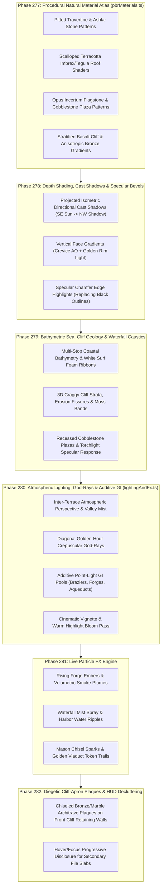

# URBS Photorealistic Vitruvian Material, Depth-Shading, Lighting & FX Specification (2026)

<!-- kb:summary -->
This specification defines the Milestone v5.0 (`Phases 277–282`) rendering pipeline upgrade for `VRBS` (`LudusSandbox.tsx` and `worldRenderer.ts`). It diagnoses why flat solid-color polygon fills and uniform dark strokes produce a cartoon/vector look, and specifies six physically-inspired rendering subsystems: procedural natural material synthesis (`pbrMaterials.ts`), projected directional cast shadows and vertical ambient occlusion (`drawIsoBox` / `drawIsoPitchedRoof`), bathymetric sea and stratified cliff geology, dual-key golden-hour/twilight atmospheric lighting with crepuscular god-rays (`lightingAndFx.ts`), deterministic particle FX emitters, and diegetic cliff-apron architrave plaques that keep 3D architecture unobstructed.
<!-- /kb:summary -->

## 1. Visual Gap Diagnosis: Why Flat Polygons Look Cartoonish

Inspecting the v4.9 Canvas 2D output against our concept plates reveals four structural rendering gaps:

1. **Flat Hex Fills + Uniform Black Outlines**: Every wall, roof, cliff, and plaza polygon was filled with a single flat color (`#4a433b`, `#d4c5b2`) and outlined with a uniform `#120f0c` stroke (`1.15px`). In real architectural photography and AAA isometric engines (*Anno 117: Pax Romana*, *Frostpunk*, *Hades*), surfaces exhibit continuous tonal gradients, micro-surface grain (pitted travertine, terracotta tile scalloping, basalt cobblestones), and specular edge chamfers rather than black comic outlines.
2. **Missing Projected Directional Cast Shadows & Vertical Crevice Occlusion**: Buildings only drew a tiny `0.08`-tile footprint pad (`z0 === 0`) and had no directional cast shadows on the ground or neighboring walls, nor vertical height-based shading along wall faces.
3. **Missing Atmospheric Depth, God-Rays & Additive GI Light Pools**: The sea was a flat `#0a1019` rectangle with no coastal bathymetry or surf foam; elevated terraces lacked inter-layer atmospheric haze; braziers, forges, and aqueducts lacked additive screen-space bloom and ground bounce pools.
4. **Floating HTML-Style Pill Clutter Over 3D Architecture**: Rendering 15+ opaque rounded-rectangle callouts directly over the center of every district occluded the 3D wonders and mechanisms.

---

## 2. Six-Subsystem Photorealistic Rendering Architecture (`Phases 277–282`)

### 2.1 Phase 277: Procedural Natural Surface Material Synthesis (`pbrMaterials.ts`)
- Deterministic, zero-network-asset offscreen `CanvasPattern` & gradient factory cached per renderer instance:
  - **Travertine Ashlar (`travertine-lit`, `travertine-shade`)**: Value-noise stone grain, micro-pitting pores, staggered ashlar mortar courses, and warm ivory-to-ochre per-block tonal variation.
  - **Terracotta Tile (`terracotta-lit`, `terracotta-shade`)**: Burnt-sienna to umber vertical gradient overlaid with staggered semicircular imbrex tile shadow scallops and warm ridge highlights.
  - **Cobblestone & Opus Sectile Plaza (`plaza-cobble`, `plaza-marble`)**: Isometric paving stone grid with weathered mortar crevices and subtle stone-to-stone value variation.
  - **Stratified Basalt Cliff (`cliff-lit`, `cliff-shade`)**: Diagonal sedimentary strata lines, dark vertical fracture crevices, and coastal moss stippling.
  - **Anisotropic Hammered Bronze (`createBronzeMetallicGradient`)**: 5-stop metallic reflection gradient (`#2a1808` → `#92400e` → `#f59e0b` → `#fef3c7` → `#78350f`).

### 2.2 Phase 278: True Isometric Directional Cast Shadows, Contact AO & Specular Bevels
- **Sun & Twilight Key-Light Model**:
  - Primary warm golden-hour key light from **South-East (`+u, -v`, elevation `36°`)**.
  - Cool indigo twilight skylight fill on **South-West (`+v`)** faces (`#2b3340` → `#473f38`).
- **Projected Cast Shadows (`drawIsoCastShadow`)**:
  - Every building box `(u0..u1, v0..v1, z0..z1)` projects a soft multi-step penumbra shadow polygon onto `z = z0` extending toward `(-u * 0.45, -v * 0.15)` before the building faces are drawn.
- **Vertical Face Gradients & Specular Chamfer Highlights**:
  - Each `swPts` and `sePts` wall face is shaded with a vertical `CanvasLinearGradient` (darker at `z0` from ground contact AO, warmer/brighter at `z1` from sky/sun rim light) plus a `repeat` overlay of the procedural travertine pattern at `0.24` alpha.
  - Hard `#120f0c` cartoon outlines are replaced with subtle crevice seams (`rgba(12, 10, 9, 0.55)`) and a crisp `1.1px` warm specular highlight (`rgba(254, 243, 199, 0.48)`) along the top/SE chamfer ridge.

### 2.3 Phase 279: Sculpted Coastal Bathymetry, Cliff Geology & Cobblestone Terraces
- **Mediterranean Twilight Bathymetry**: Radial and linear depth gradients transitioning from deep abyssal midnight (`#050a12`) to coastal Prussian teal (`#0c2538` / `#133b54`) around the peninsula footprint, rimmed by animated white/cyan coastal surf foam lines where rock cliffs meet the sea.
- **Craggy Cliff Strata & Retaining Aprons**: Multi-faceted rock buttresses, vertical fissure shadows, and mossy overhang ledges beneath chiseled ashlar retaining walls.

### 2.4 Phase 280: Atmospheric Lighting, God-Rays, Elevation Mist & Additive GI Pools (`lightingAndFx.ts`)
- **Inter-Terrace Atmospheric Mist**: Soft horizontal mist ribbons (`rgba(148, 163, 184, 0.10)` to `rgba(251, 191, 36, 0.08)`) between `L0`, `L1`, `L2`, and `L3` elevation tiers to create aerial perspective.
- **Crepuscular Volumetric God-Rays**: Diagonal golden light beams (`rgba(251, 191, 36, 0.09)` → `0`) cast across the Acropolis, Praetorium, and active districts.
- **Additive Point-Light GI Pools**: Warm radial light pools around every brazier, trip-hammer furnace, burning error building, and lit window, plus cyan water-glow along aqueduct channels.

### 2.5 Phase 281: Live Particle FX Engine
- Deterministic time-parameterized particle system in `drawAnimatedWorldEffects`:
  - **Forge & Error Embers**: Rising buoyant orange-gold sparks (`#fef08a` → `#f97316`) with sinusoidal drift.
  - **Waterfall Spray & Harbor Caustics**: Shimmering water specular glints and mist puffs at waterfall bases.
  - **Mason Chisel Dust & Sparks**: Golden micro-sparks around active Treadwheel Cranes (`+LoC / -LoC`).

### 2.6 Phase 282: Diegetic Cliff-Apron Architrave Plaques & HUD Decluttering
- District plaques mount directly onto the **front ashlar retaining wall apron** of each terrace (`toScreen(wx, wy + 26)`) styled as **chiseled Roman marble & bronze architrave inscriptions** with recessed bevel borders.
- Secondary file diff slabs render only for the **selected/hovered district or top active/error building** (max 1 compact diegetic tag on non-selected districts), uncovering the 3D Vitruvian architecture across the entire map.
