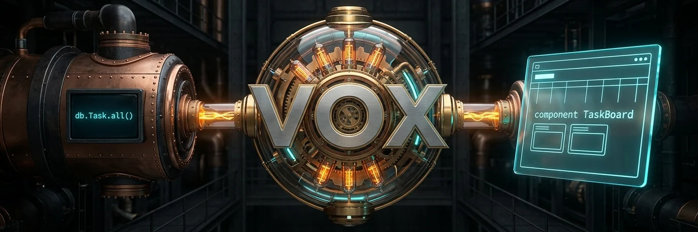
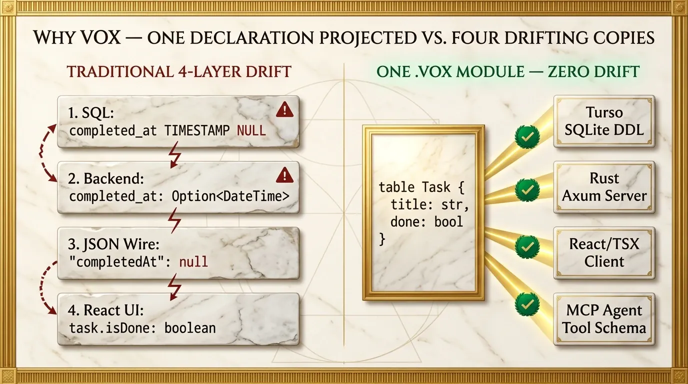
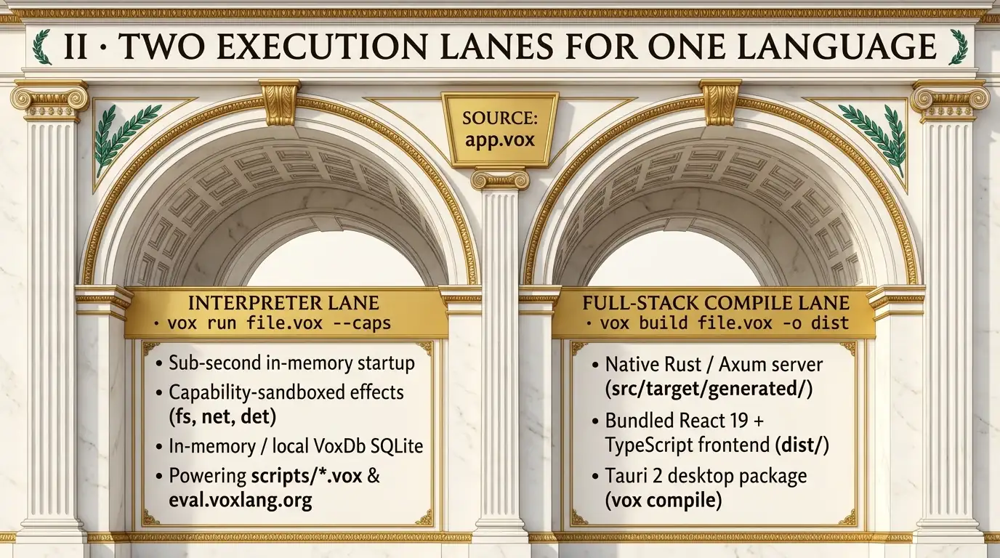
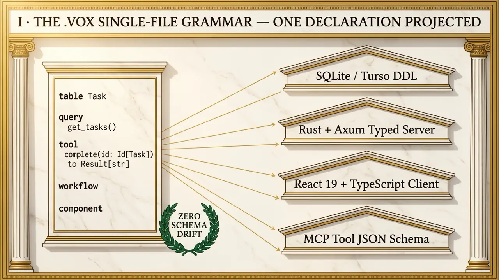

import VoxPlayground from '../../docs-astro/src/components/VoxPlayground.astro';
import VoxGuiTourCarousel from '../../docs-astro/src/components/VoxGuiTourCarousel.astro';
import { CardGrid, Card } from '@astrojs/starlight/components';

  

    Pre-1.0 Research Prototype · v9.0 / Workspace v0.6.0 · Apache-2.0
  

  <h1 class="vox-home-title">
    Vox
  </h1>
  

    A statically typed programming language, capability-sandboxed runtime, and verified multi-agent harness — paired with the native <strong>Vox Axis</strong> desktop workbench.
  

  

    Optional values are <code>Option[T]</code> and fallible calls are <code>Result[T]</code>; unhandled branches fail compile-time checking across <strong>16,491 CI tests</strong> and <strong>33 GUI surfaces</strong>.
  

  

    <a href="#try-it" class="vox-hero-btn-primary">Try Sandbox ↓</a>
    <a href="#vox-axis-workbench" class="vox-hero-btn-gold">Explore GUI Tour ↓</a>
    <a href="/tutorials/tut-getting-started/" class="vox-hero-btn-secondary">5-Min Quickstart →</a>
  

  

    
  

## Start in 60 Seconds, 5 Minutes, or 15 Minutes

  

    

      <h3 class="vox-tier-title">
        60s: Zero-Install Sandbox
      </h3>
      

        Evaluate <code>.vox</code> modules in-browser or via the deterministic interpreter with zero Cargo build wait:
      

      <ul class="vox-tier-list--cyan">
        <li>Edit example.vox live below</li>
        <li>Inspect runtime &amp; generated outputs</li>
        <li>Run locally via vox run --interp</li>
      </ul>
    

    <a href="#try-it" class="vox-tier-btn-cyan-bottom">
      Run that now ↓
    </a>
  

  

    

      <h3 class="vox-tier-title">
        5-Min: Typed App &amp; Tests
      </h3>
      

        Verify explicit error handling, typed IDs, and deterministic test suites before building native targets:
      

      <ul class="vox-tier-list--amber">
        <li>Check safety with vox check</li>
        <li>Run assertions via vox test</li>
        <li>Emit standalone code via vox build</li>
      </ul>
    

    <a href="/tutorials/tut-getting-started/#2-5-minute-single-file-full-stack-app" class="vox-tier-btn-amber">
      5-Min Quickstart →
    </a>
  

  

    

      <h3 class="vox-tier-title">
        15-Min: Agent Harness &amp; Axis
      </h3>
      

        Supervise multi-agent execution, federated search, and non-modal docs in <a href="https://github.com/vox-foundation/vox-axis" class="vox-tier-link">vox-axis ↗</a>:
      

      <ul class="vox-tier-list--emerald">
        <li>Durable workflow replay</li>
        <li>Federated vox kb sync</li>
        <li>VRBS ROMA &amp; 33 views</li>
      </ul>
    

    <a href="/how-to/how-to-axis-workbench/" class="vox-tier-btn-emerald">
      Axis Workbench →
    </a>
  

<VoxPlayground initialCode={`// Edit .vox and click Run to inspect each target
table Task {
    title: str
    done:  bool
}

query get_tasks() to int {
    return len(db.Task.all())
}

tool "Done" complete_task(id: Id[Task]) to Result[str] {
    db.Task.delete(id)?
    return Ok("done")
}

component TaskBoard() {
    view: column(raw_class="task-card") {
        heading(level=3) { "Active Tasks" }
        text() { "Typed task board with Result[T]" }
    }
}

fn main() to Result[str] {
    let id = db.Task.insert({ title: "Write Vox in browser", done: false })?
    print("Tasks queued: " + str(get_tasks()))
    let status = complete_task(id)?
    print("Tasks remaining: " + str(get_tasks()))
    return Ok(status)
}`} />

## Vox Axis Desktop Workbench

[**Vox Axis**](https://github.com/vox-foundation/vox-axis) ([Workbench Guide](/how-to/how-to-axis-workbench/)) is the Tauri 2 desktop console for agent orchestration, crate blast-radius graphs, federated search, and non-modal docs (`33` views, `0` axe violations; `◐` toggles Light/Dark captures):

<VoxGuiTourCarousel />

{/* SYNC-FROM-README: why_vox */}
## Why Vox

A typical web app restates one domain model in four places:

1. A **database schema** (SQL or an ORM migration).
2. A **backend** (Rust, Go, Python, or Node) that validates and serves it.
3. A **wire contract**, usually JSON.
4. A **frontend** (TypeScript/React) that reads that JSON.

Names and types can drift at each boundary. People and coding agents both spend time keeping the copies aligned.

  
  

    <strong>One field, written four times</strong> 
    <em>completed_at, completedAt, and isDone are the same fact. Each boundary renames it or changes its type. A Vox table states it once, and every layer keeps that name and type.</em>
  

These are the choices that follow from that, and what each one buys.

**One declaration, projected.** A second schema, written by hand, drifts, and an agent copying it drifts the same way. A `table` is the source. SQL, the server types, the JSON shape, and the TypeScript client are generated from it. `vox build` emits SQLite/Turso, Rust (Axum), and React/TypeScript, because one stack is what the tests can actually cover. Django, Vue, and other frameworks are outside that path.

**Missing values and failures are typed.** Generated code skips a failure it cannot see. `Option[T]` is `Some(x)` or `None`. `Result[T]` is `Ok(x)` or `Error(msg)`. Code that ignores either case does not type-check. `?` returns the error to the caller.

**Ids are typed.** A task id and a user id are different facts. A boundary takes `Id[Task]` rather than a bare string, so the two cannot be swapped.

**Keywords open scopes. Decorators modify them.** `table`, `query`, `mutation`, `server`, `component`, `workflow`, `activity`, `tool`, and `resource` each open a scope. `@auth`, `@pure`, `@durable`, and `@uses` change how a declaration runs. One spelling means people and agents copy the same form. A new behavior is a decorator, so the keyword list stays stable.

**The same file runs now, or compiles.** Scripts, repo automation, and the browser playground should start without a Rust build. A shipped app should be ordinary Rust and TypeScript. `vox run` interprets the file. `--caps` is the list of effects the host grants (filesystem, network, and the rest). `vox build` emits the database, the server, and the client from that same file. The two executors are still being matched, and a generated server build needs a Vox source checkout (`VOX_REPO_ROOT`).

**A tool is a function in the same file.** An agent tool kept in a side schema drifts like a hand-written JSON contract. `tool` is a typed function plus a short description. The program and an MCP client call that declaration, and a failure comes back as `Result`.
{/* SYNC-END: why_vox */}

### Interpreter vs. Native Build

  
  

    <strong>Zero-Build Evaluation (<code>vox run --caps</code>) vs. Native Compilation (<code>vox build</code>)</strong> — <em>Execute scripts immediately inside a capability-gated sandbox, or lower checked ASTs into standalone binaries and web bundles.</em>
  

  

    What do <code>Option[T]</code> and <code>Result[T]</code> mean if I'm coming from Python or JavaScript?
  

  

    
In JavaScript or Python, any variable might secretly be <code>null</code>, <code>undefined</code>, or <code>None</code>, causing runtime crashes under edge inputs.

    <ul>
      <li><strong><code>Option[T]</code></strong> encodes an explicitly optional value (<code>Some(value)</code> or <code>None</code>); the compiler rejects unchecked dereferences.</li>
      <li><strong><code>Result[T]</code></strong> encodes fallible operations (<code>Ok(value)</code> or <code>Error(message)</code>). Appending <code>?</code> unwraps <code>Ok</code> or propagates <code>Error</code> early.</li>
    </ul>
    
Read more in the <a href="/reference/ref-syntax/">Syntax Reference</a> or select <strong>"2. Result[T]"</strong> in the sandbox above.

  

## Empirical Benchmark &amp; Core Subsystems

In seeded multi-turn code generation evaluations, compiler-enforced error paths and explicit capabilities achieved [**82.0% Pass@1 vs. 68.0% TypeScript** (N = 100, McNemar p = 0.0031)](/architecture/vox-vs-ts-empirical-benchmark-2026/):

  
  

    <strong>Compiler, Runtime &amp; Verification Architecture</strong> — <em>Five-plate overview of AST lowering, execution lanes, <code>BLAKE3</code>/<code>HMAC</code> receipts, Pass@1 benchmarks, and the <code>L0</code>–<code>L5</code> zero-cycle crate graph.</em>
  

<CardGrid>
  <Card title="1. Durable Workflows" icon="setting">
    Journal <code>workflow</code> and <code>activity</code> step ordinals, signals, and timers to SQLite/Turso for deterministic crash recovery. <a href="/tutorials/tut-workflow-durability/">Workflows →</a>
  </Card>
  <Card title="2. Verified Agent Harness" icon="approve-check">
    424-tool MCP server and orchestrator issue cryptographic HMAC receipts, hopper file locks, and multi-provider routing. <a href="/how-to/how-to-ai-agents/">Agent Guide →</a>
  </Card>
  <Card title="3. Federated KB & OpenWiki" icon="open-book">
    Tantivy BM25 + HNSW + HippoRAG PageRank federated across repo, library, and canon shards with self-healing code fences. <a href="/tutorials/tut-knowledgebase-and-openwiki/">KB &amp; OpenWiki →</a>
  </Card>
  <Card title="4. Deep Research & Scientia" icon="magnifier">
    Prior-Art Preflight, <code>+1 Wave</code> steering, scoped <code>Index Now</code> vs. quarantine gates, and 7-stage <code>arXiv.org</code> LaTeX bundles. <a href="/tutorials/tut-deep-research-and-scientia/">Research Tutorial →</a>
  </Card>
  <Card title="5. Non-Modal Doc Studio" icon="pencil">
    Author Markdown, MDX, AsciiDoc, JSON, YAML, TOML, CSV, and code in <code>Read | Split | Edit</code> beside live Axis views. <a href="/how-to/how-to-axis-workbench/">Workbench Guide →</a>
  </Card>
  <Card title="6. Native Rust ML (MENS)" icon="star">
    Pure-Rust Candle QLoRA training across Metal, CUDA, and CPU with public <a href="https://huggingface.co/brbrainerd/vox-mens-index">Qwen3 0.6B–4B adapters</a>. <a href="/explanation/expl-architecture/">Architecture →</a>
  </Card>
</CardGrid>

## Ecosystem Repositories

To keep Rust incremental builds fast, isolate frontend toolchains, and keep `vox` **100% standalone offline**, the suite is split across four repositories synchronized by `vox ci cross-repo-parity` (`56` `BLAKE3`-verified schemas):

| Repository | Role | Core Scope |
|:---|:---|:---|
| [**`vox-foundation/vox`**](https://github.com/vox-foundation/vox) | **Core Language, Compiler &amp; Harness** | Parser/typechecker (`vox check`), interpreter (`vox run --caps`), codegen (`vox build`), 424-tool MCP server (`vox mcp`), `VoxDb` (v99), Candle QLoRA (`vox mens`), and the 60-row status matrix. |
| [**`vox-foundation/vox-axis`**](https://github.com/vox-foundation/vox-axis) | **Native Tauri 2 Desktop Workbench** | All **33 `SURFACE_REGISTRY` views**, **`VRBS ROMA` 3D/2.5D Simulator**, `AQVAEDUCTUS` verification cascade, 4 WCAG themes, and Local IPC / TOFU TLS ([Workbench Guide](/how-to/how-to-axis-workbench/)). |
| [**`vox-foundation/voxlang.org`**](https://github.com/vox-foundation/voxlang.org) | **Docs Portal &amp; `/v1/eval` Sandbox** | **Astro 7.4 + Starlight 0.42** site, `vox-doc-pipeline` compiler-checked doctests, W3C SKOS taxonomy, `/voxup` installers, and Coolify **`eval.voxlang.org`** sandbox. |
| **`vox-foundation/vox-ops`** *(Private)* | **Optional Telemetry &amp; Cloud GPU Fleet** | Optional OTLP/ClickHouse ingest and spot GPU brokers (RunPod, Vast.ai, Together AI). Zero compile or runtime dependency from `vox` (`vox ci standalone-sovereignty`). |

## Tradeoffs &amp; Current Stability

Every surface is graded by what works today versus what remains prototype software.

  

    When Vox Fits (and When You Should Pick Another Tool)
  

  

| Tradeoff | Why You Might Like Vox | Why You Might Wait or Pick Another Tool |
|:---|:---|:---|
| **Fixed Target Stack vs. Bring-Your-Own Framework** | Codegen targets one integrated stack (**Axum + React 19 + SQLite/Turso**) verified end-to-end in CI without wiring separate layers. | Teams standardized on Go, Python, Vue, or Svelte cannot swap out the emitted framework stack. |
| **Compile-Time Strictness vs. Loose Scripting** | Explicit `Result[T]` and `Option[T]` checking catches unhandled null/error paths before runtime across agent and human edits. | You must handle `Ok`/`Error` and `Some`/`None` everywhere instead of skipping edge cases in untyped scripts. |
| **Interpreter vs. Native Codegen** | `vox run` starts immediately under `--caps` sandboxing; `vox build` emits native Rust and TypeScript. | Compiling emitted Rust servers outside the workspace currently needs a local `vox` source checkout (`VOX_REPO_ROOT`). |
| **Pre-1.0 Research Velocity vs. Long-Term Stability** | Inspect an active AI-native compiler, 33-view workbench (`Vox Axis`), and QLoRA eval lab with candid audits. | Vox is **pre-1.0 prototype software** — syntax and CLI flags still evolve, with no prebuilt binaries yet. |

  

  

    Surface-by-Surface Stability Matrix (verified 2026-11-18; full 60-row matrix in README)
  

  

| Surface | Status (`2026-11-18`) | What Works Today &amp; Caveats |
|:---|:---|:---|
| **Compiler &amp; Type Checker (`vox check`)** | 🟣 Mature | Lexer, 57-rule parser, HIR lowering, bidirectional typechecker, `@ai(structured_output = T)` JSON-Schema emission. |
| **Script Interpreter (`vox run`)** | 🔵 Stable | Runs scripts, `table`/`query`/`tool` modules, repo automation (`scripts/*.vox`), and the browser sandbox (`--caps deterministic`). |
| **Database &amp; Secrets (`vox-db`, `vox secrets`)** | 🔵 Stable | SQLite/Turso at schema baseline `99` and `Clavis` secret resolution (`vox_secrets`). |
| **Curated Knowledge Base (`vox kb`)** | 🔵 Stable | Tantivy 0.22 lexical + RRF hybrid search, SKOS taxonomy facets, and 4-tier trust quarantine (`SystemVerified` → `Untrusted`). |
| **Full-Stack Codegen (`vox build`, `vox compile`)** | 🟡 Preview | Emits React 19 TSX, Axum handlers, DB mutations, and Tauri 2 apps. Needs `VOX_REPO_ROOT` to compile emitted servers. |
| **Durable Runtime (`workflow` / `activity`)** | 🟡 Preview | `VoxDbTracker` SQLite replay, ordinals, `workflow.version`, signals, and timers ([ADR-019](/adr/019-durable-workflow-journal-contract-v1/), [ADR-021](/adr/021-generated-workflow-durability-parity/)). |
| **Agent Harness &amp; Vox Axis (`vox mcp`, `vox-gui`)** | 🟡 Preview | 424-tool MCP server with HMAC receipts, hopper locks, 33 Axis views, `VRBS ROMA`, 4 WCAG themes, and TOFU TLS. |
| **Local ML &amp; Eval (`vox mens`, `eval-compare`)** | 🟠 Emergent | `eval-compare` (82.0% vs 68.0% TS Pass@1) and Metal/CUDA/CPU QLoRA work; adapters on <a href="https://huggingface.co/brbrainerd/vox-mens-index">Hugging Face</a>. |

→ Full 60-row tables: [vox-foundation/vox README](https://github.com/vox-foundation/vox#status) · [vox-axis 33-Screen Tour](https://github.com/vox-foundation/vox-axis) · [Stability Matrix](/reference/stability/) · [v1.0 Criteria](/architecture/v1-release-criteria/)

  

## Documentation Map

Structured by [Diátaxis](https://diataxis.fr/) around your goal:

| Goal | Start Here |
|:---|:---|
| **Learn step by step** | [Installation](/reference/installation/) · [Getting Started](/tutorials/tut-getting-started/) · [Deep Research &amp; Scientia](/tutorials/tut-deep-research-and-scientia/) · [Knowledgebase &amp; OpenWiki](/tutorials/tut-knowledgebase-and-openwiki/) · [First Full-Stack App](/tutorials/tut-first-app/) · [Full-Stack Walkthrough](/tutorials/tut-fullstack-walkthrough/) · [Durable Workflows](/tutorials/tut-workflow-durability/) |
| **Follow task recipes** | [Vox Axis Workbench](/how-to/how-to-axis-workbench/) · [Publish Scientia Papers](/how-to/how-to-scientia-publication/) · [AI Agents &amp; MCP](/how-to/how-to-ai-agents/) · [External App Bootstrap](/how-to/external-app-bootstrap/) · [Troubleshooting FAQ](/how-to/troubleshooting-faq/) |
| **Understand the design** | [Why Vox for AI](/explanation/why-vox-for-ai/) · [Compiler Architecture](/explanation/expl-architecture/) · [Vox vs. TS Benchmark](/architecture/vox-vs-ts-empirical-benchmark-2026/) · [Frontpage Perf &amp; CV Flywheel](/architecture/voxlang-frontpage-perf-and-gui-tour-cv-ssot-2026/) · [General FAQ](/explanation/faq/) |
| **Look up specifications** | [Syntax Reference](/reference/ref-syntax/) · [CLI Reference](/reference/cli/) · [Decorators](/reference/ref-decorators/) · [Search &amp; Retrieval](/reference/ref-search/) · [Stability Matrix](/reference/stability/) |
| **Contribute or audit** | [Where Things Live](/architecture/where-things-live/) · [Multi-Repo Flywheel SSOT](/architecture/monorepo-to-multirepo-flywheel-ssot-2026/) · [Contributor Hub](/contributors/contributor-hub/) · [Agents Policy (`AGENTS.md`)](/repo/agents-md/) |

## Community, Stewardship &amp; License

- **Stewardship.** Led by **Bertrand Reyna-Brainerd** and stewarded by the **Vox Foundation** (in formation), backed transparently via [Open Collective](https://opencollective.com/vox-foundation).
- **License.** [Apache 2.0](https://github.com/vox-foundation/vox/blob/main/LICENSE) — free for personal, academic, and commercial use with attribution.
- **Links.** [`vox-foundation/vox`](https://github.com/vox-foundation/vox) · [`vox-foundation/vox-axis`](https://github.com/vox-foundation/vox-axis) · [`vox-foundation/voxlang.org`](https://github.com/vox-foundation/voxlang.org) · [Issues](https://github.com/vox-foundation/vox/issues) · [RSS Feed](https://voxlang.org/feed.xml) · [`/llms.txt`](https://voxlang.org/llms.txt)
