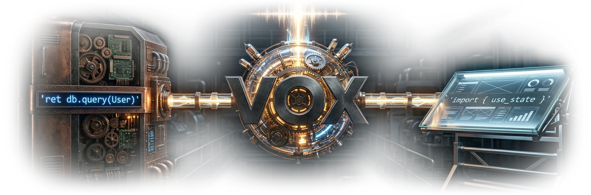
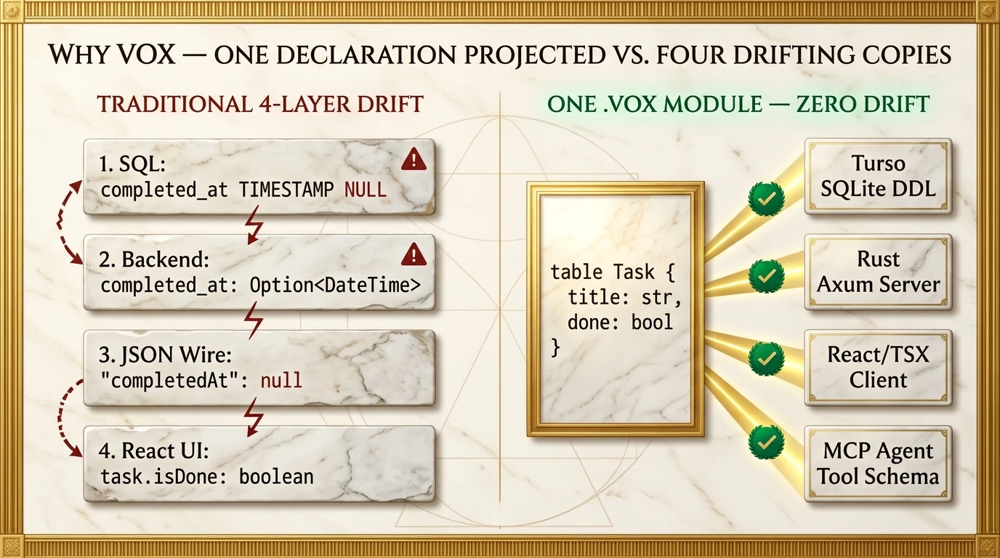
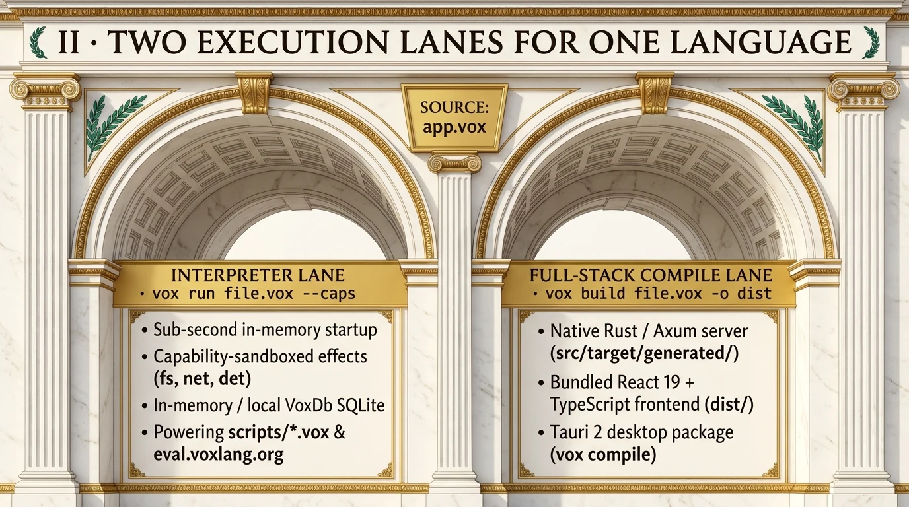
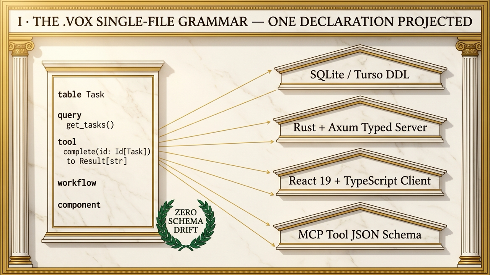
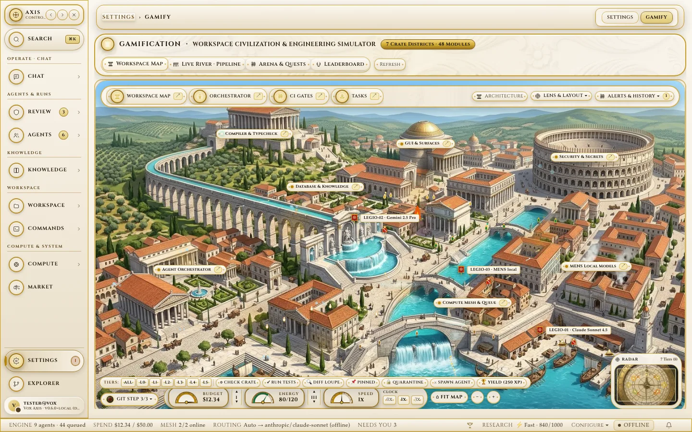
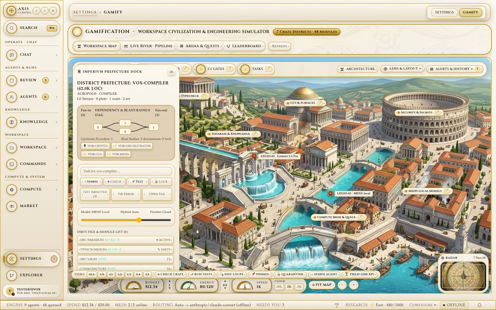
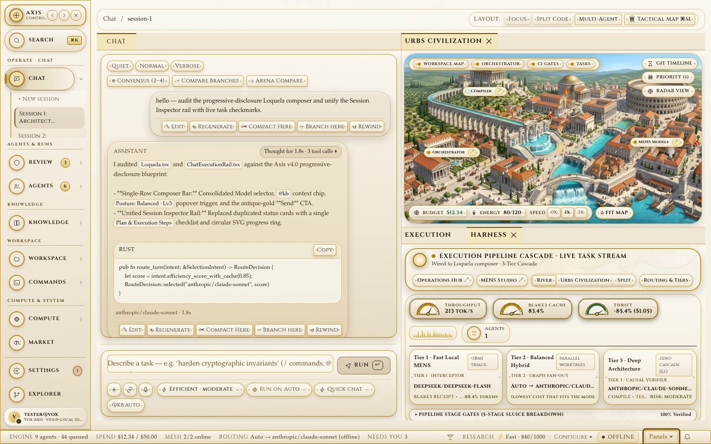
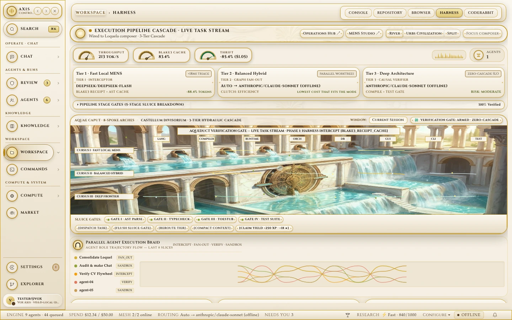
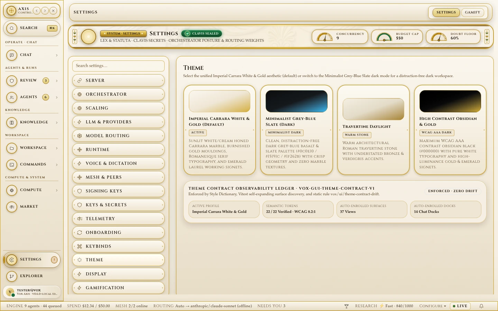
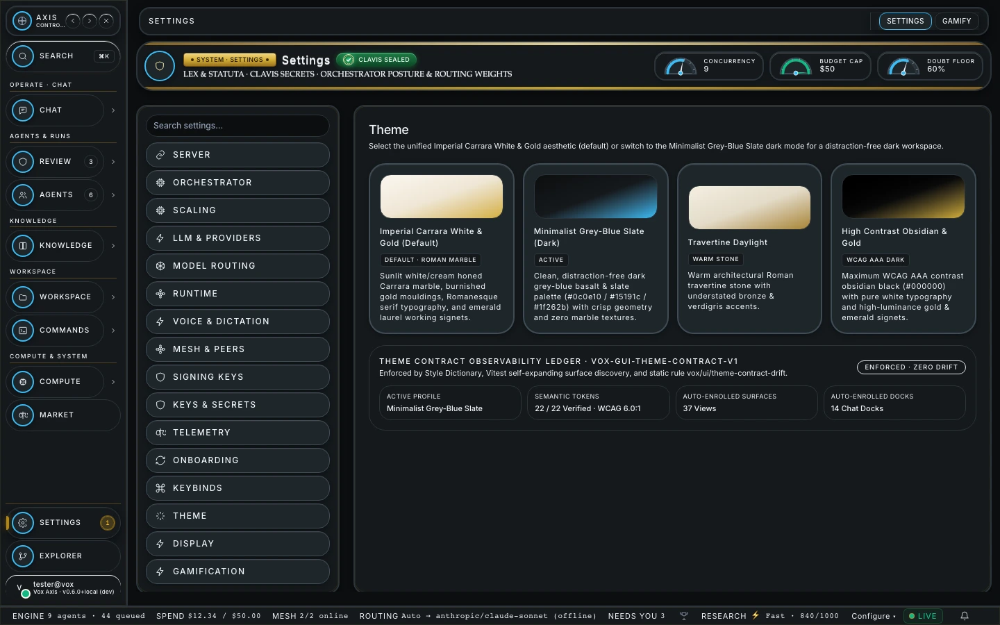

import VoxPlayground from '../../docs-astro/src/components/VoxPlayground.astro';
import { CardGrid, Card } from '@astrojs/starlight/components';

<div class="vox-home-hero" data-testid="vox-suite-portal-hero">
  <p class="vox-home-kicker">
    Pre-1.0 Research Prototype · v6.8 / Workspace v0.6.0 · Apache-2.0
  </p>
  <h1 class="vox-home-title">
    Vox
  </h1>
  <p class="vox-home-lead">
    One <code>.vox</code> module declares relational schemas, server queries, reactive UI components, durable workflows, and MCP agent tools — projected without drift across SQLite/Turso, Rust (Axum), and React/TypeScript, and supervised in the <strong>Vox Axis</strong> desktop workbench.
  </p>
  <p class="vox-home-sublead">
    Missing values are <code>Option[T]</code>. Fallible calls return <code>Result[T]</code>. Code that ignores either case does not type-check. Verified across <strong>16,491 CI tests</strong> and <strong>32 GUI workbench surfaces</strong>.
  </p>
  <div class="vox-home-actions">
    <a href="/tutorials/tut-getting-started/" class="vox-hero-btn-primary">Start the 5-Minute Tutorial →</a>
    <a href="#try-it" class="vox-hero-btn-secondary">Try in Your Browser ↓</a>
    <a href="#vox-axis-workbench" class="vox-hero-btn-gold">Explore Vox Axis GUI ↓</a>
    <a href="/reference/ref-syntax/" class="vox-hero-btn-ghost">Syntax Cheat Sheet</a>
    <a href="https://github.com/vox-foundation/vox" class="vox-hero-btn-ghost">GitHub (vox-foundation) ↗</a>
  </div>
  <div class="vox-home-banner-frame">
    
  </div>
</div>

## Build in One Voice

<div class="vox-progressive-tiers" data-testid="progressive-onboarding-tiers">
  <div class="vox-tier-card vox-tier-card--cyan">
    <div>
      <h3 class="vox-tier-title">
        <span class="vox-tier-accent--cyan">60s:</span> Zero-Install Playground
      </h3>
      <p class="vox-tier-body">
        Execute a typed <span class="vox-tier-code--cyan">.vox</span> program right here in your browser via the capability-sandboxed interpreter (<span class="vox-tier-code--cyan">--caps deterministic</span>).
      </p>
      <a href="#try-it" class="vox-tier-btn-cyan-top">
        Run that now
      </a>
      <p class="vox-tier-note">
        Zero Cargo build wait. Edit <span class="vox-tier-code--cyan">example.vox</span> below and inspect Turso SQL, Rust Axum, and React TSX in lockstep.
      </p>
    </div>
    <a href="/tutorials/tut-getting-started/#1-60-second-zero-install-sandbox" class="vox-tier-btn-cyan-bottom">
      Open 60s Sandbox →
    </a>
  </div>

  <div class="vox-tier-card vox-tier-card--amber">
    <div>
      <h3 class="vox-tier-title">
        <span class="vox-tier-accent--amber">5-Min:</span> Single-File Full-Stack App
      </h3>
      <p class="vox-tier-body">
        Start the 5-Min Single-File Full-Stack App. Unite your schema, backend routes, reactive UI, and agent tool in one module:
      </p>
      <ul class="vox-tier-list--amber">
        <li><span class="vox-tier-code--amber">table Task</span> → Turso / SQLite schema (<span class="vox-tier-code--amber">Id[Task]</span>)</li>
        <li><span class="vox-tier-code--amber">query &amp; mutation</span> → Typed Rust Axum API</li>
        <li><span class="vox-tier-code--amber">component TaskBoard()</span> → Reactive React 19 TSX</li>
        <li><span class="vox-tier-code--amber">tool "complete_task"</span> → MCP Agent Schema</li>
      </ul>
    </div>
    <a href="/tutorials/tut-getting-started/#2-5-minute-single-file-full-stack-app" class="vox-tier-btn-amber">
      Build the 5-Min App →
    </a>
  </div>

  <div class="vox-tier-card vox-tier-card--emerald">
    <div>
      <h3 class="vox-tier-title">
        <span class="vox-tier-accent--emerald">15-Min:</span> Agent Harness &amp; Vox Axis GUI
      </h3>
      <p class="vox-tier-body">
        Launch the multi-agent harness &amp; native Tauri 2 desktop workbench (<a href="https://github.com/vox-foundation/vox-axis" class="vox-tier-link">vox-axis ↗</a>):
      </p>
      <ul class="vox-tier-list--emerald">
        <li>Step 1: Replayable <span class="vox-tier-code--emerald">workflow</span> &amp; <span class="vox-tier-code--emerald">activity</span> journals</li>
        <li>Step 2: Clavis <span class="vox-tier-code--emerald">vox secrets</span> &amp; capability sandboxing</li>
        <li>Step 3: Multi-dock <span class="vox-tier-code--emerald">Loquela</span> posture controls (<span class="vox-tier-code--emerald">Alt+1..4</span>)</li>
        <li>Step 4: <span class="vox-tier-code--emerald">VRBS ROMA</span> 3D/2.5D simulator &amp; 32 workbench views</li>
      </ul>
    </div>
    <p class="vox-tier-note" style="margin: 0;">
      For desktop &amp; harness setup, open <a href="/how-to/how-to-axis-workbench/" class="vox-tier-link">#axis-workbench →</a>
    </p>
  </div>
</div>

<a id="try-it"></a>

<VoxPlayground initialCode={`// One .vox file -> Runtime, SQL, Rust & TSX
table Task {
    title: str
    done:  bool
}

query get_tasks() to int {
    return len(db.Task.all())
}

tool "Done" complete_task(id: Id[Task]) to Result[str] {
    db.Task.delete(id)?
    return Ok("done")
}

component TaskBoard() {
    view: column(raw_class="task-card") {
        heading(level=3) { "Active Tasks" }
        text() { "Synchronized across SQL, Rust, and React" }
    }
}

fn main() to Result[str] {
    let id = db.Task.insert({ title: "Write Vox in browser", done: false })?
    print("Tasks queued: " + str(get_tasks()))
    let status = complete_task(id)?
    print("Tasks remaining: " + str(get_tasks()))
    return Ok(status)
}`} />

---

{/* SYNC-FROM-README: why_vox */}
## Why Vox

A typical web app restates one domain model in four places:

1. A **database schema** (SQL or an ORM migration).
2. A **backend** (Rust, Go, Python, or Node) that validates and serves it.
3. A **wire contract**, usually JSON.
4. A **frontend** (TypeScript/React) that reads that JSON.

Names and types can drift at each boundary. People and coding agents both spend time keeping the copies aligned.

<div align="center">
  
  <p>
    <strong>One field, written four times</strong><br />
    <em>completed_at, completedAt, and isDone are the same fact. Each boundary renames it or changes its type. A Vox table states it once, and every layer keeps that name and type.</em>
  </p>
</div>

These are the choices that follow from that, and what each one buys.

**One declaration, projected.** A second schema, written by hand, drifts, and an agent copying it drifts the same way. A `table` is the source. SQL, the server types, the JSON shape, and the TypeScript client are generated from it. `vox build` emits SQLite/Turso, Rust (Axum), and React/TypeScript, because one stack is what the tests can actually cover. Django, Vue, and other frameworks are outside that path.

**Missing values and failures are typed.** Generated code skips a failure it cannot see. `Option[T]` is `Some(x)` or `None`. `Result[T]` is `Ok(x)` or `Error(msg)`. Code that ignores either case does not type-check. `?` returns the error to the caller.

**Ids are typed.** A task id and a user id are different facts. A boundary takes `Id[Task]` rather than a bare string, so the two cannot be swapped.

**Keywords open scopes. Decorators modify them.** `table`, `query`, `mutation`, `server`, `component`, `workflow`, `activity`, `tool`, and `resource` each open a scope. `@auth`, `@pure`, `@durable`, and `@uses` change how a declaration runs. One spelling means people and agents copy the same form. A new behavior is a decorator, so the keyword list stays stable.

**The same file runs now, or compiles.** Scripts, repo automation, and the browser playground should start without a Rust build. A shipped app should be ordinary Rust and TypeScript. `vox run` interprets the file. `--caps` is the list of effects the host grants (filesystem, network, and the rest). `vox build` emits the database, the server, and the client from that same file. The two executors are still being matched, and a generated server build needs a Vox source checkout (`VOX_REPO_ROOT`).

**A tool is a function in the same file.** An agent tool kept in a side schema drifts like a hand-written JSON contract. `tool` is a typed function plus a short description. The program and an MCP client call that declaration, and a failure comes back as `Result`.
{/* SYNC-END: why_vox */}

### Two Execution Lanes for One `.vox` File

<div class="vox-media-frame">
  
  <div class="vox-media-caption">
    <strong>Instant Sandboxed Interpretation (<code>vox run --caps</code>) vs. Full-Stack Native Emission (<code>vox build</code>)</strong> — <em>The same type-checked AST lowers either to the in-memory capability-gated evaluator or to standalone SQLite/Turso DDL, Rust/Axum server handlers, React 19 / TSX components, and MCP tool schemas.</em>
  </div>
</div>

```vox-diagram
graph {
    direction: right
    node Source: "One .vox Source File"
    node Check: "vox check (Type & Error Checker)"
    node Interp: "vox run (Instant Sandboxed Interpreter)"
    node SQL: "SQLite / Turso Schema"
    node Server: "Rust (Axum) HTTP Server"
    node UI: "TypeScript / React UI"
    node MCP: "MCP Agent Tools"
    Source -> Check
    Check -> Interp
    Check -> SQL
    Check -> Server
    Check -> UI
    Check -> MCP
}
```

<details class="vox-details-card">
  <summary class="vox-details-summary">
    What do <code>Option[T]</code> and <code>Result[T]</code> mean if I'm coming from Python or JavaScript?
  </summary>
  <div style="margin-top: 0.75rem; font-size: 0.95rem; line-height: 1.6;">
    <p>In JavaScript or Python, any variable might secretly be <code>null</code>, <code>undefined</code>, or <code>None</code>, causing your app to crash while a user is clicking around.</p>
    <ul>
      <li><strong><code>Option[T]</code></strong> is a box that explicitly says: <em>"this value might be missing."</em> It is either <code>Some(value)</code> or <code>None</code>. The Vox compiler makes sure you check both cases before using it.</li>
      <li><strong><code>Result[T]</code></strong> is a box for steps that might fail (like saving to a database). It returns either <code>Ok(value)</code> or <code>Error(message)</code>. Adding <code>?</code> to the end of a call (like <code>db.Task.insert(...)?</code>) means: <em>"if this succeeds, unwrap the value; if it fails, stop and return the error immediately."</em></li>
    </ul>
    <p style="margin-bottom: 0;">Read more in the <a href="/reference/ref-syntax/">Syntax Reference</a> or try the <strong>"2. No Null / Safe Errors"</strong> tab in the playground above.</p>
  </div>
</details>

---

## How the Vox Suite Works

Empirically testing whether a single-file language improves LLM code generation ([**82.0% Pass@1 vs. 68.0% TypeScript**, N = 100, McNemar p = 0.0031](/architecture/vox-vs-ts-empirical-benchmark-2026/)) required building the surrounding **agent orchestrator**, **trust-tiered knowledge base**, **operator workbench**, and **pure-Rust QLoRA training suite**:

<div class="vox-media-frame">
  
  <div class="vox-media-caption">
    <strong>Animated Language, Compiler &amp; Verification Suite Tour (<code>vox-foundation/vox</code>)</strong> — <em>Cycling through single-file <code>.vox</code> projection, dual execution lanes, durable workflow replay &amp; <code>BLAKE3</code>/<code>HMAC</code> tool receipts, empirical multi-turn compiler feedback benchmarks, and the 6-layer zero-cycle workspace architecture (<code>L0</code>–<code>L5</code>).</em>
  </div>
</div>

<CardGrid>
  <Card title="1. Unified Schema & Types" icon="document">
    One <code>table</code> declaration drives SQLite/Turso tables, Rust structs, HTTP handlers, and TypeScript clients. <code>Option[T]</code> and <code>Result[T]</code> replace <code>null</code> and exceptions. <a href="/reference/ref-syntax/">Syntax →</a>
  </Card>
  <Card title="2. Two Execution Lanes" icon="rocket">
    Use <code>vox run</code> for instant, capability-sandboxed script execution in memory, or <code>vox build</code> to emit a standalone Rust (Axum) server and React/TSX frontend. <a href="/tutorials/tut-fullstack-walkthrough/">Full-Stack Walkthrough →</a>
  </Card>
  <Card title="3. Durable Workflows" icon="setting">
    First-class <code>workflow</code> and <code>activity</code> blocks persist call ordinals, signals, and timers to a SQLite journal so long-running jobs resume deterministically after crashes. <a href="/tutorials/tut-workflow-durability/">Workflows →</a>
  </Card>
  <Card title="4. Verified Agent Harness" icon="approve-check">
    A built-in 376-tool MCP server and orchestrator issue cryptographic HMAC receipts for tool calls, lock shared files in the task hopper, and route across live OpenRouter and local models. <a href="/how-to/how-to-ai-agents/">Agent Guide →</a>
  </Card>
  <Card title="5. Trusted Knowledge Base" icon="open-book">
    <code>vox kb</code> indexes curated docs with Tantivy 0.22 and W3C SKOS taxonomy facets while quarantining unverified web scrapes as <code>Untrusted</code> until cleared by the 5-stage Socrates gate. <a href="/reference/cli/">CLI Docs →</a>
  </Card>
  <Card title="6. Native ML & Eval (MENS)" icon="star">
    Pure-Rust (Candle) QLoRA training across Metal, CUDA, and CPU plugins, paired with McNemar + Holm compiler-feedback evaluation (<code>vox model eval-compare</code>). Public adapters: <a href="https://huggingface.co/brbrainerd/vox-mens-qwen3-0.6b">Qwen3 0.6B</a>, <a href="https://huggingface.co/brbrainerd/vox-mens-qwen3-1.7b">1.7B</a>, <a href="https://huggingface.co/brbrainerd/vox-mens-qwen3-4b">4B</a>, and the <a href="https://huggingface.co/brbrainerd/vox-mens-index">index</a>. <a href="/explanation/expl-architecture/">Architecture →</a>
  </Card>
</CardGrid>

---

<a id="vox-axis-workbench"></a>

## Vox Axis (`vox-gui`): Native Tauri 2 Workbench & `VRBS ROMA` Simulator

[**Vox Axis**](https://github.com/vox-foundation/vox-axis) ([Workbench Guide](/how-to/how-to-axis-workbench/)) is the native Tauri 2 desktop operator console and spatial codebase simulator for the Vox ecosystem. Every one of its **32 workbench views** is generated from `contracts/operations/catalog.v1.yaml` (`SURFACE_REGISTRY`) and verified via Playwright (`axeViolations: 0`) across `1280×800`, `1440×900`, and `1920×1080`.

<div class="vox-media-frame" data-testid="axis-animated-showcase">
  
  <div class="vox-media-caption">
    <strong>Vox Axis Flagship Workbench Tour (<code>vox-foundation/vox-axis</code>)</strong> — <em>Real Playwright captures cycling through the <code>VRBS ROMA</code> 3D/2.5D Codebase Simulator, <code>Imperium Prefecture</code> Blast-Radius Inspector, Mission Control, Multi-Dock Chat, <code>AQVAEDUCTUS</code> 3-Tier Hydraulic Verification Cascade, MENS QLoRA Studio, and the 4-Profile WCAG Theme Contract.</em>
  </div>
</div>

### Key Operator Surfaces (`VRBS ROMA`, `AQVAEDUCTUS`, Multi-Dock Chat & MENS Studio)

<div class="vox-showcase-grid" data-testid="axis-screens-showcase">
  <div class="vox-showcase-card">
    
    <div class="vox-showcase-body">
      <span class="vox-showcase-badge vox-showcase-badge--gold">gamify · VRBS ROMA</span>
      <h3 class="vox-showcase-title">3D/2.5D Codebase Civilization Simulator</h3>
      <p class="vox-showcase-desc">
        Projects topological crate layers (<code>L0</code>–<code>L5</code>), Tarjan SCCs, and live git churn onto an interactive isometric metropolis with autonomous A* magistrate patrols (<code>LEGIO-01..03</code>) and the bottom-right <strong><code>FORMA VRBIS</code> 7-Tier Astrolabe Radar</strong>.
      </p>
    </div>
  </div>

  <div class="vox-showcase-card">
    
    <div class="vox-showcase-body">
      <span class="vox-showcase-badge vox-showcase-badge--gold">ImperiumInspector.tsx</span>
      <h3 class="vox-showcase-title">Blast-Radius DAG &amp; Monument Inspector</h3>
      <p class="vox-showcase-desc">
        Clicking any monument opens the bounded <code>Imperium Prefecture</code> dock, showing upstream providers, downstream blast radius, per-file <code>+LoC / -LoC</code> diff slabs, and 1-click <code>[CHECK]</code>, <code>[✓ TEST]</code>, and <code>[TEST IMPACTED]</code> dispatch controls.
      </p>
    </div>
  </div>

  <div class="vox-showcase-card">
    
    <div class="vox-showcase-body">
      <span class="vox-showcase-badge">chat · Loquela (Alt+1..4)</span>
      <h3 class="vox-showcase-title">Multi-Dock Chat &amp; Posture Steering</h3>
      <p class="vox-showcase-desc">
        Responsive multi-dock tiling (<code>FOCUS</code>, <code>SPLIT CODE</code>, <code>MULTI-AGENT</code>, <code>TACTICAL MAP ⌘M</code>) with multi-model consensus, git LCA branch diffing, BPE compaction receipts, and cryptographic HMAC tool chips.
      </p>
    </div>
  </div>

  <div class="vox-showcase-card">
    
    <div class="vox-showcase-body">
      <span class="vox-showcase-badge">harness · AQVAEDUCTUS</span>
      <h3 class="vox-showcase-title">3-Tier Hydraulic Verification Cascade</h3>
      <p class="vox-showcase-desc">
        Visualizes live model routing as a 3-tier Roman hydraulic sluice cascade (<code>CURSUS I · Fast Local MENS</code>, <code>CURSUS II · Balanced Hybrid</code>, <code>CURSUS III · Deep Frontier</code>) flowing through 4 verification gates (<code>AST PARSE</code> → <code>TYPECHECK</code> → <code>TOESTUB</code> → <code>TEST SUITE</code>).
      </p>
    </div>
  </div>
</div>

### Inline Dual-Theme Verification (`Light` Carrara Marble vs. `Dark` Minimalist Slate)

Every `.tsx`, `.ts`, and `.css` file in **Vox Axis** is statically gated by `vox-code-audit` detector `vox/ui/theme-contract-drift` (`Severity::Error`) and the unified 4-token typography contract (`--font-display`, `--font-serif`, `--font-sans`, `--font-mono`), guaranteeing WCAG 2.1 contrast (≥ 4.5:1) and `axeViolations: 0` across both light and dark profiles:

<div class="vox-showcase-grid" data-testid="axis-dual-theme-showcase">
  <div class="vox-showcase-card">
    
    <div class="vox-showcase-body">
      <span class="vox-showcase-badge vox-showcase-badge--gold">Light Default · arcane</span>
      <h3 class="vox-showcase-title">Sunlit Imperial Carrara White &amp; Gold</h3>
      <p class="vox-showcase-desc">
        Honed Carrara marble surfaces (<code>#FAF6EE</code>), burnished gold mouldings (<code>#C59B27</code>), deep espresso ink (<code>#1C140C</code>), classical <code>Cinzel</code> / <code>Palatino</code> typography, and emerald laurel working signets (<code>#1B6B3A</code>). Also ships with <a href="https://github.com/vox-foundation/vox-axis">Travertine Daylight (<code>glacier</code>)</a>.
      </p>
    </div>
  </div>

  <div class="vox-showcase-card">
    
    <div class="vox-showcase-body">
      <span class="vox-showcase-badge">Dark Mode · slate</span>
      <h3 class="vox-showcase-title">Minimalist Grey-Blue Slate &amp; High-Contrast AAA</h3>
      <p class="vox-showcase-desc">
        Distraction-free basalt/slate dark palette (<code>#0c0e10</code> / <code>#15191c</code> / <code>#1f262b</code>), crisp <code>Inter</code> + tabular monospace geometry, steel-blue active indicators, and zero marble textures. Also ships with <a href="https://github.com/vox-foundation/vox-axis">High Contrast Obsidian &amp; Gold (<code>high-contrast</code>, WCAG AAA)</a>.
      </p>
    </div>
  </div>
</div>

---

## Ecosystem Separation of Concerns (`vox-foundation`)

To keep incremental Rust compile times fast, isolate frontend and documentation toolchains, and enforce a strict air-gap around optional remote telemetry while keeping `vox` **100% standalone offline**, the suite is federated across four repositories governed by `README-SYNC-MAP` and `vox ci cross-repo-parity` (55 `BLAKE3`-verified shared schemas):

| Repository | Role in the Vox Suite | Canonical Scope & Documentation SSOT |
|:---|:---|:---|
| [**`vox-foundation/vox`**](https://github.com/vox-foundation/vox) | **Core Language, Compiler, Harness & ML** | `.vox` parser/typechecker (`vox check`), capability-sandboxed interpreter (`vox run --caps`), full-stack Rust/React codegen (`vox build`), 376-tool MCP server (`vox mcp`), `VoxDb` (v97), pure-Rust Candle QLoRA (`vox mens`), 33 `crates.io` crates, and the **48-row suite status matrix**. |
| [**`vox-foundation/vox-axis`**](https://github.com/vox-foundation/vox-axis) | **Native Tauri 2 Desktop Workbench (`vox-gui`)** | All **32 `SURFACE_REGISTRY` operator views**, the **`VRBS ROMA` 3D/2.5D Codebase Simulator**, `AQVAEDUCTUS` hydraulic verification cascade, 4-profile WCAG theme contract, and Local IPC / Remote TOFU SPKI-pinned TLS transport ([Workbench Guide](/how-to/how-to-axis-workbench/)). |
| [**`vox-foundation/voxlang.org`**](https://github.com/vox-foundation/voxlang.org) | **Public Portal, Docs Engine & `/v1/eval` Sandbox** | This **Astro 7.4 + Starlight 0.42** site ([voxlang.org](https://voxlang.org)), `vox-doc-pipeline` compiler-verified `.vox` doctests, Diátaxis + W3C SKOS taxonomy (`kb-taxonomy.v1.yaml`), `/voxup` bootstrap scripts, and the Coolify **`eval.voxlang.org` `/v1/eval`** deterministic browser sandbox. |
| **`vox-foundation/vox-ops`** *(Private)* | **Optional Telemetry Ingest & Cloud GPU Fleet** | Optional remote OTLP/ClickHouse telemetry receiver (`vox-ops-telemetry-ingest`) and commercial spot GPU broker adapters (`vox-plugin-cloud`: RunPod, Vast.ai, Together AI). Zero compile or runtime dependencies from `vox` (`vox ci standalone-sovereignty`). |

---

## Tradeoffs & Current Stability (Progressive Deep Dive)

We grade every Vox surface honestly by what works today versus what is still a research prototype. Expand either table below when evaluating Vox for a project:

<details open class="vox-details-card">
  <summary class="vox-details-summary">
    When Vox Fits (and When You Should Pick Another Tool)
  </summary>
  <div style="margin-top: 0.85rem;">

| Tradeoff | Why You Might Like Vox | Why You Might Wait or Pick Another Tool |
|:---|:---|:---|
| **Opinionated Stack vs. Bring-Your-Own Framework** | You want one `.vox` file to generate your database schema, backend API, reactive UI, and MCP tools without wiring up four separate frameworks. | Full-stack codegen targets **Rust (Axum) + React 19 / TypeScript + SQLite/Turso**. If you need a Python/Go backend or Vue/Svelte frontend, Vox won't emit it. |
| **Compile-Time Strictness vs. Loose Scripting** | Every possible failure (`Result[T]`) and optional value (`Option[T]`) is checked before the program runs — catching bugs that LLMs and humans often miss. | You must handle `Ok`/`Error` and `Some`/`None` explicitly instead of writing quick untyped code that ignores errors. |
| **Interpreter vs. Full-Stack Codegen** | `vox run` runs scripts immediately with zero Rust compile wait and `--caps` sandboxing; `vox build` emits native Rust and TypeScript. | Compiling a generated Rust server outside the Vox repo currently requires building `vox` from a local source checkout (`VOX_REPO_ROOT`). |
| **Pre-1.0 Research Velocity vs. Long-Term Stability** | You can inspect an active AI-native language, 32-surface operator workbench (`Vox Axis`), and QLoRA evaluation lab with candid in-tree audits. | Vox is **pre-1.0 prototype software**. Syntax and CLI flags still evolve, and there are no prebuilt binary releases yet. |

  </div>
</details>

<details class="vox-details-card">
  <summary class="vox-details-summary">
    Surface-by-Surface Stability Matrix (verified 2026-11-10; full 48-row tables in the repository README)
  </summary>
  <div style="margin-top: 0.85rem;">

| Surface | Status (`2026-11-10`) | What Works Today & Known Caveats |
|:---|:---|:---|
| **Compiler & Type Checker (`vox check`)** | 🟣 Mature / Working | Lexer, recursive-descent parser (57 EBNF rules), HIR lowering, bidirectional type checker, and `@ai(structured_output = T)` JSON-Schema emission. |
| **Script Interpreter & Sandbox (`vox run`)** | 🔵 Stable / Working | Runs `.vox` scripts, `table`/`query`/`tool` modules, repo automation (`scripts/*.vox`), and this page's browser sandbox (`--caps deterministic`). |
| **Database & Secrets (`vox-db`, `vox secrets`)** | 🔵 Stable / Working | SQLite/Turso engine at schema baseline `97` and `Clavis` secret resolution (`vox_secrets`). |
| **Curated Knowledge Base (`vox kb`)** | 🔵 Stable / Working | Tantivy 0.22 lexical + RRF hybrid search, W3C SKOS taxonomy facets, and four-tier trust filtering (`SystemVerified` → `Untrusted` inbox quarantine). |
| **Full-Stack Codegen (`vox build`, `vox compile`)** | 🟡 Preview / Prototype | Emits React 19 / TSX, typed Axum handlers, DB mutations, and Tauri 2 desktop projects. Needs a local Vox source checkout (`VOX_REPO_ROOT`) to compile generated Rust servers. |
| **Durable Runtime (`workflow` / `activity`)** | 🟡 Preview / Prototype | `VoxDbTracker` SQLite journal replay, activity call ordinals, `workflow.version` patches, signals, and timers ([ADR-019](/adr/019-durable-workflow-journal-contract-v1/), [ADR-021](/adr/021-generated-workflow-durability-parity/)). |
| **Agent Harness & Vox Axis GUI (`vox mcp`, `vox-gui`)** | 🟡 Preview / Prototype | 376-tool MCP server with HMAC tool receipts, hopper resource locks, 32 catalog-generated Axis views, `VRBS ROMA` 3D/2.5D simulator, 4-profile WCAG theme contract, and Remote Axis (TOFU TLS). |
| **Local ML & Eval (`vox mens`, `eval-compare`)** | 🟠 Emergent / Prototype | Seeded multi-turn benchmark harness (`eval-compare`, 82.0% vs 68.0% TS Pass@1) is working. QLoRA training runs on Metal, CUDA, and CPU. Public adapters: <a href="https://huggingface.co/brbrainerd/vox-mens-qwen3-0.6b">0.6B</a>, <a href="https://huggingface.co/brbrainerd/vox-mens-qwen3-1.7b">1.7B</a>, <a href="https://huggingface.co/brbrainerd/vox-mens-qwen3-4b">4B</a>, <a href="https://huggingface.co/brbrainerd/vox-mens-index">index</a>. |

→ Full 48-row dated tables: [vox-foundation/vox README Status](https://github.com/vox-foundation/vox#status) · [vox-foundation/vox-axis 32-Screen Tour](https://github.com/vox-foundation/vox-axis) · [Stability Matrix](/reference/stability/) · [v1.0 Release Criteria](/architecture/v1-release-criteria/)

  </div>
</details>

---

## Self-Maintaining Documentation & Architecture Map

Organized by the [Diátaxis framework](https://diataxis.fr/) — structured around what you want to accomplish:

| Goal | Start Here |
|:---|:---|
| **Learn step by step** | [Installing Vox](/reference/installation/) · [Getting Started](/tutorials/tut-getting-started/) · [First Full-Stack App](/tutorials/tut-first-app/) · [Full-Stack Walkthrough](/tutorials/tut-fullstack-walkthrough/) · [Durable Workflows](/tutorials/tut-workflow-durability/) |
| **Follow task recipes** | [Vox Axis Desktop Workbench](/how-to/how-to-axis-workbench/) · [AI Agents & MCP](/how-to/how-to-ai-agents/) · [External App Bootstrap](/how-to/external-app-bootstrap/) · [Troubleshooting FAQ](/how-to/troubleshooting-faq/) |
| **Understand the design** | [Why Vox for AI](/explanation/why-vox-for-ai/) · [Compiler Architecture](/explanation/expl-architecture/) · [Empirical Vox vs. TS Benchmark](/architecture/vox-vs-ts-empirical-benchmark-2026/) · [General FAQ](/explanation/faq/) |
| **Look up exact details** | [Syntax Reference](/reference/ref-syntax/) · [CLI Reference](/reference/cli/) · [Decorators](/reference/ref-decorators/) · [Stability Matrix](/reference/stability/) |
| **Contribute or audit** | [Where Things Live](/architecture/where-things-live/) · [Flywheel & Multi-Repo SSOT](/architecture/monorepo-to-multirepo-flywheel-ssot-2026/) · [Contributor Hub](/contributors/contributor-hub/) · [Agents Policy (`AGENTS.md`)](/repo/agents-md/) |

---

## Community, Stewardship & License

- **Stewardship.** Led by **Bertrand Reyna-Brainerd** and stewarded by the **Vox Foundation** (in formation), backed transparently by the community via [Open Collective](https://opencollective.com/vox-foundation) with a public ledger.
- **License.** [Apache 2.0](https://github.com/vox-foundation/vox/blob/main/LICENSE) — free for personal, academic, and commercial use with attribution.
- **Repositories & Links.** [`vox-foundation/vox`](https://github.com/vox-foundation/vox) · [`vox-foundation/vox-axis`](https://github.com/vox-foundation/vox-axis) · [`vox-foundation/voxlang.org`](https://github.com/vox-foundation/voxlang.org) · [GitHub Issues](https://github.com/vox-foundation/vox/issues) · [RSS Feed](https://voxlang.org/feed.xml) · [LLM Discovery Index (`/llms.txt`)](https://voxlang.org/llms.txt)
