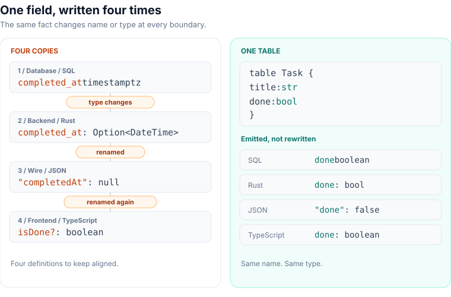

import VoxPlayground from '../../docs-astro/src/components/VoxPlayground.astro';
import { CardGrid, Card, Tabs, TabItem } from '@astrojs/starlight/components';

<div class="vox-home-hero" style="text-align: center; padding: 2.25rem 1rem 1.5rem; background: radial-gradient(ellipse at 50% 0%, rgba(56, 189, 248, 0.14), transparent 72%); border: 1px solid rgba(56, 189, 248, 0.2); border-radius: 14px; margin-bottom: 1.5rem;">
  <p style="font-size: 0.8rem; font-weight: 700; letter-spacing: 0.08em; text-transform: uppercase; color: var(--sl-color-accent-high); margin: 0 0 0.6rem;">
    Pre-1.0 Research Prototype · Workspace v0.6.0 · Apache-2.0
  </p>
  <h1 style="font-size: 2.4rem; line-height: 1.15; margin: 0 0 0.9rem;">
    Vox
  </h1>
  <p style="font-size: 1.12rem; line-height: 1.65; color: var(--sl-color-gray-1); max-width: 45rem; margin: 0 auto 0.85rem;">
    One <code>.vox</code> file can declare a table, server routes, a UI component, and an agent tool. The same declaration is the source for SQL, the Rust server, and the TypeScript client.
  </p>
  <p style="font-size: 0.98rem; line-height: 1.6; color: var(--sl-color-gray-2); max-width: 44rem; margin: 0 auto 1.5rem;">
    Missing values are <code>Option[T]</code>. Fallible calls return <code>Result[T]</code>. Code that ignores either case does not type-check. This is a pre-1.0 research prototype.
  </p>
  <div style="display: flex; gap: 0.75rem; justify-content: center; flex-wrap: wrap;">
    <a href="/tutorials/tut-getting-started/" style="background: var(--sl-color-accent); color: #05080f; padding: 0.65rem 1.35rem; border-radius: 8px; font-weight: 700; text-decoration: none;">Start the 5-Minute Tutorial →</a>
    <a href="#try-it" style="border: 1px solid var(--sl-color-accent); color: var(--sl-color-text); padding: 0.65rem 1.35rem; border-radius: 8px; font-weight: 600; text-decoration: none;">Try in Your Browser ↓</a>
    <a href="/reference/ref-syntax/" style="border: 1px solid var(--sl-color-gray-5); color: var(--sl-color-gray-2); padding: 0.65rem 1.25rem; border-radius: 8px; text-decoration: none;">Syntax Cheat Sheet</a>
    <a href="https://github.com/vox-foundation/vox" style="padding: 0.65rem 1.1rem; border-radius: 8px; text-decoration: none; color: var(--sl-color-gray-2);">GitHub ↗</a>
  </div>
</div>

## Build in One Voice

<div class="vox-progressive-tiers" data-testid="progressive-onboarding-tiers" style="display: grid; grid-template-columns: repeat(auto-fit, minmax(265px, 1fr)); gap: 1.15rem; margin: 1rem 0 1.65rem;">
  <div style="border: 1.5px solid rgba(34, 211, 238, 0.72); border-radius: 14px; padding: 1.35rem; background: radial-gradient(circle at 18% 12%, rgba(34, 211, 238, 0.24) 0%, rgba(14, 165, 233, 0.08) 42%, rgba(11, 16, 27, 0.96) 100%); box-shadow: 0 0 32px -6px rgba(34, 211, 238, 0.25), inset 0 1px 0 rgba(186, 230, 253, 0.22); display: flex; flex-direction: column; justify-content: space-between;">
    <div>
      <h3 style="margin: 0 0 0.4rem; font-size: 1.12rem; font-weight: 700; color: #f8fafc; letter-spacing: -0.01em;">
        <span style="color: #22d3ee;">60s:</span> Zero-Install Playground
      </h3>
      <p style="margin: 0 0 0.95rem; font-size: 0.88rem; line-height: 1.48; color: #cbd5e1;">
        Execute a typed <span style="color: #7dd3fc; font-family: var(--sl-font-mono, monospace);">.vox</span> program right here in your browser.
      </p>
      <a href="#try-it" style="display: flex; align-items: center; justify-content: center; height: 2.75rem; background: linear-gradient(180deg, #22d3ee 0%, #06b6d4 100%); color: #041019; padding: 0 1rem; border-radius: 8px; font-weight: 700; font-size: 0.92rem; text-decoration: none; margin-bottom: 0.85rem; box-shadow: 0 4px 20px rgba(34, 211, 238, 0.35), inset 0 1px 0 rgba(255, 255, 255, 0.4);">
        Run that now
      </a>
      <p style="margin: 0 0 0.85rem; font-size: 0.81rem; line-height: 1.48; color: #94a3b8;">
        Zero Cargo build wait. Edit <span style="color: #bae6fd; font-family: var(--sl-font-mono, monospace);">example.vox</span> below and inspect Turso SQL, Rust Axum, and React TSX in lockstep.
      </p>
    </div>
    <a href="/tutorials/tut-getting-started/#1-60-second-zero-install-sandbox" style="display: flex; align-items: center; justify-content: center; height: 2.5rem; background: linear-gradient(180deg, #22d3ee 0%, #0ea5e9 100%); color: #041019; padding: 0 0.95rem; border-radius: 8px; font-weight: 700; font-size: 0.86rem; text-decoration: none; box-shadow: 0 2px 14px rgba(14, 165, 233, 0.28);">
      Open 60s Sandbox →
    </a>
  </div>

  <div style="border: 1.5px solid rgba(245, 158, 11, 0.65); border-radius: 14px; padding: 1.35rem; background: radial-gradient(circle at 18% 12%, rgba(245, 158, 11, 0.22) 0%, rgba(180, 83, 9, 0.08) 45%, rgba(15, 17, 23, 0.96) 100%); box-shadow: 0 0 32px -6px rgba(245, 158, 11, 0.18), inset 0 1px 0 rgba(253, 230, 138, 0.18); display: flex; flex-direction: column; justify-content: space-between;">
    <div>
      <h3 style="margin: 0 0 0.4rem; font-size: 1.12rem; font-weight: 700; color: #f8fafc; letter-spacing: -0.01em;">
        <span style="color: #f59e0b;">5-Min:</span> Single-File Full-Stack App
      </h3>
      <p style="margin: 0 0 0.85rem; font-size: 0.88rem; line-height: 1.52; color: #cbd5e1;">
        Start the 5-Min Single-File Full-Stack App. Unite your schema, backend routes, reactive UI, and agent tool in one module:
      </p>
      <ul style="margin: 0 0 0.95rem; padding-left: 1.15rem; font-size: 0.83rem; line-height: 1.62; color: #fde68a;">
        <li><span style="color: #fbbf24; font-family: var(--sl-font-mono, monospace);">table Task</span> → Turso / SQLite schema</li>
        <li><span style="color: #fbbf24; font-family: var(--sl-font-mono, monospace);">query &amp; mutation</span> → Typed Rust Axum API</li>
        <li><span style="color: #fbbf24; font-family: var(--sl-font-mono, monospace);">component TaskBoard()</span> → Reactive React TSX</li>
        <li><span style="color: #fbbf24; font-family: var(--sl-font-mono, monospace);">tool "complete_task"</span> → MCP Agent Schema</li>
      </ul>
    </div>
    <a href="/tutorials/tut-getting-started/#2-5-minute-single-file-full-stack-app" style="display: flex; align-items: center; justify-content: center; height: 2.5rem; background: rgba(245, 158, 11, 0.16); border: 1px solid rgba(245, 158, 11, 0.48); color: #fde68a; padding: 0 0.95rem; border-radius: 8px; font-weight: 600; font-size: 0.85rem; text-decoration: none;">
      Build the 5-Min App →
    </a>
  </div>

  <div style="border: 1.5px solid rgba(16, 185, 129, 0.68); border-radius: 14px; padding: 1.35rem; background: radial-gradient(circle at 18% 12%, rgba(16, 185, 129, 0.22) 0%, rgba(5, 150, 105, 0.08) 45%, rgba(11, 19, 23, 0.96) 100%); box-shadow: 0 0 32px -6px rgba(16, 185, 129, 0.2), inset 0 1px 0 rgba(167, 243, 208, 0.18); display: flex; flex-direction: column; justify-content: space-between;">
    <div>
      <h3 style="margin: 0 0 0.4rem; font-size: 1.12rem; font-weight: 700; color: #f8fafc; letter-spacing: -0.01em;">
        <span style="color: #10b981;">15-Min:</span> Agent Harness &amp; Axis GUI
      </h3>
      <p style="margin: 0 0 0.65rem; font-size: 0.86rem; line-height: 1.48; color: #cbd5e1;">
        Launch the multi-agent harness &amp; desktop workbench in four steps:
      </p>
      <ul style="margin: 0 0 0.75rem; padding-left: 1.15rem; font-size: 0.81rem; line-height: 1.58; color: #d1fae5;">
        <li>Step 1: Replayable <span style="color: #6ee7b7; font-family: var(--sl-font-mono, monospace);">workflow</span> &amp; <span style="color: #6ee7b7; font-family: var(--sl-font-mono, monospace);">activity</span> journals</li>
        <li>Step 2: Clavis <span style="color: #6ee7b7; font-family: var(--sl-font-mono, monospace);">vox secrets</span> &amp; capability sandboxing</li>
        <li>Step 3: Loquela posture controls (<span style="color: #6ee7b7; font-family: var(--sl-font-mono, monospace);">Alt+1..4</span>)</li>
        <li>Step 4: Multi-panel Axis GUI &amp; 132-crate Atlas</li>
      </ul>
    </div>
    <p style="margin: 0; font-size: 0.8rem; color: #94a3b8;">
      For desktop &amp; harness setup, open <a href="/how-to/how-to-axis-workbench/" style="color: #38bdf8; text-decoration: none; font-weight: 600; white-space: nowrap;">#axis-workbench →</a>
    </p>
  </div>
</div>

<VoxPlayground initialCode={`// One .vox file -> Runtime, SQL, Rust & TSX
table Task {
    title: str
    done:  bool
}

query get_tasks() to int {
    return len(db.Task.all())
}

tool "Done" complete_task(id: Id[Task]) to Result[str] {
    db.Task.delete(id)?
    return Ok("done")
}

component TaskBoard() {
    view: column(raw_class="task-card") {
        heading(level=3) { "Active Tasks" }
        text() { "Synchronized across SQL, Rust, and React" }
    }
}

fn main() to Result[str] {
    let id = db.Task.insert({ title: "Write Vox in browser", done: false })?
    print("Tasks queued: " + str(get_tasks()))
    let status = complete_task(id)?
    print("Tasks remaining: " + str(get_tasks()))
    return Ok(status)
}`} />

---

{/* SYNC-FROM-README: why_vox */}
## Why Vox

A typical web app restates one domain model in four places:

1. A **database schema** (SQL or an ORM migration).
2. A **backend** (Rust, Go, Python, or Node) that validates and serves it.
3. A **wire contract**, usually JSON.
4. A **frontend** (TypeScript/React) that reads that JSON.

Names and types can drift at each boundary. People and coding agents both spend time keeping the copies aligned.

<div align="center">
  
  <p>
    <strong>One field, written four times</strong><br />
    <em>completed_at, completedAt, and isDone are the same fact. Each boundary renames it or changes its type. A Vox table states it once, and every layer keeps that name and type.</em>
  </p>
</div>

These are the choices that follow from that, and what each one buys.

**One declaration, projected.** A second schema, written by hand, drifts, and an agent copying it drifts the same way. A `table` is the source. SQL, the server types, the JSON shape, and the TypeScript client are generated from it. `vox build` emits SQLite/Turso, Rust (Axum), and React/TypeScript, because one stack is what the tests can actually cover. Django, Vue, and other frameworks are outside that path.

**Missing values and failures are typed.** Generated code skips a failure it cannot see. `Option[T]` is `Some(x)` or `None`. `Result[T]` is `Ok(x)` or `Error(msg)`. Code that ignores either case does not type-check. `?` returns the error to the caller.

**Ids are typed.** A task id and a user id are different facts. A boundary takes `Id[Task]` rather than a bare string, so the two cannot be swapped.

**Keywords open scopes. Decorators modify them.** `table`, `query`, `mutation`, `server`, `component`, `workflow`, `activity`, `tool`, and `resource` each open a scope. `@auth`, `@pure`, `@durable`, and `@uses` change how a declaration runs. One spelling means people and agents copy the same form. A new behavior is a decorator, so the keyword list stays stable.

**The same file runs now, or compiles.** Scripts, repo automation, and the browser playground should start without a Rust build. A shipped app should be ordinary Rust and TypeScript. `vox run` interprets the file. `--caps` is the list of effects the host grants (filesystem, network, and the rest). `vox build` emits the database, the server, and the client from that same file. The two executors are still being matched, and a generated server build needs a Vox source checkout (`VOX_REPO_ROOT`).

**A tool is a function in the same file.** An agent tool kept in a side schema drifts like a hand-written JSON contract. `tool` is a typed function plus a short description. The program and an MCP client call that declaration, and a failure comes back as `Result`.
{/* SYNC-END: why_vox */}

### How One `.vox` File Compiles Across the Stack

```vox-diagram
graph {
    direction: right
    node Source: "One .vox Source File"
    node Check: "vox check (Type & Error Checker)"
    node Interp: "vox run (Instant Sandboxed Interpreter)"
    node SQL: "SQLite / Turso Schema"
    node Server: "Rust (Axum) HTTP Server"
    node UI: "TypeScript / React UI"
    node MCP: "MCP Agent Tools"
    Source -> Check
    Check -> Interp
    Check -> SQL
    Check -> Server
    Check -> UI
    Check -> MCP
}
```

<details style="border: 1px solid var(--sl-color-gray-5); border-radius: 8px; padding: 0.85rem 1.1rem; margin: 1rem 0; background: var(--sl-color-bg-nav);">
  <summary style="cursor: pointer; font-weight: 600; color: var(--sl-color-accent-high);">
    What do <code>Option[T]</code> and <code>Result[T]</code> mean if I'm coming from Python or JavaScript?
  </summary>
  <div style="margin-top: 0.75rem; font-size: 0.95rem; line-height: 1.6;">
    <p>In JavaScript or Python, any variable might secretly be <code>null</code>, <code>undefined</code>, or <code>None</code>, causing your app to crash while a user is clicking around.</p>
    <ul>
      <li><strong><code>Option[T]</code></strong> is a box that explicitly says: <em>"this value might be missing."</em> It is either <code>Some(value)</code> or <code>None</code>. The Vox compiler makes sure you check both cases before using it.</li>
      <li><strong><code>Result[T]</code></strong> is a box for steps that might fail (like saving to a database). It returns either <code>Ok(value)</code> or <code>Error(message)</code>. Adding <code>?</code> to the end of a call (like <code>db.Task.insert(...)?</code>) means: <em>"if this succeeds, unwrap the value; if it fails, stop and return the error immediately."</em></li>
    </ul>
    <p style="margin-bottom: 0;">Read more in the <a href="/reference/ref-syntax/">Syntax Reference</a> or try the <strong>"2. No Null / Safe Errors"</strong> tab in the playground below.</p>
  </div>
</details>

---

### Where to learn each piece

The playground above is the program from the [60-second sandbox](/tutorials/tut-getting-started/#1-60-second-zero-install-sandbox). That page explains each declaration. This page does not repeat the lesson.

- **Data, mutations, and a task UI** → [First full-stack app](/tutorials/tut-first-app/)
- **SQL, Axum, and React side by side** → [Full-stack walkthrough](/tutorials/tut-fullstack-walkthrough/)
- **`tool` / `resource` for agents** → [AI agents and MCP](/how-to/how-to-ai-agents/)
- **`Option[T]` and `Result[T]`** → [Syntax reference](/reference/ref-syntax/)

---

## How the Vox Suite Works

Vox combines the language with an AI-native toolchain in one repository. Six pillars connect the workflow from writing code to running agents:

<div align="center">
  
</div>

<CardGrid>
  <Card title="1. Unified Schema & Types" icon="document">
    One <code>table</code> declaration drives SQLite/Turso tables, Rust structs, HTTP handlers, and TypeScript clients. <code>Option[T]</code> and <code>Result[T]</code> replace <code>null</code> and exceptions. <a href="/reference/ref-syntax/">Syntax →</a>
  </Card>
  <Card title="2. Two Execution Lanes" icon="rocket">
    Use <code>vox run</code> for instant, capability-sandboxed script execution in memory, or <code>vox build</code> to emit a standalone Rust (Axum) server and React/TSX frontend. <a href="/tutorials/tut-fullstack-walkthrough/">Full-Stack Walkthrough →</a>
  </Card>
  <Card title="3. Durable Workflows" icon="setting">
    First-class <code>workflow</code> and <code>activity</code> blocks persist call ordinals, signals, and timers to a SQLite journal so long-running jobs can resume after crashes. <a href="/tutorials/tut-workflow-durability/">Workflows →</a>
  </Card>
  <Card title="4. Verified Agent Harness" icon="approve-check">
    A built-in MCP server and orchestrator issue cryptographic HMAC receipts for tool calls, lock shared resources in the task hopper, and route across live OpenRouter and local models. <a href="/how-to/how-to-ai-agents/">Agent Guide →</a>
  </Card>
  <Card title="5. Trusted Knowledge Base" icon="open-book">
    <code>vox kb</code> indexes curated docs with Tantivy and SKOS taxonomy facets while quarantining unverified web scrapes and agent notes as <code>Untrusted</code> in a review inbox. <a href="/reference/cli/">CLI Docs →</a>
  </Card>
  <Card title="6. Native ML & Eval (MENS)" icon="star">
    Pure-Rust (Candle) QLoRA training across Metal, CUDA, and CPU plugins, paired with seeded multi-turn compiler-feedback evaluation (<code>vox model eval-compare</code>). Public adapters: <a href="https://huggingface.co/brbrainerd/vox-mens-qwen3-0.6b">Qwen3 0.6B</a>, <a href="https://huggingface.co/brbrainerd/vox-mens-qwen3-1.7b">1.7B</a>, <a href="https://huggingface.co/brbrainerd/vox-mens-qwen3-4b">4B</a>, and the <a href="https://huggingface.co/brbrainerd/vox-mens-index">index</a>. <a href="/explanation/expl-architecture/">Architecture →</a>
  </Card>
</CardGrid>

---

## Tradeoffs & Current Stability (Progressive Deep Dive)

We grade every Vox surface honestly by what works today versus what is still a research prototype. Expand either table below when evaluating Vox for a project:

<details open style="border: 1px solid var(--sl-color-gray-5); border-radius: 8px; padding: 0.95rem 1.15rem; margin: 1rem 0; background: var(--sl-color-bg-nav);">
  <summary style="cursor: pointer; font-weight: 600; font-size: 1.02rem; color: var(--sl-color-text);">
    When Vox Fits (and When You Should Pick Another Tool)
  </summary>
  <div style="margin-top: 0.85rem;">

| Tradeoff | Why You Might Like Vox | Why You Might Wait or Pick Another Tool |
|:---|:---|:---|
| **Opinionated Stack vs. Bring-Your-Own Framework** | You want one `.vox` file to generate your database schema, backend API, and frontend UI without wiring up four separate tools. | Full-stack codegen targets **Rust (Axum) + React/TypeScript + SQLite/Turso**. If you need a Python/Go backend or Vue/Svelte frontend, Vox won't emit it. |
| **Compile-Time Strictness vs. Loose Scripting** | Every possible failure (`Result[T]`) and optional value (`Option[T]`) is checked before the program runs — catching bugs that LLMs and beginners often miss. | You must handle `Ok`/`Error` and `Some`/`None` explicitly instead of writing quick untyped code that ignores errors. |
| **Interpreter vs. Full-Stack Codegen** | `vox run` runs scripts immediately with zero Rust compile wait and `--caps` sandboxing; `vox build` emits native Rust and TypeScript. | Compiling a generated Rust server outside the Vox repo currently requires building `vox` from a local source checkout (`VOX_REPO_ROOT`). |
| **Pre-1.0 Research Velocity vs. Long-Term Stability** | You can inspect an active AI-native language, agent harness, and evaluation lab with candid in-tree audits. | Vox is **pre-1.0 prototype software**. Syntax and CLI flags still evolve, and there are no prebuilt binary releases yet. |

  </div>
</details>

<details style="border: 1px solid var(--sl-color-gray-5); border-radius: 8px; padding: 0.95rem 1.15rem; margin: 1rem 0; background: var(--sl-color-bg-nav);">
  <summary style="cursor: pointer; font-weight: 600; font-size: 1.02rem; color: var(--sl-color-text);">
    Surface-by-Surface Stability Matrix (summary; full tables in the repository README)
  </summary>
  <div style="margin-top: 0.85rem;">

| Surface | Status | What Works Today & Known Caveats |
|:---|:---|:---|
| **Compiler & Type Checker (`vox check`)** | 🟣 Mature / Working | Lexer, recursive-descent parser, HIR lowering, bidirectional type checker, and `@ai(structured_output = T)` JSON-Schema emission. |
| **Script Interpreter & Sandbox (`vox run`)** | 🔵 Stable / Working | Runs `.vox` scripts, `table`/`query`/`tool` modules, repo automation (`scripts/*.vox`), and this page's browser sandbox (`--caps deterministic`). |
| **Database & Secrets (`vox-db`, `vox secrets`)** | 🔵 Stable / Working | SQLite/Turso engine at schema baseline 97 and `Clavis` secret resolution (`vox_secrets`). |
| **Curated Knowledge Base (`vox kb`)** | 🔵 Stable / Working | Tantivy 0.22 lexical search, SKOS taxonomy facets, and four-tier trust filtering (`SystemVerified` → `Untrusted` inbox quarantine). |
| **Full-Stack Codegen (`vox build`, `vox compile`)** | 🟡 Preview / Prototype | Emits React/TSX, typed Axum handlers, DB mutations, and Tauri desktop projects. Needs a local Vox source checkout (`VOX_REPO_ROOT`) to compile generated Rust servers. |
| **Durable Runtime (`workflow` / `activity`)** | 🟡 Preview / Prototype | Host-bridge execution with SQLite journal replay, activity call ordinals, signals, and timers ([ADR-019](/adr/019-durable-workflow-journal-contract-v1/), [ADR-021](/adr/021-generated-workflow-durability-parity/)). |
| **Agent Harness & Operator GUI (`vox mcp`, `vox-gui`)** | 🟡 Preview / Prototype | MCP server with HMAC tool receipts, task-hopper resource locks, live OpenRouter model routing, `⌘K` capability palette, and Remote Axis (TOFU TLS). |
| **Local ML & Eval (`vox mens`, `eval-compare`)** | 🟠 Emergent / Prototype | Seeded multi-turn benchmark harness (`eval-compare`) is working. QLoRA training runs on Metal, CUDA, and CPU. Public adapters: <a href="https://huggingface.co/brbrainerd/vox-mens-qwen3-0.6b">0.6B</a>, <a href="https://huggingface.co/brbrainerd/vox-mens-qwen3-1.7b">1.7B</a>, <a href="https://huggingface.co/brbrainerd/vox-mens-qwen3-4b">4B</a>, <a href="https://huggingface.co/brbrainerd/vox-mens-index">index</a>. The 8B adapter is not public. |

→ Dated per-component tables: [README Status](https://github.com/vox-foundation/vox#status) · [Stability Matrix](/reference/stability/) · [v1.0 Release Criteria](/architecture/v1-release-criteria/)

  </div>
</details>

---

## Self-Maintaining Documentation & Architecture Map

Organized by the [Diátaxis framework](https://diataxis.fr/) — structured around what you want to accomplish:

| Goal | Start Here |
|:---|:---|
| **Learn step by step** | [Installing Vox](/reference/installation/) · [Getting Started](/tutorials/tut-getting-started/) · [First Full-Stack App](/tutorials/tut-first-app/) · [Durable Workflows](/tutorials/tut-workflow-durability/) |
| **Follow task recipes** | [External App Bootstrap](/how-to/external-app-bootstrap/) · [AI Agents & MCP](/how-to/how-to-ai-agents/) · [Troubleshooting FAQ](/how-to/troubleshooting-faq/) |
| **Understand the design** | [Why Vox for AI](/explanation/why-vox-for-ai/) · [Compiler Architecture](/explanation/expl-architecture/) · [General FAQ](/explanation/faq/) |
| **Look up exact details** | [Syntax Reference](/reference/ref-syntax/) · [CLI Reference](/reference/cli/) · [Decorators](/reference/ref-decorators/) · [Stability Matrix](/reference/stability/) |
| **Contribute or audit** | [Where Things Live](/architecture/where-things-live/) · [Contributor Hub](/contributors/contributor-hub/) · [Agents Policy (`AGENTS.md`)](/repo/agents-md/) |

---

## Community, Stewardship & License

- **Stewardship.** Stewarded by the Vox Foundation (in formation) and backed by the community via [Open Collective](https://opencollective.com/vox-foundation) with a public ledger.
- **License.** [Apache 2.0](https://github.com/vox-foundation/vox/blob/main/LICENSE) — free for personal, academic, and commercial use with attribution.
- **Links.** [GitHub Repository](https://github.com/vox-foundation/vox) · [GitHub Issues](https://github.com/vox-foundation/vox/issues) · [RSS Feed](https://voxlang.org/feed.xml) · [LLM Discovery Index (`/llms.txt`)](https://voxlang.org/llms.txt)

