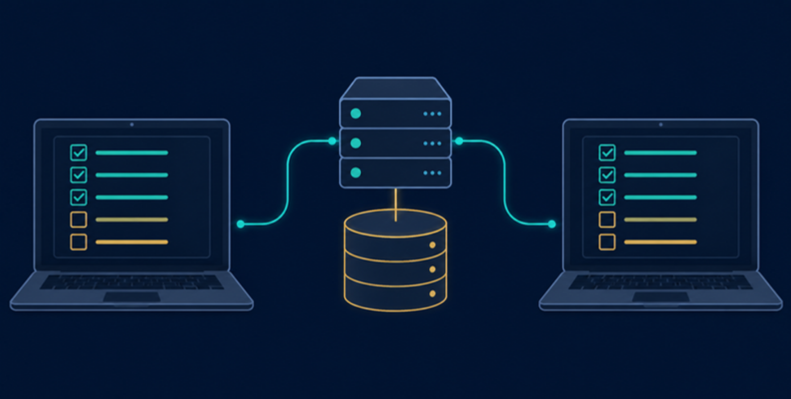

# Tutorial: Building a Collaborative Task List

<!-- kb:summary -->
Step-by-step full-stack tutorial for building a persistent task-list application in a single `.vox` module. Covers initializing a workspace with `vox init`, declaring a SQL-backed `table Task` schema, adding `query` and `mutation` endpoints with `Result[str]` error propagation, building a reactive UI `component` with route bindings, and running `vox check`, `vox build`, and `vox run`.
<!-- /kb:summary -->

Learn how to build a full-stack task list in one `.vox` file: a `table`, a `query`, a `mutation`, a `component`, and a route.

Start here after the sketch in [Getting Started §2](tut-getting-started.md). The side-by-side compiler output is the [full-stack walkthrough](tut-fullstack-walkthrough.mdx). Install steps live in [Installing Vox](../reference/installation.md).



## 1. Project Initialization

Create a new directory and initialize a Vox application:

```bash
mkdir vox-task-list
cd vox-task-list
vox init
```

## 2. Define the Data Model

Open `src/main.vox`. We'll start by defining what a "Task" is. Using the `table` keyword, we create a persistent database table.

```vox
table Task {
    title: str
    done: bool
}
```

## 3. Implement Server Logic

Next, we add `mutation` and `query` functions to interact with the database.

```vox
query get_tasks() to int {
    return len(db.Task.all())
}

mutation create_task(title: str) to Result[str] {
    db.Task.insert({ title: title, done: false })?
    return Ok("created")
}
```

## 4. Build the UI

Now, we'll create the frontend using a `component` declaration. Vox components use a JSX-like syntax and compile to plain React/TSX components consumed by the external frontend.

```vox
component TaskList() {
    view: text() { "Hello Vox" }
}
```

## 5. Wiring It Together

Finally, we map a route to our `TaskList` component.

```vox
routes {
    "/" to TaskList
}
```

## 6. Build and Run

Compile your app and start the development server:

```bash
vox check src/main.vox
vox build src/main.vox
vox run src/main.vox
```

Visit `http://localhost:3000` to see your collaborative task list in action!

---

**Next Steps**:
- [Interactive Full-Stack Walkthrough](tut-fullstack-walkthrough.mdx) — Inspect the generated SQL, Axum, and React TSX output side by side.
- [Checkpoints Checklist](tut-first-vox-app-checkpoints.md) — Verify your minimal compile and run pipeline.
- [Actor Basics](tut-actor-basics.md) — Add real-time collaboration with shared state.
- [Durable Workflows](tut-workflow-durability.md) — Automate task reminders.
- [Managing Knowledgebases & Self-Healing OpenWiki](tut-knowledgebase-and-openwiki.mdx) — Generate 5-layer OpenWiki hubs from your schema and routes automatically.
- [Deep Research & Scientia Publication](tut-deep-research-and-scientia.mdx) — Connect empirical benchmarks into the research-to-publication flywheel.
